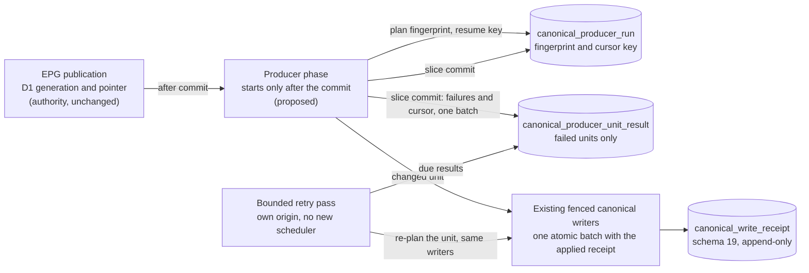

# ADR 0128: Durable execution of the EPG canonical producer: plan identity, cursor, failed-unit results and bounded retry

**Status:** **PROPOSED.** It needs the owner decision; nothing here is accepted. It authorizes no wiring of `epgSync`, no migration, no production read or write, no flag, no Task, no cron and no marker move. The number 0128 is the next free one on `main` at `b7f860f` (12 Nov 2026); another open change may take it, so it is renumbered on merge if a collision appears.  
**Original decision date:** not decided (proposal of 2026-11-12)  
**Recorded at:** 2026-11-12  
**Approval source:** none for this design. The requirement it answers is step 4 of the owner's decisions of 12 Nov 2026 on the [AIR-374 card](https://trello.com/c/ha7ais3w): before any integration with `epgSync`, define durable execution (a durable plan identity, durable cursor persistence, re-processing of failed units), with the decision that the error of one Film unit must NOT stop the EPG publication and must NOT be lost after the cursor advances: store a durable result of every unsuccessful unit and process it with a separate bounded retry, not by rolling back the whole EPG run  
**Related work:** [AIR-374](https://trello.com/c/ha7ais3w), [ADR 0099](0099-canonical-film-person-d1-authority.md), [ADR 0117](0117-film-person-d1-handoff-owner-decisions.md), [ADR 0119](0119-durable-canonical-write-receipts.md), [ADR 0123](0123-producer-receipt-adapter-film-facts.md), [ADR 0125](0125-epg-producer-layer-film-facts.md), [ADR 0126](0126-epg-producer-layer-person-credits.md), [ADR 0127](0127-dictionary-store-producer-film-title-identity.md), [ADR 0100](0100-epg-cloudflare-workflow-executor.md), [ADR 0108](0108-epg-mirror-reconciliation-writer.md), [ADR 0106](0106-bulk-projector-write-path.md), [decision pack](../runbooks/film-person-holdpoint-decision-pack.md), [E6 measurement](../evidence/d1-migration/air-374-e6-production-measurement-2026-11-12.md)  
**Supersedes:** None. It refines the "durable cursor and per-unit failure result" follow-ups that ADR 0125, 0126 and 0127 left open; it changes none of their accepted decisions.  
**Superseded by:** None

## Context

### What exists (read from `origin/main` `b7f860f`)

- Three dormant, unbundled producer layers plan and apply units through the receipt adapter of [ADR 0123](0123-producer-receipt-adapter-film-facts.md): `src/canonical-epg-producer.js` (Film facts, one unit per observed Film and one release-only unit per departed member), `src/canonical-epg-person-producer.js` (`person_state`, `film_credits`) and `src/canonical-dictionary-producer.js` (title and identity facts, origin `dictionary`). Their `apply*Units` visit at most a caller-injected number of units per call (hard ceiling 50, provisional) and return `{cursor, done, counts, failures:[{id, code}], stoppedBy}`.
- The `cursor` is an integer index into a plan that exists only in memory. `failures` exists only in the return value. Nothing outside the call keeps either. The producers' own reconcile (`reconcileEpg`, `reconcileEpgRun`, `reconcileDictionary`) re-plans a receipt only from a plan the caller still holds for the run that wrote it ([ADR 0125](0125-epg-producer-layer-film-facts.md) decision 6).
- A receipt exists only for a unit that would CHANGE something: a no-op ends before any receipt (owner decision E5) and a planner refusal (invalid input, redirect, missing reference, over-bound credit list) also happens before one. So after a restart the receipt table cannot say which units were refused, and an `unknown` receipt cannot be replayed without a plan.
- The receipt row ([ADR 0119](0119-durable-canonical-write-receipts.md), schema 19, applied) carries: request id, operation, origin, target, content digest, planned and applied revision, marker generation, state (`pending`, `applied`, `failed`, `unknown`, `abandoned`), `attempts`, `next_attempt_at`, an error class and timestamps. It is append-only (no delete), writable only while the marker is `d1`/`open`, and a new row must be `pending`, attempt 1. Its retry policy is a code constant: 5 attempts, backoff 60 s, 300 s, 1,800 s, 7,200 s, abandon after 7 days, at most 50 receipts per reconcile pass, 10 per inline own-origin reconcile (`RETRY_POLICY`, `RECONCILE_LIMIT_MAX` in `src/canonical-receipts.js`; `INLINE_RECONCILE_LIMIT` in `src/canonical-producer-adapters.js`).
- The EPG run state lives in `sync.json` (R2) and is replaced by the next run; `run.watchlist` is deleted when the run completes (`finishSync` in `src/worker.js`). The orchestration control state is `epg_orchestration_document`, whose `key` column is restricted by a CHECK to `mode`, `control` and `lease` (`migrations/0017_epg_orchestration.sql`), and whose `control` record carries the executor's failure budget ([ADR 0100](0100-epg-cloudflare-workflow-executor.md)). A step on a completed run already has a `continuation` branch (`syncStep`, `src/worker.js`).
- Step and budget facts the repository documents: the executor loop stops at `STEP_CAP=400` iterations per instance and takes a 5 minute step lease with a 15 s boundary margin (`src/epg-orchestration.js`); seal steps are bounded to "about 30 s each" ([EPG architecture page](../architecture/epg-and-availability.md)); the projector's 800-query and 60 s budgets are self-imposed and a `db.batch()` counts as one query, and [ADR 0106](0106-bulk-projector-write-path.md) states the platform allows a 15 minute cron run; `limits.cpu_ms` is 120000 in `wrangler.jsonc`. **What the repository does not document: the platform limits of a Cloudflare Workflow step** (CPU, wall time, subrequests, number of steps, state size) **and the budget an EPG step gets** ([E6 runbook](../runbooks/film-person-e6-budget-measurement.md), inputs table: unknown). This ADR invents none of them.
- The first E6 measurement ([evidence](../evidence/d1-migration/air-374-e6-production-measurement-2026-11-12.md)): about 397 Film-facts units per EPG run; offline, a Film-facts unit costs 14 round trips unchanged and 38 applied; schema 19; receipts 0; the per-run ceiling is NOT chosen; `changedShare`, Person and credits volume per run, EPG step budgets and round-trip time on the EPG path are unmeasured.

### The gaps a naive wiring would leave

1. **No plan identity.** A resumed pass cannot tell that the plan changed (the metadata cache is mutable between steps, a deploy can change the unit rules, the dictionary can change) and would apply a cursor index to another plan, skipping or repeating units.
2. **The cursor is an index in memory.** It is lost at the first restart of a Workflow step.
3. **A failed unit is lost when the cursor moves past it.** A pre-receipt refusal leaves no durable trace at all; a post-receipt `failed` or `unknown` receipt exists but cannot be replayed once the plan is gone, so it ends on the conservative path (counted retry, then abandoned).
4. **No bounded retry for what the receipts do not own.** Reconcile handles receipts; nothing owns a unit that never got one.
5. **Nothing says what "done" means** for a producer pass, and a producer error could be mistaken for an EPG step failure and feed the executor's failure budget.
6. **The dictionary version label** ([ADR 0127](0127-dictionary-store-producer-film-title-identity.md) decision 3: every genuine change MUST carry a fresh, unique version, which the future call site must mint) has no minting place.

## Decision (proposal)

Nothing below is decided until the owner accepts it. Each item names its alternative in the next section.

1. **A post-commit phase, isolated from publication.** The producer pass is a bounded continuation phase of the EPG run that starts only after the publication has committed (the published D1 generation and its pointer switch are the authority and are not touched). It is entered through the existing `continuation` branch of a completed run (the wiring PR must verify how that branch derives `nextAction`; not verified here). Every error inside the phase is caught at the phase boundary, recorded durably (decisions 4 and 5) and logged as counts and codes; it never changes the run's `stage`, `error` or published generation, is never reported to the executor as a step failure (so it cannot feed the failure budget or quarantine of [ADR 0100](0100-epg-cloudflare-workflow-executor.md)/[ADR 0089](0089-shared-orchestration-reliability-contract.md)), and never rolls anything back. The EPG hourly ensure keeps reconciling the R2 mirrors of the published generation ([ADR 0108](0108-epg-mirror-reconciliation-writer.md)) independently.
2. **Durable plan identity (fingerprint).** A plan is `{origin, event, planVersion, units}` with `units` an ordered list of `(kind, id, unitDigest)`, where `unitDigest` is the clock-free content digest the producers already compute (ADR 0123 decision 4; `unitDigest` for the Person kinds). The fingerprint is `sha256(canonicalJson(...))` of that structure, using the existing `canonicalJson` and `digestOf`. `planVersion` is a code constant bumped whenever the unit shape, the order or the digest rules change, so a deploy between two Workflow steps that changes them is detected as a changed plan. Not part of the identity: the unit ceiling, the slice size, retry caps (execution parameters; changing them mid-run must not invalidate progress), and the marker generation (the writer's own fence refuses a stale generation; it is recorded on the run row for operators). The recorded inputs (published generation id, dictionary version and digest) are stored beside the fingerprint for diagnosis and are not hashed separately because the unit digests already carry their effect.
3. **Plan change mid-run: supersede, never guess.** A pass resumes only when the stored fingerprint equals the one recomputed from current inputs. Otherwise the run row records the old and new fingerprint, `pass_no` increases, the cursor resets to the start of the NEW plan, and the pass runs again from the first unit. This is safe and bounded because every unit is idempotent: an unchanged unit is a no-op with no receipt (owner decision E5) or `already applied` by its request id, so a restart costs reads, not writes (cost: see the measurement gates). The open failure results of the run are re-validated against the new plan one by one: same `(kind, id, unitDigest)` stays open; same `(kind, id)` with another digest becomes `superseded` / `source_changed`; absent from the new plan becomes `superseded` / `left_plan`. Superseded results stay visible; nothing is dropped silently.
4. **Durable cursor, keyed by `(kind, id)`, never ahead of a durable outcome.** The cursor is the key `(kind_rank, unit_id)` of the last unit whose outcome is durable, plus the fingerprint it belongs to. Resume is the first unit strictly after that key in the recomputed ordered plan, under an equal fingerprint (an index would be equivalent for an identical plan and meaningless for a changed one; the key makes the stored value auditable and independent of list position). The cursor advances only in a **slice commit**: ONE D1 batch that (a) asserts the marker `d1`/`open` and the run row's `revision` (compare-and-set), (b) writes the failure results of the slice, (c) writes the counts and the new cursor. A unit that succeeded needs no row: its proof is its applied receipt (written atomically with the canonical mutation, ADR 0119 decision 4) or its no-op (verified by the pre-plan read), and an `absent` skip is a counted named outcome. The cursor is therefore never ahead of a unit that failed without a recorded failure. A crash between a unit's own batch and the slice commit leaves the cursor behind; the next step revisits the unit, which is a no-op or `already applied`.
5. **A durable result for every unsuccessful unit, sparse, with exactly one retry owner.** A row in a result table (one row per `(origin, event, kind, unit_id)`) exists for a unit that was refused before a receipt, hit a bounded unit-level read failure (decision 6), or whose receipt ended `failed`, `unknown` or `abandoned` in this pass. Successful, no-op and `absent` units get no row (so the table is sparse and bounded by the failure count, not the run size). Each open result has exactly ONE retry owner:
   - **`receipt`**: a non-terminal receipt exists. The retry schedule (`attempts`, `next_attempt_at`) and the terminal states belong to the receipt; the result row is an index that records the request id and reads through to the receipt (no second state machine for the same fact).
   - **`unit`**: no receipt exists (a refusal before it, or a read failure). The result row carries its own `attempts` and `next_attempt_at`.
   Classification of what the three layers already report: `film_person_invalid`, `_redirect`, `_reference`, `_bounded` (content refusals) become `unit` results, retried because the store or the source may change; `film_person_precondition` (a Film vanished after the planner read, the batch rolled back whole) is re-planned once and then settles as `absent`; `film_person_held` and `film_person_unavailable` are PASS-level stops, not unit failures (decision 6); a receipt that ended `unknown` is `receipt`-owned and settled by readback evidence; `abandoned` is terminal for both owners and stays visible. A result is `settled` when the unit finally succeeds, `superseded` (decision 3 or a newer run, decision 9) or `abandoned`.
6. **Pass-level stops and the poison unit.** `film_person_held` stops the pass with the cursor kept (the run row records `stopped_by`); the marker returning to `open` resumes it. `film_person_unavailable` also stops the pass with the cursor kept, and is NOT counted against the unit while the database is merely unavailable. To stop one unit that always throws on read from blocking every unit behind it forever, the run row counts consecutive stops on the same cursor key; after a small code-constant bound (proposed 3) the unit becomes a `unit` result (`unit_read_failed`) and the cursor moves past it. If the slice commit itself cannot be written, the pass ends with a structured log line (counts and codes only) and nothing advances: the unit is revisited by the next step.
7. **A separate bounded retry pass, no new scheduler (E2).** `retry` is its own call with a hard limit (proposal 10, the adapter's inline own-origin limit). It takes the due open results ordered by `next_attempt_at` then key. For a `unit` result it builds a one-unit plan **under the result's own event from the current inputs** and compares the unit digest with the recorded one: equal means run that one unit through the existing `apply*Units` path; different means `superseded` / `source_changed` at once; not in the sources means `superseded` / `left_plan`. This extends the receipt rule of ADR 0123 decision 5 to units that never had a receipt, without storing a payload and without a plan from an earlier step. For a `receipt` result it calls the existing own-origin reconcile (the limit is shared, not added). A failure increments `attempts` and sets `next_attempt_at` with the SAME policy as the receipts (`RETRY_POLICY`: 5 attempts, 60 s to 7,200 s, abandon after 7 days), so there is one policy to reason about. The retry pass runs (a) after the main pass in the same step when the step's budget remains and (b) first in the next run's first producer step. It is never driven by a cron, a tick, a Scheduled Task or a global hourly reconcile. Backoff is a floor between two attempts of one unit, not a timer: the effective cadence is the natural run cadence (the producer plan covers every observed Film each run anyway, so a unit that is still relevant is also re-planned by the next run under its new event).
8. **Idempotency of the whole loop across restarts and duplicate delivery.** Layered, and no lease is added: (i) request ids bind the event, the target and the content digest (ADR 0123 decision 4), so a repeated unit is the same request; (ii) the canonical mutation and its applied receipt are one atomic fenced batch; (iii) the slice commit is a compare-and-set on the run row `revision`, so two concurrent or duplicated step executions cannot both advance the cursor (the loser stops, its units were idempotent); (iv) result rows are keyed upserts whose `attempts` only increase and whose terminal states never reopen; (v) a step reads the run row first and never assumes it created it. A duplicate step wastes work and never corrupts progress.
9. **Run A versus run B.** Run B (a new event) plans its own units from the current inputs; its units are new requests. When run B starts, each open `unit` result of run A whose `(kind, id)` is covered by B's plan becomes `superseded` / `newer_run` (B's pass takes the unit over); results not covered by B's plan (a departed Film, a unit whose source is gone) stay under A's event for the bounded retry. Run A's `receipt`-owned rows settle by their own readback evidence; a receipt is never replayed from another run's plan (ADR 0125 decision 6 is unchanged).
10. **What "done" means for a run, at three independent levels.** (1) *Published*: the EPG generation committed; this is the EPG run's own success and never waits for the producer. (2) *Pass complete*: the cursor passed the last unit under the current fingerprint (all units visited, each with a durable outcome). (3) *Settled*: no open result remains. The producer's step ends the Workflow loop at (2): unsettled results do not keep the Workflow running (the next natural run and the bounded retry pick them up), and they are surfaced instead: a read-only `producer` object in the EPG read model (counts by state, age of the oldest open result, no ids or content) and a derived readiness blocker (below). A pass that exhausts `maxSlicesPerRun` ends as `passing` and is superseded by the next run's pass; its progress is not lost because every unit is idempotent.
11. **Step boundary and the unit ceiling.** The durable driver takes the slice size, `maxSlicesPerRun` and a per-slice wall deadline as REQUIRED parameters with NO default (the same rule as the E6 tool: a missing input is a refusal, not a guess), and the provisional 50-unit hard ceiling of the layers stays an upper clamp, not a recommendation. The design is ceiling-agnostic: a slice is `min(slice size, remaining)`, a pass needs `ceil(U / slice)` steps, and each step adds one run-row read, one slice commit and at most one bounded retry pass. The numbers are chosen by the owner only after the measurement gates; this ADR proposes none. The slice deadline must sit inside the step lease (5 minutes in `src/epg-orchestration.js`) with its margin, because two overlapping slices are safe but wasteful (decision 8).
12. **The dictionary version is minted by the durable run record.** The run table is keyed by `(origin, run_key)`. For origin `dictionary` the `run_key` is a monotonic sequence label (`d<seq>`) minted exactly once when the run row is created and stored with the snapshot digest; the ADR 0127 `version` is that label. A resumed or retried pass reuses the row's label, and a changed digest creates a new row with the next label, so an A, B, A edit is three distinct events and a reused label with other content cannot occur. This is the minting place ADR 0127 left to the call site.
13. **Dormancy and fences, unchanged.** All store functions and the driver read the marker once through `writerRoute` and, below `open`, return `skipped` after that read (the producer must not write at `prepared`); `held` and an unreadable marker throw; the proposed tables carry the same SQL marker triggers as the receipt table (insert and update only at `d1`/`open`, reads always allowed), so at `prepared` they stay empty even against a code defect. Ownership stays single: no new canonical writer; every canonical mutation goes through the existing fenced writers. No flag is read or changed (E4); `D1_ENRICHMENT_WRITE`, `D1_ENRICHMENT_WINDOW` and `D1_ENRICHMENT_BULK` are untouched.

### Proposed schema, for a future migration (a GO-gated step, NOT part of this change)

Schema 19 suffices for part of this and not for the rest:

| Need | Schema 19 alone | Needs a new migration |
| --- | --- | --- |
| Write-level retry of a unit that created a receipt (counts, backoff, abandon, readback evidence) | Yes: the receipt row already holds it | No |
| Durable plan identity (fingerprint) and durable cursor | No table holds them | Yes |
| Durable result of a unit refused before a receipt, or of a bounded unit-level read failure | No: a receipt cannot be inserted for it (an insert must be `pending`, attempt 1, with a planned digest and revision, and the table is append-only) | Yes |
| Replay of an `unknown` receipt in a later step | Not without a re-plan that is not stored | Yes (the result row stores the event, so the retry can re-plan under it) |
| Unique dictionary version minting (decision 12) | No sequence exists | Yes |

The proposal is a schema 20 migration (`0020`, number to be re-checked free at that time) with two tables, in the style of `0019`: no payload, no title or name, identifiers, digests and short lowercase classes only.

- `canonical_producer_run`: key `(origin, run_key)`; `plan_version`, `fingerprint`, `unit_count`, `pass_no`, cursor `(cursor_kind, cursor_id)` and `pass_done`, `stopped_by`, `stop_count`, `state` (`passing`, `passed`, `settled`, `superseded`), counts, `marker_generation` at creation, `revision` (compare-and-set), timestamps, and for origin `dictionary` the snapshot digest.
- `canonical_producer_unit_result`: key `(origin, run_key, kind, unit_id)`; `unit_digest`, `state` (`open`, `settled`, `superseded`, `abandoned`), `retry_owner` (`unit`, `receipt`), `request_id` (nullable, the link to the receipt), `code`, `attempts`, `next_attempt_at`, timestamps.
- Triggers: marker `d1`/`open` for insert and update; identity columns immutable; a state machine (`open` to any state, the three others terminal); `attempts` and `revision` only increase; no delete during stabilization (the same stance as the receipt table, decided together with the receipt retention decision, ADR 0119 decision 10).

Applying it is a separate owner GO with its own preflight and readback (modelled on the [schema 19 apply runbook](../runbooks/film-person-0019-apply.md)); a deploy never applies it and applying it writes no row. The wiring code must refuse to run its pass before schema 20 exists (`producer_store_missing`), as `receiptedWrite` does for schema 19.

## Proposed design (not implemented)

Reading rules: the arrow from the publication to the phase is one way and the phase never feeds a status back into the publication or the executor; the result and run tables are written only by the producer phase and the retry pass; nothing here is deployed, and at `prepared` every path below the phase ends after one marker read.

## Failure modes

| Condition | What is durable | Behaviour under this proposal | Net result |
| --- | --- | --- | --- |
| Step killed mid-pass, after some units applied and before the slice commit | Applied receipts and canonical rows of the finished units; the cursor is behind | Next step reads the run row, resumes at the old cursor, revisits the units: no-op or `already applied` | Repeated reads, no repeated write, no loss |
| Step killed after the slice commit | Cursor and failure rows of the slice | Next step resumes after the cursor | No loss |
| Plan changed between steps (metadata cache moved, dictionary edited) | Old fingerprint, cursor, open results | Fingerprint differs: supersede, `pass_no` + 1, cursor reset; open results re-validated one by one (kept, `source_changed` or `left_plan`) | A full re-visit of idempotent units; no skipped changed unit |
| A deploy changes the unit rules (`planVersion`) between steps | As above | Same as a changed plan | Fail-safe restart of the pass |
| Marker `held` during the pass | Cursor, receipts frozen by the marker triggers | The writers refuse (`film_person_held`); the pass stops with the cursor kept and `stopped_by` recorded; no unit failure is counted | Resumes when the marker is `open` again; a `pending` receipt settles after `held` (ADR 0119) |
| Marker `prepared`, `r2` or legacy | Nothing (no row may be written) | One marker read, `skipped`; the projector stays the only canonical writer | Dormant by design |
| DB unavailable while reading a unit | Cursor kept | `film_person_unavailable` stops the pass on that unit, not counted against it | Retried by the next step; after the stop bound the unit becomes `unit_read_failed` and the pass moves on (poison unit) |
| DB unavailable at the slice commit | Nothing from this slice | The pass ends with a log line (counts, codes); cursor unchanged | The slice is revisited; no failure is lost, because none was acknowledged |
| Partial apply: the writer's batch committed and the answer was lost | The applied receipt written in the same batch as the mutation (ADR 0119 decision 4) | The next visit finds the applied request id or a no-op | Not repeated; a rare race ends `unknown` and is settled by evidence |
| Partial apply across kinds of one Film (facts applied, credits refused) | The facts receipt (applied); a `unit` result for the credits unit | The credits unit is retried on its own; the facts are not touched | Each kind is its own unit with its own result |
| Duplicate or concurrent step delivery | Run row `revision` | Both may run units (idempotent); only one slice commit passes the compare-and-set; the other stops | Wasted work at most; no double advance |
| Run A has open results when run B starts | A's open results, A's receipts | B plans afresh; results covered by B's plan become `superseded` / `newer_run`; the rest keep A's event for the bounded retry; `receipt`-owned rows settle by evidence | No result silently dropped; no replay of A's receipt from B's plan |
| Retry exhausted (5 attempts or 7 days) | The result row, `abandoned` | Terminal and visible in the read model and the readiness blocker; nothing deleted | Needs a person; never retried blindly |
| Schema 20 not applied | Nothing | The pass refuses (`producer_store_missing`) before reading or writing a unit | Wiring cannot run unrecorded |
| The producer pass raises an exception | The last committed slice | Caught at the phase boundary; logged as a code; the run stage, `error`, publication and the executor's budget are untouched | The EPG publication is never blocked or rolled back |

## Alternatives considered

- **Persist in the EPG orchestration documents (a new `producer` key).** Rejected: the `key` column has a CHECK for three keys, so it would need a table rebuild migration anyway; the `control` record is written by the executor under a mode-revision compare-and-set, so a producer write could conflict with or disturb the control of the publication path, which the owner's isolation requirement forbids; and it mixes two owners in one record.
- **Persist in `sync.json` (R2), as the cursor of the `ratingAttempt` pattern does.** Rejected for the durable results and for the cursor of record: the next run replaces the file, so a failed unit would be lost with it; R2 has no fence in common with the D1 canonical batch. A marker in the run state remains acceptable as a transient hint only (not proposed).
- **A new R2 object with conditional put.** Rejected: canonical-related mutable progress belongs to D1 ([ADR 0051](0051-d1-domain-r2-blobs.md)); it would have its own authority and no atomic link to a receipt.
- **Reuse `canonical_write_receipt` only (schema 19, no migration).** Sufficient for the write-level retry of units that created a receipt, which is why the design leans on it there; insufficient for the plan identity, the cursor, the pre-receipt results and the dictionary label (table above). A receipt for a refused unit cannot be created (insert shape and the planned digest and revision it needs).
- **A row per unit per run (a full manifest) instead of sparse results.** Rejected for the first delivery: about 400 or more rows per daily run for a trail nothing reads, with a retention question of its own; the run row's counts and the receipts already give the audit trail of the successes. It remains the way to enable a partial resume after a plan change (skip units whose digest is unchanged) if the measured re-visit cost of decision 3 proves too high.
- **Skip a unit by a stored "last applied input digest".** Rejected: it is a second truth of "already applied" beside the writer's own planner; the no-op decision stays with the writer (single source of truth).
- **Index cursor.** Equivalent for an identical plan and meaningless for a changed one; the `(kind, id)` key plus the fingerprint is auditable.
- **Roll back the whole EPG run on a unit error.** Rejected by the owner decision itself, and impossible: publication is a D1 pointer switch plus R2 mirrors, and a code rollback reverts no data.
- **Retry by a new cron, Scheduled Task, a global hourly reconcile or a Workflow `sleepUntil` per failure.** Rejected: E2 (no new cron, Task or global reconcile); a Workflow sleep per failure would change [ADR 0100](0100-epg-cloudflare-workflow-executor.md) and extend a run that must not wait for the producer.
- **A new event platform or queue.** Excluded by owner decision 5 of 11 Nov 2026.
- **A lease for the producer pass.** Not proposed: the compare-and-set on the run row plus idempotent units make a lease unnecessary, and a lease would add a failure mode (a stuck holder) to a phase that must never block anything.

## Consequences

- One more migration and two more append-only tables; growth is bounded by the failure count, not the run size, but the failure rate is unknown (no measurement).
- The canonical store catches up AFTER publication and in bounded slices: Film facts may lag the published generation by the pass duration. Who may read canonical membership during that lag, and how long it may last, is an owner question below.
- A pass revisits unchanged units after a plan change; the cost of an unchanged unit is 14 round trips on the offline stand-in (the E6 evidence), so a full no-op pass over about 397 units is arithmetically about 5,558 round trips (397 x 14) and a full changed pass about 15,086 (397 x 38). Those are arithmetic from the evidence's per-unit numbers, Film-facts only, offline, with no round-trip time, no Person or credits volume and no fixed overhead: they are neither a budget nor a bound.
- Per-step overhead added by the durable layer, by design and not measured: one run-row read, one slice-commit batch, and a bounded retry pass of at most 10 units; the planning reads needed to recompute the fingerprint each step are a new unknown (gate M6).
- The producer's failures are visible and countable, and `handoffReadiness` gains derived blockers; a producer error can no longer end only in a log line.
- Risks: (a) the post-commit placement means a crash between publication and the first slice delays canonical catch-up to the next step or run; (b) the recomputed plan at a later step depends on mutable inputs (the metadata cache), which is exactly why the fingerprint and the digest comparison exist; (c) two overlapping Workflow steps waste work; (d) the poison-unit bound is a new constant to tune; (e) the first run after the activation flip is the largest pass (every Film may differ from what the projector wrote last), which stays unmeasured until the dry run; (f) the `person_mutation` Person-row producer does not exist (ADR 0126 decision 4), so the credits kind refuses until it does, which keeps `producer_not_wired:epg_commit` honest and means this design alone does not clear it.

## Recovery and migration boundary

This ADR authorizes nothing: no migration (the schema 20 proposal is a future GO-gated change; the file is not part of this change), no production read or write, no flag, no Task, no cron, no marker move and no wiring of `epgSync`. A code revert reverts neither a table nor its rows once a migration is applied; because the tables only record progress and results, an empty or ignored table changes no canonical state. The tables are marker-fenced like the receipts, so at `prepared` and `held` they cannot be written.

## Measurement gates before any wiring

Unmeasured today, each with its gate (none is authorized by this ADR; each production read or run needs its own GO under [authorization](../process/authorization-and-escalation.md)):

| Unknown | How it is closed | Class |
| --- | --- | --- |
| M1 Workflow step platform limits (CPU, wall time, subrequests, steps per instance, state size) | Read the current Cloudflare documentation and record it dated in [evidence](../evidence/README.md) with the source and the date; mark each limit "documented" or "not documented"; do not infer | Documentation read, no production access |
| M2 `changedShare` (changed Film units per run) | A producer dry run: plan and pre-plan only, no write, over a safe copy of production D1 (an operator copy, never a production write); a production read only under its own GO | Offline harness, then a GO |
| M3 Person and credits units per run | Same dry run (the E6 query set sizes Film-facts units only) | As M2 |
| M4 Round-trip time on the EPG path | Workers metrics of a real EPG step (a production read under a GO) or a time-stamped dry run | GO |
| M5 CPU per unit and the fixed CPU, query and wall overhead of an EPG step | As M4, and the dry run for the per-unit part | GO |
| M6 Cost of recomputing the plan and its fingerprint at each step | The dry run (planning reads only) | Offline, then a GO |
| M7 Failure rate and result-table growth | Only after a soak; no number is claimed | After activation |
| M8 The size of the first pass after the flip | Derived from M2 and M3 | Derived |

The per-run ceiling, `maxSlicesPerRun` and the slice deadline are chosen by the owner after M1 to M6; until then the 50-unit ceiling of P3a stays provisional.

## Staged delivery plan (steps 4 and 5)

Every row is an atomic offline PR unless it says otherwise; none activates anything. Test strategy for the code rows: the existing sqlite stand-in with the migrations, a statement-counting D1 stand-in for the dormancy proof (at `prepared` only the marker read), fault injection for "DB unavailable" and "lost answer", and mutation checks in the style of the producer PRs; the failure-mode table above is the test plan.

| # | Delivery | Prerequisites | Owner decision or holdpoint | Documentation impact | Test strategy |
| --- | --- | --- | --- | --- | --- |
| S4-0 | This ADR (PROPOSED) with plan and questions | none | Owner accepts, amends or rejects the ADR and answers the open questions | `docs/adr/0128-*.md`, `docs/adr/README.md` | Documentation checks, link check |
| S4-1 | Pure module for plan identity and run progress: fingerprint, ordered units, resume or supersede decision, next cursor, unit outcome classification, retry-due rule reusing `backoffMs`; no SQL, no migration | S4-0 accepted | None beyond S4-0 | Update ADR status and add an evidence file with counts; reference page only when the migration lands | Pure unit tests over every failure-mode row, property tests for "the cursor is never ahead", mutation checks |
| S4-2 | Migration file `0020` (two tables, triggers) and the schema reference; NOT applied | S4-1; owner accepts the migration question | Apply is a separate GO (below) | `docs/reference/data/d1-schema.md`, a short apply runbook, `docs/adr/README.md` | Sqlite tests of every trigger and the state machine, marker gating, immutability, a migration-order test |
| GA | Apply `0020` to production D1 | S4-2 merged; a safe-copy rehearsal; owner GO with preflight and readback | Owner GO (L2 operation contract); `SCHEMA_EXPECTED` update in the same operation | Dated evidence of the apply; feature-flag register not involved | Preflight and readback statements emitted by a tool, never executed by the PR |
| S4-3 | Store layer (D1 functions): create or resume a run by compare-and-set, slice commit in one batch, list due results, settle, mint the dictionary label; dormant, unbundled | S4-2 | None | Evidence file; reference page for the store | Sqlite stand-in: atomicity of cursor plus results, compare-and-set loser, marker gating, a code-defect test that `prepared` writes nothing |
| S4-4 | Durable driver: `runEpgProducerPass` and `retryEpgProducerResults` composing the existing `apply*Units` and reconcile functions with the store; required parameters with no default; phase-boundary error isolation | S4-1, S4-3 | None | ADR follow-up note (the ADRs 0125 to 0127 follow-ups discharged); evidence file | The failure-mode table as executable scenarios; a test that a thrown error never reaches the caller; no import from `worker.js` |
| M1 | Workflow step limits recorded from the Cloudflare documentation | none | None (documentation read) | Dated evidence page | Reviewer re-reads the cited source |
| M2 | Dry-run harness: plan and pre-plan without a write, emits counts (changed, no-op, refused, per kind) | S4-1 (can run beside S4-3) | The run on a safe copy needs the copy to exist; a production read needs a GO | Evidence file with counts only | The harness refuses any write statement (statement-class test) |
| M2b | The dry run itself: `changedShare`, Person and credits volume, planning cost | M2 | Owner GO for the read scope (safe copy first) | Dated evidence | Operator attestation plus offline replay of the saved counts |
| M3 | EPG step budgets and round-trip time from Workers metrics | M1 | Owner GO for the read | Dated evidence | As above |
| D-C | Choose the slice size, `maxSlicesPerRun` and the slice deadline | M1, M2b, M3 | **Owner decision** | Update ADR and the E6 record | n/a |
| S5-0 | `person_mutation`: the Person-row producer, so a credit unit no longer refuses for a missing Person | ADR 0126 | Owner decision if the Person-row rules need one | New ADR if a rule is new; evidence | Same pattern as ADR 0126 |
| S5-1 | Wiring: the call site in the continuation branch of `epgSync`, bundling, dictionary store injection, operation registration in `PRODUCER_OPERATIONS`, re-derived `PRODUCER_WIRING.epg_commit.requires`, the read-model `producer` object, the derived blockers | S4-4, S5-0, D-C, GA (the pass refuses without schema 20; deployed at `prepared` it stays dormant) | Controller merge after independent review; no activation | Architecture page (`epg-and-availability.md`, `scheduling-and-orchestration.md`) with Mermaid QA, reference (`mcp.md` if the read model changes), runbook, feature flags not involved | Dormancy at `prepared` (one marker read), byte-identical publication behaviour with the producer disabled, a test that the executor never sees a producer error |
| S5-2 | Differential scenario `epg_commit_natural` and the review of the 10 draft exceptions, each decided individually | S5-1 | **Owner decision per exception** (the 7 drafts of `src/canonical-differential-registry.js` and the 3 writer drafts; none is accepted as a group) | Registry entries with proof; evidence | The harness over the safe copy; each exception needs its own safety proof |
| S5-3 | Shadow evidence: the producer's output compared with the projector's on a safe copy, for a number of runs | S5-2, M2b | Owner review of the diff classes | Dated evidence | Differential harness; no production write |
| H2 | Owner-GO'd activation (`prepared` to `open`) under the existing L3 plan, with the producer pass as the catch-up of step 6 | S5-3, all readiness blockers cleared | **Owner GO** (holdpoint H2 of the decision pack); E3 quiet window | The activation plan and runbook | Not part of this plan |

### How the readiness blockers would be derived and cleared, honestly

`handoffReadiness` computes from registries and database reads; nothing here flips a flag.

- `producer_not_wired:epg_commit`: derived from `PRODUCER_WIRING.epg_commit.requires` and `PRODUCER_OPERATIONS`. It clears only when S5-1 re-derives `requires` from the kinds the EPG producer really uses (`film_facts`, `film_credits`, `person_state`, `person_mutation`, and a localization kind only if used) AND registers an atomic operation for every one of them AND the Worker bundle carries the modules (the existing test checks both). While `person_mutation` has no producer it stays a blocker; this ADR does not clear it.
- `receipts_protocol_unregistered`: clears as a consequence of the first atomic registration (derived), not by itself.
- `exception_not_accepted` (10): one by one, by the registry's own acceptance record with a named review, a safety proof and the owner acceptance id; the plan above never accepts one in bulk.
- New blockers proposed for S5-1, derived from the database: `producer_store_missing` (schema 20 absent once wiring says wired), `producer_results_open` (any `open` or `abandoned` result, the analogue of `receipts_attention_open`), `producer_store_unreadable`. An empty table at `prepared` is not evidence of correct behaviour (nothing can be written there); readiness stays blocked by wiring, exceptions and the differential until each is genuinely discharged.

## Open questions for the owner

Each has a recommended answer and the consequence of each option. Nothing is assumed accepted.

1. **Approve a new migration (schema 20, two tables) for the run and result state?** (a) Yes, recommended: the only option that gives an atomic cursor-plus-failure commit fenced by the marker, survives the run state being replaced and needs no second authority. (b) No migration, reuse schema 19 and `sync.json` or R2: failed results of the pre-receipt class and the cursor are lost when the run state is replaced; progress has no fence in common with D1; the owner requirement "not lost after the cursor advances" cannot be met. Apply stays a separate GO either way.
2. **Sparse results (failed units only) or a row per unit per run?** Recommended: sparse. Consequence: no full per-unit audit trail beyond receipts and counts; a partial resume after a plan change is not possible (a full re-visit instead). A full manifest costs about 400 or more rows a day and a retention decision.
3. **On a changed plan, restart the pass from the start (recommended) or resume partially using a manifest?** Restart: simple and safe, pays reads for unchanged units (unmeasured, gate M6). Partial resume: cheaper after a change, needs question 2 answered "full manifest" and more code.
4. **Reuse the receipt retry policy (5 attempts, 60 s to 7,200 s, 7 days, bounded pass of 10) for unit results?** Recommended: yes, one policy to reason about. Consequence: effective cadence is the natural run cadence; a failure can wait up to the next run. A separate policy doubles the surface for little gain.
5. **Is a retry latency of up to one run acceptable?** Recommended: yes for now, because the next run re-plans every observed Film anyway. The alternative, a Workflow `sleepUntil` for the next due retry, changes ADR 0100 and extends a run that must not wait for the producer; it would need its own ADR.
6. **How should open failures surface?** Recommended: the read-only `producer` object in the EPG read model and the derived readiness blocker only, no new monitor alert until a soak shows the failure rate. Consequence: nobody is paged for a failed unit; a new alert later needs an ADR 0095 follow-up.
7. **How long may the canonical store lag the published generation (the pass duration), and which readers may read canonical membership meanwhile?** No recommendation can be given before the dry run; proposed target: the pass completes within the same Madrid day. Consequence of a looser bound: readers on D1 canonical state can disagree with the programme for longer.
8. **Where does the producer phase hook in?** Recommended: the existing continuation branch of a completed run, which keeps ADR 0100 unchanged (the wiring PR verifies the `nextAction` semantics first). Alternative: a dedicated Workflow step type, which amends ADR 0100 and the executor's step accounting.
9. **Mint the dictionary version from the durable run record (decision 12)?** Recommended: yes. Alternative: a build or commit identifier, which repeats on a revert deploy and reintroduces the reused-label problem of ADR 0127.
10. **Retention of the two new tables:** append-only until the receipt retention decision, then decided together (recommended), or decide a separate policy now. Consequence: sparse tables grow slowly, but the failure rate is unknown.
11. **Build `person_mutation` (the Person-row producer) before the wiring PR?** Recommended: yes, as S5-0. Without it a credit unit refuses until the Person exists, `epg_commit` cannot be wired honestly, and the wiring PR would need a documented exception, which is not recommended.
12. **Poison-unit bound:** stop the pass on the same unit at most 3 times, then record a `unit` result and move on (recommended), or never move on (a single bad unit then blocks every unit behind it). The number 3 is a proposal, not measured.
13. **How are the 10 draft exceptions decided?** Recommended: individually, in the S5-2 review, each with a proof, using an owner decision pack like the earlier ones. Consequence: slower, and exactly what the owner decided on 12 Nov 2026; a bulk acceptance is not an option under that decision.
14. **Gate order before the ceiling:** M1, then the dry run M2b, then M3, then the owner chooses the ceiling, `maxSlicesPerRun` and the slice deadline (recommended). Choosing a number earlier repeats the 50-unit guess.

## Evidence

- **Original decision:** the owner's step 4 decision of 12 Nov 2026, [AIR-374](https://trello.com/c/ha7ais3w); this ADR is a proposal, not a decision.
- **Implementation:** none. Documentation only.
- **Dated verification:** none. Facts above were read from the repository at `origin/main` `b7f860f`; the E6 numbers are those of the [first measurement](../evidence/d1-migration/air-374-e6-production-measurement-2026-11-12.md), an operator attestation.
- **Uncertainty:** the platform limits of a Workflow step; the EPG step budgets; `changedShare`; Person and credits volume per run; round-trip time on the EPG path; the cost of recomputing a plan per step; the `nextAction` semantics of the continuation branch for a producer phase (not verified); the failure rate and table growth.

## Follow-ups

The delivery table above; the owner's answers to the open questions; a dated acceptance or amendment of this ADR. Current state belongs to Trello and GitHub.
