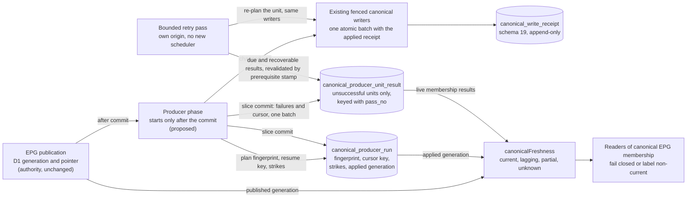

# ADR 0128: Durable execution of the EPG canonical producer: plan identity, cursor, failed-unit results and bounded retry

**Status:** **PROPOSED.** The owner confirmed the design choices recorded in the decision ledger below (12 Nov 2026); the amended text stays PROPOSED until a positive independent review. Nothing here authorizes code, a migration apply, wiring of `epgSync`, a production read or write, a flag, a Task, a cron or a marker move. The number 0128 is free on `origin/main` `97ff6bc` (12 Nov 2026); it is renumbered on merge if another change takes it.  
**Original decision date:** not decided (proposal of 2026-11-12; design choices confirmed by the owner the same day, see the ledger)  
**Recorded at:** 2026-11-12  
**Approval source:** the owner's step 4 decision of 12 Nov 2026 on the [AIR-374 card](https://trello.com/c/ha7ais3w) (durable plan identity, durable cursor, re-processing of failed units; one Film unit's error must NOT stop the EPG publication and must NOT be lost after the cursor advances), and the owner's design confirmations after the Controller review of 12 Nov 2026 (ledger rows O1 to O6). These are design approvals only.  
**Related work:** [AIR-374](https://trello.com/c/ha7ais3w), [ADR 0099](0099-canonical-film-person-d1-authority.md), [ADR 0117](0117-film-person-d1-handoff-owner-decisions.md), [ADR 0119](0119-durable-canonical-write-receipts.md), [ADR 0123](0123-producer-receipt-adapter-film-facts.md), [ADR 0125](0125-epg-producer-layer-film-facts.md), [ADR 0126](0126-epg-producer-layer-person-credits.md), [ADR 0127](0127-dictionary-store-producer-film-title-identity.md), [ADR 0100](0100-epg-cloudflare-workflow-executor.md), [ADR 0108](0108-epg-mirror-reconciliation-writer.md), [ADR 0106](0106-bulk-projector-write-path.md), [decision pack](../runbooks/film-person-holdpoint-decision-pack.md), [E6 measurement](../evidence/d1-migration/air-374-e6-production-measurement-2026-11-12.md)  
**Supersedes:** None. It refines the durable cursor and per-unit failure follow-ups that ADR 0125, 0126 and 0127 left open; it changes none of their accepted decisions. Where it needs a planner to refuse one unit instead of the whole plan (decision 9), that is a named change to the dormant planners, delivered offline.  
**Superseded by:** None

## Context

### What exists (read from the repository at `origin/main`)

- Three dormant, unbundled producer layers plan and apply units through the receipt adapter of [ADR 0123](0123-producer-receipt-adapter-film-facts.md): `src/canonical-epg-producer.js` (Film facts), `src/canonical-epg-person-producer.js` (`person_state`, `film_credits`) and `src/canonical-dictionary-producer.js` (title and identity facts, origin `dictionary`). Their `apply*Units` visit at most a caller-injected number of units (hard ceiling 50, provisional) and return `{cursor, done, counts, failures:[{id, code}], stoppedBy}`. The cursor is an in-memory integer and `failures` exists only in the return value.
- A receipt exists only for a unit that would CHANGE something: a no-op ends before any receipt (owner decision E5) and a planner refusal also happens before one. After a restart the receipt table cannot say which units were refused, and an `unknown` receipt cannot be replayed without a plan.
- The receipt row ([ADR 0119](0119-durable-canonical-write-receipts.md), schema 19, applied) is append-only, writable only while the marker is `d1`/`open`, and carries state (`pending`, `applied`, `failed`, `unknown`, `abandoned`), `attempts`, `next_attempt_at` and an error class. Its retry policy is a code constant (`RETRY_POLICY` in `src/canonical-receipts.js`): 5 attempts, backoff 60 s, 300 s, 1,800 s, 7,200 s, abandon after 7 days; at most 50 receipts per reconcile pass and 10 per inline own-origin reconcile. The receipt layer already classifies error classes: `PERMANENT` (`film_person_invalid`, `_redirect`, `_reference`, `_bounded`, `identity_collision`, `person_role_collision`, `credit_ordinal_conflict`), `RETRYABLE` (`film_person_fence`, `_revision_conflict`, `_precondition`, `_held`, `_not_open`) and everything else `unknown`.
- The EPG run state lives in `sync.json` (R2) and is replaced by the next run. The orchestration control state is `epg_orchestration_document` (`key` restricted by a CHECK to `mode`, `control`, `lease`), whose `control` record carries the executor's failure budget ([ADR 0100](0100-epg-cloudflare-workflow-executor.md)). A step on a completed run already has a `continuation` branch (`syncStep`, `src/worker.js`).
- Step and budget facts the repository documents: the executor loop stops at `STEP_CAP=400` iterations per instance and takes a 5 minute step lease with a 15 s margin (`src/epg-orchestration.js`); seal steps are bounded to "about 30 s each" ([EPG architecture page](../architecture/epg-and-availability.md)); `limits.cpu_ms` is 120000 in `wrangler.jsonc`. **Not documented in the repository: the platform limits of a Cloudflare Workflow step and the budget an EPG step gets.** This ADR invents none of them.
- First E6 measurement ([evidence](../evidence/d1-migration/air-374-e6-production-measurement-2026-11-12.md), an operator attestation): about 397 Film-facts units per EPG run; offline, 14 round trips per unchanged unit and 38 per applied one; schema 19; receipts 0; no per-run ceiling chosen.

### The gaps a naive wiring would leave

1. **No plan identity:** a resumed pass cannot tell that the plan changed and would apply a cursor to another plan.
2. **The cursor is lost at the first restart** of a Workflow step.
3. **A failed unit is lost when the cursor moves past it;** a pre-receipt refusal leaves no durable trace.
4. **No bounded retry for what receipts do not own.**
5. **Nothing says what "done" or "fresh" means** for a producer pass, so a lagging canonical store could be read as current, and a producer error could be mistaken for an EPG step failure.
6. **The dictionary version label** ([ADR 0127](0127-dictionary-store-producer-film-title-identity.md) decision 3) has no minting place, and a build or deploy identifier would repeat on a revert.

## Decision ledger

Four kinds of entry, kept apart so nothing settled is re-asked: **O** (confirmed owner choice, 12 Nov 2026), **P** (established prior decision), **G** (implementation guardrail, resolved under existing owner policy and technical recommendation, not a new owner question) and **U** (still unmeasured; closed only by a measurement gate). Each row points at the decision that implements it.

| # | Kind | Entry | Implemented by |
| --- | --- | --- | --- |
| O1 | Owner | Schema 20 with TWO durable tables, `canonical_producer_run` and `canonical_producer_unit_result`. Table design and migration file may be prepared offline; the production apply needs its own exact owner GO after preflight with readback (as for 0019). | Schema sketch; GA |
| O2 | Owner | Generation-aware freshness: a canonical generation lagging the published EPG generation is never read as current; a verifiable applied generation is persisted; each reader fails closed or serves the state explicitly labelled non-current; no silent fresh claim, no EPG-publication rollback. Numeric lag SLA only after the dry-run measurements. | Decision 11 |
| O3 | Owner | After THREE proven unit-specific failures a durable failed-unit result is persisted and the pass continues. Systemic D1, marker, lease/fence, transport or storage unavailability is a PASS-LEVEL STOP, never reclassified as a poison unit; a failed slice commit never advances the cursor. | Decisions 6 and 7 |
| O4 | Owner | `unranked_kept` stays: an unranked `original_title` is not overwritten or adopted without provenance, and string equality is not provenance. | Decision 12 |
| O5 | Owner | A credit list over 50 is a named DURABLE, PERMANENT REFUSAL (refused-permanent, visible, never retried while its digest is unchanged); splitting is a separate follow-up; no silent truncation or partial success. | Decisions 6, 9 and 12 |
| O6 | Owner | Credits are UPSERT-ONLY at this stage: no automatic prune of a credit absent from the incoming source; deletion needs a separately approved decision. | Decision 12 |
| P1 | Prior | One canonical writer per domain; every canonical mutation goes through the existing fenced writers and the receipt adapter, atomic with its applied receipt ([ADR 0099](0099-canonical-film-person-d1-authority.md), [0119](0119-durable-canonical-write-receipts.md), [0123](0123-producer-receipt-adapter-film-facts.md)). | Decisions 1 and 13 |
| P2 | Prior | No new scheduler, global reconcile, timer or Task (E2); no flag read or changed (E4); a no-op writes no receipt (E5). | Decisions 7 and 13 |
| P3 | Prior | The 10 draft differential exceptions are reviewed one by one, never in bulk. | Staged plan, S5-2 |
| G1 | Guardrail | Sparse failed-unit results, not a full manifest. | Decision 5 |
| G2 | Guardrail | A fingerprint change restarts the pass from the beginning with idempotent replay, after the plan rebuild cost is measured. | Decision 3 |
| G3 | Guardrail | One retry policy (the receipt `RETRY_POLICY`) and bounded own-origin reconcile; every live result has exactly ONE retry owner: `unit` (no receipt; this includes the revalidation of recoverable refusals) or `receipt` (receipt-backed). | Decision 8 |
| G4 | Guardrail | Natural-run retry cadence is acceptable; no new scheduler. | Decision 8 |
| G5 | Guardrail | Compact failures through the existing health / EPG read model and readiness; no new alert. | Decision 10 |
| G6 | Guardrail | The producer phase is POST-COMMIT, in an independently bounded continuation with exception isolation: a producer error never changes the published EPG result or the executor's failure budget. Before wiring, the existing `nextAction` semantics of the continuation branch are verified (not verified here; pre-wiring gate S5-1). | Decision 1 |
| G7 | Guardrail | The dictionary revision comes from durable state, never from a build SHA or deploy id; atomic monotonic minting; identical snapshot replays reuse the version; A, B, A gets three versions; no concurrent duplicate labels. | Decision 4 |
| G8 | Guardrail | The new tables stay append-only until the receipt-retention and stabilization review. | Recovery section |
| G9 | Guardrail | `person_mutation` is built before any credit producer is wired, through the existing fenced `mutatePerson` and the receipt adapter, never bypassing the single writer or receipt atomicity. | S5-0 |
| G10 | Guardrail | Owner-review protection is VERIFIED, not assumed, in three cases: no owner review entry for the Film (confirmed; normal, the unit proceeds), an entry that is present and demonstrably materialised into `film_dimension` and the localization rows (safe, the unit proceeds under the named kept outcomes), an entry that is present but inconsistent or unreadable (the unit is a recoverable refusal, and an unreadable check stops the dictionary pass). Absence of an owner record is never itself a refusal. | Decision 12 |
| G11 | Guardrail | A missing identity row is never created inside the dictionary layer (the canonical identity writer owns it): `no_identity_row` is a visible RECOVERABLE refusal (refused-recoverable) and then a durable result, revalidated when the identity row appears. A separate, unambiguous resolver maps dictionary id to canonical Film BEFORE the planner. | Decision 12 |
| G12 | Guardrail | `film_credits` moves `film.updated_at` and the canonical revision only on an actual credit write; a no-op leaves them untouched. The source-time versus write-time difference is documented for the differential review. | Decision 12 |
| U1 | Unmeasured | Workflow step platform limits and the repository's configured limits | M1 |
| U2 | Unmeasured | `changedShare`, Person and credits units per run, planning and plan-rebuild cost, fingerprint overhead, size of the first pass after the flip | M2, M2b |
| U3 | Unmeasured | EPG step budgets (CPU, wall time, D1 calls), round-trip time on the EPG path | M3 |
| U4 | Unmeasured | Failure rate and table growth | After a soak |
| G13 | Guardrail | Refusals are classed once: PERMANENT (a pure function of the unit's own input, for example `film_person_bounded`) or RECOVERABLE (depends on canonical state that another writer may legitimately change: missing identity, missing trusted TMDB claim, missing referenced Person, redirect target, owner-review materialisation inconsistent). A recoverable result is revalidated against a separate prerequisite stamp even when the source digest is identical; it is never retried by a scheduler and never claims success before write proof. | Decisions 6, 8 and 12 |
| U5 | Unmeasured | `sliceSize`, `maxSlicesPerRun`, the slice deadline, the per-run ceiling and the numeric canonical-lag SLA: chosen by the owner from quantitative options after M1 to M3; until then the 50-unit cap is provisional | D-C |

## Decision (proposal)

1. **A post-commit phase, isolated from publication (G6, P1).** The producer pass is a bounded continuation phase of the EPG run that starts only after the publication has committed. Every error inside it is caught at the phase boundary, recorded durably and logged as counts and codes; it never changes the run's `stage`, `error` or published generation, is never reported to the executor as a step failure (so it cannot feed the failure budget of [ADR 0100](0100-epg-cloudflare-workflow-executor.md)/[ADR 0089](0089-shared-orchestration-reliability-contract.md)) and never rolls anything back. The EPG hourly ensure keeps reconciling the R2 mirrors independently ([ADR 0108](0108-epg-mirror-reconciliation-writer.md)).
2. **Durable plan identity.** A plan is `{origin, event, planVersion, units}` with `units` an ordered list of `(kind, id, unitDigest)` using the clock-free digests the producers already compute. The fingerprint is `sha256(canonicalJson(...))`. `planVersion` is a code constant bumped when the unit shape, order or digest rules change. Not part of the identity: slice size, retry caps, the unit ceiling (execution parameters) and the marker generation (the writer's own fence refuses a stale one; it is recorded on the run row).
3. **Plan change under the same run: replay from the start, never guess (G2).** A pass resumes only when the stored fingerprint equals the recomputed one. Otherwise, in one compare-and-set batch on the run row, `pass_no` increases, the new fingerprint is stored and the cursor resets. The replay is safe because each unit is idempotent (a no-op writes no receipt, or `already applied` by request id), so it costs reads, not writes; that cost is unmeasured (U2). Open results are NOT bulk-rewritten at the change: they are revalidated lazily when touched (by the failure write of decision 5, by the retry pass of decision 8 or by the plan's own re-observation of the unit), so the change commit stays bounded however many results are open.
4. **Atomic minting protocol (G7).** Two kinds of run, one table (`canonical_producer_run`).
   - *EPG:* `run_key` is the EPG event id, created with `INSERT ... ON CONFLICT DO NOTHING` on the primary key `(origin, run_key)` and then read back; parallel planners of the same run converge on one row.
   - *Dictionary:* `run_key` is the version label `d<seq>`. A run row carries `seq`, `prev_seq = seq - 1` and `snapshot_digest`. A planner (i) reads the latest dictionary row (highest `seq`); (ii) if its `snapshot_digest` equals the planner's digest, it REUSES that row and version (resume, retry and identical replay never mint); (iii) otherwise it runs one conditional INSERT with `seq = latest.seq + 1` that is guarded in the same statement (`WHERE EXISTS (row with seq = prev_seq AND snapshot_digest <> :digest)`, or `prev_seq = 0` and no dictionary row) and constrained by a UNIQUE index on `(origin, seq)`. Two parallel planners reading the same latest row compute the same `seq`: exactly one INSERT succeeds; the loser gets a constraint failure, re-reads, and either reuses (same digest) or mints the next `seq` (different digest). There is no `SELECT MAX + 1` across statements: the contiguity is enforced by the `CHECK`s and the unique index, and D1 serialises the single write. A, B, A gives `d1`, `d2`, `d3`: the third insert is allowed because the LATEST row's digest (B) differs, so a revert is a genuine new version. A planner pins the snapshot to the plan by hashing: the pass for `d<n>` proceeds only while the recomputed snapshot digest equals the row's `snapshot_digest`; a different digest is a content change (mint a new version and mark the old run `superseded`), never an apply under the old label. A bump of `planVersion` with an unchanged snapshot reuses the label (the request ids already bind the unit digest).
5. **Durable cursor and a result for every unsuccessful unit (G1).** The cursor is the key `(cursor_kind, cursor_id)` of the last unit whose outcome is durable, with its fingerprint; resume is the first unit strictly after it in the recomputed ordered plan. It advances only in a **slice commit**: ONE D1 batch that (a) asserts the marker `d1`/`open` and the run row `revision` (compare-and-set), (b) writes the failure results of the slice, (c) writes counts and the new cursor. A succeeded unit needs no row (its proof is its applied receipt or its pre-plan no-op); skips and named kept outcomes are counted. A crash between a unit's own batch and the slice commit leaves the cursor behind; the unit is revisited as a no-op. A result row is keyed `(origin, run_key, pass_no, kind, unit_id)`; at most one LIVE row (`open`, `refused_permanent` or `refused_recoverable`) exists per unit per run (partial unique index). **What `unitDigest` binds:** the clock-free digest of the unit's SOURCE input only (the dictionary or EPG source content of the unit), exactly as the producers compute it. It is the only key for replay, plan fingerprint and superseding (`source_changed`). It does NOT bind canonical prerequisite state (identity row, trusted TMDB claim, referenced Person, owner-review materialisation), so a prerequisite can change while the digest and the plan fingerprint stay equal. That state is bound by a SEPARATE `prereq_stamp` (decision 8) stored on recoverable result rows, never part of the plan identity and never used for superseding; S4-1 tests that a prerequisite-only change moves the stamp and not the digest or fingerprint. The failure write is a keyed upsert in the slice batch: it first supersedes a live row of the same unit whose `unit_digest` differs (`source_changed`), then inserts the new row, or increments `attempts` of a live row with the same digest. Terminal states (`settled`, `superseded`, `abandoned`) never reopen; the three live states may move to each other and to any terminal state.
6. **Error classification (O3).** Every error a unit step can raise is classified once, by one pure function over the existing `film_person_*` codes, fail-closed.
   - **Systemic, PASS-LEVEL STOP, never a strike, never a unit result:** `film_person_unavailable` (always, regardless of count), `film_person_held`, `film_person_not_open`, `film_person_fence`, `film_person_run_mismatch`, any marker read failure, the producer store errors (`producer_store_missing`, an unreadable run row, a lost compare-and-set, a failed slice commit or strike commit), any transport, timeout or storage failure, and `unclassified` (an unknown error is never assumed to be the unit's fault). The pass stops with the cursor and the strike count untouched and records `stopped_by` when it can.
   - **Unit-specific execution failures, strike-eligible:** `film_person_revision_conflict` and `film_person_precondition` (after one immediate re-plan of the unit, since the other writer may have moved), and an error the unit's own planner or writer attributes to that unit's input (for example `identity_collision`, `person_role_collision`, `credit_ordinal_conflict`).
   - **Named planner refusals, proven at first observation, in TWO classes.** A refusal is a pure function of the unit's own input plus a read of canonical state; its durable result is written at the FIRST observation, in the slice commit, without strikes (guardrail reading of "proven"; the Controller may confirm or tighten it at review). The class decides what may clear it.
     - **PERMANENT** (depends only on the unit's own input, so it cannot change while the unit digest is unchanged): `film_person_invalid`, `film_person_bounded` (more than 50 credits, pending an explicit split policy), an ambiguous dictionary-id resolution. Durable state `refused_permanent`; no retry; cleared only by a changed `unitDigest` (`superseded` / `source_changed`) or by a later accepted decision.
     - **RECOVERABLE** (depends on canonical state another writer may legitimately change without the source digest changing): `no_identity_row`, `needs_trusted_tmdb_id`, `film_person_reference` (a credit's Person or a referenced Film is absent), `film_person_redirect` (the redirect target may move), and a Film whose owner review entry is present but inconsistent with its materialised rows (decision 12 b). Durable state `refused_recoverable`, with a `prereq_stamp` (decision 8) and a bounded revalidation; never a strike, never a silent success.
     - An unknown refusal code is `unclassified` and stops the pass; the class of a code is fixed by the classification table, not guessed at runtime.

7. **Strikes: persistence of the unit-specific count and how the step proceeds (O3).** The run row carries `strike_kind`, `strike_id`, `strike_digest`, `strike_class`, `strike_count` (0 to 3). A strike-eligible failure of unit U is recorded in a compare-and-set batch that touches only the strike columns (the cursor does not move); the count is monotone ONLY while the same STRIKE IDENTITY `(strike_kind, strike_id, strike_digest, strike_class)` stays active (each strike adds exactly one: 0 to 1 for a new identity, then 1 to 2 and 2 to 3). It resets atomically to zero, clearing the identity columns, in exactly three cases, each inside the batch that records its cause: a success of the unit, a different unit, digest or class (the new identity then starts at 1 in the same statement), and the third-strike batch that writes the result row and advances the cursor. A plan change (`pass_no` increases and the cursor resets, decision 3) also clears it. A decrement that is none of these (for example 2 to 1 for the same identity) is illegal; a systemic stop and a failed or crashed batch change nothing, so they neither reset nor add a strike. The next step re-attempts U. On the third proven failure of the same unit and digest, ONE batch writes the result row (`retry_owner` `unit` or `receipt`, `attempts` = 3, `next_attempt_at` from the receipt policy), advances the cursor past U and clears the strike; the pass continues with the next unit. Consequences: (i) a database outage over repeated steps changes nothing (every step stops systemically, the strike count stays where it was, so an outage cannot manufacture a poison unit); (ii) if that third batch cannot be written, the cursor does not advance and the count stays 2, so the unit is retried by the next step; (iii) a poison unit costs at most two extra steps. A unit that always throws a systemic class (for example an unreadable row that raises `film_person_unavailable`) blocks the pass; that is deliberate (fail closed) and is surfaced by `stopped_by` in the read model.
8. **A separate bounded retry pass, one retry owner per result, no new scheduler (G3, G4, G13, P2).** `retry` is its own call with a hard limit (proposal 10, the adapter's inline own-origin limit). It takes due live results ordered by `next_attempt_at` then key. Exactly ONE owner per result: `unit` rows (execution failures without a receipt and recoverable refusals) carry the schedule and are handled by the retry pass; `receipt` rows carry the request id and NO schedule (the receipt owns it) and are handled by the existing own-origin reconcile (the limit is shared, not added). The plan's own re-observation of a unit (decision 3) is not a second retry owner: it evaluates the unit through the same revalidation function and writes through the same row, so the two paths cannot disagree.
   - *Execution failure (`open`, owner `unit`):* the retry pass builds a one-unit plan under the result's own event from the current inputs and compares the unit digest with the recorded one: equal runs that one unit through the existing `apply*Units` path; different gives `superseded` / `source_changed` at once; absent from the sources gives `superseded` / `left_plan`. A failure increments `attempts` and sets `next_attempt_at` with the SAME `RETRY_POLICY` as receipts (5 attempts, 60 s to 7,200 s, abandon after 7 days).
   - *Permanent refusal (`refused_permanent`):* never retried and carries no schedule; cleared only when its unit digest changes (`superseded`).
   - *Recoverable refusal (`refused_recoverable`, owner `unit`):* the row stores `prereq_stamp`, a 64 hex digest of the canonical prerequisite state the planner read (identifier and revision, or the explicit absence, of the identity row, trusted TMDB claim, referenced Person or Film, redirect, owner-review entry and its materialised rows; identifiers and revisions only, no content). At due time, or when the plan re-observes the unit, the revalidation reads the CURRENT prerequisite stamp (cheap, read-only): unchanged means no apply, no attempt and no state change except `next_attempt_at` moved by the policy's last step (7,200 s), so an unchanged prerequisite costs one bounded read per row per pass; changed means the unit is planned and applied through the existing writers. If it now applies, the row becomes `settled` / `prerequisite_resolved` only after the write's own proof (its applied receipt or its verified no-op), never before; if it is refused again with a new stamp the row keeps its state and takes the new stamp; if it fails for another reason the failure write reclassifies it (`open`, `refused_permanent`) in the same compare-and-set. A recoverable refusal is NOT abandoned by attempts or age (the 7-day abandon applies to execution failures): it stays visible and blocking readiness until its prerequisite is repaired or its digest changes, because abandoning it would recreate the permanent-refusal problem. A changed unit digest supersedes it as for any live row.
   - Cadence: the retry pass runs after the main pass in the same step when budget remains and first in the next run's first producer step; it is never driven by a cron, tick or Task. Backoff is a floor between two attempts, not a timer; the effective cadence is the natural run cadence, and a recoverable refusal is also revalidated every time a natural plan contains its unit.
9. **Refusal is per unit, never per plan.** Today `planEpgPersonUnits` throws `film_person_bounded` for the whole plan when one Film has more than `CREDITS_PER_UNIT_MAX` (50) credits. Under this ADR the planners return a per-unit `refused:[{kind, id, code, unitDigest}]` list beside `units`, so one oversized or invalid unit can neither stop the pass nor be dropped silently (O5). This is a change to the dormant planners, delivered in S4-1 with their tests; it does not alter any accepted decision of ADR 0126 except "refuses the whole plan".
10. **What "done" means (three levels) and where it surfaces (G5).** (1) *Published:* the EPG generation committed; never waits for the producer. (2) *Pass complete:* the cursor passed the last unit under the current fingerprint, every unit with a durable outcome. (3) *Settled:* no live result remains. The producer step ends the Workflow loop at (2); unsettled results do not keep a Workflow running. They surface through a read-only `producer` object in the existing EPG read model (counts by state (`open`, `refused_permanent`, `refused_recoverable`, `abandoned`) and code, age of the oldest live result, current `freshness`, no ids or content) and derived readiness blockers; no new alert. A pass that exhausts `maxSlicesPerRun` stays `passing` and is superseded by the next run's pass.
11. **Generation-aware freshness contract (O2).** *Persisted fact:* the run row of origin `epg` records `source_generation` (the published generation the plan was built from) and `applied_generation`, set ONLY by the pass-complete commit, in the same batch that sets `pass_state='passed'` and `open_at_completion` (the number of live membership-affecting results). *The canonical generation counts as complete* when `pass_state='passed'`, `applied_generation = source_generation` and zero live `film_facts` results exist. A pass that is `passing`, `stopped` or `superseded`, or that passed with a live `film_facts` result, never sets a current claim. *The only way a reader learns freshness* is one pure function (`canonicalFreshness`, S4-1) over `{publishedGeneration, latest epg run row, live membership results}` returning `current` (applied equals published and complete), `lagging` (published is newer or the pass is not complete), `partial` (passed with live membership results) or `unknown` (store absent or unreadable). Equality is the only path to `current`: a published generation that moves backwards is `lagging`, not current, and nothing rolls the EPG publication back. *Reader rule:* a reader that depends on canonical EPG membership calls the function and FAILS CLOSED on anything but `current` (refuses, or returns an explicit non-current error), except a reader that the wiring PR explicitly marks display-only, which may serve the stale data only with the returned state and generations visible in its response. A direct read of canonical membership without the function is a review blocker (audit test in the style of `tests/get-write-audit.mjs`). Today no reader consumes canonical EPG membership (the layer is dormant), so the wiring PR enumerates the readers and assigns each its mode. *No numeric lag SLA* is claimed: it is chosen after M2b and M3 (U5).
12. **Domain guardrails inside the units (O4, O5, O6, G10, G11, G12).** (a) *`unranked_kept`:* an unranked `original_title` (no `titleSource`) is left alone; an equal incoming string is not provenance and does not adopt ownership. `owner_kept`, `reviewed_kept` and `unranked_kept` are named terminal outcomes: counted by reason, no result row, no retry (a retry cannot change them). (b) *Owner-review protection is verified, in three cases, per Film of a dictionary unit:* the pass reads the authoritative `owner_review_entry` (D1-owned, `owner_review_authority.mode=d1`) for the Film and distinguishes **(1) confirmed no entry** (a successful read that finds none): the normal case, the unit proceeds under the usual kept outcomes; **(2) an entry that is present and demonstrably materialised** into `film_dimension` and the localization rows (the materialised rows carry the entry's revision or equal content): safe, the unit proceeds and the kept outcomes apply; **(3) an entry that is present but inconsistent or unreadable for that Film** (materialisation missing, stale or failed): the unit is a RECOVERABLE refusal (the stamp includes the entry's revision and the materialised rows' revisions, so repairing the materialisation revalidates it), never an overwrite. If the check itself cannot be performed (the table or the read fails, systemic) the dictionary pass FAILS CLOSED as a stop. The absence of an owner record is NOT a refusal and never blocks a dictionary unit. (c) *Missing identity row:* the dictionary layer never creates a canonical identity row; `no_identity_row` is a visible RECOVERABLE refusal of the title field, written as a `unit` result (`refused_recoverable`) at first observation and revalidated by prerequisite stamp (decision 8) because the identity writer may create the row; the same holds for `needs_trusted_tmdb_id` (the trusted claim may appear). A separate resolver, unambiguous and run BEFORE the planner, maps a dictionary id to a canonical Film (a trusted, non-conflicting identity; an explicit refusal on ambiguity, which is permanent); the future caller also mints the dictionary version through decision 4. A credit whose Person is missing is likewise a recoverable `film_person_reference` refusal and is applied when the Person exists. (d) *Credits over 50:* a `refused_permanent` result with `film_person_bounded` and the digest of the incoming list; it stays visible and is never silently truncated, partially written or retried while the list is unchanged. Splitting is a separate follow-up with its own policy. (e) *Credits are upsert-only:* the planner never prunes; a stored credit absent from the source is only counted (`credits_absent_from_source`, informational) and stays; deletion needs its own decision. (f) *Timestamps:* `film_credits` moves `film.updated_at` and the canonical revision only on an actual credit write; a no-op leaves both unchanged. The value is write time, not source time; the differential review documents this difference.
13. **Dormancy and fences, unchanged (P1, P2).** The store and the driver read the marker once through `writerRoute` and, below `open`, return `skipped` after that read; `held` and an unreadable marker are systemic stops; both tables carry the SQL marker triggers of the receipt table (insert and update only at `d1`/`open`), so at `prepared` they stay empty even against a code defect. No new canonical writer; no flag is read or changed (`D1_ENRICHMENT_WRITE`, `D1_ENRICHMENT_WINDOW`, `D1_ENRICHMENT_BULK` untouched). The pass refuses before touching any unit if schema 20 is absent (`producer_store_missing`).

### Proposed schema 20 (a sketch for a future migration; NOT a migration file and NOT applied)

Schema 19 covers the write-level retry of a unit that created a receipt. It does not cover plan identity, the durable cursor, results of units refused before a receipt (a receipt insert must be `pending`, attempt 1, with a planned digest and revision, and the table is append-only), freshness, or dictionary version minting. The two tables below, in the style of `0019` (identifiers, digests and short lowercase classes only; no payload, title or name), close that. `0020` is to be re-checked free at preparation time. Preparing the migration file is allowed offline; applying it to production needs a separate exact owner GO after preflight with readback, modelled on the [schema 19 apply runbook](../runbooks/film-person-0019-apply.md).

```sql
-- SKETCH ONLY (ADR text, not a migration)
CREATE TABLE canonical_producer_run (
  origin TEXT NOT NULL CHECK (origin IN ('epg','dictionary')),
  run_key TEXT NOT NULL CHECK (length(run_key) BETWEEN 1 AND 160),
  seq INTEGER CHECK (seq IS NULL OR seq >= 1),            -- dictionary only
  prev_seq INTEGER CHECK (prev_seq IS NULL OR prev_seq >= 0),
  snapshot_digest TEXT CHECK (snapshot_digest IS NULL OR length(snapshot_digest) = 64),
  source_generation TEXT,                                  -- epg only: published generation planned from
  applied_generation TEXT,                                 -- epg only: set only by the pass-complete commit
  pass_no INTEGER NOT NULL DEFAULT 1 CHECK (pass_no BETWEEN 1 AND 10000),
  plan_version INTEGER NOT NULL CHECK (plan_version >= 1),
  fingerprint TEXT NOT NULL CHECK (length(fingerprint) = 64),
  unit_count INTEGER NOT NULL CHECK (unit_count >= 0),
  cursor_kind TEXT, cursor_id TEXT,
  pass_state TEXT NOT NULL CHECK (pass_state IN ('passing','passed','stopped','superseded')),
  stopped_by TEXT,                                         -- systemic class, only when stopped
  strike_kind TEXT, strike_id TEXT, strike_digest TEXT, strike_class TEXT,
  strike_count INTEGER NOT NULL DEFAULT 0 CHECK (strike_count BETWEEN 0 AND 3),
  n_applied INTEGER NOT NULL DEFAULT 0, n_noop INTEGER NOT NULL DEFAULT 0,
  n_kept INTEGER NOT NULL DEFAULT 0, n_failed INTEGER NOT NULL DEFAULT 0,
  open_at_completion INTEGER,
  marker_generation INTEGER NOT NULL,
  revision INTEGER NOT NULL DEFAULT 1 CHECK (revision >= 1),   -- compare-and-set token
  created_at TEXT NOT NULL, updated_at TEXT NOT NULL, completed_at TEXT,
  PRIMARY KEY (origin, run_key),
  CHECK ((cursor_kind IS NULL) = (cursor_id IS NULL)),
  CHECK ((strike_count = 0) = (strike_id IS NULL)),
  CHECK (stopped_by IS NULL OR pass_state = 'stopped'),
  CHECK (applied_generation IS NULL OR (pass_state = 'passed' AND applied_generation = source_generation)),
  CHECK ((origin = 'dictionary' AND seq IS NOT NULL AND prev_seq = seq - 1 AND run_key = 'd' || seq
          AND snapshot_digest IS NOT NULL AND source_generation IS NULL AND applied_generation IS NULL)
      OR (origin = 'epg' AND seq IS NULL AND prev_seq IS NULL AND snapshot_digest IS NULL
          AND source_generation IS NOT NULL))
);
CREATE UNIQUE INDEX uq_producer_run_seq ON canonical_producer_run (origin, seq) WHERE seq IS NOT NULL;
CREATE INDEX ix_producer_run_fresh ON canonical_producer_run (origin, source_generation, applied_generation);
CREATE INDEX ix_producer_run_updated ON canonical_producer_run (origin, updated_at);

CREATE TABLE canonical_producer_unit_result (
  origin TEXT NOT NULL, run_key TEXT NOT NULL,
  pass_no INTEGER NOT NULL,                                -- plan identity: part of the key
  kind TEXT NOT NULL CHECK (length(kind) BETWEEN 1 AND 40 AND kind NOT GLOB '*[^a-z_]*'),
  unit_id TEXT NOT NULL CHECK (length(unit_id) BETWEEN 1 AND 200),
  fingerprint TEXT NOT NULL CHECK (length(fingerprint) = 64),
  unit_digest TEXT NOT NULL CHECK (length(unit_digest) = 64),
  state TEXT NOT NULL CHECK (state IN ('open','refused_permanent','refused_recoverable','settled','superseded','abandoned')),
  retry_owner TEXT NOT NULL CHECK (retry_owner IN ('unit','receipt')),
  request_id TEXT,                                         -- link to canonical_write_receipt
  code TEXT NOT NULL CHECK (length(code) BETWEEN 1 AND 80 AND code NOT GLOB '*[^a-z_0-9]*'),
  attempts INTEGER NOT NULL CHECK (attempts BETWEEN 1 AND 16),
  prereq_stamp TEXT CHECK (prereq_stamp IS NULL OR length(prereq_stamp) = 64),  -- prerequisite state revision; NOT part of unit_digest
  next_attempt_at TEXT,
  settled_by TEXT,                                         -- source_changed, left_plan, newer_run, applied, prerequisite_resolved, ...
  created_at TEXT NOT NULL, updated_at TEXT NOT NULL, settled_at TEXT,
  PRIMARY KEY (origin, run_key, pass_no, kind, unit_id),
  FOREIGN KEY (origin, run_key) REFERENCES canonical_producer_run (origin, run_key),
  CHECK ((retry_owner = 'receipt') = (request_id IS NOT NULL)),
  CHECK (retry_owner = 'unit' OR next_attempt_at IS NULL),             -- the receipt owns its schedule
  CHECK (state <> 'open' OR retry_owner = 'receipt' OR next_attempt_at IS NOT NULL),
  CHECK (state <> 'refused_permanent' OR (next_attempt_at IS NULL AND prereq_stamp IS NULL)),  -- never retried
  CHECK (state <> 'refused_recoverable' OR (retry_owner = 'unit' AND next_attempt_at IS NOT NULL AND prereq_stamp IS NOT NULL)),  -- revalidated, one owner
  CHECK ((state IN ('settled','superseded','abandoned')) = (settled_at IS NOT NULL))
);
CREATE UNIQUE INDEX uq_unit_result_live ON canonical_producer_unit_result (origin, run_key, kind, unit_id)
  WHERE state IN ('open','refused_permanent','refused_recoverable');  -- at most one live row per unit per run
CREATE INDEX ix_unit_result_due ON canonical_producer_unit_result (next_attempt_at)
  WHERE state IN ('open','refused_recoverable') AND retry_owner = 'unit';
CREATE INDEX ix_unit_result_unit ON canonical_producer_unit_result (origin, kind, unit_id, state);
CREATE INDEX ix_unit_result_state ON canonical_producer_unit_result (state, code);
```

Triggers (sketch, in the style of `0019`): insert and update only while the marker is `d1`/`open`; identity columns immutable (`origin`, `run_key`, `seq`, `prev_seq`, `snapshot_digest`, `pass_no`, `kind`, `unit_id`, `unit_digest`); result state machine (`open`, `refused_permanent` and `refused_recoverable` may move to any state, the three others are terminal and never reopen); `attempts`, `pass_no` and `revision` only increase; `strike_count` follows the strike identity rule: while `(strike_kind, strike_id, strike_digest, strike_class)` is unchanged it may only stay or rise by exactly 1, and it may become 0 (identity columns NULL) only in an UPDATE that also moves the cursor, increases `pass_no` or changes the identity to a new one starting at 1; an UPDATE that sets `pass_state='stopped'` or `stopped_by` must leave the strike columns untouched (a systemic stop never adds or clears a strike); `applied_generation` only moves from NULL; a dictionary insert requires its `prev_seq` row (or `prev_seq = 0` with none); no delete during stabilization (the stance of the receipt table, G8).

**Scenario A: same run, plan changes, the same unit fails again.** Run `epg:R1`, pass 1, fingerprint F1: unit U (digest D1) fails; the third proven failure writes result `(epg, R1, 1, film_facts, U)` `open` (digest D1). The metadata cache moves; the next step recomputes F2 and the compare-and-set batch makes `pass_no = 2`, cursor reset. In pass 2, U has digest D2 and fails again: the failure write first sets the pass-1 row to `superseded` / `source_changed` (its digest differs), then inserts `(epg, R1, 2, film_facts, U)` `open`. Both rows are durable with different keys; the terminal pass-1 row is never overwritten or reopened; the live-row unique index is satisfied. If D2 equals D1 instead, the pass-1 row stays the live row and its `attempts` is incremented.

**Scenario B: parallel dictionary planners.** Latest row `d2` (digest B). Planners P and Q both hold digest A (a revert). Both compute `seq = 3`, `prev_seq = 2`. P's conditional insert succeeds (`d3`); Q's hits `uq_producer_run_seq`, re-reads `d3`, finds equal digest A and reuses `d3`. If Q held a different digest C, it would mint `d4` after re-reading. Replaying A again reuses `d3`; no step mints on resume.

## Proposed design (not implemented)



Reading rules: the arrow from the publication to the phase is one way and the phase never feeds a status back into the publication or the executor; the run and result tables are written only by the producer phase and the retry pass; freshness is a read-only derivation and the only way a reader learns whether the canonical generation is current; nothing here is deployed, and at `prepared` every path below the phase ends after one marker read.

## Failure modes

| Condition | What is durable | Behaviour under this proposal | Net result |
| --- | --- | --- | --- |
| Step killed mid-pass, after units applied and before the slice commit | Applied receipts and canonical rows; cursor behind | Next step resumes at the old cursor and revisits: no-op or `already applied` | Repeated reads, no repeated write, no loss |
| Step killed after the slice commit | Cursor and failure rows of the slice | Resume after the cursor | No loss |
| Plan changed between steps or a deploy changes `planVersion` | Old fingerprint, cursor, live results | Fingerprint differs: `pass_no` + 1, cursor reset; live results revalidated lazily when touched | Full replay of idempotent units; no skipped changed unit |
| Fingerprint change under the same run with a failing unit across passes (A fails, plan changes, A superseded, B fails for the same unit) | Pass-1 row terminal `superseded`; pass-2 row `open`; keys differ by `pass_no` | Failure write supersedes the older live row of a different digest, then inserts the new one (scenario A) | Both results durable; a terminal row never reopens |
| Parallel planners minting a dictionary version | One `d<seq>` row per genuine snapshot change | Conditional insert plus unique `(origin, seq)`; the loser re-reads and reuses or mints the next (scenario B); EPG runs converge on the primary key | No duplicate label; A, B, A yields three versions; a resume or retry mints nothing |
| Marker `held` or not `open` during the pass | Cursor and strikes frozen | Systemic stop, `stopped_by` recorded; no strike | Resumes when the marker is `open` |
| Marker `prepared`, `r2` or legacy | Nothing | One marker read, `skipped` | Dormant by design |
| DB outage over repeated steps (`film_person_unavailable`, transport, storage) | Cursor and strike count unchanged | Every step is a pass-level stop; never reclassified as a poison unit whatever the repeat count | Resumes where it stopped when the database returns |
| Poison unit (a unit-specific failure on every attempt) | Strike count 1, 2, then on the third: result row and cursor in one batch | Third proven failure persists the result and the pass continues; the count resets to 0 with the identity columns cleared, which is the allowed third-strike transition (a same-identity decrement is illegal) | The pass is not blocked past two extra steps; the failure is durable and retried by the bounded pass |
| Slice commit (or the third-strike batch) cannot be written | Nothing from this slice | Systemic stop; cursor and strike count unchanged | The unit is revisited; no failure is lost because none was acknowledged |
| Duplicate or concurrent step delivery | Run row `revision` | Both may run units (idempotent); one compare-and-set passes; the other stops | Wasted work at most |
| Canonical generation lag (published generation newer than `applied_generation`) | Run row generations | `canonicalFreshness` returns `lagging`; membership readers fail closed or label the state | No silent fresh claim; no EPG rollback |
| Partial pass (exhausted `maxSlicesPerRun`, or passed with live `film_facts` results) | `pass_state`, `open_at_completion`, no `applied_generation` | `lagging` or `partial`; the next run's pass supersedes | `current` is reachable only by completeness |
| Run A has live results when run B publishes | A's rows; B's plan | A's run is `superseded` (it never sets `applied_generation`); results covered by B's plan become `superseded` / `newer_run`; the rest stay under A's event for the bounded retry; receipt-owned rows settle by evidence | Nothing dropped; no replay of A's receipt from B's plan |
| More than 50 credits for a Film | `refused_permanent` result, `film_person_bounded`, digest of the list | Per-unit permanent refusal at first observation; no truncation, no partial credits write, no retry while the digest is unchanged; the pass continues | Visible and blocking readiness until splitting or a changed source |
| Dependency repaired, source digest unchanged (identity row created, trusted TMDB claim set, Person created, owner-review materialisation repaired) | `refused_recoverable` row with the old `prereq_stamp` | The plan re-observes the unit or the bounded retry pass reads the current stamp: changed means plan and apply through the existing writers; `settled` / `prerequisite_resolved` only after write proof; unchanged costs one read and no attempt | The same snapshot is eventually applied; never stuck `refused` forever |
| Recoverable refusal with its dependency still missing | `refused_recoverable`, stamp unchanged | Stays visible, blocks readiness, not abandoned by attempts or age, no strike | Visible until repaired or the digest changes |
| Strike identity changes or the unit succeeds mid-count | Strike columns | Atomic reset to 0 (success) or to a new identity at 1 in the same batch; no leftover count of the old unit | No spurious third strike on another unit |
| A systemic failure while a count is 1 or 2 | Strike columns | Pass-level stop; strike columns untouched; the trigger rejects an UPDATE that sets `stopped_by` and changes them | No spurious strike, no reset |
| Unranked `original_title` (no `titleSource`), equal or different incoming title | Counted `unranked_kept` | Left alone; equality is not provenance; no ownership adopted | Protected |
| Owner-reviewed or reviewed Film | Counted `owner_kept` / `reviewed_kept` | Three cases: confirmed no owner entry (normal, the unit proceeds), entry present and materialised (safe, kept outcomes apply), entry present but inconsistent or unreadable for that Film (recoverable refusal); if the check cannot run at all the dictionary pass stops | Fails closed; absence of an owner record never refuses a unit |
| Missing canonical identity row | `unit` result `no_identity_row`, `refused_recoverable` | The dictionary layer never creates the row; visible refusal; revalidated by prerequisite stamp because the identity writer may create it | No invented identity; applied once the row exists |
| Credit whose Person is missing | `unit` result `film_person_reference`, `refused_recoverable` | Refused per unit; revalidated when the Person exists (stamp) | Credit applied after the Person is created |
| Credit absent from the incoming source | Stored credit unchanged | Upsert only; informational `credits_absent_from_source` count | No prune |
| Partial apply across kinds of one Film | Facts receipt applied; credits result | Each kind is its own unit with its own result | Independent retries |
| Retry exhausted (5 attempts or 7 days; execution failures only, never recoverable refusals) | `abandoned` row | Terminal, visible in the read model and the readiness blocker | Needs a person |
| Schema 20 not applied | Nothing | `producer_store_missing` before any unit | Wiring cannot run unrecorded |
| The producer pass raises an exception | Last committed slice | Caught at the phase boundary; the run stage, `error`, publication and executor budget untouched | The EPG publication is never blocked or rolled back |

## Alternatives considered

- **Persist in the EPG orchestration documents.** Rejected: a `key` CHECK would need a table rebuild, the `control` record is written under the executor's mode-revision compare-and-set and could be disturbed, and it mixes two owners.
- **Persist in `sync.json` (R2).** Rejected: the next run replaces the file, so a failed unit would be lost; R2 has no fence in common with the D1 canonical batch.
- **A new R2 object with conditional put.** Rejected: canonical-related mutable progress belongs to D1 ([ADR 0051](0051-d1-domain-r2-blobs.md)).
- **Reuse `canonical_write_receipt` only.** Insufficient for identity, cursor, pre-receipt results, freshness and minting.
- **A row per unit per run (a full manifest).** Rejected for the first delivery (G1); it remains the way to enable a partial resume after a plan change if M2b shows the replay cost is too high.
- **A separate dictionary sequence table or `SELECT MAX + 1`.** Rejected: a third table is outside the owner's two-table choice, and a read-then-write across statements races; the contiguity-by-`CHECK` and unique-index protocol needs neither.
- **A dictionary label from a build or commit id.** Rejected: it repeats on a revert deploy.
- **Strike count only in memory.** Rejected: a Workflow step restart would reset it and a poison unit would block forever.
- **Counting `film_person_unavailable` against a unit.** Rejected by O3: an outage would manufacture poison units.
- **Skip a unit by a stored "last applied input digest".** Rejected: a second truth of "already applied".
- **Roll back the whole EPG run on a unit error.** Rejected by the owner decision and impossible.
- **Retry by a new cron, Task, global reconcile or a Workflow `sleepUntil`.** Rejected (P2); a sleep would change ADR 0100.
- **A new event platform or queue; a lease for the producer pass.** Excluded or unnecessary: the compare-and-set plus idempotent units suffice.

## Consequences

- One more migration and two more append-only tables; growth is bounded by the failure count, not the run size, but the failure rate is unknown (U4).
- The canonical store catches up AFTER publication, in bounded slices. Readers see that explicitly through `canonicalFreshness`; the numeric lag SLA is chosen only after measurement (U5).
- A pass revisits unchanged units after a plan change. Offline arithmetic from the E6 evidence (Film-facts only, no round-trip time, no Person or credits volume): about 5,558 round trips for a full no-op pass over 397 units (397 x 14) and about 15,086 for a full changed pass (397 x 38). These are neither a budget nor a bound.
- A credit list over 50 keeps its Film flagged in readiness until a splitting decision; that is intentional.
- Risks: (a) a crash between publication and the first slice delays catch-up; (b) a plan recomputed at a later step depends on mutable inputs, which is why the fingerprint and digest comparison exist; (c) overlapping steps waste work; (d) the strike bound 3 is a new constant; (e) the first pass after the flip is the largest (U2); (f) `person_mutation` does not exist yet, so credits units cannot be wired honestly before S5-0.

## Recovery and migration boundary

This ADR authorizes nothing: no migration apply (the file may be prepared offline, the production apply needs a separate exact owner GO with preflight and readback), no production read or write, no flag, no Task, no cron, no marker move and no wiring of `epgSync`. A code revert reverts neither a table nor its rows once applied; the tables only record progress and results, so an empty or ignored table changes no canonical state. They are marker-fenced like the receipts, and stay append-only until the existing receipt-retention and stabilization review (G8).

## Measurement gates before any wiring

Offline S4 implementation does not wait for these measurements. Each production read needs its own scoped GO under [authorization](../process/authorization-and-escalation.md); none is authorized here. The gates, in the owner's naming, and the unknowns they close:

| Gate | What | Closes | Class |
| --- | --- | --- | --- |
| M1 | The Controller documents the current Cloudflare Workflow platform limits (CPU, wall time, subrequests, steps per instance, state size) from primary sources, dated, plus the limits configured in this repository (`wrangler.jsonc`, `src/epg-orchestration.js`); each limit marked "documented" or "not documented"; none inferred | U1 | Documentation only |
| M2 | An offline, read-only plan and pre-plan dry-run harness: counts changed, no-op and refused units for Film, Person and credits, measures latency and fingerprint overhead; a test proves it can issue no SQL write | U2 (harness) | Offline |
| M2b | The harness run on an already-available, verified safe copy; a fresh production snapshot needs its own exactly scoped read-only owner GO | U2: `changedShare`, Person and credits volume, planning and plan-rebuild cost, first-pass size | Safe copy, then GO |
| M3 | Verified EPG Workflow step metrics (CPU, wall time, D1 calls) under a separately permitted production-read scope; no new EPG run is started | U3 | GO |
| D-C | Then the owner chooses from quantitative options: `sliceSize`, `maxSlicesPerRun`, the slice deadline, the per-run ceiling and the numeric lag SLA | U5 | Owner decision |

U4 (failure rate and growth) closes only after a soak. Until D-C the 50-unit hard cap stays provisional. The durable driver takes the slice size, `maxSlicesPerRun` and the slice deadline as REQUIRED parameters with NO default; the slice deadline must sit inside the 5 minute step lease with its margin.

## Staged delivery plan (steps 4 and 5)

Every row is an atomic offline PR unless it says otherwise; none activates anything. Test base: the existing sqlite stand-in with the migrations, a statement-counting D1 stand-in for the dormancy proof, fault injection for "DB unavailable" and "lost answer", and mutation checks in the style of the producer PRs.

| # | Delivery | Prerequisites | Owner decision or holdpoint | Documentation impact | Planned offline tests |
| --- | --- | --- | --- | --- | --- |
| S4-0 | This ADR (PROPOSED) | none | A positive independent review of the amended text | `docs/adr/0128-*.md`, `docs/adr/README.md` | Documentation checks, link check, rendered Mermaid QA |
| S4-1 | Pure module: fingerprint, ordered units, resume or replay decision, error classification (systemic, unit-specific, named refusal), strike state machine, retry-due rule reusing `backoffMs`, `canonicalFreshness`; planners return per-unit `refused` (decision 9); no SQL | S4-0 reviewed | None beyond S4-0 | ADR follow-up; evidence file | Every failure-mode row as a pure scenario; property test that the cursor never passes a unit without a durable outcome; classification table test (every `film_person_*` code, `unclassified` stops); `film_person_unavailable` always stops regardless of count; strike persistence including reset rules; freshness truth table and the no-false-freshness property (`current` iff applied equals published and complete, across publish/pass/crash interleavings, backwards generation); >50 credits yields a per-unit refusal and the rest of the plan survives; `unranked_kept` with an equal and a different title; credits upsert-only (absent credit counted, never pruned); `no_identity_row` never invents a row; refusal-class table test (every refusal code is permanent, recoverable or `unclassified`, and the class decides clearing); `unitDigest` and the plan fingerprint do not move when only a prerequisite changes, `prereq_stamp` does; strike identity state machine (same identity 0 to 1 to 2 to 3 only by +1, reset on success, new identity restarts at 1, third strike clears; illegal same-identity decrement, illegal skip); no strike on a systemic failure at counts 1 and 2; owner-review three-case guard (no entry proceeds, materialised proceeds, inconsistent refuses recoverably, unreadable check stops); planned scenarios (a) dictionary snapshot unchanged, `no_identity_row` refused, identity created, the same snapshot eventually applied, (b) missing Person, credit refusal, Person created, credit eventually applied, (c) a list over 50 stays `refused_permanent` and visible, never truncated; mutation checks |
| S4-2 | Migration file `0020` (two tables, triggers, CHECKs, indexes) and schema reference; NOT applied | S4-1 | Apply is a separate GO (GA) | `docs/reference/data/d1-schema.md`, an apply runbook, `docs/adr/README.md` | Sqlite tests of every CHECK, trigger and the result state machine; scenario A (A fails, plan changes, superseded, B fails, both durable, terminal never reopens); scenario B (parallel minting, A, B, A gives three versions, resume reuses); `pass_no` in key and lookup; one live row per unit across the three live states; marker gating; immutability; migration-order test; SQL-level strike trigger tests: legal reset (success, new identity starting at 1, third-strike batch with result and cursor), illegal decrement of the same active strike, a crash or failed batch that leaves count and cursor both unchanged (no reset, no cursor advance), a systemic stop that tries to touch strike columns is rejected; result CHECKs: `refused_permanent` has no schedule or stamp, `refused_recoverable` has one owner `unit`, a schedule and a stamp |
| GA | Apply `0020` to production D1 | S4-2 merged; safe-copy rehearsal | **Owner GO**: operation-specific, preflight and readback; `SCHEMA_EXPECTED` update in the same operation | Dated evidence | Preflight and readback emitted by a tool, never executed by the PR |
| S4-3 | Store layer: create or resume a run by compare-and-set, strike commit, slice commit in one batch, pass-complete commit setting `applied_generation`, due results, settle, mint the dictionary version; dormant, unbundled | S4-2 | None | Evidence; reference page for the store | Atomicity of cursor plus results; failed persistence does not advance the cursor (injected batch failure, DB outage over repeated steps leaves cursor and strike count unchanged); durable result after a poison unit exactly on the third strike; compare-and-set loser; marker gating and `prepared` writes nothing; concurrent minting race with a loser re-read; `applied_generation` set only at completeness; recoverable revalidation (stamp unchanged: no write and no attempt; stamp changed: apply then `settled` only after write proof; reclassification in one compare-and-set); store-level scenarios (a) and (b) of S4-1 end to end |
| S4-4 | Durable driver `runEpgProducerPass` and `retryEpgProducerResults` composing the existing `apply*Units`, reconcile and store; required parameters with no default; phase-boundary exception isolation; owner-review materialisation check and the dictionary-id resolver call before the planner | S4-1, S4-3 | None | ADR follow-up (ADR 0125 to 0127 follow-ups discharged) | Failure-mode table as executable scenarios; a thrown error never reaches the caller; no import from `worker.js`; offline test against overwriting owner-reviewed data and a fail-closed test when materialisation cannot be verified; ambiguous dictionary identity refuses permanently; a recoverable refusal is revalidated and applied in a later natural plan without a source change (single retry owner, no scheduler); freshness at the consumer boundary (a membership reader refuses on `lagging`, `partial`, `unknown`; a display reader returns the explicit state; partial pass and failed pass never yield `current`) |
| M1 | Workflow limits recorded | none | None | Dated evidence page | Reviewer re-reads the cited primary source |
| M2 | Dry-run harness | S4-1 | None offline | Evidence | The harness refuses any write statement (statement-class test) |
| M2b | Dry run on the safe copy | M2 | A fresh production snapshot needs an exactly scoped read-only GO | Dated evidence | Offline replay of the saved counts |
| M3 | EPG step metrics | M1 | Separately permitted production-read scope; no new EPG run | Dated evidence | As above |
| D-C | Choose slice size, `maxSlicesPerRun`, deadline, ceiling, numeric lag SLA | M1, M2b, M3 | **Owner decision** (quantitative options) | Update ADR and the E6 record | n/a |
| S5-0 | `person_mutation`: the Person-row producer, through the existing fenced `mutatePerson` and the receipt adapter, before any credit producer is wired | ADR 0126 | Owner decision only if a Person-row rule is new | New ADR if a rule is new; evidence | Single-writer and receipt atomicity preserved (no bypass); `film_credits` moves `film.updated_at` and the revision only on a real write and a no-op does not; same pattern as ADR 0126 |
| S5-1 | Wiring in the continuation branch of `epgSync`; bundling, store injection, `PRODUCER_OPERATIONS`, re-derived `PRODUCER_WIRING.epg_commit.requires`, read-model `producer` object, derived blockers; **pre-wiring gate: verify the existing `nextAction` semantics of the continuation branch** | S4-4, S5-0, D-C, GA | Controller merge after independent review; no activation | Architecture (`epg-and-availability.md`, `scheduling-and-orchestration.md`) with Mermaid QA, reference (`mcp.md` if the read model changes), runbook | Dormancy at `prepared` (one marker read); byte-identical publication behaviour with the producer disabled; the executor never sees a producer error; audit test that canonical membership is read only through `canonicalFreshness` |
| S5-2 | Differential scenario `epg_commit_natural` and the review of the 10 draft exceptions, each decided individually | S5-1 | **Owner decision per exception** | Registry entries with proof; evidence | Per-exception differential and safety proof over the safe copy; none accepted as a group |
| S5-3 | Shadow evidence: producer output compared with the projector's on a safe copy, over several runs | S5-2, M2b | Owner review of diff classes | Dated evidence | Differential harness; no production write |
| H2 | Owner-GO'd activation (`prepared` to `open`) under the existing L3 plan | S5-3, all readiness blockers cleared | **Owner GO** (holdpoint H2); E3 quiet window | Activation plan and runbook | Not part of this plan |

### The ten draft differential exceptions (S5-2, none Accepted)

Each needs its own proof and owner decision; the direction below is a preference, NOT an acceptance: `blank_never_overwrites`, `reviewed_owner_rows_protected` and `redirected_film_refused` (protect blank, owner and redirect); `canonical_identity_requires_trusted_tmdb` (trusted TMDB only); `credits_not_pruned_by_the_planner` and `credit_ordinals_kept` (keep while there is no deletion policy, O6); `held_localization_not_recorded` (prefer FIXING the loss of alias and conflict evidence over accepting a permanent difference); `updated_at_is_write_time` and `noop_write_keeps_updated_at` (substantive analysis, using G12: write time versus source time, and a no-op must not move the timestamp); `external_ids_not_pruned_by_the_planner` (substantive analysis).

### How the readiness blockers would be derived and cleared

`handoffReadiness` computes from registries and database reads; nothing here flips a flag.

- `producer_not_wired:epg_commit` clears only when S5-1 re-derives `requires` from the kinds the EPG producer really uses (`film_facts`, `film_credits`, `person_state`, `person_mutation`, a localization kind only if used), registers an atomic operation for every one, and the Worker bundle carries the modules. While `person_mutation` has no producer it stays a blocker; this ADR does not clear it.
- `receipts_protocol_unregistered` clears as a consequence of the first atomic registration.
- `exception_not_accepted` (10): one by one, by the registry's own acceptance record with a named review, a safety proof and the owner acceptance id.
- New derived blockers proposed for S5-1: `producer_store_missing` (schema 20 absent once wiring says wired), `producer_results_open` (any `open`, `refused_permanent`, `refused_recoverable` or `abandoned` result, counted by state), `producer_store_unreadable`, and `canonical_not_current` (freshness other than `current`, informational until a reader depends on it). An empty table at `prepared` is not evidence of correct behaviour.

## Evidence

- **Original decision:** the owner's step 4 decision of 12 Nov 2026, [AIR-374](https://trello.com/c/ha7ais3w), and the design confirmations of the same day recorded in the ledger; this ADR is a proposal.
- **Implementation:** none. Documentation only.
- **Dated verification:** none. Facts above were read from the repository (`src/canonical-receipts.js`, `src/canonical-producer-adapters.js`, `src/canonical-epg-person-producer.js`, `src/canonical-dictionary-producer.js`, `src/worker.js`) at `origin/main` `97ff6bc`; the E6 numbers are those of the [first measurement](../evidence/d1-migration/air-374-e6-production-measurement-2026-11-12.md), an operator attestation.
- **Uncertainty:** Workflow step platform limits; EPG step budgets; `changedShare`; Person and credits volume; round-trip time; plan rebuild and fingerprint cost; the `nextAction` semantics of the continuation branch for a producer phase (not verified, pre-wiring gate); the failure rate and table growth; whether the Controller accepts the reading of "proven" in decision 6 (named planner refusals at first observation) and the permanent versus recoverable classification of each refusal code; the exact content of `prereq_stamp` per refusal code, fixed in S4-1; whether the existing planner `unitDigest`s bind only source input (to be asserted by the S4-1 test, not assumed).

## Follow-ups

The delivery table above; a positive independent review of this text; a dated acceptance or amendment of this ADR. Current state belongs to Trello and GitHub.
