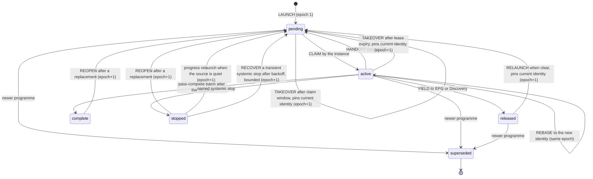
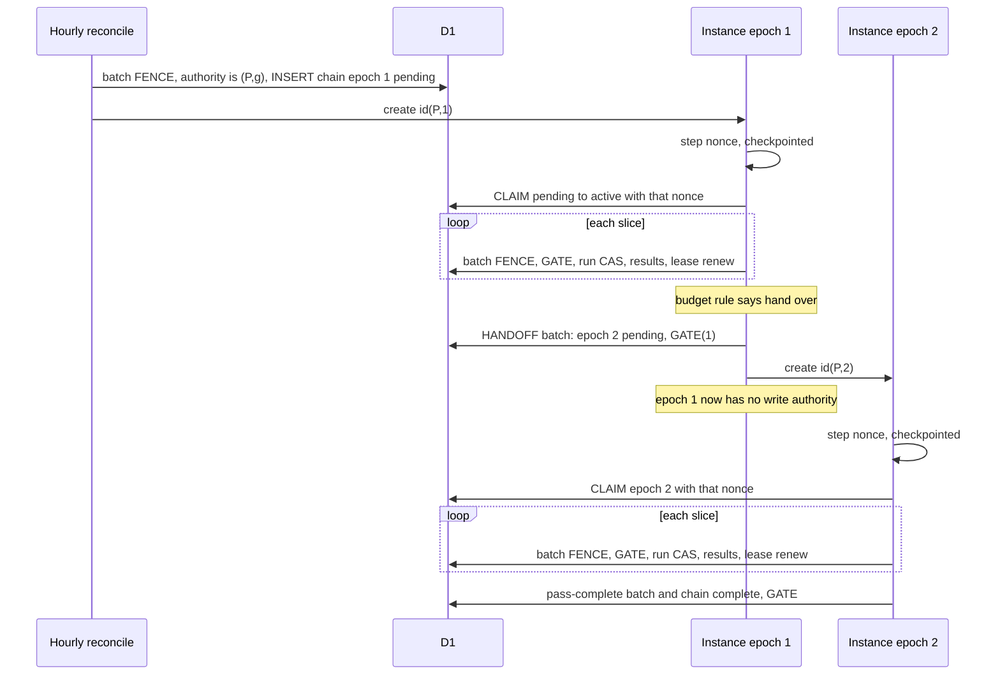
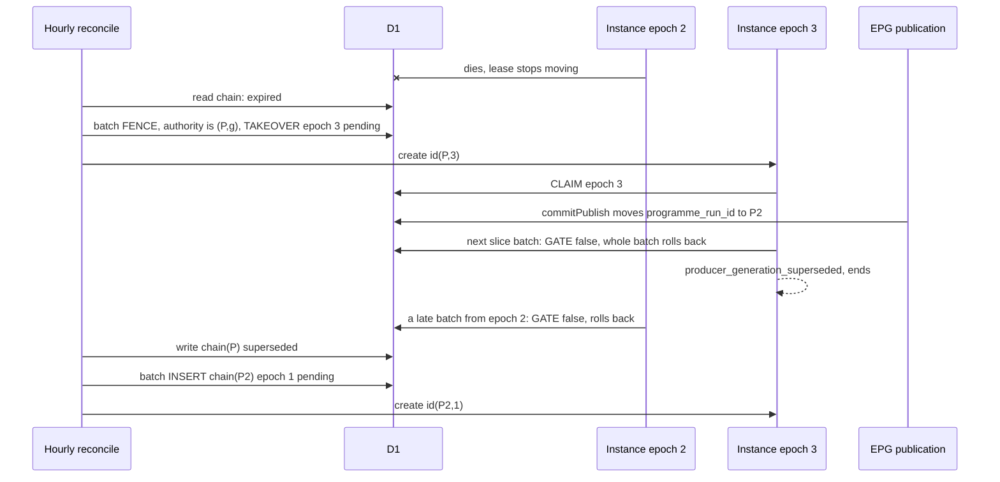
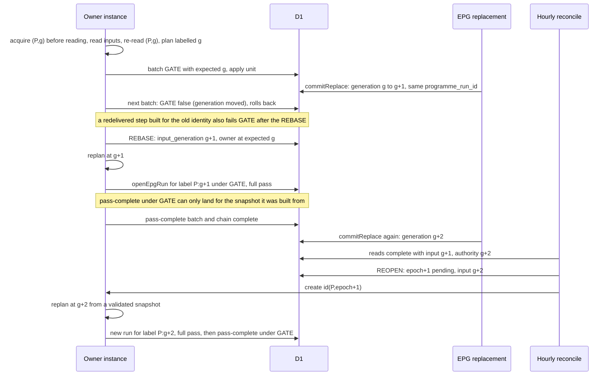
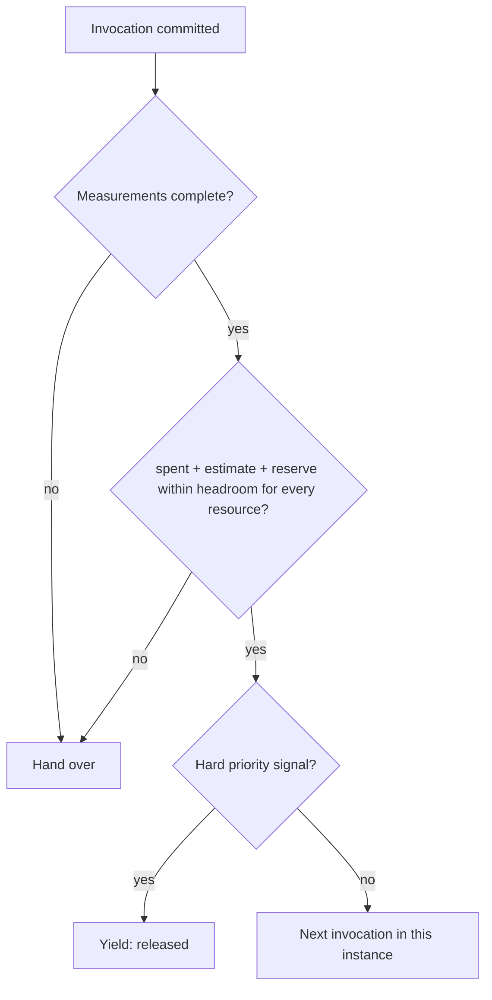

# ADR 0141: The Producer Workflow chain has one epoch-fenced owner per published generation, hands over by a durable claim before `create()`, pins every write to the latest published generation inside the write batch, and recovers only through the hourly EPG reconciliation

**Status:** **Proposed** (amended after independent and owner design reviews; design proposal for owner review, it stays Proposed until the owner resolves the options and accepts the finished protocol; no code, migration, Workflow, configuration, flag, schedule or production operation is authorized by this record)
**Original decision date:** unknown (proposal; not yet decided)
**Recorded at:** 2026-11-14
**Approval source:** not yet approved. The scope of this proposal was authorized by the owner decision of 14 November 2026 09:29 UTC on [AIR-374](https://trello.com/c/ha7ais3w#comment-6af82a03b5debcfad1f75466) (analysis, design and a documentation-only pull request; implementation, wiring, Workflow, cron, flag, limit, D1, R2 and migration changes are NOT authorized and need their own approvals after this protocol is accepted) **Partial owner decision of 14 November 2026 ([PR #618 comment 6877030809](https://github.com/vladimino/iptv-watchlist/pull/618#issuecomment-6877030809)):** the owner chooses Option A for the initial safe cutover for T-9, T-11, T-13 and T-14 only (snapshot and recomputation). It is NOT acceptance of this ADR; every other option stays open; no merge, Accepted status, implementation, migration, configuration, Cloudflare operation or production cutover is authorized. **Second partial owner decision of 14 November 2026 ([PR #618 comment 6877388086](https://github.com/vladimino/iptv-watchlist/pull/618#issuecomment-6877388086)):** the owner approves Option A for T-12 only (the explicit retry pass is refused while the chain is `pending` or `active`, even with an expired lease). It is NOT acceptance of this ADR; all other options stay open. **Third partial owner decision of 14 November 2026 ([PR #618 comment 6877480306](https://github.com/vladimino/iptv-watchlist/pull/618#issuecomment-6877480306)):** the owner approves Option A for T-2 and T-3 only (launch and relaunch only through the existing hourly reconciliation; up to about one hour plus lease expiry and margin accepted for a truly dead Producer Workflow). It is NOT acceptance of this ADR and does not satisfy or waive the progress gate G-P. **Fourth partial owner decision of 14 November 2026 ([PR #618 comment 6877979499](https://github.com/vladimino/iptv-watchlist/pull/618#issuecomment-6877979499)):** the owner approves Option A for T-1 only (a separate `canonical_producer_chain` table for the initial safe cutover, no further conditions). It authorizes no schema, code, migration or production change, does not accept this ADR and does not allow a merge. **Fifth partial owner decision of 14 November 2026 ([PR #618 comment 6878076863](https://github.com/vladimino/iptv-watchlist/pull/618#issuecomment-6878076863)):** the owner approves Option A for T-5 and Option A for T-6 only (the atomic snapshot and ownership `GATE`; conservative pre-measurement instance metering). It authorizes no schema, code, migration, Cloudflare or production change, does not accept this ADR and does not allow a merge. **Sixth partial owner decision of 14 November 2026 ([PR #618 comment 6878265393](https://github.com/vladimino/iptv-watchlist/pull/618#issuecomment-6878265393)):** the owner chooses T-7 Option B (bounded automatic recovery with backoff for recoverable systemic stops; an architecture direction, NOT an approved implementation or approved numbers) and T-8 Option A (the existing Workflow binding and Film/Person authority marker only, no additional Producer flag or binding). It authorizes no schema, code, migration, Cloudflare, configuration or production change, does not accept this ADR and does not allow a merge.
**Related work:** [AIR-374](https://trello.com/c/ha7ais3w), [ADR 0140](0140-producer-workflow-adaptive-successor-chain.md) (Accepted as DESIGN; this record refines its decisions 3, 5, 6, 7 and 8 and does not revisit its other decisions), [ADR 0128](0128-epg-canonical-producer-durable-execution.md), [ADR 0137](0137-left-plan-settlement-from-sealed-newer-input.md), [ADR 0098](0098-discovery-workflow-step-failure-recovery.md) (precedent, not proof), [ADR 0094](0094-discovery-workflow-invocation-budget.md) (precedent for a measured instance budget), [ADR 0100](0100-epg-cloudflare-workflow-executor.md), [ADR 0135](0135-epg-priority-discovery-pause.md), [M1 limits evidence](../evidence/d1-migration/air-374-m1-workflow-limits-2026-11-14.md), [S5-1 gate evidence](../evidence/d1-migration/air-374-s5-1-nextaction-gate-2026-11-13.md), [producer driver reference](../reference/data/producer-driver.md), [producer run store reference](../reference/data/producer-run-store.md)
**Supersedes:** None. It does not change [ADR 0140](0140-producer-workflow-adaptive-successor-chain.md), [ADR 0128](0128-epg-canonical-producer-durable-execution.md) decision 8 or any other Accepted record
**Superseded by:** None

## How to read this record

Every statement carries one of three marks, so a reviewer can tell what was read from what is proposed:

- **[code]** was read in the repository at the cited `file:line` (lines are those of `main` when this record was written).
- **[proposal]** is a design choice made here. Nothing exists for it yet.
- **[unverified]** is a platform or runtime behaviour this record does NOT source. It is listed in [Verification obligations](#verification-obligations-nothing-below-is-established) and must be settled by a primary-source reading or a bounded measurement before the dependent step is built. No numeric threshold is invented here: a number that needs a measurement is a named **parameter** (`PARAM-n`), never a value.

## Context

[ADR 0140](0140-producer-workflow-adaptive-successor-chain.md) fixed the direction: S-A (repeated bounded invocations of ONE run), a separate Producer Workflow started after the EPG commit (W3), an adaptive chain of instances (not one instance per 1,000 units), the default `limits.subrequests` of 10,000 per instance, and isolation from the EPG publication. It deliberately left the mechanism open: the hand-off, the exclusive-ownership proof, the generation fence, the failure windows and the budget rule. The owner decision of 14 November 2026 09:29 UTC asks for one concrete protocol covering six requirements (ownership and hand-off, generation fencing, a failure-recovery table, adaptive bounded execution, verification, storage justification). This record is that protocol. It is a proposal: the four inputs fixed by ADR 0140 (S-A, W3, adaptive successors, default limits, EPG isolation) are not reopened here.

What the code does today (all **[code]**):

1. **The producer run is already a revision-CAS row, but it carries no owner.** `canonical_producer_run` has a `revision` column and no owner, lease or epoch column ([migration 0020](../../migrations/0020_canonical_producer_run.sql) lines 45 to 86; `pass_state` allows `passing`, `passed`, `stopped`, `superseded` at line 58). Every store write asserts `casRun(run)` (the stored revision equals the one read; `src/canonical-producer-store.js:29`) and `changes()=1` (line 30) inside ONE `batch()` that also starts with the marker fence (line 31, 59 to 66, `SLICE_STATEMENT_CAP` 48 at line 21). A lost compare-and-set is named `producer_cas_lost` (lines 41 to 58). A revision compare-and-set therefore proves that nobody moved THIS ROW since it was read. It does not prove that the caller is the only instance working on the run: two instances that read the same revision race, one wins, and the loser is told only after its units were applied.
2. **The fences that exist assert the Film/Person marker, not the published generation.** `FENCE` asserts `film_person_authority` is `d1`/`open` at the generation read (`src/canonical-mutations.js:20`). `assertSql(condition)` is one upsert into `film_person_cas` whose `ok` column is `CHECK (ok=1)`, so a false condition rolls the whole batch back (`src/canonical-mutations.js:19`). `head(gate, entities)` builds `[FENCE, REVISION...]` (lines 88 to 92) and is called from eleven places: `src/canonical-film-writers.js:266`, `src/canonical-mutations.js:109, 147, 194`, `src/canonical-person-state.js:221, 242`, `src/canonical-receipts.js:339`, plus the non-producer callers `film-admission.js:93, 138`, `localization-sources.js:169`, `tmdb-retirement-decisions.js:154`. Nothing in any of them looks at `published_epg_authority.programme_run_id`.
3. **The published input moves in two ways, and only one changes `programme_run_id`.** `commitPublish` moves `published_epg_authority.programme_run_id` and increments `generation` when `stage.phase==='published'`, and only increments `generation` otherwise (`src/published-epg.js:296` to `304`). `commitReplace` increments `generation` and rewrites the programme, show, member and document rows IN PLACE under the SAME `programme_run_id` (`src/published-epg.js:318` to `343`). A pin on `programme_run_id` therefore does not show that a plan is current. The commit batches are fenced `batch()` calls with a `published_epg_cas` check after each decisive statement (`FENCE_SQL`, line 23); the file also documents the precedent for carrying a fence with a commit and asserting it in the batch's own statement (`epgFenceStatements`, lines 24 to 31).
4. **The EPG executor already solved lease, takeover and create ordering for itself, in its own documents.** `LEASE_MS=5 min` and `BOUNDARY_MARGIN_MS=15 s` (`src/epg-orchestration.js:24`); `leaseLive` treats a lease as live until expiry plus the margin (line 115); a holder refuses to act at `expires-margin` (line 159); instance ids are deterministic, `epg_<runKey>_<series>` (line 30); `casDoc` is the compare-and-set on the stored document revision (line 47); `createError` classifies a thrown create as `exists` or `uncertain` (line 90); the control row is written BEFORE `create()` and an existing instance attaches (lines 507 to 533); `instanceStatus` of `unknown` holds instead of proving death (lines 513 to 515). The hourly `ensure` runs `reconcileMirrors` and then `ensureWorkflow` as separate steps and returns results instead of throwing (lines 483 to 487).
5. **Those documents cannot host the producer's ownership.** `epg_orchestration_document.key` is `CHECK (key IN ('mode','control','lease'))` ([migration 0017](../../migrations/0017_epg_orchestration.sql) line 37); a new key needs a migration, and the `control` row is the EPG executor's own series state, so reusing it would couple the producer to the executor's CAS domain and failure budget, which ADR 0128 guardrail G6 and ADR 0140 decision 2 forbid.
6. **Discovery is the precedent for a measured instance budget.** The Discovery Workflow wraps its D1 binding in a counting proxy (`meterD1`/`meteredEnv`, `src/discovery-workflow.js:303` to `322`), writes its state BEFORE `create()` and attaches on `exists` (lines 533 to 561), and hands over at a counted level rather than a guessed one ([ADR 0094](0094-discovery-workflow-invocation-budget.md): both failing instances died near 12.2 thousand D1 statements; it hands over at 6,000; the platform limit itself was not established).

What the platform documents (checked against the Cloudflare documentation search, **[code]-level confidence is NOT claimed**; each item is also an obligation below): D1 `batch()` statements run as one SQL transaction with a full rollback when one fails; a batch counts as one query against the per-invocation query limit; `create()` with an id that already exists within retention throws; `get(id)` throws when the id does not exist; instance ids are unique per Workflow. A throw from `create()` is not a statement about the instance.

## Decision (proposal)

### D0. Three concepts, which couplings are required, and what "current" means **[proposal; evidence marked per row]**

The first revisions of this record treated the published authority counter as the version of every canonical projection (`source_generation := P:g`, a new run and a full pass per increment). The owner design review asked for a proof of which couplings are actually needed. This section separates three concepts and derives, from code, which coupling each one needs. **Its conclusion is that the full pass per label is the sound baseline; a cheaper fast path is not proven and is NOT proposed here (D0.4, D0.5).**

**D0.1 Three concepts that must not be merged.**

| Concept | What it is | Identifiers and fields (code-derived unless marked) | Compared by |
| --- | --- | --- | --- |
| **(i) Canonical identity and durable facts** | The Film and Person a fact is about, and the facts themselves. Stable whatever the EPG publication version. | Unit ids `film:*` and `person:*` (`src/canonical-epg-producer.js`, the `film:` prefix check in `planEpgUnits`); entity rows and the per-entity revision `canonical_revision`, asserted by `REVISION` in every writer batch (`src/canonical-mutations.js:21`, `88` to `92`) | `REVISION` (per entity), never by `P` or `g` |
| **(ii) Source snapshot identity and the latest-source fence** | The identity of the published input a PLAN was built from: `S = (P, g)`, `P = programme_run_id`, `g = authority generation`. It says what a planned write was derived from and whether that source is still the latest. | `published_epg_authority.programme_run_id`, `.generation`, `.watchlist_generation` (`src/published-epg.js:164` to `195`); the chain's `input_generation`; `:expectedInputGeneration` in `GATE` (D4) | `GATE` and `RETRY_GATE`, in the write batch (safety) |
| **(iii) Projection completion and freshness** | Whether the plan built from a snapshot has been completely visited and applied. | `canonical_producer_run`: `fingerprint`, `pass_state`, `applied_generation`, `open_at_completion`; the live `film_facts` results (`liveMembershipCount`, `src/canonical-producer-store.js:119`); `canonicalFreshness` (`src/canonical-producer-run.js:413` to `422`) | `canonicalFreshness` and `readerDecision` (readers) |

`P` and `g` never change a Film or Person id, a unit id, a request id (`producerRequestId` takes event, target and content digest, `src/canonical-producer-adapters.js:65`) or a durable fact. The snapshot label of a run labels concept (iii)'s claim: "the plan built from snapshot S was completely visited under the fence". It is not a version of the Film or the Person.

**D0.2 Change-impact matrix (what each publication or replacement does, from code).**

| Change | What the code does | Can the producer's projection change? | What makes a planned write stale |
| --- | --- | --- | --- |
| `commitPublish`, phase `published` (new `P`) | moves `programme_run_id`, `generation`+1 and `watchlist_generation`+1 (`src/published-epg.js:302`, `303`); inserts the whole new generation rows | Yes: a new programme and membership | `P` moved: every write planned from the old `P` |
| `commitPublish`, phase other than `published` (withheld) | `generation`+1 only (`src/published-epg.js:304`); the pointed `P` rows are not touched (the staged rows belong to the other target) | No for the pointed rows (derived from the statements above) | `generation` moved: the fence rejects a write whose projection would be identical (conservative) |
| `commitReplace(kind='programme')` through `patchProgramme`, called by Discovery's `attachWatchlistShowing` (`src/discovery.js:605` to `623`, per matched Film at `820` and `978`) | `generation`+1, `watchlist_generation` unchanged (`src/published-epg.js:318` to `343`); rewrites the programme document, the `programme` members and ALL shows of `P` in place. The patched Film item gets `canonicalIdentity`, merged `aliases`, merged shows and `hotEnteredAt` (`src/discovery.js:307` to `312`) | Depends on the wiring: identity and aliases are Film facts; showings and `hotEnteredAt` are not among the digested content keys (`CONTENT_KEYS` is `film`, `evidence`, `dimensions`, `localization`, `metadata`, `sync`, `watchlist`, `src/canonical-producer-adapters.js:36`). Which published fields the S5-1 wiring maps into those keys is **unknown** (the planner takes injected inputs) | `generation` moved |
| `commitReplace(kind='watchlist')` through `saveWatchlist`, called by `persistWatchlist` after an EPG sync when the list changed (`src/worker.js:711`) | `generation`+1 and `watchlist_generation`+1; rewrites the watchlist document and the `watchlist` members, no shows | Yes, it MAY: a Film added to or removed from the list changes `watchlist` of its `film_facts` unit and the `departed` release set (`planEpgUnits`, `src/canonical-epg-producer.js`); film entries of the list may also change | `generation` moved |
| Inputs OUTSIDE the published rows: the metadata and sync objects, the dictionary store, TMDB retirements, prerequisites stamps, Discovery state | None moves the authority counters. They enter the plan through the injected inputs; refusal prerequisites are compared by the lazily revalidated `prereq_stamp` (ADR 0128), not by the fingerprint | Yes | Nothing (no authority change). A pass that completed is not re-evaluated when only these change; a run still `passing` replays by fingerprint drift (`resumeDecision`, `src/canonical-producer-run.js:152` to `159`). This is today's behaviour and is not changed |

**What the matrix does and does not prove.** A `g` increment makes every plan built from the older snapshot stale for WRITING (the fence) and makes an old claim stop matching the label (readers). It does not say the projection changed: a withheld publish, a showings-only patch or a `hotEnteredAt` change may change nothing the plan digests. The plan fingerprint tells whether the SOURCE plan inputs are equal to those of an earlier plan. It does NOT tell whether the CURRENT canonical rows equal what that earlier plan applied: canonical rows are written durably unit by unit, before any pass completes, and by other writers too (D0.4, D0.7). So the fingerprint is useful for resuming a run of the same label and for cost estimates; it is not a proof of canonical state. No static classification of replacement kinds is needed or proposed: a watchlist-only replacement is NOT declared irrelevant (it may change membership) and a programme-only replacement is NOT declared relevant.

**D0.3 Safety is not recomputation policy. What each needs.**

- **Safety needs `S` per write, nothing more.** A write planned from snapshot `S0` must not land after the source moved, because its content may differ from what the new snapshot would write. The fence is `GATE` with the caller's `:expectedInputGeneration` (D4). It needs no run identity: it compares the authority with the plan's own identity. It stays exactly as designed; no fence is weakened to save work. Fencing on `P` alone is rejected (a watchlist removal after planning would let the old plan re-assert membership).
- **No false `current` needs a label that changes when the source moves.** `canonicalFreshness` compares the claim `applied_generation` with the published generation string (`src/canonical-producer-run.js:420`), and `epgRunForGeneration` returns a `passed` run before a `passing` one for the same label (`src/canonical-producer-store.js:94` to `98`). With the label equal to `P` alone, a `passed` claim of an old plan would keep matching after a plan-changing replacement. A reader that cannot replan must be able to tell, from the authority row alone, that a claim is about an older snapshot: the label carries `g` (`P:g`, as the existing pointer fence already carries `d1:<generation>:<programme_run_id>`, `src/published-epg.js:201`).
- **A claim of completion needs a full visit.** The Accepted schema fixes how a completed claim is superseded: a `passed` run is never updated again (`canonical_producer_run_applied_once`, migration 0020 lines 199 to 204), `source_generation` and `run_key` are immutable (lines 172 to 177) and a new row is inserted `passing` with `pass_no` 1 and no cursor (`canonical_producer_run_insert_shape`, lines 145 to 150). So a new snapshot gets a NEW run row, and that run completes only when its pass has visited every unit. **The visit is not waste: it is what re-establishes that the canonical rows equal the plan.** Each unit apply is state-based (`prePlanFilmFacts` reads the stored rows and opens no batch when they already match, `src/canonical-producer-adapters.js:72`, `142`, `153`), so a visit repairs any drift and costs only a read when nothing differs.

**D0.4 Options evaluated.**

| Option | Rule | Safety | No false `current` / no stale rows | Complexity and scope | Worst-case forward progress |
| --- | --- | --- | --- | --- | --- |
| **A** (baseline, recommended) | label `P:g`; every new snapshot opens a new run row and a full pass; the claim is written only when the pass has visited every unit and the cross-run sweep has run (`supersedeEarlierResults` before `commitPassComplete`, `src/canonical-producer-driver.js:313` to `335`, ADR 0137) | yes | **yes, by construction**: no claim is derived from anything but a completed visit of the plan at that snapshot | run key must differ from the plan event (today `runKey:event`, `src/canonical-producer-driver.js:357`), reader label change, numeric ordering of `g`; no schema or trigger change | any restarting increment during a pass restarts it; it completes only in a window of one full pass without one |
| **B** (fence only, label `P`) | `S` is only a fence; the claim stays per `P` | yes | **no**: an old `passed` claim keeps matching label `P`, and `epgRunForGeneration` prefers it over a newer run of the same `P` | stamp storage plus lineage plus an ordering gap (`order(a, b)` cannot order two runs of one label, `src/canonical-producer-driver.js:175`) | n/a |
| **C, ATTEST** (WITHDRAWN by this revision) | when the replanned fingerprint equals the earlier `passed` run's, write a `passed` run for the new label with no unit visit | yes | **no**, two counterexamples below | n/a | n/a |
| **D** (policy, complementary to A) | start or continue the pass only when no Discovery attach or watchlist save is in flight (hard yield to Discovery instead of the soft yield of T-4) | yes | yes | one more signal (V-13) | removes the main known source of restarts from the pass window at the cost of delaying the pass behind Discovery |
| **E** (rejected) | `S` fence on `P` only | **no** | no | smallest | n/a |
| **F** (not proposed) | carry the cursor of an UNFINISHED run into the new label when the fingerprint is equal | unproven | unproven: has the same two defects as C for the visited prefix | speculative; needs its own evidence | n/a |

**Why ATTEST is withdrawn (two counterexamples from review, both confirmed against the code).**

1. **Equal source inputs do not imply equal canonical rows.** `g0`: Film A `watchlist=true`, run R0 `passed`. `g1`: A is removed; the `g1` pass applies `watchlist=false` to A and stops before completing, or completes. `g2`: A is added back and the plan fingerprint equals R0's. ATTEST would write a `passed` claim for `g2` with zero visits while D1 still holds `watchlist=false` for A: a false `current` with wrong membership. Unit writes are durable before any pass completes (`commitSlice` and `passed` are not a rollback boundary), so checking only the latest `passed` run cannot cover the partial writes of an intervening unfinished pass, of a direct retry, or of any other canonical writer.
2. **ATTEST skips the cross-run sweep.** `g1` adds Film B and its unfinished pass leaves a live `refused_permanent` result for B; `g2` returns to the `g0` plan (B absent). ATTEST visits no unit and runs no sweep, so the live result stays and freshness never becomes `current`. The sweep (`supersedeEarlierResults`) runs inside a visiting pass before `commitPassComplete`.

**Is there a simple sound proof of current-state equivalence? No, and the conclusion follows.** A sound ATTEST would have to prove that every canonical row the plan covers equals the plan's effect now. The writers that can change those rows after R0 are not limited to the chain: the explicit retry pass (`retryEpgProducerResults`), Discovery admission (`src/film-admission.js`), localization sources (`src/localization-sources.js`), TMDB retirement and merge (`src/tmdb-retirement-decisions.js`, `mergeFilms`), the enrichment projector and owner review writers, all through the same `head` fence (call sites listed in D4). The run row stores a fingerprint, a cursor and counters, not per-entity applied effects or revisions (migration 0020), and receipts are per request, not per state. A proof would need an applied-state watermark per entity and a bounded, resumable, generation-proven check across all those writer paths, plus the sweep and ADR 0137's sealed-input and ordering requirements. That is not simple and not designed here. **Conclusion: Option A is the sound baseline. Any fast path is a separate future proposal that must first measure the cost of a visit (V-22) and then prove state equivalence across every writer path; none is part of this record.**

**D0.5 Conclusion (a recommendation, not a decision).** `(P, g)` IS warranted as the per-write fence and chain pin (concept ii) and as the label readers compare (so that no stale claim reads `current`). A NEW FULL PASS PER LABEL is the sound baseline because the visit is what proves the canonical rows equal the plan. The cost of repeating it when nothing changed is an open measurement (V-22), not a reason to skip the proof. Option D is a separate scheduling choice (T-4, T-14). **Partial owner decision ([comment 6877030809](https://github.com/vladimino/iptv-watchlist/pull/618#issuecomment-6877030809), 14 Nov 2026): Option A is CHOSEN for the initial safe cutover** (keep the snapshot identity and write fence `(P, g)`, use `P:g` as the claim label, require a full, bounded, resumable pass per newly published snapshot, including the ADR 0137 cross-run settlement, before the label reads `passed`/`current`). ATTEST is deferred as an optional, independent later optimisation, not an automatic follow-up or prerequisite, reconsidered only on evidence of meaningful cost AND a correctness proof of present canonical-state equivalence and prior-result settlement across intervening runs and all writer paths. It is not built or repaired here. This does not accept the ADR. The choice is conditional on the mandatory pre-cutover progress gate (D10a).

**D0.6 Cost and liveness, with evidence levels.**

- **Code-derived structure:** Discovery attaches showings film by film and each attach is one `commitReplace(programme)` and one generation increment (`src/discovery.js:605` to `623`, `820`, `978`); the Discovery series opens as soon as the generation is published ([ADR 0030](0030-discovery-queued-at-publication.md)); a watchlist save is one increment per changed list (`src/worker.js:711`). So increments overlap the producer pass window by design.
- **Model (not measured):** the synthetic plan has 7,240 units and needs at least 8 invocations at a ceiling of 1,000 units ([AIR-465](../evidence/d1-migration/air-465-m2b-synthetic-scale-2026-11-14.md), [ADR 0140](0140-producer-workflow-adaptive-successor-chain.md)); the 30,999 prepared statements of that model are APPLY costs, not the cost of re-visiting an already applied unit. A unit whose facts are already stored is a no-op that opens no batch (`applyFilmFacts`, `src/canonical-producer-adapters.js:142`, `153`), but its read cost per unit is **unknown**, as is the cost of building the plan.
- **Unknown:** the real frequency of increments per kind (the authority keeps counters, not a history; replacements leave no row), the real pass duration, the fraction of increments that change the plan.
- **Liveness statement.** Let `T` be the time one full pass needs. Under A the pass completes only if some window of length `T` contains no restarting increment, and every increment restarts it. The chain can therefore restart perpetually and keep freshness `lagging` when increments arrive faster than `T`, and no design inside this record's limits (no delta engine, no weakened fence, no unproven fast path) can promise otherwise. What is bounded: the rebase cap (`PARAM-rebase-cap`) stops a live owner, the chain REOPENs at most once per hourly tick, and the canonical projection still converges, because every visited unit is applied durably even when the claim never completes. The code-derived bound on increments and the mandatory progress gate are in D10a. What must be measured: increments per hour per kind (a counts-only delta of `generation` and `watchlist_generation` at the hourly tick needs no new writer, V-21), how often a replan finds units to change, the plan-build cost and the no-op re-visit cost per unit (V-22).

**D0.7 Correctness across transitions and state histories (Option A).**

| Scenario | No stale write | No false `current` | No silent missed update | Eventual completion |
| --- | --- | --- | --- | --- |
| New `P` | the chain of the old `P` fails `GATE` (`P` moved) | the new label has no claim until its pass completes | the new plan is built from the new snapshot and fully visited | needs a window without restarting increments |
| Same `P`, `g` moves, nothing the plan digests changed, run `passed` | no run is active; a retry is refused by `RETRY_GATE` on the moved identity | label `P:g1` has no claim until its pass completes (`lagging`) | the full visit finds nothing to write | one full pass of reads |
| Watchlist add or remove | the old plan's writes fail `GATE` | the old claim has label `P:g0`: not `current` for `P:g1` | the new plan carries the changed units; the visit applies them | as above |
| A Film or Person attribute or credit change through published rows | as above | as above | as above | as above |
| The same change through inputs outside the published rows | no authority change, no fence event | the claim stays for its label (today's behaviour) | picked up by fingerprint drift while `passing`, otherwise by the next EPG run (unchanged, stated, not new) | n/a |
| Change before the pass, during it, after `passed` | before: the plan already includes it; during: write fails `GATE`, REBASE, replan, new run; after: REOPEN, new run | label guarantees it | the full visit covers it | as above |
| REBASE and a stale in-flight step | the step's own `:g` fails `GATE` | n/a | n/a | n/a |
| Unfinished pass | the unfinished run's writes fail `GATE`; its row is left | no claim for the new label until the new run completes | the new run replans and visits everything | needs a restart-free window |

**State-history matrix (the review's interleavings; Option A, and what ATTEST would have claimed).**

| History | What the canonical rows hold | Option A | ATTEST (withdrawn) |
| --- | --- | --- | --- |
| H1: `g0` passed; `g1` applied and passed (A removed); `g2` plan equals `g0` | A `watchlist=false` | the `g2` run visits A, stored `false` differs from the plan, applies `true`; claim only after the full pass and the sweep | claim with no visit: false `current`, wrong membership |
| H2: `g0` passed; `g1` PARTIALLY applied (A written, pass stopped); `g2` equals `g0` | A `watchlist=false`, other `g1` effects partly written | the `g2` run revisits every unit, repairs A and every other drifted unit; sweep settles the `g1` run's live results by numeric `g` order (`g1 < g2`) | false `current` |
| H3: `g1` left a live `refused_permanent` result for B; `g2` plan has no B | B's failure is a live result | the `g2` pass reaches the sweep before `commitPassComplete`; with sealed provenance the result is settled `left_plan` (ADR 0137); without provenance the driver settles nothing and `open_at_completion` is above zero, so freshness reads `partial`, never a false `current` | no visit, no sweep: the result stays live, never `current` |
| H4: a direct retry ran between the runs (`RETRY_GATE` allowed it while the chain was `complete`, `released` or `stopped`) | rows consistent with the retry's plan at its own `(P, g)` | the new run's full visit re-establishes equality for every unit; the retry's per-row results are decided by `retryDecision` against the current plan | not covered by the claim |
| H5: another canonical writer (Discovery admission, projector-class, owner review, TMDB merge) changed Film F after R0 | F differs from R0's effect | the new run visits F and applies the plan's facts through the same fenced writer with `REVISION` against the revision read at apply time; writer precedence is the existing contract, not changed here | not covered |
| H6: nothing changed except `g` | rows equal the plan | the full visit is reads only; cost unmeasured (V-22) | claim without visit |

**Existing-contract checks.** `canonicalFreshness` and `readCanonicalFreshness` take the published generation as a string and compare by equality (`src/canonical-producer-run.js:413` to `422`, `src/canonical-producer-driver.js:476` to `483`): the label `P:g` needs no change to them, only the string the readers pass (V-14). `inputProvenanceOk` requires `provenance.publishedGeneration === sourceGeneration` (`src/canonical-producer-driver.js:211`): the sealed provenance must state the label `P:g` it was sealed for, taken from the same validated snapshot (D0a). [ADR 0137](0137-left-plan-settlement-from-sealed-newer-input.md) requires a monotone ordering of generations supplied by the caller; the authority `generation` is one integer that every publish and replace increments in the same fenced batch (`src/published-epg.js:302` to `304`, `318` to `343`), so ordering two labels is a numeric comparison of `g`, not a string comparison and not an ordering of programmes (V-19: no revert or import path may lower it). ADR 0140's full-pass and generation-fence direction is preserved, and no Accepted contract is changed.

### D0a. Input snapshot binding: an invariant, not a wiring detail **[proposal]**

A plan is built from many reads (paginated; `runEpgProducerPass` builds the plan from its inputs, `src/canonical-producer-driver.js:348`). The identity attached to a plan must therefore be the one the rows were really read at. The protocol requires, for every plan acquisition by a chain owner and by the explicit retry pass:

1. **Acquire before reading.** Read the authority once: `(d1, open, P, g0)`. This `g0` is the ONLY identity the plan will ever carry. A later read of the authority never relabels it.
2. **Read** all published-row inputs of the plan, page by page.
3. **Revalidate after reading.** Read the authority again. If it is not exactly `(d1, open, P, g0)`, DISCARD the plan, apply nothing, and replan from step 1 (a chain owner through REBASE, D3b, bounded by `PARAM-rebase-cap`; the retry pass stops with `producer_input_superseded`).
4. **Write under the label.** Every batch of the plan carries `:expectedInputGeneration = g0` (D4), so a replacement after step 3 fails the write batch itself.

Why steps 1 to 3 close the mixed-snapshot window: every change of the published rows is made by a fenced batch that also increments `generation` in the same transaction and never decrements it (`commitPublish` and `commitReplace`, `src/published-epg.js:296` to `343`; the legacy publish, line 586), so a read of `generation = g0` before and after the reads proves that no such change committed in between and every page was read at `g0`. This rests on two facts that are **[unverified]** and listed as V-17 and V-18: that NO other writer changes `published_epg_document`, `published_epg_member` or `published_epg_show` without a `generation` increment (S5-1 proves it by an audit of the writers), and that the reads of steps 1 to 3 see the primary's committed state in order (D1 read replication or session bookmarks must not make step 3 stale). Plan inputs that are NOT published rows (the metadata cache, Discovery state, prerequisites) are not covered by `I`; they stay under the fingerprint-drift replay of ADR 0128 (F13). Where a verified sealed snapshot of the published rows exists it may replace steps 1 to 3; none is assumed.

### D1. One durable chain row per published programme, separate from the run row **[proposal]**

A new table `canonical_producer_chain` (proposal only; a migration is a separate approval, see [Storage](#storage-what-is-reused-what-is-new-and-why)) holds the ownership of the chain of ONE published programme `P`. Its CAS domain is its own revision, separate from the run row's.

| Column | Meaning |
| --- | --- |
| `programme_run_id` (primary key) | The published programme the chain serves |
| `input_generation` | The authority `generation` `g` of the input identity the chain currently works on. Moved only by REBASE, REOPEN or LAUNCH, never by the owner's slices |
| `run_key` (nullable) | The run key of the run of the current input identity, filled by the first `openEpgRun` |
| `owner_epoch` | Monotone fencing token, `>= 1`, rises ONLY by a compare-and-set batch that read the previous value |
| `owner_instance` | `pw_<hash(programme_run_id)>_<epoch>`: deterministic and derived, stored for diagnosis |
| `claim_nonce` | A random value fixed BEFORE the CLAIM mutation (D2), part of every ownership assertion |
| `owner_state` | `pending`, `active`, `released`, `complete`, `stopped`, `superseded` |
| `lease_expires_at` | `pending`: end of the claim window. `active`: lease end, renewed by every slice commit. `released`: time of the release |
| `handoff_count`, `takeover_count`, `rebase_count`, `stopped_by` | Counts and a named code only (no ids, no content) |
| `recovery_class`, `recovery_attempts`, `streak_started_at`, `next_attempt_at`, `progress_relaunches` | The durable state of the bounded automatic recovery of D3R (T-7): the class of the last stop, the consecutive non-progress stops, when that streak started, the durable due time of the next attempt and the number of progress relaunches. Counts, times and a named class only |
| `revision`, `created_at`, `updated_at` | The chain row's own compare-and-set and times |

A trigger refuses writes outside `d1`/`open`, a change of the key or `created_at`, a `revision` that does not rise by one and a decreasing `owner_epoch` (the trigger pattern of migration 0020).

### D2. Ownership protocol: the exact order of transitions and writes **[proposal]**

An instance with epoch `e` owns the chain only while the chain row says `owner_epoch=e`, its own `claim_nonce`, `owner_state='active'`, and the authority still says `I`. The proof is asserted INSIDE every write batch (D4), never read first and written later.

**Launch** (ONLY through the hourly reconciliation, D6; chosen for T-2 by the partial owner decision [comment 6877480306](https://github.com/vladimino/iptv-watchlist/pull/618#issuecomment-6877480306): no best-effort launch call from the EPG post-commit tail, no new scheduler, no Scheduled Task, no new cron entry; the EPG publication is decoupled from any producer launch failure):

1. L1. Read the published authority (`d1`/`open`, `P`, `g`) and the chain row of `P`. No chain row and no passed run of identity `P:g` means launch.
2. L2. Batch: `[FENCE, authority is (P,g), INSERT chain(P, input_generation=g, epoch=1, owner_instance=id(P,1), state='pending', lease_expires_at=now+PARAM-claim-window) ON CONFLICT DO NOTHING, assert changes()=1]`. A concurrent launcher loses on the primary key and does not create.
3. L3. `create({id: id(P,1), params: {programmeRunId: P, epoch: 1}})`. The ownership state is already durable; the create's outcome changes nothing in D1.

**Claim** (the first steps of every instance). The nonce is fixed durably BEFORE the mutation, because a random value generated inside the side-effecting step is not stable when D1 commits and the step fails before its result is checkpointed:

1. C0. `step.do('nonce')`: no D1 or other side effect, returns a random value `n`. A retry of this step before its result is stored may return a different value, which is harmless because nothing has used the value yet. The stored result is the only nonce this instance will ever use.
2. C1. `step.do('claim', n, g_now)`: the instance first reads the authority `(d1, open, P, g_now)` (D0a step 1). A claim ADOPTS the current identity, which is safe because nothing has been planned yet. Batch: `[FENCE, authority is (P, :g_now), UPDATE chain SET owner_state='active', claim_nonce=:n, input_generation=:g_now, lease_expires_at=now+LEASE, revision=revision+1 WHERE programme_run_id=P AND owner_epoch=:e AND owner_instance=:id AND owner_state='pending' AND revision=:r, assert changes()=1]`. If the authority moved between the read and the batch (a replacement before CLAIM) the batch fails, the instance re-reads and retries (bounded by `PARAM-rebase-cap`), so a replacement before CLAIM needs no reconciler.
3. C2. **Commit succeeded, result lost** (the exact window): the retried claim step receives the SAME `n` from the checkpointed nonce step. Its batch fails (the row is no longer `pending`). It reads the row once: it is the owner iff the row says `active`, its epoch, its `owner_instance` and `claim_nonce=n`. Otherwise it is `not_owner` and ends without writing. A derived nonce `hash(P, e, id)` would also be stable, but identical for two instances started under one id (a platform fault this design treats as impossible but does not rely on), so both would read themselves as owners; a stored random value defeats that, and a derived value is rejected for that reason only. If the checkpointed nonce is unreadable the instance ends as `not_owner` and the chain recovers by expiry (liveness only).

**Work** (every slice):

1. W1. Each slice commit is the existing batch (`fence`, run CAS, result rows, run update, `changes()=1`, `src/canonical-producer-store.js:205` to `222`) plus `GATE` (D4) and the chain lease renewal (`UPDATE chain SET lease_expires_at=now+LEASE, revision=revision+1 WHERE <owner predicate>`). The renewal piggybacks on the commit.
2. W2. Every unit apply asserts the one combined statement `GATE` in its own batch (D4). Every batch carries the plan's own `:expectedInputGeneration` (D4); a slice that finds `not_owner`, `producer_generation_superseded` or `producer_input_superseded` ends or rebases (D3b) with no retry of the failed batch.
3. W3. The instance stops starting new work at `lease_expires_at - margin` of its own clock (the EPG precedent, `src/epg-orchestration.js:159`).

**Hand-off** (the exact order, closing the question about before and after `create()`):

1. H1. The budget rule (D5) decides, at an invocation boundary after a committed slice, to hand over. The cursor is durable in the run row.
2. H2. HANDOFF batch: `[FENCE, GATE(e), UPDATE chain SET owner_epoch=e+1, owner_instance=id(P,e+1), owner_state='pending', claim_nonce=NULL, lease_expires_at=now+claim-window, handoff_count=handoff_count+1, revision=revision+1 WHERE owner_epoch=e AND claim_nonce=:n AND owner_state='active' AND revision=:r, assert changes()=1]`. From this commit the old instance has NO write authority. **Commit succeeded, result lost:** the retried step's batch fails; its read-back finds `owner_epoch=e+1`, `owner_instance=id(P,e+1)` and `owner_state` `pending` or `active` and treats the hand-off as done.
3. H3. `create({id: id(P,e+1), ...})` in a separate `step.do`. Outcomes: success, exit. `exists`: treated as created (the successor's own CLAIM decides). Any other throw, or no answer: bounded retries (`PARAM-create-attempts`), then exit. An ambiguous create NEVER proves that the instance is absent.
4. H4. The successor runs C0 to C2. If it never starts, the claim window ends and the reconciliation takes over with a NEW epoch (D3a).

**Why safe:** ownership (D1 state) moves BEFORE `create()` ([ADR 0098](0098-discovery-workflow-step-failure-recovery.md) and the EPG executor do the same with their own state). A crash after H2 and before H3 leaves `pending` with nobody running (recovered by expiry). A duplicate create or a duplicate instance changes nothing (the nonce-bound CLAIM). Every recovery action takes a new epoch, so no path needs to know whether an earlier instance is dead.

**Separation the owner asked for:** the RUN row revision (`casRun`) fences the cursor and results of the plan; the CHAIN row (epoch, nonce, state, input) is the proof of exclusive ownership. A slice batch asserts both; neither substitutes for the other.

### D3. Transitions other than hand-off **[proposal]**

Every transition is ONE batch `[FENCE, <authority predicate>, UPDATE chain ... WHERE programme_run_id=P AND owner_epoch=:e AND revision=:r AND owner_state <predicate>, assert changes()=1]`. Transitions that START a new instance (HANDOFF, TAKEOVER, RELAUNCH, REOPEN) take a NEW epoch, so none of them needs proof that an earlier instance is dead, and each is followed by `create(id(P,e+1))`. CLAIM, REBASE, YIELD, COMPLETE, STOP and SUPERSEDE do not take a new epoch. The instance status (`running`, `errored`, `unknown`, absent) is telemetry only, never a gate.

**Every transition that (re)starts work pins the chain to the CURRENT identity in the same batch:** it reads the authority `(d1, open, P, g_now)`, asserts `authority.generation = :g_now`, and writes `input_generation = :g_now`. It does not require the old `chain.input_generation` to equal anything. This is what makes a stale input recoverable when no owner is alive.

| Transition | Who | State predicate and extra assertions | Effect |
| --- | --- | --- | --- |
| **a. TAKEOVER** | hourly reconcile | `owner_state IN ('pending','active')` AND `lease_expires_at + BOUNDARY_MARGIN < now` (Worker clock); authority `(P, :g_now)` with the SAME `P`; NO condition on the old `input_generation` | `input_generation=:g_now`, epoch+1, `pending`, new claim window, `takeover_count+1` |
| **b. REBASE** | the owner, in its path | owner assertion with expected identity `:g_old`; authority `(P, :g_new)` with `g_new > :g_old`; `chain.input_generation = :g_old` | `input_generation=:g_new`, epoch and nonce unchanged, `rebase_count+1`; the owner builds a NEW fence object for `g_new`, replans (D0a) and opens run `P:g_new` through `openEpgRun` for a full pass (an unfinished earlier run is left as it is). Past `PARAM-rebase-cap` the chain is `stopped` (`producer_input_unstable`) |
| **c. RELAUNCH** | hourly reconcile | `owner_state='released'`; authority `(P, :g_now)`; no hard priority signal (read first; where one SQL predicate on one table expresses it, the same predicate is asserted in the batch, otherwise the relaunched owner re-checks at its first invocation boundary and yields again at the cost of one claim, V-13); NO condition on the old `input_generation` | `input_generation=:g_now`, epoch+1, `pending`, new claim window, `relaunch_count+1`. Its predicate is disjoint from TAKEOVER's (`released` vs `pending`/`active`) |
| **d. REOPEN** | hourly reconcile | `owner_state IN ('complete','stopped')` AND authority `(P, :g_now)` with EITHER `g_now > chain.input_generation` OR (`owner_state='stopped'` AND `stopped_by` is a PROGRESS stop (`producer_input_unstable`, the rebase cap) AND `g_now = chain.input_generation` AND the authority was quiet for at least `PARAM-quiet` since the stop). A progress stop is not a verdict about the snapshot: it only says the owner could not finish while the source kept moving. Systemic stops (T-7) are not relaunched by this rule | `input_generation=:g_now`, epoch+1, `pending`, pass counters reset, `reopen_count+1`; the new instance replans and runs a full pass of a new run for the label, exactly as after REBASE. Without the second predicate a chain stopped at the LAST increment would stay `stopped` at the latest `g` with no claim forever |
| **e. YIELD** | the owner | owner assertion WITH expected identity `:g` (`c.input_generation = :g`); no authority condition, so a yield stays writable when the input moved | `released`, epoch unchanged. A late YIELD built for an old identity after a REBASE fails (`input_generation` differs) |
| **f. COMPLETE** | the owner | the SAME batch as `commitPassComplete`: `GATE` with expected identity `:g` | `complete` |
| **g. STOP** | the owner | owner assertion with expected identity `:g`; no authority condition | `stopped` with a named code and, for a systemic stop, the recovery class, the streak and the durable `next_attempt_at` (D3R). A late STOP built for an old identity after a REBASE fails |
| **h. SUPERSEDE** | hourly reconcile | a non-terminal chain row whose `programme_run_id` is not the published `P` | `superseded` (hygiene; safety rests on `GATE`). The older run row is left untouched (no new writer) |

**Stale-input recovery with no live owner (bounded).** After a same-programme replacement the chain is recovered by exactly one reconciler batch per state: `pending` or `active` with an expired lease by TAKEOVER, `released` by RELAUNCH, `complete` or `stopped` by REOPEN. None compares against the old `input_generation`, each pins `:g_now` atomically, and each takes a fresh epoch, so no state is stuck. Replacement before CLAIM: the instance re-reads and claims at `g_now` (D2 C1); if it never starts, the claim window ends and TAKEOVER pins `g_now`. Replacement plus death: TAKEOVER. Replacement plus YIELD: RELAUNCH. A live owner is never taken over only because its input is stale: it REBASEs at its next failed batch, and the reconciler waits for its lease. A TAKEOVER that races an owner's REBASE is one compare-and-set on the same `revision`: if TAKEOVER wins, the owner's next batch fails on the epoch and it ends; if REBASE wins, the TAKEOVER's compare-and-set fails and it re-reads.

**Safety does not depend on clocks.** A takeover that races a healthy owner either commits first (the owner's next batch fails its assertion) or loses its compare-and-set because the owner's slice commit bumped `revision`. Clocks affect liveness only. TAKEOVER is performed ONLY by the hourly reconciliation (T-2 and T-3, chosen by the partial owner decision [comment 6877480306](https://github.com/vladimino/iptv-watchlist/pull/618#issuecomment-6877480306)), never authorized by the Cloudflare instance status, and recovers a truly dead chain within about one hour plus the lease expiry and margin; transient failures inside a live instance are not waiting for it. The epoch cap `PARAM-epoch-cap` bounds flapping (`producer_chain_epoch_cap`, `stopped`).

#### D3R. Bounded automatic recovery for systemic stops (T-7, Option B chosen as the architecture direction) **[proposal; every parameter is a proposed, UNMEASURED and UNVERIFIED value, not an approved number]**

Source: the partial owner decision [comment 6878265393](https://github.com/vladimino/iptv-watchlist/pull/618#issuecomment-6878265393). Owner rationale: minimal manual troubleshooting, autorecovery preferred. The previous proposed default (a systemic stop terminal for the same identity) is replaced by the path below. It is a design for independent review, not an unreviewed retry implementation and not numerical settings.

**1. Rule.** A RECOVERABLE systemic stop of the chain is retried automatically, with backoff, by the existing hourly `reconcileProducerChain` (T-2, T-3: no new scheduler, cron or Scheduled Task; the due time is a durable column of the chain row, never an in-memory timer). Every retry is a fresh epoch through the same fenced batch (a RECOVER transition below), so no two writer epochs are active, `GATE` and `(P, g)` apply to everything it does, and the ADR 0137 settlement is unchanged. A pass is `current` only after a complete pass (I-21). **The automatic chain recovery NEVER calls `retryEpgProducerResults`** (ADR 0128 decision 8, T-12): it restarts the pass of the chain, not the retry of failed units.

**2. Error taxonomy (a proposal over the code's classes).** The code classifies a pass-level stop as `systemic` (`ERROR_CLASSES`, `src/canonical-producer-run.js:41` to `51`) and treats an unknown code as `unclassified`, which also stops (line 77). Within the systemic codes this record proposes four recovery classes, each code explicitly assigned; the assignment of each code is itself a review item and unassigned or ambiguous codes default to the fail-closed class:

| Recovery class | Codes (proposed grouping from the code's systemic list) | Automatic behaviour |
| --- | --- | --- |
| **transient** (recoverable infrastructure or race) | `film_person_unavailable`, `producer_transport`, `producer_timeout`, `producer_storage`, `producer_marker_unreadable`, `producer_run_unreadable`, `producer_slice_commit_failed`, `producer_strike_commit_failed`, `producer_cas_lost` | bounded backoff and relaunch (below), counted against the attempt cap |
| **authority** (the marker is not `d1`/`open`) | `film_person_held`, `film_person_not_open`, `film_person_not_projector`, `film_person_transition`, `film_person_baseline_not_verified`, `film_person_fence` | the chain parks; it is relaunched when the marker is `d1`/`open` again; no attempt is consumed because no work was done; bounded by the epoch cap against marker flapping; never retried while the marker denies it (an owner `held` is an owner decision) |
| **terminal** (deterministic configuration, protocol or schema) | `producer_store_missing`, `producer_source_generation_mismatch`, `canonical_producer_invalid`, `receipt_schema_missing`, `receipt_baseline_missing`, `receipt_baseline_exists`, `receipt_atomic_required`, `receipt_conflict`, `receipt_exists`, `receipt_readback_required`, `baseline_over_capacity`, `film_person_run_mismatch`, `producer_replan_unavailable` | NOT retried blindly: safe terminal outcome, visible in telemetry; a new programme `P` still launches its own chain once, and a changed configuration is picked up only by that or by a separately approved step |
| **receipt** (conditional on T-10; today `receipt_state_conflict`, raised by an unresolved receipt, `src/canonical-producer-driver.js:124`, `130`) | `receipt_state_conflict` | if T-10 selects a chain-owned receipt reconcile (D4b, Options B or C): recoverable, the chain reconciles the receipt (bounded by the receipt policy, 5 attempts) before it resumes, and the attempt cap of D3R applies; if T-10 stays explicit (Option A): terminal, cleared by a manual retry that reconciles it |
| **fail-closed** (unclassified, or a code whose class is not yet reviewed, including `owner_review_check_failed`) | `unclassified`, `owner_review_check_failed` and any new code | treated as terminal until reviewed |

**3. Durable state and bounds (the chain row columns of D1).** A STOP (D3g) by the owner writes, in the same owner-asserted batch, `stopped_by`, `recovery_class`, the streak (`recovery_attempts`, `streak_started_at`) and `next_attempt_at = now + backoff(recovery_attempts)`. A stop the owner cannot write (D1 unavailable) leaves the chain `active` with an expiring lease and is recovered by TAKEOVER (T-3), which the epoch cap bounds. The streak counts consecutive stops WITHOUT committed progress; a committed cursor advance beyond the position of the last stop resets it, so a rare flake never exhausts the cap while a stuck failure does. The streak belongs to the chain of `P`; a new `g` does NOT reset it.

**4. RECOVER (transition k, hourly reconcile).** Predicate: `owner_state='stopped'`, `recovery_class='transient'`, `recovery_attempts < PARAM-recovery-attempt-cap`, `now >= next_attempt_at`, `now - streak_started_at < PARAM-recovery-window`, the authority is `d1`/`open` on the same `P`, the marker is open, and the epoch cap is not reached. One batch: `[FENCE, authority is (P, :g_now), UPDATE chain SET owner_epoch=e+1, owner_state='pending', claim window, input_generation=:g_now, recovery_attempts=recovery_attempts+1, revision+1 WHERE owner_epoch=:e AND revision=:r AND owner_state='stopped', assert changes()=1]` and then `create(id(P,e+1))`, exactly as TAKEOVER. The authority-class RESUME is the same batch with the predicate `recovery_class='authority'` and the marker `d1`/`open`, without incrementing `recovery_attempts`.

**5. Exhaustion and the safe outcome.** When `recovery_attempts` reaches the cap, or the window ends, or the epoch cap is reached, the chain stays `stopped` with `recovery_class='exhausted'`: a safe, held outcome. It is observable (`recoveryExhausted`, the last `stopped_by`, the attempt count, counts only), freshness stays `lagging` and never `current`, no writer runs, nothing spins, and no automatic relaunch happens for this chain (a new `g` does not reopen an exhausted or terminal chain; a new programme `P` launches its own chain). A forward-recovery step beyond that is NOT created here (the operational limitation already recorded for T-12 applies; any such mechanism needs its own approval).

**6. Distinct from the progress stop.** The progress stop of D3d (the rebase cap, restarted when the source is quiet) answers a MOVING SOURCE, has its own cap (`PARAM-progress-relaunch-cap`, counted in `progress_relaunches`), uses a quiet-input predicate, and consumes no systemic attempt. The systemic path answers a FAILING EXECUTION, uses the class, the backoff and the attempt cap. The two predicates are disjoint (`stopped_by` distinguishes them), so one row can never satisfy both, and both are bounded and tested (T-39, T-40, T-41).

**7. Proposed bounded parameters (UNMEASURED, UNVERIFIED, for independent review; not approved numbers).** Because the only launcher is the hourly tick (T-2), the backoff is counted in ticks:

| Parameter | Proposed value | Meaning |
| --- | --- | --- |
| `PARAM-recovery-attempt-cap` | 5 | consecutive non-progress transient stops before the exhausted outcome |
| backoff before attempt `n` | 1, 2, 4, 8, 8 ticks (base one tick, factor two, maximum eight ticks) | durable due time `next_attempt_at`, quantised by the hourly tick |
| `PARAM-recovery-window` | 24 hours from the start of the streak | the sum of the proposed backoff is 23 ticks, so the window and the cap are consistent; the shorter bound wins |
| `PARAM-progress-relaunch-cap` | 8 per chain | progress relaunches (D3d) before the exhausted outcome |
| one relaunch per tick | fixed by T-2 | at most one recovery instance per chain per tick; the resource bound of a streak is the attempt cap times the instance budget of D5 |

These values are proposals. They are NOT measured and NOT verified, and no numeric setting is approved by this record. They must be set from the evidence of the gate G-P and the measurements E-1 to E-4 and approved separately.

**8. Restart and exhaustion interleavings (for independent review).**

- (a) The owner records a transient stop at attempt `n`; a Worker restart follows; the due time is a column, so the tick after the due time RECOVERs and nothing depends on memory.
- (b) The stop write and the due time are one batch: the chain is either `active` (recovered by TAKEOVER) or `stopped` with a due time, never `stopped` without one.
- (c) RECOVER commits and its `create()` result is lost: `pending`; the claim window ends and TAKEOVER follows (counted by the epoch cap), no attempt is lost or double counted.
- (d) RECOVER races a progress-stop REOPEN on one row: disjoint predicates and one compare-and-set; the loser re-reads.
- (e) A new `g` arrives while `stopped` with a due time: the streak is kept (no reset); RECOVER pins the current `g` (every start pins `:g_now`).
- (f) Exhaustion at the same tick as a new `g`: the chain stays exhausted; no REOPEN.
- (g) A manual retry while `stopped` and due: `RETRY_GATE` allows it (the chain is not `pending` or `active`); when RECOVER moves the row to `pending` the retry is refused from its next batch (T-12).
- (h) Progress between two stops resets the streak; no progress does not.
- (i) The marker leaves `d1`/`open` during a streak: the next stop is class authority, the streak is untouched, no attempt is consumed.

### D4. Fencing at the write boundary, atomically, and fail-closed **[proposal]**

**One statement, `GATE`, asserted in the same batch as the write**, using the existing rollback primitive (`src/canonical-mutations.js:19`). No read-then-write check exists anywhere in the producer. It binds the CALLER's identity and ownership, never only the mutable chain row: the bound value `:g` is the `expectedInputGeneration` that the plan, the unit or the step was built for (D0a), carried in the fence object and in the checkpointed step input. For a chain-owned write:

`EXISTS (SELECT 1 FROM published_epg_authority a JOIN canonical_producer_chain c ON c.programme_run_id=a.programme_run_id WHERE a.id=1 AND a.mode='d1' AND a.cutover='open' AND a.programme_run_id=:P AND a.generation=:g AND c.input_generation=:g AND c.owner_epoch=:e AND c.claim_nonce=:n AND c.owner_state='active')`

It asserts, at the instant of the write, that the published input is still exactly the identity the caller built its plan for (`P` and `g`; a publication OR a replacement fails it), that the chain is pinned to that same identity, and that the caller owns the chain at its epoch and nonce. **Choice and justification (the review asked for one of two):** the expected identity is carried by the caller, rather than rotating the epoch and nonce on REBASE. The ownership token says WHO owns the chain; the identity says WHAT input a write was built from. Keeping them orthogonal means REBASE needs no hand-off, no second nonce step and no new instance, and an old invocation or a redelivered old step can never pass against a newer chain generation because its own `:g` is compared. The cost is that every fence object and every checkpointed step input carries `:g`, and that a stale `:g` is a named refusal. Consequences: the nonce step is unchanged (one per instance); after REBASE the instance builds a new fence object `(P, g_new, e, n)` and the old object is dead; a redelivered step built for `g_old` fails `GATE`, reads `producer_input_superseded` and ends or rebases (F30 to F32). The ownership-ending writes (STOP, YIELD) carry the same `:g` in an owner assertion without the authority condition (D3e, D3g).

Failure naming re-reads the rows, as `refuse` does for the marker (`src/canonical-producer-store.js:41` to `58`): `producer_not_owner` (epoch, nonce or state moved), `producer_generation_superseded` (`programme_run_id` moved), `producer_input_superseded` (`generation` or the chain's `input_generation` differs from `:g`).

**Chosen for the initial safe cutover (T-5, partial owner decision, [comment 6878076863](https://github.com/vladimino/iptv-watchlist/pull/618#issuecomment-6878076863)): the atomic snapshot AND ownership `GATE`.** Every chain-owned mutating producer batch proves BOTH the caller's pinned published input identity `(P, g)` and the current exclusive chain ownership (`owner_epoch`, `claim_nonce`, active state) in the SAME D1 transaction as the mutations. A moved generation, a new owner epoch, an invalid nonce or a non-active ownership fails closed and leaves no partial write. There is no read-then-write substitute, no generation-only gate and no optional fence (the typed required fence of this section is the enforcement). The separately decided T-12 `RETRY_GATE` for the explicitly invoked retry and the documented owner-state-only exit transitions (STOP and YIELD with the expected identity, D3e and D3g) are preserved unchanged. Owner intent: the minimal necessary safety, without weakening the atomic gate or adding an optimisation. The statement budget of the added assertions stays an open verification obligation (V-10, V-16).

**Every mutating store path asserts `GATE`, except the two end-of-ownership writes (`commitStop` and the yield), which assert the owner at the caller's expected identity so they stay writable after the input moved. No path asserts the generation alone: there is no `PIN`-only exception, and no path runs without the owner proof.** That includes both `openEpgRun` transactions (the guarded INSERT and the fingerprint-replay reset of `pass_no`, cursor and strikes, `src/canonical-producer-store.js:131` to `150`): an instance has already CLAIMed when it calls them, and a stale instance after a takeover must not insert or reset the shared run.

| Writer | Today (code) | Change |
| --- | --- | --- |
| `openEpgRun` (both transactions), `commitStrike`, `commitSlice`, `commitPassComplete`, `commitStop`, `commitResume`, `settleResult`, `updateResult` (`src/canonical-producer-store.js:131, 180, 205, 224, 234, 273, 245, 258`) | `[fence, casRun, ...]` | `GATE` in every batch of the chain-driven path; `commitSlice`, `commitStrike` also renew the lease; `commitPassComplete` also sets the chain `complete` (D3f) in the SAME batch. `commitStop` and a yield use the owner assertion at the expected identity, without the authority condition (D3e, D3g), because they must stay writable after the input moved |
| Unit writers reached by `film_facts`, `person_mutation`, `person_state`, `film_credits` through `fenced.head` | `head(gate, entities)` = `[FENCE, REVISION...]` (`src/canonical-mutations.js:88` to `92`) | `GATE` (chain-driven) or the RETRY fence (below), carried by the producer fence object and asserted by `head`. Non-producer callers (`film-admission.js`, `localization-sources.js`, `tmdb-retirement-decisions.js`, the projector) are unchanged |
| EPG publication (`commitPublish`, `commitReplace`) | unchanged | none: they are the writers whose commit the gate observes |
| `mintDictionaryRun` and the dictionary pass | `origin='dictionary'` | not chain-driven: an explicit `dictionary` fence variant (below), never an absent one |

**Enforceable producer boundary (an optional argument is not fail-closed).** The first revision claimed that an optional gate argument in `fenced.head` prevents a producer call site from forgetting it. That is wrong. The boundary is layered, and each layer is a test:

1. **Required parameter, explicit variants.** Every producer-reachable store function and applier takes a REQUIRED `fence` object with a `kind`: `chain` (carries `programmeRunId`, `epoch`, `nonce`), `retry` (D4a), or `dictionary`. A missing or unknown `fence` is refused before any statement with `producer_fence_missing`; no default exists.
2. **Marked writes refuse without a gate.** The appliers reach the shared writers only through ONE helper, `producerWrite(fence, writer, input)`, which sets `input.origin='producer'` and passes the fence. `head` refuses (`producer_fence_missing`, nothing written) when `origin='producer'` and the fence is absent or of the wrong kind for the batch.
3. **Static audit.** A test in the style of `tests/get-write-audit.mjs` fails when any module of the producer path (`canonical-producer-driver.js`, `canonical-producer-store.js`, `canonical-epg-producer.js`, `canonical-epg-person-producer.js`, `canonical-dictionary-producer.js`, `canonical-person-mutation-producer.js`) calls a writer or a store function other than through the helper or with a literal missing `fence`. It is a guard against a forgotten call, not a proof that JavaScript cannot bypass it.
4. **Negative runtime tests.** For each store writer and each unit kind: a producer write with no fence, with a wrong-kind fence, with a stale epoch, with a moved programme, and with a moved `generation`, is refused and leaves the database byte-identical.

**D4a. The unit retry pass has its own fail-closed fence.** `retryEpgProducerResults` is separately callable (`src/canonical-producer-driver.js:420` to `470`): it reads the due results, builds the current plan, applies units through the same appliers and settles through `settleResult` and `updateResult`. [ADR 0128](0128-epg-canonical-producer-durable-execution.md) decision 8 keeps it an explicit, unscheduled call, and neither this record's chain nor its reconciliation calls it. It therefore cannot hold the chain's `OWNER`. It carries the `retry` fence `{programmeRunId: P, inputGeneration: g}` taken from the plan it just built, asserted in the same batch as every write as `RETRY_GATE`:

`authority is (d1, open, :P, :g)` AND `NOT EXISTS (SELECT 1 FROM canonical_producer_chain WHERE programme_run_id=:P AND owner_state IN ('pending','active'))`

**The exclusion is independent of time.** An expired lease is not a revoked owner: the chain `GATE` does not look at the lease, so an old owner (or an owner resuming before any TAKEOVER) keeps write authority until a compare-and-set changes the row. A retry that treated an expired lease as "no owner" could commit concurrently with a late in-flight chain batch. The retry is refused while the chain is `pending` or `active`, whatever the clock says. (Option B, a retry that first wins an atomic epoch-fenced claim of its own, was not chosen; it is kept for historical context under T-12.)

**Chosen for the initial safe cutover (partial owner decision on T-12, [comment 6877388086](https://github.com/vladimino/iptv-watchlist/pull/618#issuecomment-6877388086)).** The separately invoked `retryEpgProducerResults` MUST be refused with `producer_chain_active` and NO writes whenever the chain is `pending` or `active`, even when the claim or owner lease has expired. `RETRY_GATE` asserts this exclusion and the caller's current `(P, g)` input identity atomically in the same D1 batch as EACH retry mutation (`settleResult`, `updateResult` and every unit write of the retry). Lease expiry alone does not revoke ownership; only an owner-state and epoch compare-and-set such as TAKEOVER fences out the former owner, so no old in-flight owner and explicit retry can commit concurrently. Recovery of a stalled or dead Producer Workflow stays AUTOMATIC and independent of any manual retry: the existing hourly reconciliation performs the epoch-fenced TAKEOVER and claim and resumes the durable producer cursor (D3a, D6). ADR 0128 decision 8 is preserved: the explicit failed-unit retry is not scheduled and neither the chain nor the reconciliation calls it (a chain-owned reconcile step, if T-10 selects one, is a different entry point and is not `retryEpgProducerResults`; see D4b, T-10 stays open). A dead chain can block the manual retry until recovery progresses; that fail-closed trade-off is accepted and NO new retry-ownership protocol is added for cutover.

**Operational limitation (not a design in this record).** If the hourly reconciliation is disabled (for example the Workflow binding is removed) and a stale `active` or `pending` chain row remains, the manual retry stays refused indefinitely. This is recorded as an operational limitation. A forward-recovery mechanism, if one is needed, needs its own separately approved decision; none is created under T-12.

| Chain state at the write | Result for the retry |
| --- | --- |
| `pending` or `active`, live or expired lease | refused: `producer_chain_active`; the retry returns `stopped` with that code and leaves its rows for a later call |
| `released`, `complete`, `stopped`, or no row | allowed, provided the authority still says `(P, g)` |
| `superseded`, or the published `P` or `generation` moved | refused: `producer_generation_superseded` or `producer_input_superseded`; results of the older identity stay for the sweep |

Why batch-level exclusion is complete: a chain batch commits only while the row is `active`, and a retry batch only while it is neither `pending` nor `active`. Both are asserted in their own batch, so they cannot both commit at one row state, and a late in-flight chain batch after any state change or epoch move fails its own `GATE`. **Liveness cost:** a dead chain stays `active` until its lease and margin end AND the next hourly tick runs TAKEOVER, which creates a new `pending` chain that itself blocks the retry until that chain completes, stops, yields or is superseded. The retry can therefore be blocked for the whole remaining pass: about one hour plus the lease after a death, then the duration of the resumed pass (hours at the modelled eight or more invocations). If the reconciliation is off (binding removed) an `active` row stays `active` and blocks the retry until a named forward writer, not designed here, ends it (T-12, follow-ups). The retry is fail-closed, never silently unfenced.

The retry's own units remain protected by the per-row compare-and-set on state and attempts in `settleResult` and `updateResult` (`src/canonical-producer-store.js:245` to `269`), idempotent appliers, receipts and `REVISION`.

**Which of the eleven `head` call sites each unit kind reaches** (`src/canonical-film-writers.js:266`, `src/canonical-mutations.js:109, 147, 194`, `src/canonical-person-state.js:221, 242`, `src/canonical-receipts.js:339`, and the non-producer `film-admission.js:93, 138`, `localization-sources.js:169`, `tmdb-retirement-decisions.js:154`) is **[unverified]** (V-9): S5-1 maps and proves them with the tests above.

### D4b. Retry owners, their ACTUAL triggers, and the reconciliation of ADR 0128 decision 8, ADR 0141 D4a and T-12 (T-10 stays OPEN) **[proposal; design direction, nothing here is chosen]**

Source: the owner design direction [comment 6878336507](https://github.com/vladimino/iptv-watchlist/pull/618#issuecomment-6878336507): T-10 stays OPEN, neither alternative is chosen, and the mismatch between Accepted [ADR 0128](0128-epg-canonical-producer-durable-execution.md) decision 8, this record and T-12 is to be reconciled in a testable way. Owner goal: preserve automatic processing of recoverable failures with no new scheduler and without violating T-12; minimise manual intervention. ADR 0128 is NOT edited or superseded here, and T-12 is NOT reinterpreted.

**1. The actual trigger of each class and retry owner (code-derived).**

| Result class and owner | Created by | What actually retries it today | Under the chain (Option A, full pass per label) |
| --- | --- | --- | --- |
| `open`, owner `unit` (an execution failure after the third strike) | `failureWrite` in the slice batch (`src/canonical-producer-driver.js:306` to `314`) | (a) NORMAL RE-OBSERVATION: the next pass whose plan contains the unit applies it again (`evaluate`, `applyOne`, lines 133 to 150), settling the same-run held row in the slice batch (`obsolete`, lines 270 to 274) and, across runs, by the sweep at completion (`supersedeEarlierResults`, lines 161 to 192); (b) DUE-RESULT PROCESSING, only by `retryEpgProducerResults` (`retry_apply`, `src/canonical-producer-run.js:320` to `323`, driver lines 420 to 470); abandoned after 5 attempts or 7 days (`RETRY_POLICY`, `src/canonical-receipts.js:49`, run.js line 321) | (a) happens at every new snapshot label, because every pass visits every unit; (b) has no automatic trigger |
| `refused_recoverable`, owner `unit` (a prerequisite that another writer can repair) | the planner (`entry.refusal`, driver line 146) or the writer at apply time | (a) the same NORMAL RE-OBSERVATION: the natural plan re-applies the unit; the `reobserved` mode of `retryDecision` exists but NO caller uses it (`rg reobserved src` finds only `src/canonical-producer-run.js:301` and `305`); (b) DUE-RESULT PROCESSING: `retryDecision` with the stamp comparison (`src/canonical-producer-run.js:313` to `319`): an unchanged `prereq_stamp` moves only the schedule, a changed one plans and applies; never abandoned | (a) at every new label; the revalidation by stamp is available only to (b) |
| `receipt`-owned (`retry_owner='receipt'`, a request id, no schedule) | a receipted write that is `pending`, `unknown` or `failed` | the OWN-ORIGIN RECEIPT RECONCILE (`reconcileReceipts`, `src/canonical-receipts.js:513`, through `reconcileOwnOrigin`, `src/canonical-producer-adapters.js:166` to `171`). For origin `epg` its ONLY caller in the code is the end of `retryEpgProducerResults` (`reconcileEpgRun`, driver line 464; `rg` over `src` finds no other caller). Inside a pass an unresolved receipt is a STOP (`interpretApply` returns `receipt_state_conflict`, driver lines 130 and 124) | **no automatic trigger exists today**; the pass stops on an unresolved receipt until the explicit retry pass reconciles it. This is the part of the owner's goal that the current text does not meet |
| `refused_permanent` | the planner or the writer, a pure function of the unit's own input | never retried and never scheduled (`retryDecision`, run.js line 310); cleared only by a changed digest, in practice when a later run's plan covers the unit and the completion sweep settles it `newer_run` (driver lines 161 to 192) | cleared by the sweep of the next completed pass |

**2. Retries after a pass and on the next natural invocation, with no cron, Task, timer or scheduler.** There are exactly three automatic triggers and none is a schedule: (i) the next label's pass re-observes every unit and so re-applies failed and recoverable units (the NATURAL RE-OBSERVATION above); (ii) the completion sweep settles superseded and left-plan results; (iii) the chain's own step ordering (section 4). The explicit retry pass and the receipt reconcile are NOT triggered by the hourly reconciliation (that would be a tick-driven retry, which ADR 0128 decision 8 forbids: "never driven by a cron, tick or Task").

**3. Liveness is not promised without a trigger.** If no new published `P:g` arrives for a long time while a recoverable prerequisite changes (for example a trusted TMDB claim is added), NOTHING automatic runs: re-observation needs a new label, the sweep needs a completing pass, and the retry pass is explicit. The visible state is honest: a live membership-affecting result keeps freshness `partial` (never `current`, `canonicalFreshness`, `src/canonical-producer-run.js:421`; the live count, `liveMembershipCount`, `src/canonical-producer-store.js:119`). The daily EPG publication normally supplies the next label, but this record does not promise it, and a manual retry remains possible whenever the chain is not `pending` or `active` (T-12).

**4. Alternatives for due-unit and receipt processing (T-10 OPEN; a recommendation, not a choice).**

| Option | What it is | Fences | Meets the owner goal | Cost and tension |
| --- | --- | --- | --- | --- |
| **A, explicit only** (the current text of D4a and D6) | `retryEpgProducerResults` and the receipt reconcile run only when invoked; the chain never reconciles receipts | RETRY_GATE (T-12) | recoverable unit failures retry at each new label; an unresolved receipt stops the pass until a manual call | manual intervention for receipts and for any due-result bookkeeping; the `receipt_state_conflict` stop (D3R) would be terminal |
| **B, chain-owned receipt reconcile plus natural re-observation (recommended, not approved)** | the chain runs the EXISTING bounded own-origin reconcile (`reconcileEpgRun`) as a chain step under the typed chain fence, at the start of every instance's first invocation after CLAIM (and before it resumes a cursor after RECOVER) and before the pass-complete batch; unit-owned results keep their natural re-observation and the completion sweep; the explicit due-result processing stays explicit | the chain `GATE` (owner, nonce, epoch, `(P, g)`), because the chain is the owner while it runs | removes the manual dependency for receipts, retries recoverable failures at every new label, no new trigger | a new CALLER of an existing function (the adapter documents `reconcileOwnOrigin` as "called by the producer after its own natural run, no timer", `src/canonical-producer-adapters.js:16`), not `retryEpgProducerResults`; one more bounded step in the instance budget (V-31) |
| **C, chain-owned due step (the full retry decision inside the chain)** | B plus the due-result processing (`retryDecision`, apply, `settleResult`, `updateResult`) as a chain step under the chain `GATE`, in the same two places | the chain `GATE` | adds due-result bookkeeping (abandon after 5 attempts or 7 days, defer, stamp comparison) | a second implementation path of the retry pass; its rows are mostly not due when the pass ends (next attempts are at least 60 s later), so it adds little between labels; closest to ADR 0128's wording but a larger new surface |
| **D, periodic due processing from the hourly reconciliation** | the hourly step triggers the retry | n/a | would work without a new label | **a tick-driven retry: it contradicts ADR 0128 decision 8 and needs a NEW owner decision and an explicit amendment of that Accepted record; not recommended** |

**Recommendation: Option B**, with natural re-observation as the retry of unit-owned results, because it is the smallest mechanism that meets the owner goal (no new scheduler, no manual call for receipts, T-12 untouched, exclusive `unit` versus `receipt` ownership unchanged). It is NOT approved and NOT implemented, and C and D stay as alternatives.

**5. Exact atomic exclusion and ownership rules (compatible with T-12).**

- The manual `retryEpgProducerResults` is refused with `producer_chain_active` and writes NOTHING whenever the chain is `pending` or `active`, including with an expired lease (T-12, D4a), asserted in the same batch as each of its mutations.
- A chain-owned step (reconcile or due) is not a retry batch of an unowned caller: it writes only inside an instance whose chain row is `active` with its epoch and nonce, under the typed chain fence (D4: `GATE` with the caller's `:g`). No unowned retry batch can write beside a live chain; the chain's own steps and the manual retry are mutually exclusive by the same state predicates.
- `unit` and `receipt` retry ownership is exclusive per result and unchanged: the chain-owned reconcile touches only receipts of origin `epg` (the reconcile filters by origin, `src/canonical-receipts.js:265`) and never a unit-owned row; unit-owned rows change only through the applier path or the CAS settle (`settleResult`, `updateResult`, `src/canonical-producer-store.js:245` to `269`).
- A late old-owner write fails `GATE` on the epoch (F11); a moved input generation fails it on `:g`.

**6. Budget, scheduling and settlement.** The due time is a FLOOR, not a timer: a row is taken only when `next_attempt_at <= now` at the moment a chain step runs (`dueResults`, `src/canonical-producer-store.js:84` to `88`); nothing wakes the chain for it. Each call is bounded by a row `limit` (`DUE_LIMIT_MAX` 50, store line 22), the invocation deadline and the instance meter (D5). The receipt policy caps unit-owned execution failures at 5 attempts and 7 days (`RETRY_POLICY`); a recoverable refusal is not abandoned and stays visible and blocking (run.js lines 313 to 321). A row is settled only after the write's own proof (`afterRetry`, run.js lines 341 to 343) by a compare-and-set on state and attempts, so a replay or a concurrent writer cannot double settle. There is no loop: the step runs a bounded number of times per instance (once at the first invocation, once before completion) and unresolved rows remain, visibly (`partial`), for the next opportunity.

**7. Where the step sits relative to the completion claim (an uncovered consequence).** The chain row becomes `complete` in the SAME batch as `commitPassComplete` (I-11), after which `GATE` fails, so a chain-owned step cannot run AFTER the completion claim. ADR 0128 places the retry pass after the main pass, in the same step. Under Option B or C the chain-owned step therefore runs BEFORE the pass-complete batch (and first in the next instance), which also lowers `open_at_completion`. Whether that ordering is compatible with the wording "the pass-complete commit is the only claim" and with ADR 0128's cadence text is V-32.

**8. Tension with ADR 0128 and the new owner decision it needs.** ADR 0128 decision 8 calls the retry pass "its own call" with a natural-run cadence (after the main pass when budget remains, first in the next run's first producer step, never driven by a cron, tick or Task). The EPG executor's producer step that sentence assumed is replaced by the Workflow chain of ADR 0140, so the mapping of "same step" and "first producer step" to chain instances is an interpretation. Option A needs no amendment but leaves the owner goal unmet for receipts. Option B uses an existing function from a new caller and needs only an explicit owner decision under T-10 (this record), not an edit of ADR 0128. Option C duplicates the retry pass in the chain and Option D drives it by a tick: both need an explicit NEW owner decision and a proposed amendment or superseding record for ADR 0128 decision 8, which is NOT written here. T-12 is untouched in every option.

### D5. Adaptive bounded execution **[proposal]**

**Two kinds of limits, never conflated:**

| Boundary | What it bounds | Source |
| --- | --- | --- |
| Invocation limits | one `runEpgProducerPass` call: `sliceSize`, `maxSlicesPerRun`, `sliceDeadlineMs`, the unit ceiling | required parameters of the driver, no defaults (`src/canonical-producer-driver.js`, header and `parameterProblem`); values are the D-C numbers, not decided here |
| Instance limits | one Workflow instance across all its invocations: subrequests (D1 and R2 calls), CPU, wall time, memory | documented platform limits per [M1 evidence](../evidence/d1-migration/air-374-m1-workflow-limits-2026-11-14.md); default `limits.subrequests` stays 10,000 (ADR 0140 decision 4); never raised globally |

**Metering.** Each invocation runs as its own `step.do` and returns the counts it spent (`d1Calls`, `d1Statements`, `r2Calls`, `elapsedMs`, `peakMemory` if observable). The instance rebuilds its totals from the step results on every replay, as [ADR 0094](0094-discovery-workflow-invocation-budget.md) does, with the counting proxy of `src/discovery-workflow.js:303` to `322` as the pattern. The meter counts both binding calls and statements, and the decision uses the more conservative until a measurement settles how a batch counts toward the subrequest limit (V-3). A failed step attempt's spend is unknown and is charged at the instance's largest measured invocation.

**Chosen for the initial safe cutover (T-6, partial owner decision, [comment 6878076863](https://github.com/vladimino/iptv-watchlist/pull/618#issuecomment-6878076863)): conservative pre-measurement instance metering.** The instance tracks BOTH the D1 binding calls and the SQL statements and the successor decision uses the MORE conservative of the two until primary-source evidence or an authorized bounded measurement establishes Cloudflare's actual subrequest accounting of a D1 batch (V-3). The headroom fractions and the reserved hand-off budget are preserved; the remaining instance resources and the cost of an uncertain failed step are counted conservatively. No numeric limit is invented here, and the per-step CPU and memory semantics are NOT claimed to be verified (V-5, V-6). If a counter or a feasibility condition is unknown, the instance fails closed by handing over or by the named infeasibility stop (`producer_budget_infeasible`), never by exceeding the instance's budget. Verification and any measurement stay open and need their own authorization.

**Successor decision rule.** At each invocation boundary the instance continues in the same instance only if, for EVERY metered resource `r`:

`spent_r + E_r + R_r <= f_r × L_r`

`L_r` is the documented limit, `f_r` in `(0, 1]` the headroom fraction (`PARAM-headroom-r`), `E_r` the estimate of the next invocation (the largest spend this instance measured, never below the measured floor `PARAM-floor-r`; for the first invocation the floor alone) and `R_r` the hand-off reserve: the counted cost of the hand-off path (one admit read, the HANDOFF batch, one create: three subrequest calls by this design) plus `PARAM-reserve-margin-r`. Otherwise it hands over (H1 to H4). **A missing or implausible measurement means hand over, never continue**; every instance performs at least one invocation (progress guarantee). If `E_floor + R > f × L` for any `r` the configuration is infeasible and the chain stops with `producer_budget_infeasible` instead of creating a successor that cannot progress. Wall time and memory follow the same form with their own parameters; whether CPU and memory are per step or cumulative per instance is **[unverified]** (V-5, V-6), so until settled the rule treats each as cumulative. A REBASE (D3b) discards the plan of the old identity: its spend still counts toward the instance, and a rebase never resets the meter.

**Priority and contention.** The producer yields to the EPG publication and to Discovery ([ADR 0135](0135-epg-priority-discovery-pause.md)). Before every invocation after the first it reads, read-only, the existing signals (an EPG series in flight, the Discovery EPG-priority state, a live Discovery lease, an open projector window); the exact predicates are defined from those ADRs by S5-1 (V-13). A hard signal makes the owner YIELD (D3e: `released`, epoch unchanged) and return `yielded`; the hourly reconciliation RELAUNCHes (D3c) when the signal is clear. A soft signal (Discovery active) allows one more invocation before the yield (a fairness floor; T-4). D1 contention: classify transient D1 errors and the observed batch latency against a baseline (`PARAM-contention-thresholds`): `step.sleep` backoff with jitter, then a halved `sliceSize` down to a floor, then yield.

**Isolation from the EPG executor.** The chain writes nothing into `epg_orchestration_document`, never changes EPG mode or control rows, never returns an error to the EPG executor and keeps its own telemetry and read-model state (ADR 0140 decisions 2 and 8). The EPG hourly step calls the chain reconciliation as a third independent step whose result is returned, never thrown (D6).

### D6. Recovery only through the existing hourly reconciliation **[proposal]**

The hourly `EpgOrchestration.ensure` (`src/epg-orchestration.js:483` to `487`; the Worker's single cron tick calls it, `src/worker.js:1751`) gains a third independent step after `reconcileMirrors` and `ensureWorkflow`: `reconcileProducerChain`. It never throws, returns counts, and does nothing when the Film/Person marker or the authority is not `d1`/`open` or the producer Workflow binding is absent (the `workflow_unavailable` shape of `src/epg-orchestration.js:495`). It adds no schedule, no Task and no cron entry. **Dormant startup and the stop (T-8, Option A chosen by the partial owner decision [comment 6878265393](https://github.com/vladimino/iptv-watchlist/pull/618#issuecomment-6878265393)):** dormancy is governed ONLY by the existing producer Workflow binding and the Film/Person authority marker; there is no additional Producer feature flag and no additional binding. The binding controls NEW launches. Removing a binding is NOT proof that an already-running instance is fenced and no instance termination is inferred from configuration removal: the stop of an active instance's writes is the existing marker gate, which every producer batch asserts (`FENCE`, `src/canonical-mutations.js:20`; the producer store skips below `open`, `src/canonical-producer-store.js:34` to `37`, and the run-table triggers refuse a write outside `d1`/`open`, migration 0020 lines 128 to 141; the chain table is proposed with the same trigger). `GATE` is not weakened. Safe shutdown and readback must be demonstrated (V-27, T-44).

| Observed state (one authority read, one chain read, bounded) | Action |
| --- | --- |
| authority not `d1`/`open`, marker not open, binding absent | none |
| published `(P, g)` has no chain row and no passed run of identity `P:g` | LAUNCH (D2 L1 to L3) |
| chain `pending` or `active`, not expired | none |
| chain `pending` or `active`, expired (any `input_generation`, same `P`) | TAKEOVER pinned to `g_now` (D3a) |
| chain `released`, no hard priority signal (any `input_generation`) | RELAUNCH pinned to `g_now` (D3c) |
| chain `complete` or `stopped`, `input_generation` equals `g` | none |
| chain `complete` or `stopped`, `g > input_generation` | REOPEN (D3d) |
| chain `stopped` by a progress stop, `g = input_generation`, authority quiet for `PARAM-quiet` | REOPEN, progress relaunch (D3d) |
| chain `stopped`, class `transient`, attempts under the cap, due, inside the window | RECOVER (D3R transition k) |
| chain `stopped`, class `authority`, marker `d1`/`open` again | RESUME, no attempt consumed (D3R) |
| chain `stopped`, class `terminal`, `fail-closed` or `exhausted` | none; safe held outcome, counts reported (D3R) |
| a non-terminal chain row for an older programme | SUPERSEDE (D3h) |

**Reconciliation, retry owners and T-10 (OPEN):** see D4b. The hourly reconciliation never triggers due-result processing or a receipt reconcile; whether the CHAIN runs a receipt reconcile step is the open T-10 question.

**Two statements that keep ADR 0128 decision 8 intact:** the reconciliation only (re)starts the chain of the pass; it never calls `retryEpgProducerResults`, and neither does the chain, so the retry pass stays an explicit request and is not turned into a scheduled retry. The reconciliation is recovery of the chain, not a retry of failed units. This is the qualification ADR 0140 decision 5 already records.

**Chosen for the initial safe cutover: T-2 (partial owner decision, [comment 6877480306](https://github.com/vladimino/iptv-watchlist/pull/618#issuecomment-6877480306)).** `reconcileProducerChain` is the ONLY launcher and relauncher of the Producer Workflow chain. It is an isolated, bounded, independent step of the existing hourly `EpgOrchestration.ensure`: it never throws, returns counts, and a failure of the step or of a `create()` stays inside its own result, so the EPG publication and the other independent steps of the tick are unaffected. There is NO best-effort launch call from the EPG post-commit tail, no new scheduler, no Scheduled Task and no new cron entry. The first start of a chain can therefore come up to one hourly tick after the publication; any fast launch needs measured evidence that this prevents safe convergence and a separate owner decision.

**Latency bound (chosen for T-3, partial owner decision [comment 6877480306](https://github.com/vladimino/iptv-watchlist/pull/618#issuecomment-6877480306)).** A TRULY DEAD chain is noticed at the first hourly tick after its lease (5 minutes plus the margin, **[code]** `LEASE_MS`) or claim window has ended: worst case about one hour plus the lease expiry and margin. The existing hourly reconciliation then performs the epoch-fenced TAKEOVER of the expired `pending` or `active` chain and resumes the durable cursor, independent of the manual `retryEpgProducerResults` and with no dependency on the Cloudflare instance status to authorize it. This is a recovery-SLA trade-off only: **transient, recoverable failures inside a live instance (a failed step, a transient D1 error) are retried in the instance by the Workflow step retries and the backoff of D5 and are NOT deferred to the next hour.** Idempotent hand-off and the rule of no two active writer epochs are unchanged. Neither T-2 nor T-3 satisfies or waives the progress gate G-P (D10a), which stays binding.

### D7. Failure windows and recovery **[proposal]**

| # | Window | State left in D1 | Detection | Recovery | Why it is safe |
| --- | --- | --- | --- | --- | --- |
| F1 | Owner crashes mid-slice, before any CAS | cursor at the last committed slice; epoch `e` active | lease passes expiry plus margin | TAKEOVER; the new owner resumes from the cursor | unit effects are idempotent; the run CAS resumes at the stored revision |
| F2 | Crash before the HANDOFF batch | as F1 | as F1 | as F1 | nothing changed |
| F3 | Crash AFTER HANDOFF, BEFORE `create()` | `pending`, epoch `e+1`, no instance | claim window passes | TAKEOVER, epoch `e+2`, new id | the old instance has no authority; the pending epoch is skipped |
| F4 | `create()` throws an unknown error | `pending`, epoch `e+1` | none at the time | bounded retries, then exit; an instance claims, or the window passes and F3 applies | absence is never inferred from the throw |
| F5 | `create()` succeeds, acknowledgement lost | as F4 | as F4 | as F4 | CLAIM, not create, is the proof |
| F6 | Duplicate create (`exists`) | unchanged | the explicit `exists` | treated as created; the instance's CLAIM decides | same epoch means same id; the stored random nonce excludes a second owner |
| F7 | Successor dies before CLAIM | `pending` | window passes | as F3 | as F3 |
| F8 | Successor claims, works, dies | `active`, lease stops moving | lease expiry | TAKEOVER | as F1 |
| F9 | TAKEOVER races the successor's CLAIM | one batch wins on the serialized D1 | the loser's assertion or CAS fails | CLAIM wins: the reconciler's CAS fails and it re-reads; TAKEOVER wins: the successor gets `not_owner` | one revision, one winner |
| F10 | TAKEOVER races an owner's slice commit | revision bumped | takeover's `revision=:r` fails | the reconciler sees a live lease next read | compare-and-set on the old revision |
| F11 | Lease lost while the owner is alive but stalled (skew beyond the margin, slow D1) | takeover committed, or not | the owner's next batch fails `GATE`, or it stops at `expires-margin` | the owner ends; the takeover owner continues | the epoch, not the clock, fences; waste is at most the unit in flight |
| F12 | Step or message redelivery (replay) | the same | step results are cached; CLAIM, HANDOFF and slice commits are read-back idempotent | none | the nonce comes from a checkpointed step; the revision CAS resumes the cursor; the create step sees `exists` |
| F13 | Fingerprint drift inside an unfinished run (an input that does NOT move `S`, for example the metadata object) | run row replays with `pass_no+1` | `openEpgRun` at the start of an invocation, under `GATE` | the same owner continues from the start; `PARAM-replay-cap` replays end in `stopped` (`producer_fingerprint_unstable`) | ADR 0128 semantics; the chain row is untouched |
| F14 | A newer programme is published during the chain | `programme_run_id` moved | the next producer batch fails `GATE` and rolls back | the stale owner ends; SUPERSEDE; LAUNCH for the new programme | the gate is asserted in the write batch: no read-then-write window |
| F15 | Marker or authority leaves `d1`/`open` | unchanged | `FENCE` or `GATE` fails | the chain ends; no launch while not open | fail closed; code rollback never touches authority |
| F16 | D1 batch fails transiently in HANDOFF, TAKEOVER, RELAUNCH or REOPEN | batch is atomic: unchanged | the batch error | in-instance bounded retry, else the next tick | a failed `batch()` leaves no partial transition |
| F17 | Reconciler dies between a transition and `create()`, or the transition commits and its result is lost | `pending`, new epoch | claim window passes | TAKEOVER at the next tick | as F3 |
| F18 | Platform status says `unknown`, `errored` or absent | any | n/a | none: status never gates safety | telemetry only |
| F19 | Epoch cap, replay cap, rebase cap or infeasible budget | `stopped` with a named code | the code | no automatic relaunch for the same input; a new input identity REOPENs | prevents a hot loop |
| F20 | Priority yield | `released` | reconciler read | RELAUNCH when the signal is clear | the cursor is durable |
| F21 | **CLAIM commits, its result is lost** | `active`, epoch `e`, nonce `n` | the retried claim step | the retry reuses the checkpointed `n`, its batch fails, the read-back finds its own epoch, instance and nonce: owner | the nonce is fixed before the mutation (D2 C0 to C2) |
| F22 | HANDOFF commits, its result is lost | `pending`, epoch `e+1` | the retried step | its read-back finds `id(P,e+1)` and proceeds to create | D2 H2 |
| F23 | Same-programme replacement between planning and a unit write | `generation` moved | the unit batch fails `GATE` | REBASE: the owner re-reads inputs at `g'`, replans and opens a new run `P:g'` for a full pass; the old run row stays | the fence pins `S`, not only `P` |
| F24 | Replacement between the last unit and `commitPassComplete` | `generation` moved | the pass-complete batch fails `GATE` | the run is NOT `passed`; REBASE as F23 | the claim is written only under the snapshot it was built for |
| F25 | Replacement AFTER `passed` and chain `complete` | run `passed` for label `P:g`; authority `(P, g')` | the reconciler sees `g' > input_generation` | REOPEN, replan, a new run `P:g'` and a full pass. Freshness reads `lagging` for `P:g'` until it completes | the label changes with `g`, so the old claim cannot read `current`; no replay of an applied claim; the visit re-establishes equality of the canonical rows |
| F26 | Direct retry pass while a chain is `pending` or `active` (live or expired lease) | chain `pending`/`active` | `RETRY_GATE` | refused `producer_chain_active` | D4a |
| F27 | Direct retry pass against a chain that is `complete`, `released` or `stopped`, authority unchanged | no live owner | `RETRY_GATE` passes | the retry applies and settles under per-row compare-and-set | D4a |
| F28 | Direct retry pass after a newer publication or replacement | authority moved | `RETRY_GATE` fails | refused; older results await the sweep | D4a |
| F29 | Producer write with no fence | none | `producer_fence_missing` before any statement | the caller bug is visible; nothing is written | D4 boundary, layer 1 and 2 |
| F30 | Old invocation or redelivered old step (built for `g_old`) commits AFTER REBASE to `g_new` under the same epoch and nonce | chain `input_generation=g_new` | the batch carries `:g_old`: `a.generation` and `c.input_generation` differ | refused `producer_input_superseded`; the step ends | `GATE` compares the caller's own identity, not only the mutable chain row (D4) |
| F31 | Old STOP or YIELD (built for `g_old`) after REBASE | as F30 | the owner assertion carries `:g_old` | refused; the rebased chain is untouched | D3e, D3g |
| F32 | REBASE races a TAKEOVER, or two REBASEs | one batch wins on `revision` | the loser's compare-and-set | TAKEOVER wins: the owner ends on the epoch; REBASE wins: the reconciler re-reads | D3 |
| F33 | Replacement before CLAIM | `pending`, authority moved | the claim batch asserts `(P, :g_now)` and fails | the instance re-reads, claims at the new `g_now` (bounded); if it never starts, TAKEOVER pins `g_now` | D2 C1, D3a |
| F34 | Replacement while the owner is dead | `active` or `pending`, expired | the hourly tick | TAKEOVER pinned to `g_now` (no condition on the old identity) | D3 |
| F35 | Replacement while the chain is `released` | `released` | the hourly tick | RELAUNCH pinned to `g_now` | D3c |
| F36 | Replacement between the pre-read and the post-read of plan inputs, or between pages | `generation` moved | the post-read differs from `g0` | the plan is discarded and nothing is applied; REBASE and replan | D0a |
| F37 | Retry pass against an `active` chain whose lease EXPIRED and a late in-flight chain batch | `active` | the retry's `RETRY_GATE` and the chain's `GATE` | the retry is refused; a late chain batch commits only while the row is `active`, and then the retry cannot commit | D4a: exclusion by state, independent of time |
| F38 | `g0` passed, `g1` applied (or partially applied) a different state, `g2` returns to the `g0` plan (H1, H2) | canonical rows hold the `g1` effects | the `g2` run visits every unit | each drifted unit is re-applied through the fenced writer; the claim is written after the full pass and the sweep | a claim is never derived from fingerprint equality (D0.4) |
| F39 | An unfinished earlier run left a live result for a unit the new plan no longer holds (H3) | live `refused_permanent` result | the sweep before `commitPassComplete` | settled `left_plan` with sealed provenance and a proven earlier run (numeric `g` order); without provenance it stays live and freshness reads `partial` | ADR 0137 contract, unchanged |
| F40 | A direct retry (H4) or another canonical writer (H5) changed rows between two runs | rows differ from the earlier run's effect | the next run's visit | the visit applies the plan's facts under `REVISION`; the retry is fenced by `RETRY_GATE` | existing writer contracts; no claim assumes no other writer ran |
| F41 | Replan finds nothing to write (H6) | rows equal the plan | the visit reads only | the pass completes with zero writes; cost is the unmeasured read cost per unit (V-22) | the visit is the proof of equality; an unproven fast path is not offered |
| F42 | The rebase cap stops the chain at the LAST increment of a Discovery series (`g` then stops moving) | `stopped` (`producer_input_unstable`), `g = input_generation`, no claim for `P:g` | the hourly tick sees the authority quiet for `PARAM-quiet` | progress relaunch (D3d): new epoch, full pass, which can finish because nothing moves | a bounded STOP is not convergence; without this row it would be perpetual `lagging` (G-P) |
| F43 | Increments keep arriving faster than a pass (starvation) | repeated REBASE, cap stops, relaunches | telemetry: rebases, stops, relaunches per hour, freshness still `lagging` | no convergence is possible without a coordination design; the gate (D10a) must have detected this BEFORE cutover and returned it to the owner | the system stays bounded in resources but is not accepted as converging |
| F44 | A producer launch or `create()` fails, or `reconcileProducerChain` itself errors, at an hourly tick | `pending` (or no row) | the step's returned result | the EPG publication and the other tick steps are unaffected; the next tick retries the launch or the TAKEOVER | the step is isolated and returns, never throws; no launch call exists in the EPG post-commit tail (T-2) |
| F45 | A transient, recoverable failure inside a LIVE instance (a failed step, a transient D1 error) | `active`, lease renewed by commits | the Workflow step retry and the in-instance backoff | retried in the instance, not at the next tick | T-3 accepts the hour only for a truly DEAD chain |
| F46 | A transient systemic stop at attempt `n` | `stopped`, class `transient`, `next_attempt_at` durable | the tick after the due time | RECOVER (epoch+1) | D3R; epoch, `GATE` and `(P, g)` unchanged |
| F47 | The owner cannot write the stop (D1 unavailable) | `active`, lease expires | the hourly tick | TAKEOVER, counted by the epoch cap | T-3; bounded |
| F48 | RECOVER commits, its `create()` result is lost | `pending` | claim window | TAKEOVER | F3; no attempt double counted |
| F49 | The attempt cap, window or epoch cap is reached | `stopped`, class `exhausted` | the counts in telemetry | none automatic; safe held outcome, `lagging` | no indefinite spin; no unfenced writer |
| F50 | A deterministic or unclassified code stops the chain | `stopped`, class `terminal` or `fail-closed` | the class | none for this chain; a new `P` launches its own chain once | no blind retry |
| F51 | The marker is `held`, not open, or the fence moved | `stopped`, class `authority` | the class | RESUME when the marker is `d1`/`open`, no attempt consumed | the marker gate, not the binding, stops writers (T-8) |
| F52 | RECOVER races a progress-stop REOPEN, or a new `g` or a manual retry arrives while `stopped` and due | one row | one compare-and-set | the loser re-reads; the streak is kept; the retry is refused once `pending` | disjoint predicates; T-12 |
| F53 | A receipt is `pending`, `unknown` or `failed` after a crash between a writer batch and its settle | the pass stops `receipt_state_conflict` | the stop code | Option A: manual retry that reconciles; Options B and C: RECOVER reconciles it first, then resumes | D4b; exclusive receipt ownership |
| F54 | The chain crashes between the chain-owned reconcile and the pass-complete batch | `active`, lease expires | the hourly tick | TAKEOVER; the new instance reconciles again (idempotent) and resumes | compare-and-set on state and attempts |
| F55 | A manual retry arrives during the chain-owned step | `pending` or `active` | `RETRY_GATE` | refused `producer_chain_active`, no writes | T-12 |
| F56 | A recoverable prerequisite changes and no new `P:g` arrives | live `refused_recoverable` result | none | nothing automatic; freshness stays `partial`; a manual retry is possible when the chain is not live | no liveness is promised without a trigger |

### D8. Mermaid diagrams **[proposal]**

The chain row states and all transitions:

Launch, work, hand-off and the successor's claim (the order of D2):

Crash, hourly takeover and supersession (F3, F8, F11, F14):

Same-programme replacement against the owner and after completion (F23 to F25):

The successor decision rule of D5:

### D9. Invariants **[proposal]**

- **I-1** At most one `(epoch, nonce)` holds write authority over a chain at any commit instant; enforced in-batch, independent of clocks and of platform instance state.
- **I-2** `owner_epoch` is monotone and rises only through a compare-and-set batch that read the previous value.
- **I-3** No chain-driven producer write commits unless the SAME batch asserts `GATE` with the CALLER's expected identity `(P, :g)`: the published input and the chain are both at that `g` AND the caller owns the chain at its epoch and nonce. No read-then-write check exists. A `PIN`-only mutating path does not exist.
- **I-4** Ownership moves BEFORE `create()`. The outcome of `create()` never changes ownership; CLAIM does.
- **I-5** A failed or ambiguous create never proves absence; recovery never depends on instance status.
- **I-6** The same id is never repaired; every recovery transition takes a new epoch.
- **I-7** Recovery runs only inside the existing hourly reconciliation; no new schedule exists; neither the chain nor the reconciliation calls the unit retry pass.
- **I-8** The chain writes nothing in the EPG executor's documents and never reports into its failure budget.
- **I-9** A missing measurement means hand over; every instance makes at least one invocation or a named stop; no successor is created that cannot progress.
- **I-10** The hand-off reserve is never spent by an invocation.
- **I-11** `passed` on the run row and `complete` on the chain row are set in one batch, under `GATE`, for the identity the run was built for.
- **I-12** SUPERSEDE is hygiene; safety rests on `GATE`.
- **I-13** An applied claim (`passed`) is never replayed or reopened (Accepted triggers, migration 0020 lines 199 to 204); a new snapshot is a NEW run row for the new label.
- **I-20** The write fence (concept ii) and the run identity (concept iii) are different: `GATE` compares the caller's own `S` with the authority; the run label exists for readers and for the claim and never decides whether a write is admitted.
- **I-21** No claim of completion is derived from plan-fingerprint equality or from an earlier run's claim: a run is `passed` only when its own pass has visited every unit under `GATE` and the cross-run sweep has run before `commitPassComplete` (D0.4, D0.7). The canonical rows are not assumed to equal an earlier run's effects.
- **I-22** `P` and `g` never enter a Film id, a Person id, a unit id, a request id or a durable fact.
- **I-23** A stop is never counted as convergence. Freshness is `current` only when a run of the latest label has completed its full pass; a chain `stopped` by a progress stop is relaunched when the source is quiet, and a perpetual `lagging` outcome is a failed progress gate, not an accepted state (D10a).
- **I-24** A systemic stop is retried automatically only when its recovery class is transient, within the attempt cap and the window, by a fresh epoch through the same fenced batch; a terminal, fail-closed or exhausted stop is never retried blindly and never spins.
- **I-25** The automatic chain recovery never calls `retryEpgProducerResults`, and the recovery rides only the existing hourly `reconcileProducerChain`; the due time and the streak are durable columns, never memory.
- **I-26** The marker gate, not the Workflow binding, stops the writes of an active instance; configuration removal is never taken as proof of fencing.
- **I-14** The `claim_nonce` of an instance is fixed by a checkpointed step before its CLAIM mutation and never regenerated.
- **I-15** Every writer reachable from the producer takes a required, typed fence; a missing or wrong-kind fence refuses before any statement. The direct retry pass is admitted only by `RETRY_GATE` (current identity and no live chain) and never by the chain `OWNER`.
- **I-16** RELAUNCH, TAKEOVER and REOPEN have disjoint state predicates and each takes a new epoch by a compare-and-set, so concurrent reconcilers cannot both win. Every (re)start transition pins the CURRENT identity atomically and never depends on the old `input_generation`, so no nonterminal state is stuck after a replacement.
- **I-17** A plan carries the identity acquired BEFORE its reads, validated again AFTER them; a plan whose identity moved is discarded, never relabelled (D0a).
- **I-18** An expired lease never revokes write authority; only a compare-and-set that moves the epoch or state does. The explicit retry is therefore excluded while the chain is `pending` or `active`, independent of time.
- **I-19** REBASE keeps epoch and nonce; the expected identity carried by every batch, step input and ownership-ending write is what makes an old identity unable to commit after it.

### D10. Verification: tests and acceptance criteria **[proposal]**

Offline tests (S5-1 acceptance; each names the rows it covers):

1. T-1 `batch()` rollback: a false `GATE` rolls every store writer and a unit writer back with no partial row, on real SQLite with the real migrations (F11, F14, F23).
2. T-2 Interleavings by a controllable D1 double: HANDOFF vs slice commit, TAKEOVER vs CLAIM, TAKEOVER vs lease renewal, two launchers, two reconcilers on RELAUNCH, TAKEOVER vs RELAUNCH vs REOPEN (F9, F10, F17, I-16).
3. T-3 Crash and retry at every hand-off point (F2 to F8).
4. T-4 Create outcomes: success, `exists`, unknown throw, no answer, duplicate under one id (F4 to F6).
5. T-5 Redelivery of every step with cached results; **commit succeeded, result lost** for CLAIM, HANDOFF, TAKEOVER, RELAUNCH, REOPEN; the nonce step retried before its checkpoint; two instances under one id never both own (F12, F17, F21, F22).
6. T-6 Fingerprint drift and the replay cap (F13).
7. T-7 Supersession between two batches of one slice, between a unit write and the slice commit, and at the hand-off (F14).
8. T-8 Budget rule table-driven: a missing measurement hands over, an infeasible budget stops, the reserve is preserved, a REBASE does not reset the meter (D5).
9. T-9 Priority signals and contention classes: YIELD, RELAUNCH only when clear, a relaunched owner that yields again (F20).
10. T-10 The reconciliation: every row of the D6 table, never throws, bounded reads and writes, never calls the retry pass, adds no schedule.
11. T-11 Statement budgets: the new base statements fit `SLICE_STATEMENT_CAP` 48 and `MUTATION_STATEMENT_CAP` 60 at the chosen sizes (V-10).
12. T-12 Static audit: no producer path reaches a writer except through the typed fence and `producerWrite`; the chain writes nothing in the EPG executor documents.
13. T-13 **Replacement racing unit applies**: `commitReplace` between planning and a unit batch; the batch fails `GATE`, nothing is written, REBASE and replan, then a new run `P:g'` with a full pass (F23).
14. T-14 **Replacement racing pass-complete**: replace before `commitPassComplete`: the run does not become `passed`; replace after it: the run stays `passed` for `P:g`, freshness for `P:g'` is `lagging`, REOPEN launches a new chain epoch and a new run with a full pass (F24, F25, I-13, I-21).
15. T-15 **Replace after passed**: `canonicalFreshness` with the label reads `lagging`, never `current`, for the replaced snapshot until its own pass completes; no replay of an applied claim (F25, I-13).
16. T-16 **RELAUNCH**: released chain, priority clear and not clear, a race with a concurrent reconcile and with TAKEOVER, a relaunch against a moved input (F20, I-16).
17. T-17 **Direct retry pass**: against a live chain (refused `producer_chain_active`), a `complete`/`released`/`stopped` chain, a `superseded` chain and a moved `programme_run_id` or `generation` (refused, nothing written); a retry in flight when a chain claims fails on its next batch; the retry still works with no chain row at all (F26 to F28).
18. T-18 **Negative fence tests**: a producer write with no fence, a wrong-kind fence, a stale epoch, a moved programme and a moved `generation` is refused with the named code and leaves the database unchanged, for every store writer and every unit kind (F29).
19. T-19 Both `openEpgRun` transactions (the INSERT and the replay reset) under a stale epoch: refused, the run row unchanged (D4).
20. T-20 **Old step after REBASE**: an invocation, a redelivered step and a retried step built for `g_old` commit under the same epoch and nonce after REBASE to `g_new`: every batch is refused `producer_input_superseded` and nothing is written; an old STOP and an old YIELD after REBASE are refused and leave the rebased chain untouched (F30, F31, I-19).
21. T-21 **No-owner replacement recovery**: replacement before CLAIM (the instance re-claims at `g_now`; the instance that never starts is taken over), replacement plus owner death (TAKEOVER), replacement plus YIELD (RELAUNCH), and replacement racing an active REBASE (one winner on `revision`, the loser re-reads) (F32 to F35, I-16).
22. T-22 **Expired lease and the retry pass**: an `active` chain with an expired lease and no TAKEOVER refuses the retry (`producer_chain_active`); a late in-flight chain batch after the retry was refused still commits only under the owner's `GATE`; no interleaving lets both commit (F37, I-18).
23. T-23 **Plan snapshot binding**: replacement between the pre-read and the first page, between pages, and between the last page and the post-read: the plan is discarded and nothing is applied; replacement after the post-read is refused by the write batch; the plan label is always the pre-read identity (F36, I-17).
24. T-24 **Generation ordering and left-plan with the label `P:g`**: the caller-supplied `generationOrder` compares the numeric `g` of the two labels (`-1`, `1`, or an unproven answer for a malformed label), never a string comparison and never an ordering of programmes; `inputProvenanceOk` requires `provenance.publishedGeneration` to equal the label of the snapshot validated under D0a; the ADR 0137 `left_plan` settlement still happens only with sealed newer input and a proven earlier run, across a new programme and across a replacement; the sweep runs before `commitPassComplete` of every run (V-14, V-19).
25. T-25 **Change-impact matrix**: for each row of D0.2 (publish, withheld publish, programme replacement, watchlist replacement, input outside the published rows) a recomputed fingerprint is equal or different exactly as the matrix states, over fixtures with an added and a removed watchlist Film, a shows-only programme patch, an identity or alias patch, a withheld publish and a metadata-only change (V-20).
26. T-26 **State histories (H1 to H6 of D0.7)**: g0 passed, g1 applied and passed, g2 plan equal to g0: the g2 run re-applies the drifted unit, the claim exists only after the full pass and the sweep; g1 partially applied, then g2 equal to g0: every drifted unit repaired; g1 left a live result for a unit absent from g2: settled `left_plan` with sealed provenance and numeric `g` order, left live (freshness `partial`) without it; a direct retry between the runs and another canonical writer changed a Film: the next run repairs it. In every case no `current` is read before the full pass completes (F38 to F41, I-21).
27. T-27 **No claim from equality**: a plan whose fingerprint equals an earlier `passed` run's still gets a new run and a full visit; a test that stubs the stored rows to differ from the earlier effect fails any implementation that writes `passed` without visiting (I-21).
28. T-28 **Perpetual restart bound**: increments injected faster than a pass in a model clock: the chain stops by `PARAM-rebase-cap`, REOPENs only at the hourly tick, canonical rows converge for the visited units and freshness stays `lagging` (the liveness statement of D0.6, stated as a test of the bound, not of completion).
29. T-29 **Run key and event**: the run key is `event@g` and the plan event stays constant across labels; two labels of one event yield equal fingerprints for equal units and the request ids are the same, so already-applied units remain `already` (V-24).

A bounded shadow measurement (counts only; any production operation is separately approved) closes V-3 to V-8 before a default is chosen.

### D10a. MANDATORY PRE-CUTOVER PROGRESS GATE (G-P), the top open obligation **[proposal; required by the partial owner decision]**

Source: the [partial owner decision](https://github.com/vladimino/iptv-watchlist/pull/618#issuecomment-6877030809). Option A is chosen for the initial safe cutover only on the condition that the full-pass strategy is shown to reach `current` despite FREQUENT increments of `published_epg_authority.generation`, including same-`P` Discovery `commitReplace(programme)` and watchlist `commitReplace(watchlist)`. **A daily EPG cycle is not a sufficient frequency assumption: Discovery can increment `g` per attach.** The gate is not met today: there is no measurement and no test. No cutover, implementation or production measurement is authorized by this record; every production measurement, run, flag or resource needs its own explicit operation GO.

**1. What the code already bounds on restarts (code-derived) and what it does not.**

- A replacement is serialised on `g`: `replacePart` returns false unless the authority generation equals the expected one (`src/published-epg.js:422`), and each success adds exactly one. Increments cannot be coalesced or skipped, and a Discovery attach built against an older `g` fails instead of landing.
- The producer cannot add to `g`: it writes no published row (ADR 0140 W3, decision 2).
- Discovery attaches only after the EPG publication: it has no candidates before it ([ADR 0135](0135-epg-priority-discovery-pause.md) context). It attaches once per verified candidate whose Film is already on the watchlist (`attachWatchlistShowing`, `src/discovery.js:605` to `623`, called at `820` and `978`), one `patchProgramme` per attach. A chunk runs under the single Discovery lease and takes at most `limit` candidates (`resolveDiscoveryBatch(env,report,limit=24)`, `src/discovery.js:637`); a chunk stops when the generation changed (`programmeChanged`, `src/discovery.js:722`); the series settles when its queue is `done` (`src/discovery.js:586` to `594`).
- A watchlist save happens at most once per EPG sync in which the list changed (`persistWatchlist`, `src/worker.js:711`).
- **Therefore, absent a new publication, the number of increments per published `P` is finite and ends when the Discovery series ends:** at most the number of matched candidates plus one watchlist save. After the last increment nothing moves `g`, so a pass that starts then can finish.
- **Not derivable from code:** the size of that number, the spacing of the increments in time, how long the series runs, whether a full pass fits between two attaches, and the pass duration. These decide whether the chain converges before the series ends or only after it.
- **Proposed (not code) bounds in this record:** the rebase cap (`PARAM-rebase-cap`), at most one REOPEN or progress relaunch per hourly tick, the epoch and replay caps, and the progress relaunch of D3d. They bound resources; they do NOT bound the time to `current`.

**2. Definitions.** A *restarting increment* is any `g` increment while a pass is unfinished. *Pass time* `T` is the time one full pass needs. **CONVERGED** means: at some model time `t*` the freshness of the latest published label `P:g_last` reads `current` (a run of that label is `passed` after its full pass and sweep, the chain is `complete`), and a full re-plan of the latest snapshot compared with the stored rows finds nothing to change (the canonical rows equal the plan). **BOUNDED STOP** means the chain stopped by a cap with no claim for the latest label. A bounded stop is NOT convergence: it counts as success only if a later relaunch reaches CONVERGED within the horizon. **STARVED** means the horizon passed with increments still arriving and no CONVERGED state. **False current** means freshness reads `current` at any instant when the rows do not equal the plan of the published snapshot.

**3. The bounded adversarial restart test (offline; no production).** Environment: the real driver and store on real SQLite with the real migrations, a controllable D1 double and a model clock, the synthetic 7,240-unit plan and the elevated 14,474-unit plan of [AIR-465](../evidence/d1-migration/air-465-m2b-synthetic-scale-2026-11-14.md), the D-C parameters as named parameters (`sliceSize`, `maxSlicesPerRun`, `sliceDeadlineMs`, per-invocation cost model), the instance meter of D5, and `PARAM-rebase-cap`, `PARAM-epoch-cap`, `PARAM-replay-cap`, `PARAM-quiet` and a horizon `PARAM-horizon`. The increment source is injected into the published authority through the real `patchProgramme` and `saveWatchlist` paths. Patterns:

| Pattern | Increments | Expected outcome |
| --- | --- | --- |
| G-A finite burst | `K` programme replacements at a fixed gap, then silence | CONVERGED within `T` plus one hourly tick plus `PARAM-quiet` after the last increment |
| G-B seeded random burst | `K` increments with seeded random gaps (several seeds), mixed programme and watchlist kinds, then silence | CONVERGED, for every seed |
| G-C adversarial timing | an increment injected just before each pass-complete attempt, `K` times, then silence | no false `current`; a bounded stop is allowed; CONVERGED after the last increment through the progress relaunch |
| G-D new publication mid-burst | a new `P` published during a burst | the old chain ends (`P` moved), the new chain converges after the burst |
| G-E replacement racing REBASE, TAKEOVER and a retry | increments at the instants of REBASE, TAKEOVER and a retry attempt | no stale write, no false `current`, CONVERGED after the last increment |
| G-F sustained starvation | an increment gap shorter than `T` for the whole horizon | STARVED is the expected outcome; the test requires that it is DETECTED (named telemetry, `lagging` reported, no `current`), that resources stay within the stated restart budget and that nothing is silently accepted as success |

**4. Acceptance criteria.** (1) In G-A to G-E every run reaches CONVERGED within `PARAM-horizon` after the last increment; a run that ends `stopped` with no claim for the latest label fails. (2) At every model step no false current. (3) No stale write: every write batch carries the expected `g` and none lands after the source moved. (4) The restart counts (REBASE, relaunch, epoch) stay within their stated caps and the per-hour resource use (statements, invocations) within the instance budget. (5) A progress stop at the last increment is followed by a progress relaunch when the source is quiet (F42). (6) In G-F the starvation is reported and bounded. (7) The measured evidence of section 5 is attached and the model parameters are set from it, not invented.

**5. Measured evidence needed (each item needs its own explicit operation GO; none is authorized here).**

| Evidence | What | Current status |
| --- | --- | --- |
| E-1 | Increments per hour per kind (publish, programme replacement, watchlist replacement) and their timing around publication; a counts-only sample of `generation` and `watchlist_generation` (the authority keeps counters, not a history, and a replacement leaves no row) | unknown |
| E-2 | Plan-build cost and the no-op re-visit cost per unit: first on a safe stand-in (the AIR-465 synthetic harness, local cost only), then the Worker-to-D1 cost under its own GO | unknown; AIR-465 statements are apply costs |
| E-3 | Pass duration `T`, derived from E-2 and the D-C numbers and confirmed by a shadow measurement under its own GO | unknown |
| E-4 | Discovery attaches per published `P` and the series duration (the queue size and the time the series takes) | unknown |

**6. Verdict rule and return path.** From E-1 to E-4 the model decides whether the chain reaches `current` before or after the Discovery series ends and with what margin. If the test or the measured evidence identifies STARVATION (a restart-free window of length `T` does not occur in the measured pattern), **this work RETURNS** with the smallest defensible Discovery and producer coordination design for a separate owner decision BEFORE cutover. Candidates only, not designed here: (1) the producer starts its pass for `P` only after the Discovery series of `P` is `done` (a hard yield, with a maximum wait), (2) fewer, coalesced replacements by Discovery (a Discovery change). It does NOT add ATTEST, a delta engine or a weakened fence. T-4 and the rest of the coordination options stay open.

**7. Gate tests (offline).**

30. T-30 The six patterns of section 3 with the named acceptance criteria, over at least the 7,240-unit and 14,474-unit plans.
31. T-31 Convergence definition: a run is CONVERGED only when the latest label has a `passed` run after a full pass and sweep and a re-plan finds nothing to change; a stop with no claim is never counted as success.
32. T-32 Progress relaunch: a chain stopped by the rebase cap at `g = input_generation` is relaunched after `PARAM-quiet` and converges; a systemic stop is not relaunched by that rule (T-7 stays open).
33. T-33 Restart budget: counts of REBASE, relaunch and epoch never exceed their caps over the horizon, including under G-F.
34. T-34 No false current under every pattern, checked at each model step against a full re-plan of the stored rows.
35. T-35 Starvation detection: G-F reports the named telemetry and `lagging`, and the run is not marked converged.
36. T-36 **T-12 interleavings with automatic recovery**: (a) an expired `active` or `pending` chain with no TAKEOVER yet: the manual retry is refused with `producer_chain_active` and NO writes (also when the lease expired long ago); (b) the hourly reconciliation then performs the epoch-fenced TAKEOVER, the new instance claims and resumes the durable cursor, with the refusal of the manual retry having changed nothing; (c) a late write from the OLD owner after the TAKEOVER is rejected by `GATE` (epoch moved) whether or not a refused manual retry happened between; (d) a manual retry attempted between the TAKEOVER batch and the new CLAIM (chain `pending`) is refused; (e) the retry never calls or is called by the reconciliation (ADR 0128 decision 8). Complements T-17, T-22 and the TAKEOVER tests T-2, T-3 and T-21 (F11, F26, F37, I-18).
37. T-37 **Launch only through the hourly step (T-2)**: a static audit finds no `create()` of the Producer Workflow outside `reconcileProducerChain`, no call from the EPG post-commit tail, and no new cron entry, scheduler or Scheduled Task in the configuration; an injected launch failure, `create()` failure and a throwing `reconcileProducerChain` leave the EPG publication result and the other independent tick steps identical (F44).
38. T-38 **Recovery SLA is for a dead chain only (T-3)**: an expired `pending` or `active` chain is taken over at the next tick with no reading of the Workflow instance status (a status of `unknown`, `errored`, absent or `running` changes nothing); a transient step or D1 failure inside a live instance is retried inside the instance and does not wait for the tick; the manual retry plays no part in recovery (F8, F18, F45, T-36).
39. T-39 **Systemic auto-recovery, bounded (T-7)**: for every code of the transient class a stop is followed by backoff and RECOVER at the due tick; the attempt cap, the window and the epoch cap each end the streak in the exhausted outcome with counts reported; progress between stops resets the streak and no progress does not; a terminal or fail-closed code is never relaunched; an authority-class stop parks and resumes only when the marker is open and consumes no attempt; no instance runs after exhaustion; `current` is never read without a complete pass (F46 to F52, I-24).
40. T-40 **Progress-stop restart, bounded**: a rebase-cap stop is relaunched only after the quiet input, consumes no systemic attempt, is bounded by `PARAM-progress-relaunch-cap`, and the exhausted outcome is reported (F42, I-23).
41. T-41 **Restart and exhaustion interleavings (D3R section 8)**: items (a) to (i), each as a controllable interleaving of the D1 double and a model clock: the durable due time survives a restart, the stop write is atomic with its due time, RECOVER racing the progress-stop REOPEN, a new `g` during a streak, exhaustion at the tick of a new `g`, a manual retry while `stopped` and due, and the marker leaving `open` during a streak.
42. T-42 **Taxonomy completeness**: every code of the systemic set of `ERROR_CLASSES` has exactly one recovery class; a new or unassigned code is fail-closed; the table of D3R section 2 equals the code's list.
43. T-43 **No retry pass, hourly only**: a static and a runtime check that no recovery path calls `retryEpgProducerResults` and that RECOVER and RESUME exist only inside `reconcileProducerChain` (no new scheduler, cron or Scheduled Task).
44. T-44 **Marker gate stops an active instance (T-8)**: with an active instance mid-pass, the marker is moved to a non-open or `held` state: every subsequent producer batch fails closed with a named code, no producer row (run, result, chain, Film, Person) changes after the flip (readback), and the chain recovers only by TAKEOVER or RESUME after the marker is open; removing the binding in the model stops only new launches and does not stop the running instance's writes (V-27, I-26).
45. T-45 **Retry-owner trigger map (D4b)**: each class and owner reaches settlement only through its stated trigger: unit failures and recoverable refusals by natural re-observation, the sweep and (explicitly) the due pass; receipt-owned rows only by the own-origin reconcile; permanent refusals only by the sweep; no row is touched by two owners (exclusive `unit` versus `receipt` ownership unchanged).
46. T-46 **Pass-to-reconcile hand-off (if T-10 selects B or C)**: the chain-owned reconcile runs at the first invocation after CLAIM and before the pass-complete batch under `GATE`; a crash between the reconcile and the completion replays idempotently (compare-and-set on state and attempts); a pass stopped by `receipt_state_conflict` is recovered by RECOVER whose first step reconciles the receipt and then resumes the cursor; the reconcile never touches a unit-owned row or another origin.
47. T-47 **Concurrent manual retry**: while the chain is `pending` or `active`, live or with an expired lease, the manual retry is refused with `producer_chain_active` and writes nothing, whatever the chain step is doing; after `complete`, `released` or `stopped` it is allowed; an old-owner write inside the chain step after TAKEOVER fails `GATE` (T-12, T-36).
48. T-48 **Due time is a floor**: a row that is not due is untouched when a chain step runs; a due row is taken only when a chain step runs; no timer, scheduler or Scheduled Task exists (static audit with T-37); the step is bounded by the row limit, the deadline and the instance meter.
49. T-49 **Visible non-current status**: while a membership-affecting result is unsettled freshness reads `partial`, before and after the completion claim, and `current` only when the live count is zero after a complete pass (no false `current`); a recoverable refusal is not abandoned and stays visible; an execution failure is `abandoned` visibly after 5 attempts or 7 days.
50. T-50 **No loop, caps, long gap**: the chain step runs a bounded number of times per instance; unresolved rows remain for the next opportunity; with no new `P:g` for a long time nothing automatic runs and the state stays `partial` (the test asserts the absence of an automatic trigger and the honest status, not a liveness promise).

### D11. Telemetry (counts only) **[proposal]**

Numbers and short codes per invocation and per transition, no ids, keys or content: `epoch`, `invocations`, `slices`, `unitsApplied`, `unitsNoop`, `unitsKept`, `unitsFailed`, `d1Calls`, `d1Statements`, `r2Calls`, `elapsedMs`, `reserveRemaining`, `decision` (`continue`, `handoff`, `yield`, `complete`, `stop`, `rebase`), `handoffs`, `takeovers`, `relaunches`, `reopens`, `rebases`, `notOwner`, `generationSuperseded`, `inputSuperseded`, `chainActiveRefusals` (retry pass), `planDiscarded`, `claimRetries`, `fenceMissing`, `createOutcome` (`ok`, `exists`, `uncertain`), `replays`, `transientD1Errors`, `contentionAction`. They land in the producer read model and run summary, never in the EPG executor's.

### D12. Rollback and orphaned instances **[proposal]**

- Everything proposed is additive in storage (one new table). The shared writers gain a REQUIRED fence parameter on the producer path only; the existing non-producer callers are unchanged. Code rollback leaves the chain table inert (no launches without the reconciliation step) and does not touch R2, D1 data, markers, Access or schedules ([ADR 0140](0140-producer-workflow-adaptive-successor-chain.md) boundaries stand).
- A running instance whose code or epoch is gone ends at its next admission or batch (`producer_not_owner`, `producer_generation_superseded`, `producer_input_superseded`) with no write. Whether a running instance keeps its starting code version is **[unverified]** (V-11); the design needs no answer because ownership is a D1 fact, not a code fact.
- The emergency stop is the existing marker (`held` or not `open` stops every producer batch through `FENCE`); removing the Workflow binding stops only NEW launches and is not proof that a running instance is fenced (T-8). Dropping the table needs a migration approval; an inert table costs nothing.
- The EPG publication path is unchanged, so a producer failure cannot affect the EPG hourly publication.

## Storage: what is reused, what is new, and why

**Chosen for the initial safe cutover (T-1, partial owner decision, [comment 6877979499](https://github.com/vladimino/iptv-watchlist/pull/618#issuecomment-6877979499)): a separate `canonical_producer_chain` table.** The chain row stays separate from `canonical_producer_run`, which keeps the plan fingerprint, the execution cursor and the pass and result state under its existing Accepted invariants. The chain row can exist BEFORE the Producer Workflow is created and before the first plan or run row is materialized; it is the independent compare-and-set domain for `owner_epoch`, `claim_nonce`, the owner state, the lease, the input generation and the hand-off and recovery; the run row need not accept a placeholder shape or owner columns. Atomic owner and input-identity fencing at the D1 write boundary (`GATE`, D4) is preserved. This choice itself authorizes NO schema, code, migration or production change (the table remains a proposal until a separately approved migration), does not accept this ADR and does not allow a merge; the table rows below are kept for historical context.

| Candidate | Verdict | Evidence |
| --- | --- | --- |
| `epg_orchestration_document` `control` | Not reusable | EPG executor series state; coupling violates G6; `casDoc` couples every write to the EPG mode revision (`src/epg-orchestration.js:47`) |
| `epg_orchestration_document` with a new key | Needs a migration to change `CHECK (key IN ('mode','control','lease'))` (migration 0017 line 37) and still sits in the EPG executor's CAS domain | rejected |
| Owner columns on `canonical_producer_run` | Possible only if the row exists at launch. It does not: the row needs `fingerprint`, `unit_count` and a plan (migration 0020 lines 54 and 55), produced by the instance, not the reconciler. A placeholder row would relax Accepted schema constraints, and REBASE would need a run row that outlives the identity. It would also merge the ownership and cursor compare-and-set the owner asked to separate | rejected; the flat alternative if the owner prefers no new table (T-1), at the cost of moving the launch behind the plan |
| New `canonical_producer_chain` | Recommended | ownership exists before the plan, its own revision domain, carries the input identity, the run row and its triggers stay untouched |
| A Durable Object lock | Not reused | new binding and product, a `wrangler.jsonc` change out of scope; the project's own primitive is the D1 batch fence |
| Platform id uniqueness plus `instanceStatus` | Not sufficient | does not fence a stale instance after a takeover; status is never proof (F18) |

Reused: the batch-transaction primitive (`assertSql`, `src/canonical-mutations.js:19`), the marker fence, the run-row CAS, the lease constants and margin rule of the EPG executor, the deterministic-id and state-before-create pattern, the hourly tick. New: one table, `GATE` and `RETRY_GATE`, the typed fence, the snapshot label, the reconciliation step and the instance meter. All new schema is a proposal; this record applies none.

## Alternatives considered

| Alternative | Evidence | Why not |
| --- | --- | --- |
| Read-then-write generation check at admission only | the owner decision requires the race closed atomically | a newer publication between the read and the write lands an old plan's write (TOCTOU) |
| Pin on `programme_run_id` alone (the first revision) | `commitReplace` keeps `programme_run_id` and rewrites the rows in place, `generation` +1 (`src/published-epg.js:318` to `343`) | a plan can go stale while the pin stays true; a passed run would then read `current` for replaced content |
| Replay a passed run on replacement | `openEpgRun` refuses replay of an applied claim (`src/canonical-producer-store.js:143`) | would change an Accepted contract; a new input identity and run row need no change to it |
| Same-id repair of a lost instance | ADR 0098 keeps the id after an unknown create | a created-and-errored id throws `exists` for the whole retention and would wedge the chain; a new epoch needs no proof of absence |
| One long-lived instance with `step.sleep` between invocations | the instance budget is the same 10,000 | does not remove the instance boundary; kept only as an in-instance optimisation |
| New cron or Scheduled Task for chain recovery | owner decision: only the existing hourly reconciliation | outside the allowed mechanism |
| Chain recovery through the unit retry pass | ADR 0128 decision 8: explicit, not scheduled | would turn the retry pass into a scheduled retry |
| The retry pass holds the chain `OWNER` | it is called outside the Workflow | would break the explicit approved call; it gets its own `RETRY_GATE` instead |
| Derived nonce `hash(P, e, id)` | stable across replay | identical for two instances under one id, so it cannot exclude a duplicate; a checkpointed random nonce can |
| Successor per fixed unit count | ADR 0140 decision 3 | rejected by the owner |
| Raise `limits.subrequests` globally | ADR 0140 decision 4 | rejected by the owner |

## Consequences

- Exclusive ownership and input-identity fencing become facts of one D1 batch, not caller discipline or platform state.
- Cost: one table, one trigger set, one added `GATE` statement per unit batch and about three per slice batch (gate, lease renewal and its assertion); whether the caps still fit is V-10.
- The label `P:g` (Option A) changes the run label, the string every freshness reader passes (V-14) and two pieces the driver takes from its caller: the monotone ordering of published generations used by the supersede sweep (`order(row.run_source_generation, run.source_generation)`, `src/canonical-producer-driver.js:175`, and [ADR 0137](0137-left-plan-settlement-from-sealed-newer-input.md) point 3), which becomes a numeric comparison of `g` (V-19), and the provenance check (`inputProvenanceOk`, line 211). The run key must differ from the plan event (today `runKey:event`, `src/canonical-producer-driver.js:357`) so that labels of one event can have equal fingerprints. One run row per label accrues (rows per increment, not measured). A replacement reads `lagging` until its own pass completes, which is the truthful state. The cost of a full pass when nothing changed is unmeasured (V-22). This is an owner choice (T-9, T-11), not accepted tacitly.
- The explicit retry pass is refused while a chain is `pending` or `active`; that is a behavioural restriction of an approved call, kept fail-closed, and Option A of T-12 is chosen by the owner for the initial safe cutover (partial owner decision, [comment 6877388086](https://github.com/vladimino/iptv-watchlist/pull/618#issuecomment-6877388086)).
- The worst-case recovery of a dead chain is about an hour, and repeated deaths multiply it.
- The meter adds a counting proxy and a hand-off reserve that reduce usable instance budget by design.
- A stopped or epoch-capped chain needs a named forward writer; it is not designed here.

## Options for the owner (the recommendation is mine, nothing is chosen)

These are options with a recommendation for the owner to decide after the correctness design above. None is approved by this record. Option ids `T-n` here and test ids `T-n` in D10 are separate numberings.

| # | Decision | Recommendation (not a choice) |
| --- | --- | --- |
| T-1 | New table `canonical_producer_chain`, or owner columns on the run row | **CHOSEN: Option A, a separate `canonical_producer_chain` table for the initial safe cutover (partial owner decision of 14 Nov 2026, T-1 only, no further conditions, [comment 6877979499](https://github.com/vladimino/iptv-watchlist/pull/618#issuecomment-6877979499)).** The owner columns on the run row are kept for historical context and are not chosen. This authorizes no schema, code or migration |
| T-2 | Launch only by the hourly reconciliation, or also a best-effort post-commit call in the EPG tail | **CHOSEN: Option A, hourly reconciliation only for launch and relaunch (partial owner decision of 14 Nov 2026, T-2 and T-3 only, [comment 6877480306](https://github.com/vladimino/iptv-watchlist/pull/618#issuecomment-6877480306)).** The post-commit call is kept for historical context and is not chosen; no scheduler, Scheduled Task or cron entry is added; the EPG publication stays decoupled from a launch failure. Any fast launch needs measured evidence that this prevents safe convergence and a separate decision |
| T-3 | Accept recovery latency of up to about an hour per death | **CHOSEN: Option A (same decision, [comment 6877480306](https://github.com/vladimino/iptv-watchlist/pull/618#issuecomment-6877480306)):** up to about one hour plus lease expiry and margin for a truly DEAD chain, recovered by the hourly epoch-fenced TAKEOVER independent of the manual retry and of the instance status. NOT a deferral of transient in-instance step retries to the next hour. The mandatory gate G-P is neither satisfied nor waived |
| T-4 | Priority: hard yield to the EPG publication and a soft yield with a one-invocation floor to Discovery, or hard to both | Hard to EPG, soft to Discovery |
| T-5 | `GATE` (input identity and owner) on unit writes, or input identity only | **CHOSEN: Option A, the atomic snapshot AND ownership `GATE` on every chain-owned mutating batch (partial owner decision of 14 Nov 2026, T-5 and T-6, [comment 6878076863](https://github.com/vladimino/iptv-watchlist/pull/618#issuecomment-6878076863)).** The identity-only alternative is kept for historical context and is not chosen. The statement budget stays open (V-10) |
| T-6 | Meter strictness before measurement | **CHOSEN: Option A, count both D1 binding calls and SQL statements and use the more conservative until the accounting is established (same decision, [comment 6878076863](https://github.com/vladimino/iptv-watchlist/pull/618#issuecomment-6878076863)).** A less strict meter is kept for historical context and is not chosen. Verification and any measurement stay open (V-3, V-5, V-6) |
| T-7 | A systemic stop is terminal for its input identity (the previous proposed default), or bounded automatic recovery with backoff | **CHOSEN: Option B, bounded automatic recovery with backoff for recoverable systemic stops, as an ARCHITECTURE DIRECTION (partial owner decision of 14 Nov 2026, T-7 and T-8, [comment 6878265393](https://github.com/vladimino/iptv-watchlist/pull/618#issuecomment-6878265393)).** The terminal default is kept for history. The design of D3R, its taxonomy and the proposed parameters (unmeasured, unverified, not approved) are for independent review; this is not an approved retry implementation or numeric settings. The progress stop of D3d stays a separate, bounded path |
| T-8 | Dormancy by binding and marker only, or an extra flag | **CHOSEN: Option A, the existing Workflow binding and the Film/Person authority marker only, no additional Producer flag or binding (same decision, [comment 6878265393](https://github.com/vladimino/iptv-watchlist/pull/618#issuecomment-6878265393)).** The extra flag is kept for history and is not chosen. The binding controls new launches only; the marker gate stops active writers; safe shutdown and readback are a verification obligation (V-27, T-44) |
| T-9 | Label of the claim: `P:g` per snapshot (Option A), or `P` alone (Option B, rejected on false-current grounds in D0.4) | `P:g` **CHOSEN for the initial safe cutover (partial owner decision of 14 Nov 2026, [comment 6877030809](https://github.com/vladimino/iptv-watchlist/pull/618#issuecomment-6877030809)), subject to the progress gate D10a.** |
| T-10 | Retry-pass boundary: (A) explicit only; (B) chain-owned receipt reconcile plus natural re-observation (the recommendation of D4b, not approved); (C) a chain-owned due step; (D) periodic due processing from the hourly reconciliation (needs a new owner decision and an amendment of ADR 0128) | **OPEN. Neither alternative is chosen** (owner design direction of 14 Nov 2026, [comment 6878336507](https://github.com/vladimino/iptv-watchlist/pull/618#issuecomment-6878336507)). The reconciliation of ADR 0128 decision 8, D4a and T-12 and the recommendation are in D4b |
| T-11 | Freshness readers pass `P:g` (and the generation ordering and the provenance check use it), versus a reader that also consults a stamp (Option B) | `P:g`; needs V-14, V-19 and tests T-24, T-27 **CHOSEN for the initial safe cutover (partial owner decision of 14 Nov 2026, [comment 6877030809](https://github.com/vladimino/iptv-watchlist/pull/618#issuecomment-6877030809)), subject to the progress gate D10a.** |
| T-12 | Retry pass: (A) refused while a chain is `pending` or `active`, independent of time; (B) the retry first wins an atomic epoch-fenced claim of its own that fences out the former owner; (C) allowed with the identity gate only (per-row compare-and-set remains) | **CHOSEN: Option A for the initial safe cutover (partial owner decision of 14 Nov 2026 on T-12 only, [comment 6877388086](https://github.com/vladimino/iptv-watchlist/pull/618#issuecomment-6877388086)).** B and C are kept for historical context and are not chosen. Consequence accepted by the owner: it blocks the manual retry while a chain is live, including a dead chain until the hourly TAKEOVER and its resumed pass progress, and, with the reconciliation off, indefinitely (an operational limitation for a separately approved forward-recovery mechanism, not created here) |
| T-13 | Any `generation` change replans, or a per-replacement-kind narrowing | Any change replans; the fingerprint, not a static class of change, decides whether units are visited (no proof for a narrower rule, and a watchlist-only change may alter membership) **CHOSEN for the initial safe cutover (partial owner decision of 14 Nov 2026, [comment 6877030809](https://github.com/vladimino/iptv-watchlist/pull/618#issuecomment-6877030809)), subject to the progress gate D10a.** |
| T-14 | Recomputation: (A) a full pass per label, the sound baseline; (D) A plus a hard yield to Discovery and watchlist saves; a fast path for an unchanged plan only as a SEPARATE future proposal that first measures the visit cost (V-22) and proves current-state equivalence across every writer path | A; D decided under T-4 after V-21; no fast path in this record **CHOSEN for the initial safe cutover (partial owner decision of 14 Nov 2026, [comment 6877030809](https://github.com/vladimino/iptv-watchlist/pull/618#issuecomment-6877030809)), subject to the progress gate D10a.** |

## Owner decision: what is and is not being approved

**Plain language.** A Film or a Person is the same Film or Person whatever EPG version was published; nothing here changes an id or a durable fact. Two questions were separated: (1) **safety**, a write planned from an older snapshot must never land after a newer one appeared (kept exactly as designed, in the same database batch, not traded for speed); (2) **recomputation**, whether a new published snapshot forces the units to be applied again.

**Chosen (partial owner decision, [comment 6877030809](https://github.com/vladimino/iptv-watchlist/pull/618#issuecomment-6877030809), 14 Nov 2026).** For the initial safe cutover, for T-9, T-11, T-13 and T-14 only: **Option A**. Keep the snapshot identity and write fence `(P, g)`; use `P:g` as the claim label; require a full, bounded, resumable producer pass for each newly published snapshot, including the ADR 0137 cross-run settlement, before the label reads `passed`/`current`. No ATTEST fast path is in the current scope; it is deferred as an optional, independent later optimisation, not an automatic follow-up or prerequisite, reconsidered only on evidence of meaningful cost and a proof of present canonical-state equivalence and prior-result settlement across intervening runs and all writer paths. It is not built or repaired here.

**Chosen (second partial owner decision, [comment 6877388086](https://github.com/vladimino/iptv-watchlist/pull/618#issuecomment-6877388086), 14 Nov 2026), T-12 only.** The explicit retry pass is refused with `producer_chain_active` and no writes whenever the chain is `pending` or `active`, even with an expired lease; `RETRY_GATE` asserts it with the caller's `(P, g)` atomically in each retry batch; recovery of a dead chain stays automatic through the hourly reconciliation, independent of the manual retry; ADR 0128 decision 8 is preserved and no new retry-ownership protocol is added; a stale `active` owner blocking the retry with the reconciliation off is an operational limitation for a separately approved mechanism. 

**Chosen (third partial owner decision, [comment 6877480306](https://github.com/vladimino/iptv-watchlist/pull/618#issuecomment-6877480306), 14 Nov 2026), T-2 and T-3 only.** T-2 Option A: the Producer Workflow chain is launched and relaunched ONLY through the existing hourly reconciliation (`reconcileProducerChain`, an isolated bounded step); no post-commit tail call, no new scheduler, Scheduled Task or cron entry; the EPG publication stays decoupled from a launch failure. T-3 Option A: up to about one hour plus lease expiry and margin is accepted for the recovery of a truly DEAD chain by the epoch-fenced TAKEOVER, independent of the manual retry and of the instance status; this is NOT a deferral of transient in-instance step retries. Owner intent: the fastest SAFE cutover, with no new fast-launch or recovery mechanism absent measured evidence that the chosen behaviour prevents safe convergence. The progress gate G-P is binding and is NOT satisfied or waived by T-2 or T-3.

**Chosen (fourth partial owner decision, [comment 6877979499](https://github.com/vladimino/iptv-watchlist/pull/618#issuecomment-6877979499), 14 Nov 2026), T-1 only.** Option A: a separate `canonical_producer_chain` table for the initial safe cutover, with no further conditions: the chain row stays separate from `canonical_producer_run`, can exist before the Workflow is created and before the first plan or run row, and is the independent compare-and-set domain for owner epoch, claim nonce, owner state, lease, input generation and hand-off and recovery; atomic owner and input-identity fencing is preserved. It authorizes no schema, code, migration or production change, does not accept the ADR and does not allow a merge; G-P remains required and unfulfilled.

**Chosen (fifth partial owner decision, [comment 6878076863](https://github.com/vladimino/iptv-watchlist/pull/618#issuecomment-6878076863), 14 Nov 2026), T-5 and T-6 only.** T-5 Option A: every chain-owned mutating producer batch proves the pinned `(P, g)` AND the current exclusive ownership (`owner_epoch`, `claim_nonce`, active state) in the same D1 transaction, failing closed with no partial write; no read-then-write substitute, generation-only gate or optional fence; T-12 `RETRY_GATE` and the owner-state-only exits preserved. T-6 Option A: track both D1 binding calls and SQL statements per instance and use the more conservative until primary-source evidence or an authorized bounded measurement establishes the D1-batch subrequest accounting; keep headroom and a reserved hand-off budget; count remaining resources and uncertain failed-step costs conservatively; invent no limits and claim no unverified CPU or memory semantics; fail closed by hand-off or the named infeasibility stop when a counter or feasibility condition is unknown. It authorizes no schema, code, migration, Cloudflare or production change, does not accept the ADR and does not allow a merge; G-P is neither fulfilled nor waived, and the V- and E- verification obligations stay open.

**Chosen (sixth partial owner decision, [comment 6878265393](https://github.com/vladimino/iptv-watchlist/pull/618#issuecomment-6878265393), 14 Nov 2026), T-7 and T-8 only.** T-7 Option B: bounded automatic recovery with backoff for recoverable systemic stops (explicit taxonomy, capped attempts and resource budget, durable due time and state, observable exhaustion, a safe held outcome when recovery is not permissible or the caps are exhausted; no indefinite spin, no blind retry of a deterministic configuration or a denied authority, no unfenced writer, never `current` without a complete pass; epoch, `(P, g)` fences and the ADR 0137 settlement unchanged; the chain recovery never calls `retryEpgProducerResults`; distinct from the progress-stop restart; hourly-only per T-2 and T-3). This is the architecture direction only: the proposed parameters in D3R are unmeasured and unverified and are NOT approved numbers. T-8 Option A: dormancy by the existing Workflow binding and the Film/Person marker only, no extra flag or binding; the binding controls new launches, its removal is not proof that a running instance is fenced, the marker gate stops active writers, and safe shutdown and readback must be demonstrated. It authorizes no schema, code, migration, Cloudflare, configuration or production change, does not accept the ADR and does not allow a merge; G-P is neither fulfilled nor waived.

**Design direction recorded (owner comment [6878336507](https://github.com/vladimino/iptv-watchlist/pull/618#issuecomment-6878336507), 14 Nov 2026), T-10 REMAINS OPEN.** The owner asks that neither T-10 alternative be chosen and that the mismatch between Accepted ADR 0128 decision 8, this record and T-12 Option A be reconciled in a testable way, to preserve the automatic processing of recoverable failures without a new scheduler and without violating T-12. D4b delivers the trace of each retry owner to its actual trigger, the alternatives (explicit only, chain-owned receipt reconcile, chain-owned due step, tick-driven), the recommendation (Option B, not approved), the exact exclusion rules, the budget semantics, the tests T-45 to T-50, the tension with ADR 0128 and the explicit new owner decision that Options C and D would need. ADR 0128 is not edited or superseded. No implementation, migration, Cloudflare, production, measurement or merge is authorized.

**Items now chosen: T-9, T-11, T-13, T-14 (comment 6877030809), T-12 (comment 6877388086), T-2 and T-3 (comment 6877480306), T-1 (comment 6877979499), T-5 and T-6 (comment 6878076863), T-7 and T-8 (comment 6878265393). Items still open: T-4, T-10 (design direction recorded in D4b, nothing chosen), the progress gate G-P (mandatory, not met), the numeric settings of D3R and D5, and acceptance of the ADR as a whole.**

**Open obligations and decisions (the first is mandatory before cutover).**

| # | Item | Status | What it needs |
| --- | --- | --- | --- |
| 0 | **Pre-cutover progress gate G-P (D10a)** | OPEN, mandatory, the top obligation; not met today | the offline adversarial restart test, measured evidence E-1 to E-4 (increment frequency per kind, plan and no-op cost, pass duration, Discovery series size), each production measurement under its own explicit operation GO. A perpetual `lagging` outcome fails the gate. If it shows starvation the work RETURNS with the smallest defensible Discovery and producer coordination design for a separate owner decision before cutover, without ATTEST, a delta engine or a weakened fence |
| 1 | Recomputation policy (T-9, T-11, T-13, T-14) | **chosen** for the initial safe cutover (partial owner decision, link above) | conditional on item 0 |
| 2 | Readers of freshness (T-11) | follows the chosen label: pass `P:g`; the reader change V-14, the numeric `g` ordering V-19 and tests T-24 remain implementation requirements | implementation, after acceptance |
| 3 | Pass versus Discovery and watchlist saves (T-4) | OPEN; its outcome may be forced by item 0 | decide after E-1 and E-4 |
| 4 | Retry-pass boundary (T-10) | OPEN; design direction recorded, recommendation Option B in D4b, not approved | independent review of D4b, then an owner decision; Options C and D need a new owner decision and an ADR 0128 amendment proposal |
| 9 | Systemic-stop recovery and dormancy (T-7, T-8) | **chosen**: T-7 Option B as an architecture direction, T-8 Option A (partial owner decision, [comment 6878265393](https://github.com/vladimino/iptv-watchlist/pull/618#issuecomment-6878265393)) | independent review of D3R and its UNMEASURED proposed parameters; T-39 to T-44; V-27; no number is approved |
| 8 | Gate statements and meter strictness (T-5, T-6) | **chosen**: Option A for both (partial owner decision, [comment 6878076863](https://github.com/vladimino/iptv-watchlist/pull/618#issuecomment-6878076863)) | implementation after acceptance; V-3, V-5, V-6, V-10, V-16 and any measurement stay open |
| 7 | Ownership storage (T-1) | **chosen**: Option A, a separate `canonical_producer_chain` table (partial owner decision, [comment 6877979499](https://github.com/vladimino/iptv-watchlist/pull/618#issuecomment-6877979499)) | a separately approved migration after acceptance; no schema authorized here |
| 6 | Launch and recovery latency (T-2, T-3) | **chosen**: Option A for both (partial owner decision, [comment 6877480306](https://github.com/vladimino/iptv-watchlist/pull/618#issuecomment-6877480306)) | implementation after acceptance; tests T-36, T-37, T-38; conditional on item 0 |
| 5 | Retry pass exclusion (T-12) | **chosen**: Option A (partial owner decision, [comment 6877388086](https://github.com/vladimino/iptv-watchlist/pull/618#issuecomment-6877388086)) | implementation after acceptance; tests T-17, T-22, T-36 |

**Not being approved here.** ADR acceptance, merge, any code, migration, Workflow, schedule, flag, configuration, Cloudflare operation, measurement run or production cutover; any change to ADR 0140, 0128, 0137 or their Accepted contracts; a delta engine; an ATTEST or other unproven fast path; a weakened fence. Each needs its own approval or operation GO.

**What is not known.** Real frequency of increments per kind and the Discovery series size and duration, real pass duration, plan-build cost and no-op re-visit cost per unit, which published fields the wiring maps into the Film facts, and whether a full pass fits between Discovery attaches. These are measurement obligations (V-20 to V-26, E-1 to E-4), not assumptions of the design.

## Verification obligations (nothing below is established)

- **V-1** `create()` from inside a Workflow step (ADR 0098's Discovery does it; no behaviour of this Workflow is asserted).
- **V-2** The error class or code of a duplicate create through the Workflow binding (the existing classifiers match a message pattern, `src/epg-orchestration.js:90`; REST error 10405 is documented, the binding's shape is not established).
- **V-3** How a D1 batch counts toward the instance subrequest limit (per call or per statement), and the discrepancy between 1,000 queries per invocation (D1 limits page) and 10,000 subrequests (Workers and Workflows pages), per ADR 0140 decision 9.
- **V-4** Real D1 and R2 call counts per unit kind and slice (the synthetic [AIR-465](../evidence/d1-migration/air-465-m2b-synthetic-scale-2026-11-14.md) figures are statement estimates and are not converted into instance counts).
- **V-5** CPU limit per step or per instance; **V-6** whether memory is released between steps.
- **V-7** Retention of finished and failed instance ids (bounds the `exists` window).
- **V-8** D1 contention behaviour under the producer's batches and the transient error classes.
- **V-9** Which `head` call site each unit kind reaches; trigger and CHECK behaviour of the new table on real D1.
- **V-10** That the added statements fit `SLICE_STATEMENT_CAP` 48 and `MUTATION_STATEMENT_CAP` 60 at the chosen sizes (`SLICE_BASE_STATEMENTS` is 4 today, `src/canonical-producer-driver.js:33`).
- **V-11** Whether a running instance keeps its starting code version across a deploy.
- **V-12** Clock skew between Worker isolates against the 15 second margin (safety does not depend on it; waste does).
- **V-13** The exact predicates of the ADR 0135, projector-window and Discovery-lease priority signals, and whether one of them is expressible as an in-batch SQL predicate.
- **V-14** What string every freshness reader passes as `publishedGeneration` today (the callers are not wired) and that all of them can adopt the label `P:g` (the existing pointer fence already carries `d1:<generation>:<programme_run_id>`, `src/published-epg.js:201`).
- **V-15** That a returned `step.do` result is durably checkpointed before the next step starts and is the value seen by a retried later step (documented platform behaviour is not asserted here).
- **V-16** That a `JOIN` inside one `assertSql` condition is accepted by D1 inside a batch and counts as one statement.
- **V-17** That no writer other than `commitPublish`, `commitReplace` and the legacy publish changes the published programme rows without a `generation` increment in the same batch (the snapshot argument of D0a depends on it).
- **V-18** That the reads of D0a steps 1 to 3 see the primary's committed state in order (read replication, session bookmarks).
- **V-19** That the authority `generation` is monotone over every path, including any revert, import or restore (`revertPublished`, `importPublished`, `src/published-epg.js:560` and `666`), so a numeric comparison of `g` is a valid ADR 0137 ordering.
- **V-20** Which published fields the S5-1 wiring maps into the digested Film and Person facts (the planner takes injected inputs); the matrix of D0.2 states the dependence and the fixture test T-25 proves it once the wiring exists.
- **V-21** The real frequency of increments per kind. The authority keeps counters, not a history, and a replacement leaves no row; a counts-only sample of `generation` and `watchlist_generation` at the hourly tick would measure it without a new writer.
- **V-22** The cost of building the plan and of re-visiting an already-applied unit (a no-op read per unit); the AIR-465 statements are apply costs.
- **V-23** For any FUTURE fast path (not proposed): a proof that the current canonical rows equal the plan's effect across every writer path (the chain, the explicit retry pass, Discovery admission, localization sources, TMDB retirement and merge, the projector class, owner review), which needs an applied-state record the run row does not hold, and a bounded, resumable, generation-proven sweep.
- **V-24** That a run key `event@g` distinct from the plan event is accepted by the driver and store with no other change (today `runKey:event`, `src/canonical-producer-driver.js:357`; run key length limit 160).
- **V-25** The real number and spacing of increments per published `P` and the Discovery series duration (E-1, E-4); whether a full pass fits between attaches.
- **V-26** That the progress relaunch and the rebase cap together bound resources per hour under sustained starvation (G-F), and that `PARAM-quiet` can be set without hiding a real starvation.
- **V-27** That the marker gate demonstrably stops the writes of an ACTIVE instance and that a safe shutdown and readback can be shown (every producer batch fails closed after the marker leaves `d1`/`open` and no producer row changes), and that the removal of a Workflow binding is not relied on to fence a running instance.
- **V-28** The recovery taxonomy of D3R section 2 (each code's class) and every proposed parameter of D3R section 7 (attempt cap, backoff, window, progress-relaunch cap): unmeasured and unverified, for independent review and separate approval.
- **V-29** That no other code path calls the origin-`epg` receipt reconcile than the end of `retryEpgProducerResults` (`rg` over `src` at HEAD finds none; the wiring is not written), and what an unresolved receipt costs a pass today.
- **V-30** That re-applying every unit at each new label is equivalent in outcome to the stamp revalidation of ADR 0128 (the `reobserved` mode of `retryDecision` has no caller), including the extra cost of re-applying a recoverable refusal whose prerequisite did not change.
- **V-31** The instance-budget cost of the chain-owned reconcile (and of a due step) per instance, to be measured; its statements and calls count under the conservative meter of D5.
- **V-32** That running the chain-owned step BEFORE the pass-complete batch (the chain is `complete`, and `GATE` fails, after it) is compatible with ADR 0128's wording that the pass-complete commit is the only claim and with its cadence text, and its effect on `open_at_completion`.

## Parameters (values need measurement; none is chosen here)

`PARAM-claim-window`, `PARAM-create-attempts`, `PARAM-epoch-cap`, `PARAM-replay-cap`, `PARAM-rebase-cap`, `PARAM-headroom-r` (per resource), `PARAM-floor-r` (per resource), `PARAM-reserve-margin-r`, `PARAM-contention-thresholds`. The invocation limits `sliceSize`, `maxSlicesPerRun`, `sliceDeadlineMs` and the unit ceiling remain the D-C numbers. The lease length and margin reuse the EPG constants by default (5 minutes and 15 seconds, **[code]**), as an owner-changeable default.

## Recovery and migration boundary

This record authorizes nothing: no migration, code, Workflow, cron, flag, `wrangler.jsonc` or limit change, no D1 or R2 operation, no producer run. It stays **Proposed** until the owner resolves the options above and accepts the finished protocol. After acceptance the implementation (S5-1: the migration, the store, `head` and typed-fence changes, the driver wiring, the reconciliation step, the meter) and every rollout step need their own approvals. Code rollback does not revert D1 data, markers, Access, secrets or schedules.

## Evidence

- **Partial owner decision:** [PR #618 comment 6877030809](https://github.com/vladimino/iptv-watchlist/pull/618#issuecomment-6877030809) (14 Nov 2026): Option A chosen for the initial safe cutover (T-9, T-11, T-13, T-14), ATTEST deferred and not in scope, mandatory pre-cutover progress gate (D10a); not acceptance of this ADR. It was recorded against HEAD `f9332a3`.
- **Second partial owner decision:** [PR #618 comment 6877388086](https://github.com/vladimino/iptv-watchlist/pull/618#issuecomment-6877388086) (14 Nov 2026): T-12 only, Option A (the explicit retry refused while the chain is `pending` or `active`, even with an expired lease; automatic recovery unchanged). Recorded against HEAD `5f8085b`; not acceptance of this ADR.
- **Third partial owner decision:** [PR #618 comment 6877480306](https://github.com/vladimino/iptv-watchlist/pull/618#issuecomment-6877480306) (14 Nov 2026): T-2 and T-3 only, Option A for both (hourly reconciliation only for launch and relaunch; about one hour plus lease expiry and margin accepted for a truly dead chain). Recorded against HEAD `9d2d842`; not acceptance of this ADR and not a waiver of G-P.
- **Fourth partial owner decision:** [PR #618 comment 6877979499](https://github.com/vladimino/iptv-watchlist/pull/618#issuecomment-6877979499) (14 Nov 2026): T-1 only, Option A (a separate `canonical_producer_chain` table). Recorded against HEAD `e00b3d2`; authorizes no schema, code, migration or production change; not acceptance of this ADR and not a waiver of G-P.
- **Fifth partial owner decision:** [PR #618 comment 6878076863](https://github.com/vladimino/iptv-watchlist/pull/618#issuecomment-6878076863) (14 Nov 2026): T-5 and T-6 only, Option A for both (atomic snapshot and ownership `GATE`; conservative pre-measurement metering). Recorded against HEAD `892fe43`; authorizes no schema, code, migration, Cloudflare or production change; not acceptance of this ADR and not a waiver of G-P.
- **Design direction, T-10 open:** [PR #618 comment 6878336507](https://github.com/vladimino/iptv-watchlist/pull/618#issuecomment-6878336507) (14 Nov 2026): neither T-10 alternative is chosen; reconcile ADR 0128 decision 8, D4a and T-12; recorded against HEAD `ff0239d`; authorizes no code, migration, Cloudflare, production, measurement or merge and is not acceptance of this ADR.
- **Sixth partial owner decision:** [PR #618 comment 6878265393](https://github.com/vladimino/iptv-watchlist/pull/618#issuecomment-6878265393) (14 Nov 2026): T-7 Option B (bounded automatic recovery with backoff; architecture direction, parameters unapproved) and T-8 Option A (existing Workflow binding and marker only). Recorded against HEAD `d6008d7`; authorizes no schema, code, migration, Cloudflare, configuration or production change; not acceptance of this ADR and not a waiver of G-P.
- **Original decision:** not yet decided. Scope authorization: [AIR-374 owner decision comment of 14 Nov 2026 09:29 UTC](https://trello.com/c/ha7ais3w#comment-6af82a03b5debcfad1f75466).
- **Review:** independent architecture reviews on [PR #618](https://github.com/vladimino/iptv-watchlist/pull/618), the first at HEAD `02fbe9f` ([review 5903555042](https://github.com/vladimino/iptv-watchlist/pull/618#pullrequestreview-5903555042)), then at `87c153b`, `7ff6850` ([owner design review 5904062843](https://github.com/vladimino/iptv-watchlist/pull/618#pullrequestreview-5904062843)) and `f79186e` ([review 5904156258](https://github.com/vladimino/iptv-watchlist/pull/618#pullrequestreview-5904156258)); the current amended HEAD, and the six partial owner decisions recorded against `f9332a3`, `5f8085b`, `9d2d842`, `e00b3d2`, `892fe43` and `d6008d7`, are recorded on the pull request.
- **Implementation:** none.
- **Dated verification:** none. The platform behaviours quoted in Context were read from the Cloudflare documentation search on 14 Nov 2026; they are not measurements of this Worker.
- **Uncertainty:** V-1 to V-24 above.

## Follow-ups

- **First, the mandatory pre-cutover progress gate (D10a)**: the offline adversarial restart test and the measured evidence E-1 to E-4, each measurement under its own explicit operation GO; if it shows starvation the work returns for a separate owner decision on Discovery and producer coordination.
- S5-1 implementation card: migration proposal, store, `head` and typed-fence changes, driver wiring, reconciliation step, meter and the tests of D10 (after acceptance and its own approvals).
- A bounded shadow measurement for V-3 to V-8 and the parameters.
- The D-C numbers, the lag number, the freshness-reader label change (V-14) (Option A needs no further store writer).
- ATTEST (a fast path for an unchanged plan) is deferred by the partial owner decision as an optional, independent later optimisation. It is NOT an automatic follow-up or prerequisite and is reconsidered only on evidence of meaningful cost and the proof of V-23.
- A counts-only measurement of authority increments per kind and of plan fingerprint stability across consecutive snapshots (V-21, V-22) before any recomputation or yield decision is made final.
- A named forward writer for a `stopped` chain (not designed here).
