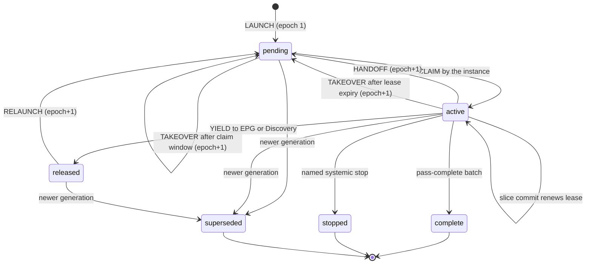
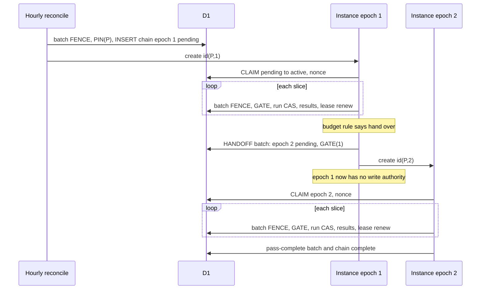
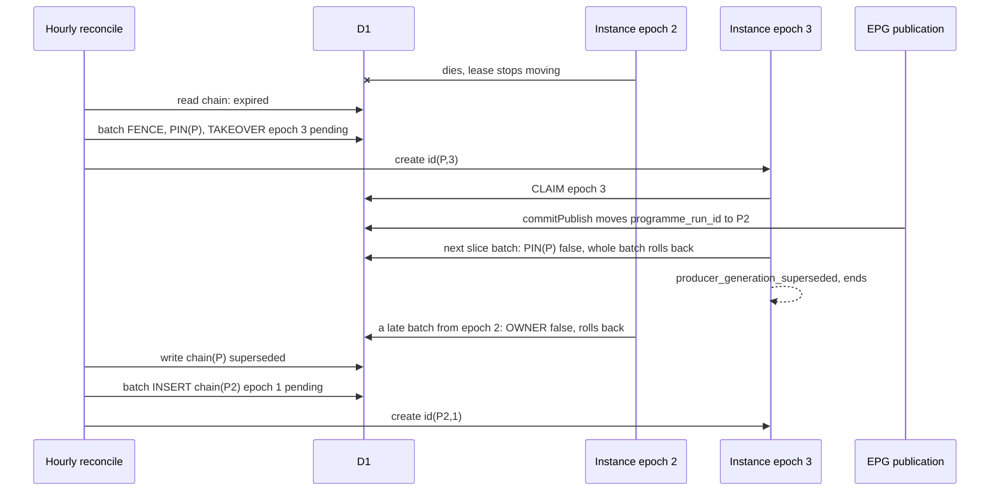
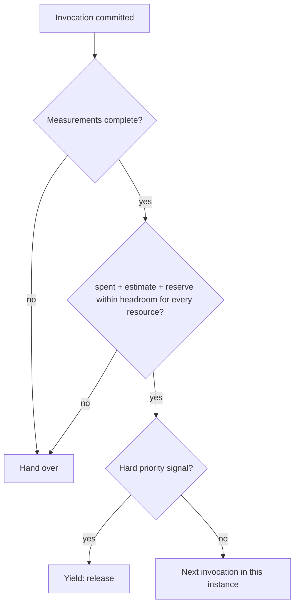

# ADR 0141: The Producer Workflow chain has one epoch-fenced owner per published generation, hands over by a durable claim before `create()`, pins every write to the latest published generation inside the write batch, and recovers only through the hourly EPG reconciliation

**Status:** **Proposed** (design proposal for owner review; no code, migration, Workflow, configuration, flag, schedule or production operation is authorized by this record)
**Original decision date:** unknown (proposal; not yet decided)
**Recorded at:** 2026-11-14
**Approval source:** not yet approved. The scope of this proposal was authorized by the owner decision of 14 November 2026 09:29 UTC on [AIR-374](https://trello.com/c/ha7ais3w#comment-6af82a03b5debcfad1f75466) (analysis, design and a documentation-only pull request; implementation, wiring, Workflow, cron, flag, limit, D1, R2 and migration changes are NOT authorized and need their own approvals after this protocol is accepted)
**Related work:** [AIR-374](https://trello.com/c/ha7ais3w), [ADR 0140](0140-producer-workflow-adaptive-successor-chain.md) (Accepted as DESIGN; this record refines its decisions 3, 5, 6, 7 and 8 and does not revisit its other decisions), [ADR 0128](0128-epg-canonical-producer-durable-execution.md), [ADR 0137](0137-left-plan-settlement-from-sealed-newer-input.md), [ADR 0098](0098-discovery-workflow-step-failure-recovery.md) (precedent, not proof), [ADR 0094](0094-discovery-workflow-invocation-budget.md) (precedent for a measured instance budget), [ADR 0100](0100-epg-cloudflare-workflow-executor.md), [ADR 0135](0135-epg-priority-discovery-pause.md), [M1 limits evidence](../evidence/d1-migration/air-374-m1-workflow-limits-2026-11-14.md), [S5-1 gate evidence](../evidence/d1-migration/air-374-s5-1-nextaction-gate-2026-11-13.md), [producer driver reference](../reference/data/producer-driver.md), [producer run store reference](../reference/data/producer-run-store.md)
**Supersedes:** None. It does not change [ADR 0140](0140-producer-workflow-adaptive-successor-chain.md), [ADR 0128](0128-epg-canonical-producer-durable-execution.md) decision 8 or any other Accepted record
**Superseded by:** None

## How to read this record

Every statement carries one of three marks, so a reviewer can tell what was read from what is proposed:

- **[code]** was read in the repository at the cited `file:line` (lines are those of `main` when this record was written).
- **[proposal]** is a design choice made here. Nothing exists for it yet.
- **[unverified]** is a platform or runtime behaviour this record does NOT source. It is listed in [Verification obligations](#verification-obligations-nothing-below-is-established) and must be settled by a primary-source reading or a bounded measurement before the dependent step is built. No numeric threshold is invented here: a number that needs a measurement is a named **parameter** (`PARAM-n`), never a value.

## Context

[ADR 0140](0140-producer-workflow-adaptive-successor-chain.md) fixed the direction: S-A (repeated bounded invocations of ONE run), a separate Producer Workflow started after the EPG commit (W3), an adaptive chain of instances (not one instance per 1,000 units), the default `limits.subrequests` of 10,000 per instance, and isolation from the EPG publication. It deliberately left the mechanism open: the hand-off, the exclusive-ownership proof, the generation fence, the failure windows and the budget rule. The owner decision of 14 November 2026 09:29 UTC asks for one concrete protocol covering six requirements (ownership and hand-off, generation fencing, a failure-recovery table, adaptive bounded execution, verification, storage justification). This record is that protocol. It is a proposal: the four inputs fixed by ADR 0140 (S-A, W3, adaptive successors, default limits, EPG isolation) are not reopened here.

What the code does today (all **[code]**):

1. **The producer run is already a revision-CAS row, but it carries no owner.** `canonical_producer_run` has a `revision` column and no owner, lease or epoch column ([migration 0020](../../migrations/0020_canonical_producer_run.sql) lines 45 to 86; `pass_state` allows `passing`, `passed`, `stopped`, `superseded` at line 58). Every store write asserts `casRun(run)` (the stored revision equals the one read; `src/canonical-producer-store.js:29`) and `changes()=1` (line 30) inside ONE `batch()` that also starts with the marker fence (line 31, 59 to 66, `SLICE_STATEMENT_CAP` 48 at line 21). A lost compare-and-set is named `producer_cas_lost` (lines 41 to 58). A revision compare-and-set therefore proves that nobody moved THIS ROW since it was read. It does not prove that the caller is the only instance working on the run: two instances that read the same revision race, one wins, and the loser is told only after its units were applied.
2. **The fences that exist assert the Film/Person marker, not the published generation.** `FENCE` asserts `film_person_authority` is `d1`/`open` at the generation read (`src/canonical-mutations.js:20`). `assertSql(condition)` is one upsert into `film_person_cas` whose `ok` column is `CHECK (ok=1)`, so a false condition rolls the whole batch back (`src/canonical-mutations.js:19`). `head(gate, entities)` builds `[FENCE, REVISION...]` (lines 88 to 92) and is called from eleven places: `src/canonical-film-writers.js:266`, `src/canonical-mutations.js:109, 147, 194`, `src/canonical-person-state.js:221, 242`, `src/canonical-receipts.js:339`, plus the non-producer callers `film-admission.js:93, 138`, `localization-sources.js:169`, `tmdb-retirement-decisions.js:154`. Nothing in any of them looks at `published_epg_authority.programme_run_id`.
3. **The published generation moves in one place.** `commitPublish` changes `published_epg_authority.programme_run_id` only when `stage.phase==='published'`; the replace phase only increments `generation` and leaves `programme_run_id` alone (`src/published-epg.js:296` to `304`). The whole commit batch is a fenced `batch()` with a `published_epg_cas` check after each decisive statement (`FENCE_SQL`, line 23). The file also documents the precedent for carrying a fence with a commit and asserting it in the batch's own statement (`epgFenceStatements`, lines 24 to 31).
4. **The EPG executor already solved lease, takeover and create ordering for itself, in its own documents.** `LEASE_MS=5 min` and `BOUNDARY_MARGIN_MS=15 s` (`src/epg-orchestration.js:24`); `leaseLive` treats a lease as live until expiry plus the margin (line 115); a holder refuses to act at `expires-margin` (line 159); instance ids are deterministic, `epg_<runKey>_<series>` (line 30); `casDoc` is the compare-and-set on the stored document revision (line 47); `createError` classifies a thrown create as `exists` or `uncertain` (line 90); the control row is written BEFORE `create()` and an existing instance attaches (lines 507 to 533); `instanceStatus` of `unknown` holds instead of proving death (lines 513 to 515). The hourly `ensure` runs `reconcileMirrors` and then `ensureWorkflow` as separate steps and returns results instead of throwing (lines 483 to 487).
5. **Those documents cannot host the producer's ownership.** `epg_orchestration_document.key` is `CHECK (key IN ('mode','control','lease'))` ([migration 0017](../../migrations/0017_epg_orchestration.sql) line 37); a new key needs a migration, and the `control` row is the EPG executor's own series state, so reusing it would couple the producer to the executor's CAS domain and failure budget, which ADR 0128 guardrail G6 and ADR 0140 decision 2 forbid.
6. **Discovery is the precedent for a measured instance budget.** The Discovery Workflow wraps its D1 binding in a counting proxy (`meterD1`/`meteredEnv`, `src/discovery-workflow.js:303` to `322`), writes its state BEFORE `create()` and attaches on `exists` (lines 533 to 561), and hands over at a counted level rather than a guessed one ([ADR 0094](0094-discovery-workflow-invocation-budget.md): both failing instances died near 12.2 thousand D1 statements; it hands over at 6,000; the platform limit itself was not established).

What the platform documents (checked against the Cloudflare documentation search, **[code]-level confidence is NOT claimed**; each item is also an obligation below): D1 `batch()` statements run as one SQL transaction with a full rollback when one fails; a batch counts as one query against the per-invocation query limit; `create()` with an id that already exists within retention throws; `get(id)` throws when the id does not exist; instance ids are unique per Workflow. A throw from `create()` is not a statement about the instance.

## Decision (proposal)

### D1. One durable chain row per published generation, separate from the run row **[proposal]**

A new table `canonical_producer_chain` (proposal only; a migration is a separate approval, see [Storage](#storage-what-is-reused-what-is-new-and-why)) holds the ownership of the chain of ONE published generation. Its CAS domain is its own revision, separate from the run row's.

| Column | Meaning |
| --- | --- |
| `programme_run_id` (primary key) | The pin: the published generation this chain serves. `canonical_producer_run.source_generation` of the chain's run is defined to be this value (S5-1 must map the EPG run key to it; the store already finds a run by generation, `epgRunForGeneration`, `src/canonical-producer-store.js:94`) |
| `run_key` (nullable) | The producer run key, filled by the first CLAIM |
| `owner_epoch` | Monotone fencing token, `>= 1`, increases ONLY by a compare-and-set batch that read the previous value |
| `owner_instance` | `pw_<hash(programme_run_id)>_<epoch>`: deterministic and derived, stored only for display and diagnosis |
| `claim_nonce` | Random value written by the instance's own CLAIM batch; part of every ownership assertion, so even a platform that started two instances under one id could not make both owners |
| `owner_state` | `pending`, `active`, `released`, `complete`, `stopped`, `superseded` |
| `lease_expires_at` | For `pending`: the end of the claim window. For `active`: the lease end, renewed by every slice commit |
| `handoff_count`, `takeover_count`, `stopped_by` | Counts and a named code only (no ids, no content) |
| `revision`, `created_at`, `updated_at` | The chain row's own compare-and-set and times |

Rules of the row: a trigger refuses writes outside `d1`/`open` and a change of the key or `created_at`, `revision` rises by exactly one per update, and `owner_epoch` may only increase (the same trigger pattern as migration 0020).

### D2. Ownership protocol: the exact order of transitions and writes **[proposal]**

An instance with epoch `e` owns the chain only while the chain row says `owner_epoch=e`, its own `claim_nonce` and `owner_state='active'`. The proof is asserted INSIDE every write batch (D4), never read first and written later.

**Launch** (by the hourly reconciliation, D6; first instance):

1. L1. Read the published authority (`d1`/`open`, `programme_run_id=P`) and the chain row of `P`. No chain row and no completed run for `P` means launch.
2. L2. Batch: `[FENCE, PIN(P), INSERT chain(P, epoch=1, owner_instance=id(P,1), state='pending', lease_expires_at=now+PARAM-claim-window) ON CONFLICT DO NOTHING, assert changes()=1]`. A concurrent launcher loses on the primary key and does nothing (no create).
3. L3. `create({id: id(P,1), params: {programmeRunId: P, epoch: 1}})`. The ownership state is already durable; the outcome of the create changes nothing in D1.
4. L4. The new instance's first step is CLAIM (below).

**Claim** (first step of every instance, idempotent):

1. C1. Batch: `UPDATE chain SET owner_state='active', claim_nonce=:n, lease_expires_at=now+LEASE, revision=revision+1 WHERE programme_run_id=P AND owner_epoch=:e AND owner_instance=:id AND owner_state='pending' AND revision=:r`, plus `[FENCE, PIN(P)]` and `assert changes()=1`.
2. C2. The nonce `n` is generated INSIDE the claim `step.do`, so a replay of that step returns the stored nonce. If the batch fails, the instance reads the row once: it is the owner only if it finds `owner_state='active'`, its epoch and its own nonce (a replayed claim). Any other result is `not_owner` and the instance ends without writing anything else.

**Work** (every slice):

1. W1. Each slice commit is the existing batch (`fence`, run CAS, result rows, run update, `changes()=1`) plus: `OWNER`, `PIN` and the chain lease renewal (`UPDATE chain SET lease_expires_at=now+LEASE, revision=revision+1 ... WHERE owner assertion`). The renewal piggybacks on the commit, so the lease moves forward with every committed slice and costs no extra round trip.
2. W2. A unit apply asserts the single combined statement `GATE = PIN ∧ OWNER` in its own batch (D4). A slice that finds `not_owner` or `producer_generation_superseded` ends the instance without a retry.
3. W3. The instance stops starting new work at `lease_expires_at - margin` of its own clock (the EPG precedent, `src/epg-orchestration.js:159`).

**Hand-off** (the exact order, closing the owner's question about before/after `create()`):

1. H1. The budget rule (D5) decides, at an invocation boundary after a committed slice, to hand over. The cursor is already durable in the run row.
2. H2. HANDOFF batch: `[FENCE, GATE(e), UPDATE chain SET owner_epoch=e+1, owner_instance=id(P,e+1), owner_state='pending', claim_nonce=NULL, lease_expires_at=now+claim-window, handoff_count=handoff_count+1, revision=revision+1 WHERE owner_epoch=e AND claim_nonce=:n AND owner_state='active' AND revision=:r, assert changes()=1]`. From this commit the old instance has NO write authority: its next batch fails the ownership assertion. It may only create the successor and exit.
3. H3. `create({id: id(P,e+1), ...})` in a separate `step.do`. Outcomes: success: exit. `exists`: treated as created (same deterministic id; the successor's own CLAIM decides ownership). Any other throw, or no answer: bounded retries (PARAM-create-attempts) and then exit. An ambiguous create NEVER proves that the instance is absent.
4. H4. The successor runs CLAIM. If it never starts, the claim window ends and the hourly reconciliation takes over with a NEW epoch (D6). The old id is never "repaired".

**Why this ordering is safe:** ownership (D1 state) moves BEFORE `create()` ([ADR 0098](0098-discovery-workflow-step-failure-recovery.md) and the EPG executor do the same with their own state). A crash after H2 and before H3 leaves `pending` with nobody running: recovered by expiry. A crash after H3 leaves a started successor: it claims. A duplicate create or a duplicate successor changes nothing: the nonce-bound CLAIM makes only one of them the owner. Because every recovery action takes a new epoch, no path needs to know whether an earlier instance is dead.

**Separation the owner asked for:** the RUN row revision (`casRun`) fences the cursor and the results of the plan; the CHAIN row (epoch, nonce, state) is the proof of exclusive ownership. A slice batch asserts both. Neither substitutes for the other.

### D3. Takeover: the only recovery transition **[proposal]**

A takeover is allowed only when the chain row is `pending` or `active` and `lease_expires_at + BOUNDARY_MARGIN < now` by the reconciler's Worker clock (`pending` uses the claim window end). The batch is `[FENCE, PIN(P), UPDATE chain SET owner_epoch=e+1, owner_instance=id(P,e+1), owner_state='pending', claim_nonce=NULL, lease_expires_at=now+claim-window, takeover_count=takeover_count+1, revision=revision+1 WHERE programme_run_id=P AND owner_epoch=e AND revision=:r AND owner_state IN ('pending','active'), assert changes()=1]`, followed by `create(id(P,e+1))`. Rules:

- The epoch cap `PARAM-epoch-cap` bounds flapping: past it the chain becomes `stopped` with `stopped_by='producer_chain_epoch_cap'` and is not relaunched by itself.
- The instance status (`running`, `errored`, `unknown`, absent) is telemetry only. It never gates a takeover and never proves death or absence (the EPG precedent at `src/epg-orchestration.js:513` to `515` holds on `unknown`; here the epoch makes holding unnecessary).
- **Safety does not depend on clocks.** A takeover that races a healthy owner either commits first (the owner's next batch fails its assertion) or loses its compare-and-set because the owner's slice commit bumped `revision`. Clocks affect only liveness: how long a dead owner blocks, and how much work a healthy-but-late owner wastes (at most the unit batch in flight).

### D4. Generation fencing at the write boundary, atomically **[proposal]**

Two assertions are added as `assertSql` conditions inside the SAME batch as the write, using the existing rollback primitive (`src/canonical-mutations.js:19`). No read-then-write is accepted anywhere in the producer.

- `PIN(P)`: `EXISTS (SELECT 1 FROM published_epg_authority WHERE id=1 AND mode='d1' AND cutover='open' AND programme_run_id=?)`. It asserts that the pinned generation is STILL the latest published one at the instant of the write. A newer publication moves `programme_run_id` (`src/published-epg.js:296` to `304`), so every later producer batch of the older chain fails and rolls back whole. The replace phase (same programme, `generation` +1) does not trip the pin by design: content that changed inside the same programme is handled by the existing fingerprint-drift replay ([ADR 0128](0128-epg-canonical-producer-durable-execution.md), `openEpgRun`, `src/canonical-producer-store.js:131` to `152`), which is cheaper than stopping.
- `OWNER(P, e, n)`: `EXISTS (SELECT 1 FROM canonical_producer_chain WHERE programme_run_id=? AND owner_epoch=? AND claim_nonce=? AND owner_state='active')`.
- `GATE = PIN ∧ OWNER` is ONE statement (one added statement per batch).

A new systemic error `producer_generation_superseded` names a failed PIN (after a re-read shows the pin moved, the way `refuse` re-reads the marker, `src/canonical-producer-store.js:41` to `58`), and `producer_not_owner` names a failed OWNER. Both end the instance quietly; neither is a failure of the run.

**Which writers need which change (proposal):**

| Writer | Today (code) | Change |
| --- | --- | --- |
| Store writers `openEpgRun`, `commitStrike`, `commitSlice`, `commitPassComplete`, `commitStop`, `commitResume`, `settleResult`, `updateResult` (`src/canonical-producer-store.js:131, 180, 205, 224, 234, 245, 258, 273`) | `[fence, casRun, ...]` | add `GATE` (or `PIN` alone for `openEpgRun`, which runs before the instance owns a run row but after its CLAIM) to every batch; `commitSlice` and `commitStrike` also renew the chain lease; `commitPassComplete` also sets the chain row to `complete` in the SAME batch (a crash cannot leave a passed run under an active chain) |
| Unit writers reached by `film_facts`, `person_mutation`, `person_state` and `film_credits` through `fenced.head` | `head(gate, entities)` = `[FENCE, REVISION...]` | `head` takes the gate from a producer fence carried with the call (as `epgFence` is carried with a commit, `src/published-epg.js:24` to `31`, and as Discovery wraps its environment, `src/discovery-workflow.js:303` to `322`) and appends `GATE` when it is present. Non-producer callers (`film-admission.js`, `localization-sources.js`, `tmdb-retirement-decisions.js`, the projector) pass none and are unchanged |
| EPG publication (`commitPublish`) | unchanged | none: it is the writer whose commit the pin observes; the producer never writes into it |

Which of the eleven `head` call sites each unit kind reaches is **[unverified]** (V-9): S5-1 maps each kind to its call sites and proves by test that every producer path asserts `GATE`. The single change point (`head`) is chosen so that no producer path can forget it.

Unit applies by two owners are data-safe even without `OWNER` (idempotent appliers, receipts and `REVISION` per [ADR 0128](0128-epg-canonical-producer-durable-execution.md) decision 3), so `OWNER` on unit writes is waste-prevention; `PIN` on unit writes is correctness (an older plan must not write older content over a newer generation's). Trade-off T-5.

### D5. Adaptive bounded execution **[proposal]**

**Two kinds of limits, never conflated:**

| Boundary | What it bounds | Source |
| --- | --- | --- |
| Invocation limits | one `runEpgProducerPass` call: `sliceSize`, `maxSlicesPerRun`, `sliceDeadlineMs`, the unit ceiling | required parameters of the driver, no defaults (`src/canonical-producer-driver.js`, header and parameter validation); values are the D-C numbers, not decided here |
| Instance limits | one Workflow instance across all its invocations: subrequests (D1 and R2 calls), CPU, wall time, memory | documented platform limits per [M1 evidence](../evidence/d1-migration/air-374-m1-workflow-limits-2026-11-14.md); default `limits.subrequests` stays 10,000 (ADR 0140 decision 4); never raised globally |

**Metering.** Each invocation runs as its own `step.do` and returns the counts it spent (`d1Calls`, `d1Statements`, `r2Calls`, `elapsedMs`, `peakMemory` if observable). The instance keeps its totals by rebuilding them from the step results on every replay, as [ADR 0094](0094-discovery-workflow-invocation-budget.md) does, with the counting proxy of `src/discovery-workflow.js:303` to `322` as the pattern. The meter counts both binding calls and statements and the decision uses the more conservative of the two until a measurement settles how a batch counts toward the subrequest limit (V-3). A failed step attempt's spend is unknown, so it is charged at the instance's largest measured invocation (conservative).

**Successor decision rule.** At each invocation boundary the instance continues in the same instance only if, for EVERY metered resource `r`:

`spent_r + E_r + R_r <= f_r × L_r`

where `L_r` is the documented limit, `f_r` in `(0, 1]` is the headroom fraction (`PARAM-headroom-r`), `E_r` is the estimate of the next invocation (the largest spend measured by this instance so far, never below the measured floor `PARAM-floor-r`, which for the first invocation is the only term) and `R_r` is the hand-off reserve: the counted cost of the hand-off path (one admit read, the HANDOFF batch, one create: three subrequest calls by the design above) plus a margin `PARAM-reserve-margin-r`. Otherwise it hands over (H1 to H4). The fail-safe direction is fixed: **a missing or implausible measurement means hand over, never continue**, except that every instance performs at least one invocation (a progress guarantee). If `E_floor + R > f × L` for any `r`, the configuration is infeasible and the chain stops with `producer_budget_infeasible` instead of creating a successor that cannot progress. Wall time and memory follow the same form with their own parameters; whether CPU and memory are cumulative per instance or per step is **[unverified]** (V-5, V-6), so until it is settled the rule treats each as cumulative.

**Priority and contention.** The producer yields to the EPG publication and to Discovery ([ADR 0135](0135-epg-priority-discovery-pause.md)). Before every invocation after the first it reads, read-only, the existing signals (an EPG executor series in flight, the Discovery EPG-priority state, a live Discovery lease, an open projector window); the exact predicates are defined from those ADRs by S5-1 and are **[unverified]** here. A hard signal (EPG publication in flight) makes the owner yield immediately: a batch `owner_state='released'` (epoch unchanged, lease ended) and the instance returns `yielded`. The hourly reconciliation relaunches with a new epoch once the signal is clear. A soft signal (Discovery active) allows one more invocation before the yield (the fairness floor; T-4). D1 contention is handled by classifying transient D1 errors and observed batch latency against a baseline (`PARAM-contention-thresholds`): first `step.sleep` backoff with jitter, then a halved `sliceSize` down to a floor, then yield. The tolerated contention level stays a parameter.

**Isolation from the EPG executor.** The chain writes nothing into `epg_orchestration_document`, never changes the EPG mode or control rows, never returns an error to the EPG executor, and has its own telemetry and read-model state (ADR 0140 decisions 2 and 8). The EPG hourly step calls the chain reconciliation as a third independent step whose result is returned, never thrown (D6).

### D6. Recovery only through the existing hourly reconciliation **[proposal]**

The hourly `EpgOrchestration.ensure` (`src/epg-orchestration.js:483` to `487`; the Worker's single cron tick calls it, `src/worker.js:1751`) gains a third independent step after `reconcileMirrors` and `ensureWorkflow`: `reconcileProducerChain`. It never throws, returns counts, and does nothing when the Film/Person marker is not `d1`/`open`, when the authority is not `d1`/`open`, or when the producer Workflow binding is absent (the same `workflow_unavailable` shape as `src/epg-orchestration.js:495`). It adds no schedule, no Task and no cron entry.

| Observed state (one authority read, one chain read, bounded) | Action |
| --- | --- |
| authority not `d1`/`open`, marker not open, binding absent | none |
| published `P` has no chain row and no completed run | LAUNCH (L2, L3) |
| chain row `complete`, `stopped`, `superseded` | none |
| chain row `pending` or `active` and not yet expired | none |
| chain row `pending` or `active` and expired | TAKEOVER (D3) |
| chain row `released` and no hard priority signal | TAKEOVER (relaunch) |
| a non-terminal chain row of an older generation | write `superseded` on the chain row (hygiene; safety comes from `PIN`); the older run row is left untouched (no new writer) |

**Two statements that keep ADR 0128 decision 8 intact:** the reconciliation only (re)starts the chain of the pass; it never calls `retryEpgProducerResults`, and neither does the chain, so the unit retry pass stays an explicit request and is not turned into a scheduled retry. The reconciliation is recovery of the chain, not a retry of failed units. This is exactly the qualification ADR 0140 decision 5 already records.

**Latency bound.** A chain that dies is noticed at the first hourly tick after its lease (5 minutes, plus the margin, **[code]** `LEASE_MS`) or claim window has ended: the worst case is about one hour plus the lease. Transient failures inside a live instance are retried by the Workflow step retries and do not wait for a tick. Whether an hour per death meets the freshness target is the owner's lag question, left to the D-C numbers (T-3).

### D7. Failure windows and recovery **[proposal]**

| # | Window | State left in D1 | Detection | Recovery | Why it is safe |
| --- | --- | --- | --- | --- | --- |
| F1 | Owner crashes mid-slice, before any CAS | cursor at the last committed slice; epoch `e` active | lease passes expiry plus margin | TAKEOVER at the next tick; the new owner resumes from the cursor | uncommitted unit effects are idempotent and re-derived; the run CAS resumes at the stored revision |
| F2 | Crash before the HANDOFF batch | as F1 | as F1 | as F1 | nothing changed |
| F3 | Crash AFTER the HANDOFF batch, BEFORE `create()` | `pending`, epoch `e+1`, no instance | claim window passes | TAKEOVER, epoch `e+2`, new id | the old instance has no authority; the pending epoch is simply skipped |
| F4 | `create()` throws an unknown error | `pending`, epoch `e+1` | none at the time | bounded retries, then exit. Either an instance exists and claims, or the window passes and F3 applies | absence is never inferred from the throw |
| F5 | `create()` succeeds but the acknowledgement is lost | as F4 | as F4 | as F4 | CLAIM, not create, is the proof of ownership |
| F6 | Duplicate create (`exists`) | unchanged | the explicit `exists` | treated as created; the instance's own CLAIM decides | same epoch means same id; the nonce excludes a second owner |
| F7 | Successor starts and dies before CLAIM | `pending` | window passes | as F3 | as F3 |
| F8 | Successor claims, works, then dies | `active`, lease stops moving | lease expiry | TAKEOVER | as F1 |
| F9 | Hourly takeover races the successor's CLAIM | one wins the serialized D1 batches | the loser's assertion or CAS fails | the CLAIM wins: the reconciler's CAS fails and it re-reads; the takeover wins: the successor gets `not_owner` and exits | two writers, one revision; both batches cannot commit |
| F10 | Hourly takeover races an owner's slice commit | revision bumped by the commit | takeover's `revision=:r` fails | the reconciler sees a live lease on its next read | the compare-and-set expects the old revision |
| F11 | Lease lost while the owner is alive but stalled (clock skew beyond the margin, long GC, slow D1) | takeover committed, or not | the owner's next batch fails `OWNER`, or the owner stops at `expires-margin` | the owner ends; the takeover owner continues | the epoch, not the clock, fences; waste is at most the unit in flight |
| F12 | Step or message redelivery (Workflow replay) | the same | step results are cached; CLAIM and slice commits are read-back idempotent | none needed | claim nonce comes from the cached step result; revision CAS resumes the cursor; the create step sees `exists` |
| F13 | Fingerprint drift inside the run | run row replays with `pass_no+1` | `openEpgRun` at the start of an invocation | the same owner continues from the start; `PARAM-replay-cap` replays end in `stopped` (`producer_fingerprint_unstable`) | existing S4-4 semantics; the chain row is not touched |
| F14 | A newer generation is published during the chain | `programme_run_id` moved | the next producer batch fails `PIN` and rolls back | the stale owner ends; the reconciler marks the old chain `superseded` and LAUNCHes the new one | the pin is asserted in the write batch: no read-then-write window |
| F15 | Marker or authority leaves `d1`/`open` (revert or hold) | unchanged | `FENCE` or `PIN` fails | the chain ends; no launch while not open | fail closed; code rollback never touches authority |
| F16 | D1 batch fails transiently in HANDOFF or TAKEOVER | batch is atomic: unchanged | the batch error | in-instance bounded retry, otherwise the tick | a failed `batch()` leaves no partial transition |
| F17 | Reconciler dies between the LAUNCH insert and `create()` | `pending`, epoch 1 | window passes | TAKEOVER at the next tick | as F3 |
| F18 | Platform status says `unknown`, `errored` or absent | any | n/a | none: status never gates safety | status is telemetry only |
| F19 | Epoch cap, replay cap or infeasible budget reached | `stopped` with a named code | the code | no automatic relaunch; a named forward writer (out of scope) resumes it | prevents a hot loop |
| F20 | Priority yield | `released` | reconciler read | relaunch when the signal is clear | the cursor is durable; a release is a clean hand-back |

### D8. Mermaid diagrams **[proposal]**

The chain row states and the transitions of D2, D3 and D6:

Launch, work, hand-off and the successor's claim (the order of D2):

Crash, hourly takeover and supersession (F3, F8, F11, F14):

The successor decision rule of D5:

### D9. Invariants **[proposal]**

- **I-1** At most one `(epoch, nonce)` holds write authority at any commit instant; enforced in-batch, independent of clocks and of platform instance state.
- **I-2** `owner_epoch` is monotone and rises only through a compare-and-set batch that read the previous value.
- **I-3** No producer write commits unless the SAME batch asserts the pin. No read-then-write generation check exists in the producer.
- **I-4** Ownership moves BEFORE `create()`. The outcome of `create()` never changes ownership; CLAIM does.
- **I-5** A failed or ambiguous create never proves absence; recovery never depends on instance status.
- **I-6** The same id is never repaired; recovery always uses a new epoch.
- **I-7** Recovery runs only inside the existing hourly reconciliation; no new schedule exists; neither the chain nor the reconciliation calls the unit retry pass.
- **I-8** The chain writes nothing in the EPG executor's documents and never reports into its failure budget.
- **I-9** A missing measurement means hand over; every instance makes at least one invocation or a named stop; no successor is created that cannot progress.
- **I-10** The hand-off reserve is never spent by an invocation.
- **I-11** `passed` on the run row and `complete` on the chain row are set in one batch.
- **I-12** The superseded mark is hygiene; safety rests on the pin.

### D10. Verification: tests and acceptance criteria **[proposal]**

Offline tests (S5-1 acceptance; each names the failure row it covers):

1. T-1 `batch()` rollback: a false `PIN` or `OWNER` rolls the producer batch back with no partial row (F11, F14), for each store writer and for a unit writer, on a real SQLite with the real migrations.
2. T-2 Interleavings by a controllable D1 double: HANDOFF vs slice commit, TAKEOVER vs CLAIM, TAKEOVER vs lease renewal, two launchers (F9, F10, F17).
3. T-3 Crash and retry at every hand-off point: before HANDOFF, after HANDOFF, after create, after CLAIM (F2 to F8).
4. T-4 Create outcomes: success, `exists`, unknown throw, no answer, duplicate under one id (F4 to F6).
5. T-5 Redelivery of every step with cached results (F12).
6. T-6 Fingerprint drift and the replay cap inside a chain (F13).
7. T-7 Supersession between two batches of one slice, between the unit write and the slice commit, and at the hand-off (F14).
8. T-8 Budget rule: table-driven over the parameters; missing measurement hands over; infeasible budget stops; reserve is preserved (D5).
9. T-9 Priority signals and contention classes: yield and relaunch (F20).
10. T-10 The reconciliation: every row of the D6 table, never throws, reads and writes bounded, never calls the retry pass, adds no schedule.
11. T-11 Statement budgets: the new base statements fit `SLICE_STATEMENT_CAP` (48) and `MUTATION_STATEMENT_CAP` (60) with the slice and unit sizes S5-1 chooses (V-10).
12. T-12 Static: no producer path reaches a writer without `GATE`; the EPG executor documents are not written by the chain.

A bounded shadow measurement (counts only, no production write beyond the separately approved operation) closes V-3 to V-8 before any default is chosen.

### D11. Telemetry (counts only) **[proposal]**

Per invocation and per hand-off, numbers and short codes only, no ids, keys or content: `epoch`, `invocations`, `slices`, `unitsApplied`, `unitsNoop`, `unitsKept`, `unitsFailed`, `d1Calls`, `d1Statements`, `r2Calls`, `elapsedMs`, `reserveRemaining`, `decision` (`continue`, `handoff`, `yield`, `complete`, `stop`), `handoffs`, `takeovers`, `notOwner`, `pinFailures`, `createOutcome` (`ok`, `exists`, `uncertain`), `replays`, `transientD1Errors`, `contentionAction`. They land in the producer read model and the run summary, never in the EPG executor's.

### D12. Rollback and orphaned instances **[proposal]**

- Everything proposed is additive: one new table, optional parameters on shared writers, one more independent step in the hourly tick. Code rollback leaves the chain table inert (no launches without the step) and does not touch R2, D1 data, markers, Access or schedules ([ADR 0140](0140-producer-workflow-adaptive-successor-chain.md) boundaries stand).
- A running instance whose code or epoch is gone ends at its next admission or batch (`producer_not_owner`, `producer_generation_superseded`) with no write. Whether a running instance keeps its starting code version is **[unverified]** (V-11); the design needs no answer because ownership is a D1 fact, not a code fact.
- The emergency stop is the existing marker (`held` or not `open` stops every producer batch through `FENCE`) or removing the Workflow binding (the reconciliation then launches nothing). Dropping the table needs a migration approval; an inert table costs nothing.
- Nothing here changes the EPG publication path, so the EPG hourly publication is unaffected by a producer failure.

## Storage: what is reused, what is new, and why

| Candidate | Verdict | Evidence |
| --- | --- | --- |
| `epg_orchestration_document` `control` | Not reusable | EPG executor series state; coupling violates G6; `casDoc` couples every write to the EPG mode revision (`src/epg-orchestration.js:47`) |
| `epg_orchestration_document` with a new key | Needs a migration to change `CHECK (key IN ('mode','control','lease'))` (migration 0017 line 37) and still sits in the EPG executor's CAS domain | rejected |
| Owner columns on `canonical_producer_run` | Possible only if the row exists at launch. It does not: the row needs `fingerprint`, `unit_count` and a plan (migration 0020 lines 54 and 55), which are produced by the instance, not by the reconciler. A placeholder row would relax Accepted schema constraints. It would also merge the ownership and cursor compare-and-set the owner asked to separate | rejected; a flat alternative if the owner prefers no new table (T-1), at the cost of moving the launch behind the plan |
| New `canonical_producer_chain` | Recommended | ownership exists before the plan, its own revision domain, the run row and its triggers stay untouched |
| A Durable Object lock | Not reused | new binding and product, a `wrangler.jsonc` change out of scope; the project's own primitive is the D1 batch fence |
| Reuse without storage: platform id uniqueness plus `instanceStatus` | Not sufficient | does not fence a stale instance after a takeover; status is never proof (F18) |

Reused: the batch-transaction primitive (`assertSql`, `src/canonical-mutations.js:19`), the marker fence, the run-row CAS, the lease constants and the margin rule of the EPG executor, the deterministic-id and state-before-create pattern, the hourly tick. New: one table, the pin and owner assertions, `GATE`, the reconciliation step, and the instance meter. All new schema is a proposal; this record applies none.

## Alternatives considered

| Alternative | Evidence | Why not |
| --- | --- | --- |
| Read-then-write generation check at admission only | the owner decision requires the race closed atomically | a newer publication between the read and the write lands an old plan's write (TOCTOU) |
| Pin on `published_epg_authority.generation` | `commitReplace` only increments `generation` (`src/published-epg.js:304`) | would stop the producer on every same-programme content replacement that fingerprint drift already handles |
| Same-id repair of a lost instance | ADR 0098 keeps the id after an unknown create | the created-and-errored id throws `exists` for the whole retention and would wedge the chain; a new epoch needs no proof of absence |
| One long-lived instance with `step.sleep` between invocations | the instance budget is the same 10,000 | does not remove the instance boundary; kept only as an in-instance optimisation |
| New cron or Scheduled Task for chain recovery | owner decision: only the existing hourly reconciliation | out of the allowed mechanism |
| Chain recovery through the unit retry pass | ADR 0128 decision 8: explicit, not scheduled | would turn the retry pass into a scheduled retry |
| Successor per fixed unit count | ADR 0140 decision 3 | rejected by the owner |
| Raise `limits.subrequests` globally | ADR 0140 decision 4 | rejected by the owner |

## Consequences

- Exclusive ownership and generation fencing become facts of one D1 batch, not of caller discipline or platform state.
- Cost: one table, one trigger set, `+1` statement (`GATE`) per unit batch and about `+3` per slice batch (gate, lease renewal and its assertion). Whether the slice and unit caps still fit is V-10 and S5-1's gate.
- The worst-case recovery of a dead chain is about an hour. Repeated deaths multiply it; the lag number is the owner's.
- The instance meter adds a counting proxy and a hand-off reserve that reduce usable instance budget by design; a larger default would need its own measurement (ADR 0140 decision 4).
- A stopped or epoch-capped chain needs a named forward writer; that writer is not designed here.

## Material trade-offs for the owner (each with a recommendation)

| # | Decision | Recommendation |
| --- | --- | --- |
| T-1 | New table `canonical_producer_chain`, or owner columns on the run row | New table (ownership exists before the plan; the row stays small and its CAS separate) |
| T-2 | Launch only by the hourly reconciliation, or also a best-effort post-commit call in the EPG tail | Hourly only first; add the fast path later and only if measured lag exceeds the lag number. It would touch the EPG executor's code path |
| T-3 | Accept a recovery latency of up to about an hour per death | Accept for the first rollout; improve in-instance retries first |
| T-4 | Priority: hard yield to the EPG publication; Discovery a soft yield with a one-invocation floor, or a hard yield to both | Hard to EPG, soft to Discovery with the floor, to avoid starving the pass |
| T-5 | `GATE` (pin and owner) on unit writes, or `PIN` only | Both, as one statement; `OWNER` prevents duplicate-owner waste at the cost of one statement |
| T-6 | Meter strictness before measurement | The more conservative of calls and statements until V-3 is settled |
| T-7 | A systemic stop is terminal (no auto relaunch), or relaunches with backoff | Terminal; a named forward writer resumes it |
| T-8 | Dormancy by binding and marker only, or an extra flag | Binding and marker only; add a flag if the owner wants a separate off switch |
| T-9 | `source_generation := programme_run_id` | Yes (the pin and the run identity agree) |
| T-10 | Chain never calls the unit retry pass (stays explicit) | Keep explicit, as decided in ADR 0128 |

## Verification obligations (nothing below is established)

- **V-1** `create()` from inside a Workflow step (the platform allows it, and ADR 0098's Discovery does; no behaviour of this Workflow is asserted).
- **V-2** The error class or code of a duplicate create through the Workflow binding (the existing classifiers match a message pattern, `src/epg-orchestration.js:90`; REST error 10405 is documented, the binding's shape is not established).
- **V-3** How a D1 batch counts toward the instance subrequest limit (per call or per statement), and the discrepancy between 1,000 queries per invocation (D1 limits page) and 10,000 subrequests (Workers and Workflows pages), per ADR 0140 decision 9.
- **V-4** Real D1 and R2 call counts per unit kind and per slice (not modelled here; the synthetic [AIR-465](../evidence/d1-migration/air-465-m2b-synthetic-scale-2026-11-14.md) figures are statement estimates and are not converted into instance counts).
- **V-5** Whether CPU limits are per step or per instance; **V-6** whether memory is released between steps.
- **V-7** The instance-level retention period of finished and failed instance ids (bounds the `exists` window).
- **V-8** D1 contention behaviour under the producer's batches and the error classes to treat as transient.
- **V-9** Which `head` call site each unit kind reaches; the trigger and CHECK behaviour for the new table on real D1.
- **V-10** That the added statements fit `SLICE_STATEMENT_CAP` 48 and `MUTATION_STATEMENT_CAP` 60 at the chosen sizes (`SLICE_BASE_STATEMENTS` is 4 today, `src/canonical-producer-driver.js:33`).
- **V-11** Whether a running instance keeps its starting code version across a deploy.
- **V-12** Clock skew between Worker isolates against the 15 second margin (safety does not depend on it; the waste does).
- **V-13** The exact predicates of the ADR 0135, projector-window and Discovery-lease priority signals.

## Parameters (values need measurement; none is chosen here)

`PARAM-claim-window`, `PARAM-create-attempts`, `PARAM-epoch-cap`, `PARAM-replay-cap`, `PARAM-headroom-r` (per resource), `PARAM-floor-r` (per resource), `PARAM-reserve-margin-r`, `PARAM-contention-thresholds`. The invocation limits `sliceSize`, `maxSlicesPerRun`, `sliceDeadlineMs` and the unit ceiling remain the D-C numbers. The lease length and margin reuse the EPG constants by default (5 minutes and 15 seconds, **[code]**), as an owner-changeable default.

## Recovery and migration boundary

This record authorizes nothing: no migration, no code, no Workflow, no cron, no flag, no `wrangler.jsonc` or limit change, no D1 or R2 operation, no producer run. After acceptance the implementation (S5-1: the migration, the store and `head` changes, the driver wiring, the reconciliation step, the meter) and every rollout step need their own approvals. Code rollback does not revert D1 data, markers, Access, secrets or schedules.

## Evidence

- **Original decision:** not yet decided. Scope authorization: [AIR-374 owner decision comment of 14 Nov 2026 09:29 UTC](https://trello.com/c/ha7ais3w#comment-6af82a03b5debcfad1f75466).
- **Implementation:** none.
- **Dated verification:** none. The platform behaviours quoted in Context were read from the Cloudflare documentation search on 14 Nov 2026; they are not measurements of this Worker.
- **Uncertainty:** V-1 to V-13 above.

## Follow-ups

- S5-1 implementation card: migration proposal, store and `head` changes, driver wiring, reconciliation step, meter, and the tests of D10 (after acceptance and its own approvals).
- A bounded shadow measurement for V-3 to V-8 and the parameters.
- The D-C numbers and the lag number.
- A named forward writer for a `stopped` chain (not designed here).
