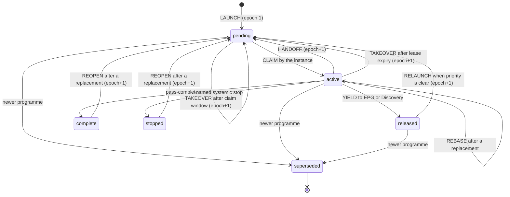
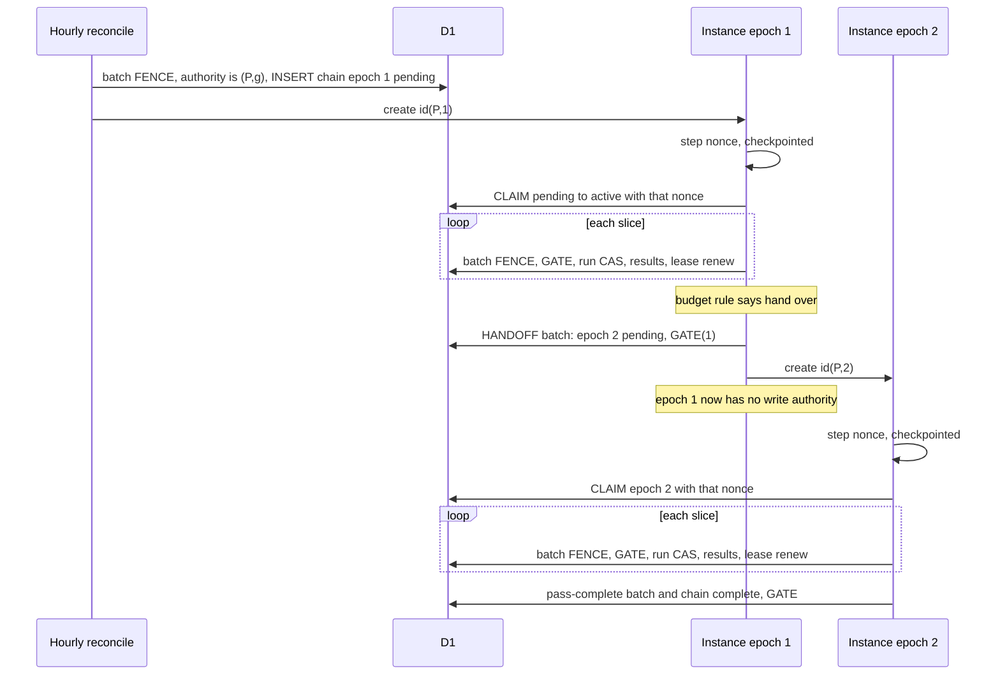
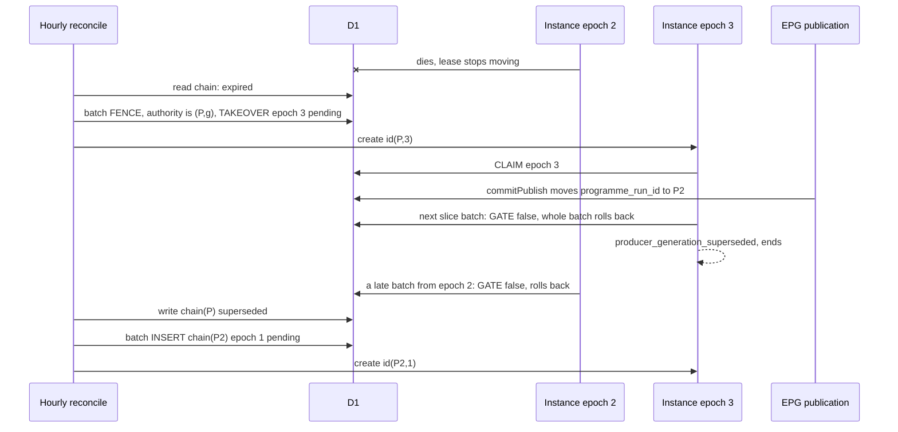
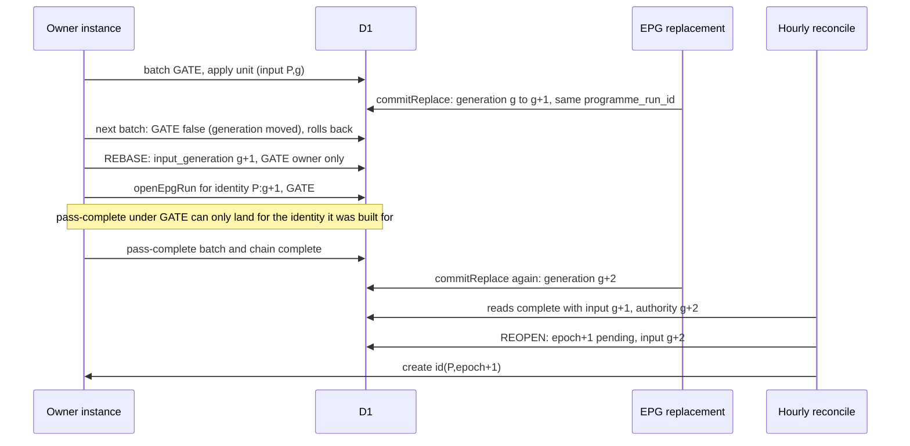
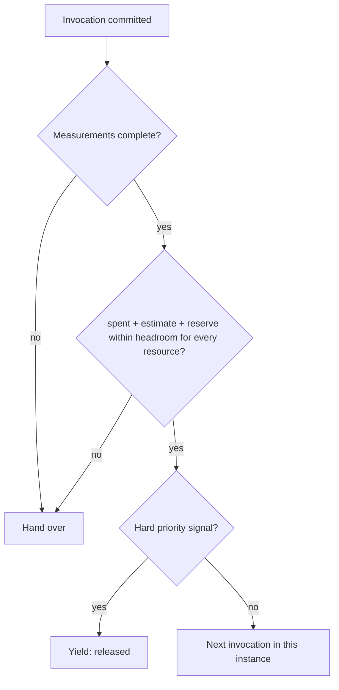

# ADR 0141: The Producer Workflow chain has one epoch-fenced owner per published generation, hands over by a durable claim before `create()`, pins every write to the latest published generation inside the write batch, and recovers only through the hourly EPG reconciliation

**Status:** **Proposed** (revision 2 after independent architecture review; design proposal for owner review, it stays Proposed until the owner resolves the options and accepts the finished protocol; no code, migration, Workflow, configuration, flag, schedule or production operation is authorized by this record)
**Original decision date:** unknown (proposal; not yet decided)
**Recorded at:** 2026-11-14
**Approval source:** not yet approved. The scope of this proposal was authorized by the owner decision of 14 November 2026 09:29 UTC on [AIR-374](https://trello.com/c/ha7ais3w#comment-6af82a03b5debcfad1f75466) (analysis, design and a documentation-only pull request; implementation, wiring, Workflow, cron, flag, limit, D1, R2 and migration changes are NOT authorized and need their own approvals after this protocol is accepted)
**Related work:** [AIR-374](https://trello.com/c/ha7ais3w), [ADR 0140](0140-producer-workflow-adaptive-successor-chain.md) (Accepted as DESIGN; this record refines its decisions 3, 5, 6, 7 and 8 and does not revisit its other decisions), [ADR 0128](0128-epg-canonical-producer-durable-execution.md), [ADR 0137](0137-left-plan-settlement-from-sealed-newer-input.md), [ADR 0098](0098-discovery-workflow-step-failure-recovery.md) (precedent, not proof), [ADR 0094](0094-discovery-workflow-invocation-budget.md) (precedent for a measured instance budget), [ADR 0100](0100-epg-cloudflare-workflow-executor.md), [ADR 0135](0135-epg-priority-discovery-pause.md), [M1 limits evidence](../evidence/d1-migration/air-374-m1-workflow-limits-2026-11-14.md), [S5-1 gate evidence](../evidence/d1-migration/air-374-s5-1-nextaction-gate-2026-11-13.md), [producer driver reference](../reference/data/producer-driver.md), [producer run store reference](../reference/data/producer-run-store.md)
**Supersedes:** None. It does not change [ADR 0140](0140-producer-workflow-adaptive-successor-chain.md), [ADR 0128](0128-epg-canonical-producer-durable-execution.md) decision 8 or any other Accepted record
**Superseded by:** None

## How to read this record

Every statement carries one of three marks, so a reviewer can tell what was read from what is proposed:

- **[code]** was read in the repository at the cited `file:line` (lines are those of `main` when this record was written).
- **[proposal]** is a design choice made here. Nothing exists for it yet.
- **[unverified]** is a platform or runtime behaviour this record does NOT source. It is listed in [Verification obligations](#verification-obligations-nothing-below-is-established) and must be settled by a primary-source reading or a bounded measurement before the dependent step is built. No numeric threshold is invented here: a number that needs a measurement is a named **parameter** (`PARAM-n`), never a value.

## Context

[ADR 0140](0140-producer-workflow-adaptive-successor-chain.md) fixed the direction: S-A (repeated bounded invocations of ONE run), a separate Producer Workflow started after the EPG commit (W3), an adaptive chain of instances (not one instance per 1,000 units), the default `limits.subrequests` of 10,000 per instance, and isolation from the EPG publication. It deliberately left the mechanism open: the hand-off, the exclusive-ownership proof, the generation fence, the failure windows and the budget rule. The owner decision of 14 November 2026 09:29 UTC asks for one concrete protocol covering six requirements (ownership and hand-off, generation fencing, a failure-recovery table, adaptive bounded execution, verification, storage justification). This record is that protocol. It is a proposal: the four inputs fixed by ADR 0140 (S-A, W3, adaptive successors, default limits, EPG isolation) are not reopened here.

What the code does today (all **[code]**):

1. **The producer run is already a revision-CAS row, but it carries no owner.** `canonical_producer_run` has a `revision` column and no owner, lease or epoch column ([migration 0020](../../migrations/0020_canonical_producer_run.sql) lines 45 to 86; `pass_state` allows `passing`, `passed`, `stopped`, `superseded` at line 58). Every store write asserts `casRun(run)` (the stored revision equals the one read; `src/canonical-producer-store.js:29`) and `changes()=1` (line 30) inside ONE `batch()` that also starts with the marker fence (line 31, 59 to 66, `SLICE_STATEMENT_CAP` 48 at line 21). A lost compare-and-set is named `producer_cas_lost` (lines 41 to 58). A revision compare-and-set therefore proves that nobody moved THIS ROW since it was read. It does not prove that the caller is the only instance working on the run: two instances that read the same revision race, one wins, and the loser is told only after its units were applied.
2. **The fences that exist assert the Film/Person marker, not the published generation.** `FENCE` asserts `film_person_authority` is `d1`/`open` at the generation read (`src/canonical-mutations.js:20`). `assertSql(condition)` is one upsert into `film_person_cas` whose `ok` column is `CHECK (ok=1)`, so a false condition rolls the whole batch back (`src/canonical-mutations.js:19`). `head(gate, entities)` builds `[FENCE, REVISION...]` (lines 88 to 92) and is called from eleven places: `src/canonical-film-writers.js:266`, `src/canonical-mutations.js:109, 147, 194`, `src/canonical-person-state.js:221, 242`, `src/canonical-receipts.js:339`, plus the non-producer callers `film-admission.js:93, 138`, `localization-sources.js:169`, `tmdb-retirement-decisions.js:154`. Nothing in any of them looks at `published_epg_authority.programme_run_id`.
3. **The published input moves in two ways, and only one changes `programme_run_id`.** `commitPublish` moves `published_epg_authority.programme_run_id` and increments `generation` when `stage.phase==='published'`, and only increments `generation` otherwise (`src/published-epg.js:296` to `304`). `commitReplace` increments `generation` and rewrites the programme, show, member and document rows IN PLACE under the SAME `programme_run_id` (`src/published-epg.js:318` to `343`). A pin on `programme_run_id` therefore does not show that a plan is current. The commit batches are fenced `batch()` calls with a `published_epg_cas` check after each decisive statement (`FENCE_SQL`, line 23); the file also documents the precedent for carrying a fence with a commit and asserting it in the batch's own statement (`epgFenceStatements`, lines 24 to 31).
4. **The EPG executor already solved lease, takeover and create ordering for itself, in its own documents.** `LEASE_MS=5 min` and `BOUNDARY_MARGIN_MS=15 s` (`src/epg-orchestration.js:24`); `leaseLive` treats a lease as live until expiry plus the margin (line 115); a holder refuses to act at `expires-margin` (line 159); instance ids are deterministic, `epg_<runKey>_<series>` (line 30); `casDoc` is the compare-and-set on the stored document revision (line 47); `createError` classifies a thrown create as `exists` or `uncertain` (line 90); the control row is written BEFORE `create()` and an existing instance attaches (lines 507 to 533); `instanceStatus` of `unknown` holds instead of proving death (lines 513 to 515). The hourly `ensure` runs `reconcileMirrors` and then `ensureWorkflow` as separate steps and returns results instead of throwing (lines 483 to 487).
5. **Those documents cannot host the producer's ownership.** `epg_orchestration_document.key` is `CHECK (key IN ('mode','control','lease'))` ([migration 0017](../../migrations/0017_epg_orchestration.sql) line 37); a new key needs a migration, and the `control` row is the EPG executor's own series state, so reusing it would couple the producer to the executor's CAS domain and failure budget, which ADR 0128 guardrail G6 and ADR 0140 decision 2 forbid.
6. **Discovery is the precedent for a measured instance budget.** The Discovery Workflow wraps its D1 binding in a counting proxy (`meterD1`/`meteredEnv`, `src/discovery-workflow.js:303` to `322`), writes its state BEFORE `create()` and attaches on `exists` (lines 533 to 561), and hands over at a counted level rather than a guessed one ([ADR 0094](0094-discovery-workflow-invocation-budget.md): both failing instances died near 12.2 thousand D1 statements; it hands over at 6,000; the platform limit itself was not established).

What the platform documents (checked against the Cloudflare documentation search, **[code]-level confidence is NOT claimed**; each item is also an obligation below): D1 `batch()` statements run as one SQL transaction with a full rollback when one fails; a batch counts as one query against the per-invocation query limit; `create()` with an id that already exists within retention throws; `get(id)` throws when the id does not exist; instance ids are unique per Workflow. A throw from `create()` is not a statement about the instance.

## Decision (proposal)

### D0. What "current" means: the input identity **[proposal, derived from code]**

The published authority has TWO counters that matter. `programme_run_id` names the published programme. `generation` is a monotone integer that rises on EVERY change of published content: a publication (`commitPublish`, `src/published-epg.js:302` to `304`), a legacy publish (`src/published-epg.js:586`) and a same-programme replacement (`commitReplace`, which also deletes and re-copies the programme and watchlist rows IN PLACE under the same `programme_run_id`, `src/published-epg.js:318` to `343`). A plan built from the published rows is therefore built from one **input identity** `I = (programme_run_id P, authority generation g)` read together with the rows. `I` is "current" exactly while the authority says `mode='d1'`, `cutover='open'`, `programme_run_id=P` and `generation=g`.

Consequences, stated because the first revision got them wrong:

- A pin on `programme_run_id` alone does NOT say that a plan is current: a replacement keeps `P` and changes the rows under it. The pin of this record is on `I`.
- `canonical_producer_run.source_generation` (immutable run identity; `openEpgRun` throws `producer_source_generation_mismatch` for another value, `src/canonical-producer-store.js:139`) and `applied_generation` (`pass_state='passed'` claim, never replayed, `src/canonical-producer-store.js:143`) are compared as STRINGS with the published generation by `canonicalFreshness` (`src/canonical-producer-run.js:420`). The run identity must therefore carry `g`: **`source_generation := P || ':' || g`** and the run key carries it as well (`run_key := <EPG event id>@<g>`; length limit 160, `migrations/0020_canonical_producer_run.sql` line 46). A replacement then yields a NEW input identity, a NEW run row and `lagging` until its pass completes, instead of a stale `passed` run that still reads `current`. Fingerprint drift remains the handling of changes that do NOT move `I` (metadata cache, prerequisites), as in ADR 0128.
- Every reader that compares freshness (the [reader inventory](../evidence/d1-migration/air-374-canonical-freshness-readers-2026-11-14.md)) must pass the same identity string. That is a consequence S5-1 must carry (V-14, T-11).
- Replacing a `passed` run is not "replay": it is a new run for a new identity, so `openEpgRun`'s refusal to replay a completed applied claim stays untouched and correct.
- Any `generation` change is conservatively treated as a new input identity, including a watchlist-only replacement. Narrowing this per replacement kind is an optimisation that needs its own proof and is not proposed.

### D1. One durable chain row per published programme, separate from the run row **[proposal]**

A new table `canonical_producer_chain` (proposal only; a migration is a separate approval, see [Storage](#storage-what-is-reused-what-is-new-and-why)) holds the ownership of the chain of ONE published programme `P`. Its CAS domain is its own revision, separate from the run row's.

| Column | Meaning |
| --- | --- |
| `programme_run_id` (primary key) | The published programme the chain serves |
| `input_generation` | The authority `generation` `g` of the input identity the chain currently works on. Moved only by REBASE, REOPEN or LAUNCH, never by the owner's slices |
| `run_key` (nullable) | The run key of the run of the current input identity, filled by the first `openEpgRun` |
| `owner_epoch` | Monotone fencing token, `>= 1`, rises ONLY by a compare-and-set batch that read the previous value |
| `owner_instance` | `pw_<hash(programme_run_id)>_<epoch>`: deterministic and derived, stored for diagnosis |
| `claim_nonce` | A random value fixed BEFORE the CLAIM mutation (D2), part of every ownership assertion |
| `owner_state` | `pending`, `active`, `released`, `complete`, `stopped`, `superseded` |
| `lease_expires_at` | `pending`: end of the claim window. `active`: lease end, renewed by every slice commit. `released`: time of the release |
| `handoff_count`, `takeover_count`, `rebase_count`, `stopped_by` | Counts and a named code only (no ids, no content) |
| `revision`, `created_at`, `updated_at` | The chain row's own compare-and-set and times |

A trigger refuses writes outside `d1`/`open`, a change of the key or `created_at`, a `revision` that does not rise by one and a decreasing `owner_epoch` (the trigger pattern of migration 0020).

### D2. Ownership protocol: the exact order of transitions and writes **[proposal]**

An instance with epoch `e` owns the chain only while the chain row says `owner_epoch=e`, its own `claim_nonce`, `owner_state='active'`, and the authority still says `I`. The proof is asserted INSIDE every write batch (D4), never read first and written later.

**Launch** (the hourly reconciliation, D6):

1. L1. Read the published authority (`d1`/`open`, `P`, `g`) and the chain row of `P`. No chain row and no passed run of identity `P:g` means launch.
2. L2. Batch: `[FENCE, authority is (P,g), INSERT chain(P, input_generation=g, epoch=1, owner_instance=id(P,1), state='pending', lease_expires_at=now+PARAM-claim-window) ON CONFLICT DO NOTHING, assert changes()=1]`. A concurrent launcher loses on the primary key and does not create.
3. L3. `create({id: id(P,1), params: {programmeRunId: P, epoch: 1}})`. The ownership state is already durable; the create's outcome changes nothing in D1.

**Claim** (the first steps of every instance). The nonce is fixed durably BEFORE the mutation, because a random value generated inside the side-effecting step is not stable when D1 commits and the step fails before its result is checkpointed:

1. C0. `step.do('nonce')`: no D1 or other side effect, returns a random value `n`. A retry of this step before its result is stored may return a different value, which is harmless because nothing has used the value yet. The stored result is the only nonce this instance will ever use.
2. C1. `step.do('claim', n)`: batch `[FENCE, authority is (P, chain.input_generation), UPDATE chain SET owner_state='active', claim_nonce=:n, lease_expires_at=now+LEASE, revision=revision+1 WHERE programme_run_id=P AND owner_epoch=:e AND owner_instance=:id AND owner_state='pending' AND revision=:r, assert changes()=1]`.
3. C2. **Commit succeeded, result lost** (the exact window): the retried claim step receives the SAME `n` from the checkpointed nonce step. Its batch fails (the row is no longer `pending`). It reads the row once: it is the owner iff the row says `active`, its epoch, its `owner_instance` and `claim_nonce=n`. Otherwise it is `not_owner` and ends without writing. A derived nonce `hash(P, e, id)` would also be stable, but identical for two instances started under one id (a platform fault this design treats as impossible but does not rely on), so both would read themselves as owners; a stored random value defeats that, and a derived value is rejected for that reason only. If the checkpointed nonce is unreadable the instance ends as `not_owner` and the chain recovers by expiry (liveness only).

**Work** (every slice):

1. W1. Each slice commit is the existing batch (`fence`, run CAS, result rows, run update, `changes()=1`, `src/canonical-producer-store.js:205` to `222`) plus `GATE` (D4) and the chain lease renewal (`UPDATE chain SET lease_expires_at=now+LEASE, revision=revision+1 WHERE <owner predicate>`). The renewal piggybacks on the commit.
2. W2. Every unit apply asserts the one combined statement `GATE` in its own batch (D4). A slice that finds `not_owner`, `producer_generation_superseded` or `producer_input_superseded` ends or rebases (D3b) with no retry of the failed batch.
3. W3. The instance stops starting new work at `lease_expires_at - margin` of its own clock (the EPG precedent, `src/epg-orchestration.js:159`).

**Hand-off** (the exact order, closing the question about before and after `create()`):

1. H1. The budget rule (D5) decides, at an invocation boundary after a committed slice, to hand over. The cursor is durable in the run row.
2. H2. HANDOFF batch: `[FENCE, GATE(e), UPDATE chain SET owner_epoch=e+1, owner_instance=id(P,e+1), owner_state='pending', claim_nonce=NULL, lease_expires_at=now+claim-window, handoff_count=handoff_count+1, revision=revision+1 WHERE owner_epoch=e AND claim_nonce=:n AND owner_state='active' AND revision=:r, assert changes()=1]`. From this commit the old instance has NO write authority. **Commit succeeded, result lost:** the retried step's batch fails; its read-back finds `owner_epoch=e+1`, `owner_instance=id(P,e+1)` and `owner_state` `pending` or `active` and treats the hand-off as done.
3. H3. `create({id: id(P,e+1), ...})` in a separate `step.do`. Outcomes: success, exit. `exists`: treated as created (the successor's own CLAIM decides). Any other throw, or no answer: bounded retries (`PARAM-create-attempts`), then exit. An ambiguous create NEVER proves that the instance is absent.
4. H4. The successor runs C0 to C2. If it never starts, the claim window ends and the reconciliation takes over with a NEW epoch (D3a).

**Why safe:** ownership (D1 state) moves BEFORE `create()` ([ADR 0098](0098-discovery-workflow-step-failure-recovery.md) and the EPG executor do the same with their own state). A crash after H2 and before H3 leaves `pending` with nobody running (recovered by expiry). A duplicate create or a duplicate instance changes nothing (the nonce-bound CLAIM). Every recovery action takes a new epoch, so no path needs to know whether an earlier instance is dead.

**Separation the owner asked for:** the RUN row revision (`casRun`) fences the cursor and results of the plan; the CHAIN row (epoch, nonce, state, input) is the proof of exclusive ownership. A slice batch asserts both; neither substitutes for the other.

### D3. Transitions other than hand-off **[proposal]**

Every transition is ONE batch `[FENCE, <authority predicate>, UPDATE chain ... WHERE programme_run_id=P AND owner_epoch=:e AND revision=:r AND owner_state <predicate>, assert changes()=1]` followed, where a new instance is wanted, by `create(id(P,e+1))`. Each takes a NEW epoch, so no transition needs proof that an earlier instance is dead. The instance status (`running`, `errored`, `unknown`, absent) is telemetry only, never a gate.

| Transition | Who | State predicate and extra assertions | Effect |
| --- | --- | --- | --- |
| **a. TAKEOVER** | hourly reconcile | `owner_state IN ('pending','active')` AND `lease_expires_at + BOUNDARY_MARGIN < now` (Worker clock) AND authority is `(P, chain.input_generation)` | epoch+1, `pending`, new claim window, `takeover_count+1` |
| **b. REBASE** | the owner, in its batch path | `OWNER`; authority is `(P, g')` with `g' > chain.input_generation` (the replacement is observed through the authority, the owner never trusts its own earlier read) | `input_generation=g'`, `rebase_count+1`, epoch unchanged; the owner then plans from the inputs read at `g'` and opens the run of identity `P:g'` through `openEpgRun` (GATE). Past `PARAM-rebase-cap` the chain is `stopped` (`producer_input_unstable`) |
| **c. RELAUNCH** | hourly reconcile | `owner_state='released'` AND authority is `(P, chain.input_generation)` AND no hard priority signal. The signal is read first; where it is expressible as one SQL predicate on one table (the EPG priority row of ADR 0135) the same predicate is asserted in the batch, otherwise the relaunched owner re-checks at its first invocation boundary and yields again at the cost of one claim (V-13) | epoch+1, `pending`, new claim window, `relaunch_count+1`. Its state predicate is disjoint from TAKEOVER's (`released` vs `pending`/`active`), so two concurrent reconcilers cannot both succeed: one batch wins on `owner_epoch` and `revision` and the other reads the new row |
| **d. REOPEN** | hourly reconcile | `owner_state IN ('complete','stopped')` AND authority is `(P, g)` with `g > chain.input_generation` | `input_generation=g`, epoch+1, `pending`, counters of the pass reset, `reopen_count+1`. This is the "replacement after passed" path |
| **e. YIELD** | the owner | `OWNER` (no `PIN`: a yield must be writable when the input moved) | `released`, epoch unchanged |
| **f. COMPLETE** | the owner | the SAME batch as `commitPassComplete`: `GATE` AND `chain.input_generation` equals the run's `P:g` | `complete` |
| **g. STOP** | the owner | `OWNER` (no `PIN`) | `stopped` with a named code |
| **h. SUPERSEDE** | hourly reconcile | a non-terminal chain row whose `programme_run_id` is not the published `P` | `superseded` (hygiene; safety rests on the pin). The older run row is left untouched (no new writer) |

**Safety does not depend on clocks.** A takeover that races a healthy owner either commits first (the owner's next batch fails its assertion) or loses its compare-and-set because the owner's slice commit bumped `revision`. Clocks affect liveness only: how long a dead owner blocks and how much a healthy but late owner wastes (at most the unit batch in flight). The epoch cap `PARAM-epoch-cap` bounds flapping (`producer_chain_epoch_cap`, `stopped`).

### D4. Fencing at the write boundary, atomically, and fail-closed **[proposal]**

**One statement, `GATE`, asserted in the same batch as the write**, using the existing rollback primitive (`src/canonical-mutations.js:19`). No read-then-write check exists anywhere in the producer. For a chain-owned write it is:

`EXISTS (SELECT 1 FROM published_epg_authority a JOIN canonical_producer_chain c ON c.programme_run_id=a.programme_run_id WHERE a.id=1 AND a.mode='d1' AND a.cutover='open' AND a.programme_run_id=? AND a.generation=c.input_generation AND c.owner_epoch=? AND c.claim_nonce=? AND c.owner_state='active')`

It asserts, at the instant of the write, that the input identity is still the latest published one (`P` and `g`, so a publication OR a same-programme replacement fails it) AND that the caller still owns the chain at its epoch and nonce. A false `GATE` rolls the whole batch back. Failure naming re-reads the rows, as `refuse` does for the marker (`src/canonical-producer-store.js:41` to `58`): `producer_not_owner` (chain row moved), `producer_generation_superseded` (`programme_run_id` moved), `producer_input_superseded` (same programme, `generation` moved: the REBASE trigger).

**Every mutating store path asserts `GATE`, except the two end-of-ownership writes (`commitStop` and the yield), which assert `OWNER` so they stay writable after the input moved. No path asserts the generation alone: there is no `PIN`-only exception, and no path runs without the owner proof.** That includes both `openEpgRun` transactions (the guarded INSERT and the fingerprint-replay reset of `pass_no`, cursor and strikes, `src/canonical-producer-store.js:131` to `150`): an instance has already CLAIMed when it calls them, and a stale instance after a takeover must not insert or reset the shared run.

| Writer | Today (code) | Change |
| --- | --- | --- |
| `openEpgRun` (both transactions), `commitStrike`, `commitSlice`, `commitPassComplete`, `commitStop`, `commitResume`, `settleResult`, `updateResult` (`src/canonical-producer-store.js:131, 180, 205, 224, 234, 273, 245, 258`) | `[fence, casRun, ...]` | `GATE` in every batch of the chain-driven path; `commitSlice`, `commitStrike` also renew the lease; `commitPassComplete` also sets the chain `complete` (D3f) in the SAME batch. `commitStop` and a yield use `OWNER` alone (D3e, D3g) because they must stay writable after the input moved |
| Unit writers reached by `film_facts`, `person_mutation`, `person_state`, `film_credits` through `fenced.head` | `head(gate, entities)` = `[FENCE, REVISION...]` (`src/canonical-mutations.js:88` to `92`) | `GATE` (chain-driven) or the RETRY fence (below), carried by the producer fence object and asserted by `head`. Non-producer callers (`film-admission.js`, `localization-sources.js`, `tmdb-retirement-decisions.js`, the projector) are unchanged |
| EPG publication (`commitPublish`, `commitReplace`) | unchanged | none: they are the writers whose commit the gate observes |
| `mintDictionaryRun` and the dictionary pass | `origin='dictionary'` | not chain-driven: an explicit `dictionary` fence variant (below), never an absent one |

**Enforceable producer boundary (an optional argument is not fail-closed).** The first revision claimed that an optional gate argument in `fenced.head` prevents a producer call site from forgetting it. That is wrong. The boundary is layered, and each layer is a test:

1. **Required parameter, explicit variants.** Every producer-reachable store function and applier takes a REQUIRED `fence` object with a `kind`: `chain` (carries `programmeRunId`, `epoch`, `nonce`), `retry` (D4a), or `dictionary`. A missing or unknown `fence` is refused before any statement with `producer_fence_missing`; no default exists.
2. **Marked writes refuse without a gate.** The appliers reach the shared writers only through ONE helper, `producerWrite(fence, writer, input)`, which sets `input.origin='producer'` and passes the fence. `head` refuses (`producer_fence_missing`, nothing written) when `origin='producer'` and the fence is absent or of the wrong kind for the batch.
3. **Static audit.** A test in the style of `tests/get-write-audit.mjs` fails when any module of the producer path (`canonical-producer-driver.js`, `canonical-producer-store.js`, `canonical-epg-producer.js`, `canonical-epg-person-producer.js`, `canonical-dictionary-producer.js`, `canonical-person-mutation-producer.js`) calls a writer or a store function other than through the helper or with a literal missing `fence`. It is a guard against a forgotten call, not a proof that JavaScript cannot bypass it.
4. **Negative runtime tests.** For each store writer and each unit kind: a producer write with no fence, with a wrong-kind fence, with a stale epoch, with a moved programme, and with a moved `generation`, is refused and leaves the database byte-identical.

**D4a. The unit retry pass has its own fail-closed fence.** `retryEpgProducerResults` is separately callable (`src/canonical-producer-driver.js:420` to `470`): it reads the due results, builds the current plan, applies units through the same appliers and settles through `settleResult` and `updateResult`. [ADR 0128](0128-epg-canonical-producer-durable-execution.md) decision 8 keeps it an explicit, unscheduled call, and neither this record's chain nor its reconciliation calls it. It therefore cannot hold the chain's `OWNER`. It carries the `retry` fence `{programmeRunId: P, inputGeneration: g}` taken from the plan it just built, asserted in the same batch as every write as `RETRY_GATE`:

`authority is (d1, open, P, g)` AND `NOT EXISTS (SELECT 1 FROM canonical_producer_chain WHERE programme_run_id=P AND owner_state IN ('pending','active') AND lease_expires_at > ?now)`

| Chain state at the write | Result for the retry |
| --- | --- |
| `pending` or `active` with a live lease | refused: `producer_chain_active`; the retry returns `stopped` with that code and leaves its rows for a later call (the chain finishes the pass; retried results of the same plan are then redundant or superseded by the chain's own sweep) |
| `released`, `complete`, `stopped`, expired `pending`/`active`, or no row | allowed, provided the authority still says `(P, g)` |
| `superseded`, or the published `P` or `generation` moved | refused: `producer_generation_superseded` or `producer_input_superseded`; results of the older identity stay for the sweep that already supersedes them |

Interleaving is closed at batch granularity: a chain that claims between two retry batches makes the retry's NEXT batch fail `producer_chain_active`; a retry batch already committed was individually data-safe (idempotent appliers, receipts, `REVISION`, and a per-row compare-and-set on state and attempts in `settleResult` and `updateResult`, `src/canonical-producer-store.js:245` to `269`). The exclusion is a restriction of the explicit retry while a chain is live (up to about an hour after a chain death, because a dead chain stays `active` until its lease and margin end and the next tick). The alternative of `PIN` plus the per-row compare-and-set without the exclusion is a trade-off (T-12).

**Which of the eleven `head` call sites each unit kind reaches** (`src/canonical-film-writers.js:266`, `src/canonical-mutations.js:109, 147, 194`, `src/canonical-person-state.js:221, 242`, `src/canonical-receipts.js:339`, and the non-producer `film-admission.js:93, 138`, `localization-sources.js:169`, `tmdb-retirement-decisions.js:154`) is **[unverified]** (V-9): S5-1 maps and proves them with the tests above.

### D5. Adaptive bounded execution **[proposal]**

**Two kinds of limits, never conflated:**

| Boundary | What it bounds | Source |
| --- | --- | --- |
| Invocation limits | one `runEpgProducerPass` call: `sliceSize`, `maxSlicesPerRun`, `sliceDeadlineMs`, the unit ceiling | required parameters of the driver, no defaults (`src/canonical-producer-driver.js`, header and `parameterProblem`); values are the D-C numbers, not decided here |
| Instance limits | one Workflow instance across all its invocations: subrequests (D1 and R2 calls), CPU, wall time, memory | documented platform limits per [M1 evidence](../evidence/d1-migration/air-374-m1-workflow-limits-2026-11-14.md); default `limits.subrequests` stays 10,000 (ADR 0140 decision 4); never raised globally |

**Metering.** Each invocation runs as its own `step.do` and returns the counts it spent (`d1Calls`, `d1Statements`, `r2Calls`, `elapsedMs`, `peakMemory` if observable). The instance rebuilds its totals from the step results on every replay, as [ADR 0094](0094-discovery-workflow-invocation-budget.md) does, with the counting proxy of `src/discovery-workflow.js:303` to `322` as the pattern. The meter counts both binding calls and statements, and the decision uses the more conservative until a measurement settles how a batch counts toward the subrequest limit (V-3). A failed step attempt's spend is unknown and is charged at the instance's largest measured invocation.

**Successor decision rule.** At each invocation boundary the instance continues in the same instance only if, for EVERY metered resource `r`:

`spent_r + E_r + R_r <= f_r × L_r`

`L_r` is the documented limit, `f_r` in `(0, 1]` the headroom fraction (`PARAM-headroom-r`), `E_r` the estimate of the next invocation (the largest spend this instance measured, never below the measured floor `PARAM-floor-r`; for the first invocation the floor alone) and `R_r` the hand-off reserve: the counted cost of the hand-off path (one admit read, the HANDOFF batch, one create: three subrequest calls by this design) plus `PARAM-reserve-margin-r`. Otherwise it hands over (H1 to H4). **A missing or implausible measurement means hand over, never continue**; every instance performs at least one invocation (progress guarantee). If `E_floor + R > f × L` for any `r` the configuration is infeasible and the chain stops with `producer_budget_infeasible` instead of creating a successor that cannot progress. Wall time and memory follow the same form with their own parameters; whether CPU and memory are per step or cumulative per instance is **[unverified]** (V-5, V-6), so until settled the rule treats each as cumulative. A REBASE (D3b) discards the plan of the old identity: its spend still counts toward the instance, and a rebase never resets the meter.

**Priority and contention.** The producer yields to the EPG publication and to Discovery ([ADR 0135](0135-epg-priority-discovery-pause.md)). Before every invocation after the first it reads, read-only, the existing signals (an EPG series in flight, the Discovery EPG-priority state, a live Discovery lease, an open projector window); the exact predicates are defined from those ADRs by S5-1 (V-13). A hard signal makes the owner YIELD (D3e: `released`, epoch unchanged) and return `yielded`; the hourly reconciliation RELAUNCHes (D3c) when the signal is clear. A soft signal (Discovery active) allows one more invocation before the yield (a fairness floor; T-4). D1 contention: classify transient D1 errors and the observed batch latency against a baseline (`PARAM-contention-thresholds`): `step.sleep` backoff with jitter, then a halved `sliceSize` down to a floor, then yield.

**Isolation from the EPG executor.** The chain writes nothing into `epg_orchestration_document`, never changes EPG mode or control rows, never returns an error to the EPG executor and keeps its own telemetry and read-model state (ADR 0140 decisions 2 and 8). The EPG hourly step calls the chain reconciliation as a third independent step whose result is returned, never thrown (D6).

### D6. Recovery only through the existing hourly reconciliation **[proposal]**

The hourly `EpgOrchestration.ensure` (`src/epg-orchestration.js:483` to `487`; the Worker's single cron tick calls it, `src/worker.js:1751`) gains a third independent step after `reconcileMirrors` and `ensureWorkflow`: `reconcileProducerChain`. It never throws, returns counts, and does nothing when the Film/Person marker or the authority is not `d1`/`open` or the producer Workflow binding is absent (the `workflow_unavailable` shape of `src/epg-orchestration.js:495`). It adds no schedule, no Task and no cron entry.

| Observed state (one authority read, one chain read, bounded) | Action |
| --- | --- |
| authority not `d1`/`open`, marker not open, binding absent | none |
| published `(P, g)` has no chain row and no passed run of identity `P:g` | LAUNCH (D2 L1 to L3) |
| chain `pending` or `active`, not expired | none |
| chain `pending` or `active`, expired | TAKEOVER (D3a) |
| chain `released`, no hard priority signal | RELAUNCH (D3c) |
| chain `complete` or `stopped`, `input_generation` equals `g` | none |
| chain `complete` or `stopped`, `g > input_generation` | REOPEN (D3d) |
| a non-terminal chain row for an older programme | SUPERSEDE (D3h) |

**Two statements that keep ADR 0128 decision 8 intact:** the reconciliation only (re)starts the chain of the pass; it never calls `retryEpgProducerResults`, and neither does the chain, so the retry pass stays an explicit request and is not turned into a scheduled retry. The reconciliation is recovery of the chain, not a retry of failed units. This is the qualification ADR 0140 decision 5 already records.

**Latency bound.** A chain that dies is noticed at the first hourly tick after its lease (5 minutes plus the margin, **[code]** `LEASE_MS`) or claim window has ended: worst case about one hour plus the lease. Transient failures inside a live instance are retried by the Workflow step retries and do not wait for a tick. Whether an hour per death meets the freshness target is the owner's lag question (T-3).

### D7. Failure windows and recovery **[proposal]**

| # | Window | State left in D1 | Detection | Recovery | Why it is safe |
| --- | --- | --- | --- | --- | --- |
| F1 | Owner crashes mid-slice, before any CAS | cursor at the last committed slice; epoch `e` active | lease passes expiry plus margin | TAKEOVER; the new owner resumes from the cursor | unit effects are idempotent; the run CAS resumes at the stored revision |
| F2 | Crash before the HANDOFF batch | as F1 | as F1 | as F1 | nothing changed |
| F3 | Crash AFTER HANDOFF, BEFORE `create()` | `pending`, epoch `e+1`, no instance | claim window passes | TAKEOVER, epoch `e+2`, new id | the old instance has no authority; the pending epoch is skipped |
| F4 | `create()` throws an unknown error | `pending`, epoch `e+1` | none at the time | bounded retries, then exit; an instance claims, or the window passes and F3 applies | absence is never inferred from the throw |
| F5 | `create()` succeeds, acknowledgement lost | as F4 | as F4 | as F4 | CLAIM, not create, is the proof |
| F6 | Duplicate create (`exists`) | unchanged | the explicit `exists` | treated as created; the instance's CLAIM decides | same epoch means same id; the stored random nonce excludes a second owner |
| F7 | Successor dies before CLAIM | `pending` | window passes | as F3 | as F3 |
| F8 | Successor claims, works, dies | `active`, lease stops moving | lease expiry | TAKEOVER | as F1 |
| F9 | TAKEOVER races the successor's CLAIM | one batch wins on the serialized D1 | the loser's assertion or CAS fails | CLAIM wins: the reconciler's CAS fails and it re-reads; TAKEOVER wins: the successor gets `not_owner` | one revision, one winner |
| F10 | TAKEOVER races an owner's slice commit | revision bumped | takeover's `revision=:r` fails | the reconciler sees a live lease next read | compare-and-set on the old revision |
| F11 | Lease lost while the owner is alive but stalled (skew beyond the margin, slow D1) | takeover committed, or not | the owner's next batch fails `GATE`, or it stops at `expires-margin` | the owner ends; the takeover owner continues | the epoch, not the clock, fences; waste is at most the unit in flight |
| F12 | Step or message redelivery (replay) | the same | step results are cached; CLAIM, HANDOFF and slice commits are read-back idempotent | none | the nonce comes from a checkpointed step; the revision CAS resumes the cursor; the create step sees `exists` |
| F13 | Fingerprint drift inside the run (an input that does NOT move `I`) | run row replays with `pass_no+1` | `openEpgRun` at the start of an invocation, under `GATE` | the same owner continues from the start; `PARAM-replay-cap` replays end in `stopped` (`producer_fingerprint_unstable`) | ADR 0128 semantics; the chain row is untouched |
| F14 | A newer programme is published during the chain | `programme_run_id` moved | the next producer batch fails `GATE` and rolls back | the stale owner ends; SUPERSEDE; LAUNCH for the new programme | the gate is asserted in the write batch: no read-then-write window |
| F15 | Marker or authority leaves `d1`/`open` | unchanged | `FENCE` or `GATE` fails | the chain ends; no launch while not open | fail closed; code rollback never touches authority |
| F16 | D1 batch fails transiently in HANDOFF, TAKEOVER, RELAUNCH or REOPEN | batch is atomic: unchanged | the batch error | in-instance bounded retry, else the next tick | a failed `batch()` leaves no partial transition |
| F17 | Reconciler dies between a transition and `create()`, or the transition commits and its result is lost | `pending`, new epoch | claim window passes | TAKEOVER at the next tick | as F3 |
| F18 | Platform status says `unknown`, `errored` or absent | any | n/a | none: status never gates safety | telemetry only |
| F19 | Epoch cap, replay cap, rebase cap or infeasible budget | `stopped` with a named code | the code | no automatic relaunch for the same input; a new input identity REOPENs | prevents a hot loop |
| F20 | Priority yield | `released` | reconciler read | RELAUNCH when the signal is clear | the cursor is durable |
| F21 | **CLAIM commits, its result is lost** | `active`, epoch `e`, nonce `n` | the retried claim step | the retry reuses the checkpointed `n`, its batch fails, the read-back finds its own epoch, instance and nonce: owner | the nonce is fixed before the mutation (D2 C0 to C2) |
| F22 | HANDOFF commits, its result is lost | `pending`, epoch `e+1` | the retried step | its read-back finds `id(P,e+1)` and proceeds to create | D2 H2 |
| F23 | Same-programme replacement between planning and a unit write | `generation` moved | the unit batch fails `GATE` | REBASE: the owner re-reads inputs at `g'`, opens run `P:g'`; the old run row stays | the gate pins `I`, not only `P` |
| F24 | Replacement between the last unit and `commitPassComplete` | `generation` moved | the pass-complete batch fails `GATE` | the run is NOT `passed`; REBASE as F23 | the claim is written only under the identity it was built for |
| F25 | Replacement AFTER `passed` and chain `complete` | run `passed` for `P:g`; authority `(P, g')` | the reconciler sees `g' > input_generation` | REOPEN; freshness reads `lagging` for `P:g'` meanwhile | identity-string freshness (D0); no replay of an applied claim |
| F26 | Direct retry pass while a chain is live | chain `pending`/`active` | `RETRY_GATE` | refused `producer_chain_active` | D4a |
| F27 | Direct retry pass against a chain that is `complete`, `released` or `stopped`, authority unchanged | no live owner | `RETRY_GATE` passes | the retry applies and settles under per-row compare-and-set | D4a |
| F28 | Direct retry pass after a newer publication or replacement | authority moved | `RETRY_GATE` fails | refused; older results await the sweep | D4a |
| F29 | Producer write with no fence | none | `producer_fence_missing` before any statement | the caller bug is visible; nothing is written | D4 boundary, layer 1 and 2 |

### D8. Mermaid diagrams **[proposal]**

The chain row states and all transitions:

Launch, work, hand-off and the successor's claim (the order of D2):

Crash, hourly takeover and supersession (F3, F8, F11, F14):

Same-programme replacement against the owner and after completion (F23 to F25):

The successor decision rule of D5:

### D9. Invariants **[proposal]**

- **I-1** At most one `(epoch, nonce)` holds write authority over a chain at any commit instant; enforced in-batch, independent of clocks and of platform instance state.
- **I-2** `owner_epoch` is monotone and rises only through a compare-and-set batch that read the previous value.
- **I-3** No chain-driven producer write commits unless the SAME batch asserts `GATE`: the input identity `(P, g)` is the latest published one AND the caller owns the chain. No read-then-write check exists. A `PIN`-only mutating path does not exist.
- **I-4** Ownership moves BEFORE `create()`. The outcome of `create()` never changes ownership; CLAIM does.
- **I-5** A failed or ambiguous create never proves absence; recovery never depends on instance status.
- **I-6** The same id is never repaired; every recovery transition takes a new epoch.
- **I-7** Recovery runs only inside the existing hourly reconciliation; no new schedule exists; neither the chain nor the reconciliation calls the unit retry pass.
- **I-8** The chain writes nothing in the EPG executor's documents and never reports into its failure budget.
- **I-9** A missing measurement means hand over; every instance makes at least one invocation or a named stop; no successor is created that cannot progress.
- **I-10** The hand-off reserve is never spent by an invocation.
- **I-11** `passed` on the run row and `complete` on the chain row are set in one batch, under `GATE`, for the identity the run was built for.
- **I-12** SUPERSEDE is hygiene; safety rests on `GATE`.
- **I-13** An applied claim (`passed`) is never replayed or reopened; a replacement creates a new input identity and a new run row. `source_generation` and `applied_generation` carry `g`.
- **I-14** The `claim_nonce` of an instance is fixed by a checkpointed step before its CLAIM mutation and never regenerated.
- **I-15** Every writer reachable from the producer takes a required, typed fence; a missing or wrong-kind fence refuses before any statement. The direct retry pass is admitted only by `RETRY_GATE` (current identity and no live chain) and never by the chain `OWNER`.
- **I-16** RELAUNCH, TAKEOVER and REOPEN have disjoint state predicates and each takes a new epoch by a compare-and-set, so concurrent reconcilers cannot both win.

### D10. Verification: tests and acceptance criteria **[proposal]**

Offline tests (S5-1 acceptance; each names the rows it covers):

1. T-1 `batch()` rollback: a false `GATE` rolls every store writer and a unit writer back with no partial row, on real SQLite with the real migrations (F11, F14, F23).
2. T-2 Interleavings by a controllable D1 double: HANDOFF vs slice commit, TAKEOVER vs CLAIM, TAKEOVER vs lease renewal, two launchers, two reconcilers on RELAUNCH, TAKEOVER vs RELAUNCH vs REOPEN (F9, F10, F17, I-16).
3. T-3 Crash and retry at every hand-off point (F2 to F8).
4. T-4 Create outcomes: success, `exists`, unknown throw, no answer, duplicate under one id (F4 to F6).
5. T-5 Redelivery of every step with cached results; **commit succeeded, result lost** for CLAIM, HANDOFF, TAKEOVER, RELAUNCH, REOPEN; the nonce step retried before its checkpoint; two instances under one id never both own (F12, F17, F21, F22).
6. T-6 Fingerprint drift and the replay cap (F13).
7. T-7 Supersession between two batches of one slice, between a unit write and the slice commit, and at the hand-off (F14).
8. T-8 Budget rule table-driven: a missing measurement hands over, an infeasible budget stops, the reserve is preserved, a REBASE does not reset the meter (D5).
9. T-9 Priority signals and contention classes: YIELD, RELAUNCH only when clear, a relaunched owner that yields again (F20).
10. T-10 The reconciliation: every row of the D6 table, never throws, bounded reads and writes, never calls the retry pass, adds no schedule.
11. T-11 Statement budgets: the new base statements fit `SLICE_STATEMENT_CAP` 48 and `MUTATION_STATEMENT_CAP` 60 at the chosen sizes (V-10).
12. T-12 Static audit: no producer path reaches a writer except through the typed fence and `producerWrite`; the chain writes nothing in the EPG executor documents.
13. T-13 **Replacement racing unit applies**: `commitReplace` between planning and a unit batch; the batch fails `GATE`, nothing is written, REBASE opens run `P:g'` (F23).
14. T-14 **Replacement racing pass-complete**: replace before `commitPassComplete`: the run does not become `passed`; replace after it: the run stays `passed` for `P:g`, freshness for `P:g'` is `lagging`, REOPEN launches a new chain epoch (F24, F25).
15. T-15 **Replace after passed**: `canonicalFreshness` with the identity string reads `lagging`, never `current`, for the replaced input; no replay of an applied claim (F25, I-13).
16. T-16 **RELAUNCH**: released chain, priority clear and not clear, a race with a concurrent reconcile and with TAKEOVER, a relaunch against a moved input (F20, I-16).
17. T-17 **Direct retry pass**: against a live chain (refused `producer_chain_active`), a `complete`/`released`/`stopped` chain, a `superseded` chain and a moved `programme_run_id` or `generation` (refused, nothing written); a retry in flight when a chain claims fails on its next batch; the retry still works with no chain row at all (F26 to F28).
18. T-18 **Negative fence tests**: a producer write with no fence, a wrong-kind fence, a stale epoch, a moved programme and a moved `generation` is refused with the named code and leaves the database unchanged, for every store writer and every unit kind (F29).
19. T-19 Both `openEpgRun` transactions (the INSERT and the replay reset) under a stale epoch: refused, the run row unchanged (D4).

A bounded shadow measurement (counts only; any production operation is separately approved) closes V-3 to V-8 before a default is chosen.

### D11. Telemetry (counts only) **[proposal]**

Numbers and short codes per invocation and per transition, no ids, keys or content: `epoch`, `invocations`, `slices`, `unitsApplied`, `unitsNoop`, `unitsKept`, `unitsFailed`, `d1Calls`, `d1Statements`, `r2Calls`, `elapsedMs`, `reserveRemaining`, `decision` (`continue`, `handoff`, `yield`, `complete`, `stop`, `rebase`), `handoffs`, `takeovers`, `relaunches`, `reopens`, `rebases`, `notOwner`, `generationSuperseded`, `inputSuperseded`, `chainActiveRefusals` (retry pass), `fenceMissing`, `createOutcome` (`ok`, `exists`, `uncertain`), `replays`, `transientD1Errors`, `contentionAction`. They land in the producer read model and run summary, never in the EPG executor's.

### D12. Rollback and orphaned instances **[proposal]**

- Everything proposed is additive in storage (one new table). The shared writers gain a REQUIRED fence parameter on the producer path only; the existing non-producer callers are unchanged. Code rollback leaves the chain table inert (no launches without the reconciliation step) and does not touch R2, D1 data, markers, Access or schedules ([ADR 0140](0140-producer-workflow-adaptive-successor-chain.md) boundaries stand).
- A running instance whose code or epoch is gone ends at its next admission or batch (`producer_not_owner`, `producer_generation_superseded`, `producer_input_superseded`) with no write. Whether a running instance keeps its starting code version is **[unverified]** (V-11); the design needs no answer because ownership is a D1 fact, not a code fact.
- The emergency stop is the existing marker (`held` or not `open` stops every producer batch through `FENCE`) or removing the Workflow binding (the reconciliation then launches nothing). Dropping the table needs a migration approval; an inert table costs nothing.
- The EPG publication path is unchanged, so a producer failure cannot affect the EPG hourly publication.

## Storage: what is reused, what is new, and why

| Candidate | Verdict | Evidence |
| --- | --- | --- |
| `epg_orchestration_document` `control` | Not reusable | EPG executor series state; coupling violates G6; `casDoc` couples every write to the EPG mode revision (`src/epg-orchestration.js:47`) |
| `epg_orchestration_document` with a new key | Needs a migration to change `CHECK (key IN ('mode','control','lease'))` (migration 0017 line 37) and still sits in the EPG executor's CAS domain | rejected |
| Owner columns on `canonical_producer_run` | Possible only if the row exists at launch. It does not: the row needs `fingerprint`, `unit_count` and a plan (migration 0020 lines 54 and 55), produced by the instance, not the reconciler. A placeholder row would relax Accepted schema constraints, and REBASE would need a run row that outlives the identity. It would also merge the ownership and cursor compare-and-set the owner asked to separate | rejected; the flat alternative if the owner prefers no new table (T-1), at the cost of moving the launch behind the plan |
| New `canonical_producer_chain` | Recommended | ownership exists before the plan, its own revision domain, carries the input identity, the run row and its triggers stay untouched |
| A Durable Object lock | Not reused | new binding and product, a `wrangler.jsonc` change out of scope; the project's own primitive is the D1 batch fence |
| Platform id uniqueness plus `instanceStatus` | Not sufficient | does not fence a stale instance after a takeover; status is never proof (F18) |

Reused: the batch-transaction primitive (`assertSql`, `src/canonical-mutations.js:19`), the marker fence, the run-row CAS, the lease constants and margin rule of the EPG executor, the deterministic-id and state-before-create pattern, the hourly tick. New: one table, `GATE` and `RETRY_GATE`, the typed fence, the identity string, the reconciliation step and the instance meter. All new schema is a proposal; this record applies none.

## Alternatives considered

| Alternative | Evidence | Why not |
| --- | --- | --- |
| Read-then-write generation check at admission only | the owner decision requires the race closed atomically | a newer publication between the read and the write lands an old plan's write (TOCTOU) |
| Pin on `programme_run_id` alone (the first revision) | `commitReplace` keeps `programme_run_id` and rewrites the rows in place, `generation` +1 (`src/published-epg.js:318` to `343`) | a plan can go stale while the pin stays true; a passed run would then read `current` for replaced content |
| Replay a passed run on replacement | `openEpgRun` refuses replay of an applied claim (`src/canonical-producer-store.js:143`) | would change an Accepted contract; a new input identity and run row need no change to it |
| Same-id repair of a lost instance | ADR 0098 keeps the id after an unknown create | a created-and-errored id throws `exists` for the whole retention and would wedge the chain; a new epoch needs no proof of absence |
| One long-lived instance with `step.sleep` between invocations | the instance budget is the same 10,000 | does not remove the instance boundary; kept only as an in-instance optimisation |
| New cron or Scheduled Task for chain recovery | owner decision: only the existing hourly reconciliation | outside the allowed mechanism |
| Chain recovery through the unit retry pass | ADR 0128 decision 8: explicit, not scheduled | would turn the retry pass into a scheduled retry |
| The retry pass holds the chain `OWNER` | it is called outside the Workflow | would break the explicit approved call; it gets its own `RETRY_GATE` instead |
| Derived nonce `hash(P, e, id)` | stable across replay | identical for two instances under one id, so it cannot exclude a duplicate; a checkpointed random nonce can |
| Successor per fixed unit count | ADR 0140 decision 3 | rejected by the owner |
| Raise `limits.subrequests` globally | ADR 0140 decision 4 | rejected by the owner |

## Consequences

- Exclusive ownership and input-identity fencing become facts of one D1 batch, not caller discipline or platform state.
- Cost: one table, one trigger set, one added `GATE` statement per unit batch and about three per slice batch (gate, lease renewal and its assertion); whether the caps still fit is V-10.
- The freshness identity string changes the run identity and every freshness reader (V-14); a replacement now produces `lagging` until a new pass completes, which is the truthful state.
- The explicit retry pass is refused while a chain is live; that is a behavioural restriction of an approved call, kept fail-closed and offered as an owner choice (T-12).
- The worst-case recovery of a dead chain is about an hour, and repeated deaths multiply it.
- The meter adds a counting proxy and a hand-off reserve that reduce usable instance budget by design.
- A stopped or epoch-capped chain needs a named forward writer; it is not designed here.

## Options for the owner (the recommendation is mine, nothing is chosen)

These are options with a recommendation for the owner to decide after the correctness design above. None is approved by this record.

| # | Decision | Recommendation (not a choice) |
| --- | --- | --- |
| T-1 | New table `canonical_producer_chain`, or owner columns on the run row | New table |
| T-2 | Launch only by the hourly reconciliation, or also a best-effort post-commit call in the EPG tail | Hourly only first; the fast path would touch the EPG executor's code path |
| T-3 | Accept recovery latency of up to about an hour per death | Accept for the first rollout; improve in-instance retries first |
| T-4 | Priority: hard yield to the EPG publication and a soft yield with a one-invocation floor to Discovery, or hard to both | Hard to EPG, soft to Discovery |
| T-5 | `GATE` (input identity and owner) on unit writes, or input identity only | Both, as one statement |
| T-6 | Meter strictness before measurement | The more conservative of calls and statements |
| T-7 | A systemic stop is terminal for its input identity, or relaunches with backoff | Terminal; a new input identity REOPENs |
| T-8 | Dormancy by binding and marker only, or an extra flag | Binding and marker only; a flag if the owner wants a separate off switch |
| T-9 | Run identity string `P:g` and run key `<event>@<g>` | Yes (needed so a replacement is a new identity) |
| T-10 | The chain never calls the unit retry pass | Keep explicit, as ADR 0128 decided |
| T-11 | Identity string in freshness readers versus keeping `source_generation=P` plus a chain-level reader check | Identity string (readers stay on one comparison) |
| T-12 | Retry pass: refused while a chain is live, or allowed with the input-identity gate only (per-row compare-and-set remains) | Refused while live (simpler to reason about) |
| T-13 | Any `generation` change reopens, or a per-replacement-kind narrowing | Any change (no proof for a narrower rule) |

## Verification obligations (nothing below is established)

- **V-1** `create()` from inside a Workflow step (ADR 0098's Discovery does it; no behaviour of this Workflow is asserted).
- **V-2** The error class or code of a duplicate create through the Workflow binding (the existing classifiers match a message pattern, `src/epg-orchestration.js:90`; REST error 10405 is documented, the binding's shape is not established).
- **V-3** How a D1 batch counts toward the instance subrequest limit (per call or per statement), and the discrepancy between 1,000 queries per invocation (D1 limits page) and 10,000 subrequests (Workers and Workflows pages), per ADR 0140 decision 9.
- **V-4** Real D1 and R2 call counts per unit kind and slice (the synthetic [AIR-465](../evidence/d1-migration/air-465-m2b-synthetic-scale-2026-11-14.md) figures are statement estimates and are not converted into instance counts).
- **V-5** CPU limit per step or per instance; **V-6** whether memory is released between steps.
- **V-7** Retention of finished and failed instance ids (bounds the `exists` window).
- **V-8** D1 contention behaviour under the producer's batches and the transient error classes.
- **V-9** Which `head` call site each unit kind reaches; trigger and CHECK behaviour of the new table on real D1.
- **V-10** That the added statements fit `SLICE_STATEMENT_CAP` 48 and `MUTATION_STATEMENT_CAP` 60 at the chosen sizes (`SLICE_BASE_STATEMENTS` is 4 today, `src/canonical-producer-driver.js:33`).
- **V-11** Whether a running instance keeps its starting code version across a deploy.
- **V-12** Clock skew between Worker isolates against the 15 second margin (safety does not depend on it; waste does).
- **V-13** The exact predicates of the ADR 0135, projector-window and Discovery-lease priority signals, and whether one of them is expressible as an in-batch SQL predicate.
- **V-14** What string every freshness reader passes as `publishedGeneration` today (the callers are not wired) and that all of them can adopt `P:g`.
- **V-15** That a returned `step.do` result is durably checkpointed before the next step starts and is the value seen by a retried later step (documented platform behaviour is not asserted here).
- **V-16** That a `JOIN` inside one `assertSql` condition is accepted by D1 inside a batch and counts as one statement.

## Parameters (values need measurement; none is chosen here)

`PARAM-claim-window`, `PARAM-create-attempts`, `PARAM-epoch-cap`, `PARAM-replay-cap`, `PARAM-rebase-cap`, `PARAM-headroom-r` (per resource), `PARAM-floor-r` (per resource), `PARAM-reserve-margin-r`, `PARAM-contention-thresholds`. The invocation limits `sliceSize`, `maxSlicesPerRun`, `sliceDeadlineMs` and the unit ceiling remain the D-C numbers. The lease length and margin reuse the EPG constants by default (5 minutes and 15 seconds, **[code]**), as an owner-changeable default.

## Recovery and migration boundary

This record authorizes nothing: no migration, code, Workflow, cron, flag, `wrangler.jsonc` or limit change, no D1 or R2 operation, no producer run. It stays **Proposed** until the owner resolves the options above and accepts the finished protocol. After acceptance the implementation (S5-1: the migration, the store, `head` and typed-fence changes, the driver wiring, the reconciliation step, the meter) and every rollout step need their own approvals. Code rollback does not revert D1 data, markers, Access, secrets or schedules.

## Evidence

- **Original decision:** not yet decided. Scope authorization: [AIR-374 owner decision comment of 14 Nov 2026 09:29 UTC](https://trello.com/c/ha7ais3w#comment-6af82a03b5debcfad1f75466).
- **Review:** independent architecture review of revision 1 on [PR #618](https://github.com/vladimino/iptv-watchlist/pull/618#pullrequestreview-5903555042); this revision answers its six blockers and the optional-gate finding.
- **Implementation:** none.
- **Dated verification:** none. The platform behaviours quoted in Context were read from the Cloudflare documentation search on 14 Nov 2026; they are not measurements of this Worker.
- **Uncertainty:** V-1 to V-16 above.

## Follow-ups

- S5-1 implementation card: migration proposal, store, `head` and typed-fence changes, driver wiring, reconciliation step, meter and the tests of D10 (after acceptance and its own approvals).
- A bounded shadow measurement for V-3 to V-8 and the parameters.
- The D-C numbers, the lag number and the freshness-reader identity change (V-14).
- A named forward writer for a `stopped` chain (not designed here).
