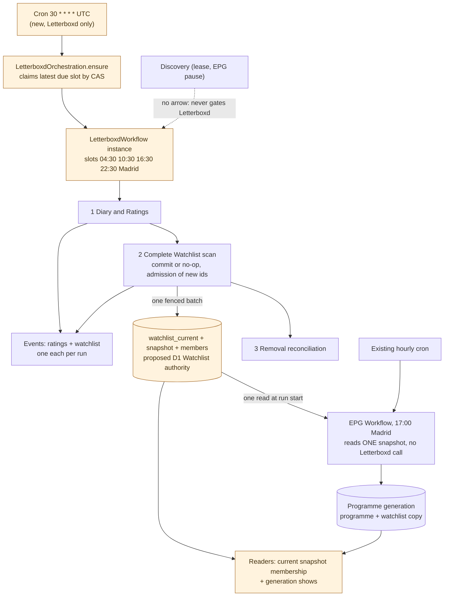
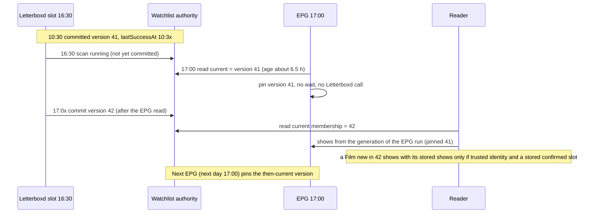

# ADR 0186: One four-slot Letterboxd Sync Workflow writes the Watchlist, which becomes its own D1 authority that the EPG only reads

**Status:** Proposed  
**Original decision date:** 2026-11-21 (design; the target below is the Product Owner's directive recorded on the card, the mechanism is proposed here)  
**Recorded at:** 2026-11-21  
**Approval source:** Not yet given. The owner's target (four Letterboxd Sync runs, an independent EPG at 17:00, two separate user Events, no propagation of Discovery or EPG failures to the user sources) is recorded on [AIR-568](https://trello.com/c/UjY7WXFf). This record becomes Accepted only after independent review and an explicit owner decision, because it changes data authority, orchestration and publication.  
**Related work:** [AIR-568](https://trello.com/c/UjY7WXFf) (this design); successors [AIR-569](https://trello.com/c/yaXv2oj6) (D1 Watchlist authority and readers), [AIR-570](https://trello.com/c/JSXgFWzp) (one Letterboxd Workflow and two Events), [AIR-571](https://trello.com/c/b6UrtwUG) (controlled production cutover); integration boundaries [AIR-550](https://trello.com/c/xMTEtaLp), [AIR-551](https://trello.com/c/YAVPlcAe), [AIR-552](https://trello.com/c/Hk2dJf2U); [AIR-532](https://trello.com/c/mGPwomMX); [ADR 0142](0142-epg-owned-generation-addressed-discovery-slots.md); [ADR 0090](0090-ratings-cloudflare-workflow-executor.md); [ADR 0101](0101-ratings-logical-due-time-1700.md); [ADR 0185](0185-epg-checkpoint-d1-authority.md); [ADR 0173](0173-watchlist-retention-observed-at-is-state-start.md); [ADR 0089](0089-shared-orchestration-reliability-contract.md); [ADR 0166](0166-diary-rated-only-identity-bridge.md); [ADR 0184](0184-ratings-confirmed-letterboxd-claim-on-existing-film.md); [ADR 0107](0107-get-head-read-side-effect-boundary.md)  
**Supersedes:** None. It **qualifies** (the older records are not edited): decisions 3 and 10 of ADR 0142 (who writes the watchlist part and the watchlist tail) for the `d1` Watchlist mode only; decision 1 of ADR 0090 and ADR 0101 (one daily Ratings run at 17:00) once the Letterboxd Workflow is active; the ingest status and the `watchlist`, `ratedAdmissionScan`, `removalRefs` and `removalLookups` parts of the checkpoint described by ADR 0185 for the `d1` Watchlist mode; and the writer (not the semantics) of the scan watermark of ADR 0173. Each qualification takes effect only when this record is Accepted **and** its implementation is delivered, activated and accepted.  
**Superseded by:** None

## Context

Confirmed from code on `main` `5d80240` (21 Nov 2026). Production behavior, run durations and Letterboxd response sizes are **not** measured here.

1. **The EPG run fetches the Watchlist.** `beginSync` (`src/worker.js`) reads the Letterboxd watchlist pages (at most 100 pages, total must match, a second read of page 1 must agree), merges the metadata cache, and creates the run with the whole `watchlist` array. If the fetch fails the run is **not created** and `watchlist-ingest.json` records `watchlist_failed`. A Letterboxd outage at the daily due time therefore blocks the EPG publication, and the EPG failure class `network_error` also matches a message that mentions the watchlist.
2. **The EPG generation owns the membership.** The publish commit stores the watchlist part of the generation (`published_epg_document`, `published_epg_member`, `watchlist_generation`); `persistWatchlist` is a no-op under a live D1 pin (ADR 0142 decision 14) and `PublishedEpg.saveWatchlist` remains for the non-pinned path. `GET /api/watchlist` and the R2 mirrors `watchlist.json` read that generation. Membership therefore changes at most once a day, with the EPG commit.
3. **The scan and the removal event are in the EPG commit tail.** `persistScan` applies `LetterboxdFacts.applyWatchlistScan`, the rated-admission retention work (`ratedAdmissionScan`, ADR 0173) and records `scanOutcome`; the `watchlist` Event (added, removed, total, baseline) is written by the EPG completion; removed films are handed to the Ratings queue as `removalRefs` through `sync.json`. An EPG failure after the fetch loses the scan for that day.
4. **Ratings are a separate daily Workflow.** `RatingsOrchestration.ensure` creates one `ratings_<YYYYMMDD>_<series>` instance per Madrid day; `RATINGS_SCHEDULE` and `EPG_SCHEDULE` are both `{hour: 17, minute: 0}` (`src/domain/orchestration-policy.js`; ADR 0101). The run is Diary (page 1, history, facts, cursor, rated-only bridge of ADR 0166), then the removal queue (at most five member-page lookups per step). One `ratings` Event is written per terminal run.
5. **Crons today** (`wrangler.jsonc`): `0 * * * *` (EPG, Ratings, Discovery reconcile, mirrors, monitor `ensure`), `1-59/2 * * * *` (Discovery recovery only, ADR 0174) and `24 3 * * *` (catalog posters, ADR 0179). Madrid is a whole-hour offset from UTC, so a UTC `:30` tick is a Madrid `:30` tick in CET and CEST.
6. **What the list page gives.** `parseWatchlist` returns `lid`, `title`, `year`, `url` only. A TMDB id for a Letterboxd id comes from the film page or from a canonical Film, never from the list page.
7. **Existing fences to reuse.** Domain markers with a generation epoch and `writes open|held` (ADR 0162), D1 `*_cas` fence rows, the stage-verify-switch pattern and write receipts (ADR 0185), the Madrid wall-clock helpers (`madridInstant`, `dailyDue`), the mode document with an epoch fence (ADR 0089, 0090), canonical Film writers with CAS and receipts (ADR 0099), the bounded same-run identity check (ADR 0166) and the proof-gated claim (ADR 0184).

**The problem.** The two user-facing Letterboxd sources (Ratings and Watchlist) are coupled to the EPG and Discovery, which are slow, shared-lease and failure-prone, and they run only once a day. A Discovery or EPG fault delays or loses a user's Watchlist change, and a Letterboxd fault blocks the programme.

**Not established:** how long the Watchlist scan takes in production; how many statements a 700-row snapshot commit needs on D1 (to be measured offline, as ADR 0185 did); whether the account allows a fourth cron trigger on this Worker (the repository shows three; the platform limit was not verified here, see open question O1).

## Decision (proposed; not implemented)

Nothing here is active, no schema is applied, no cron or binding is changed by this record.

### 1. The Watchlist is its own D1 authority

A new per-domain marker `watchlist_authority` (`id=1`, `mode` `epg`|`d1`, `generation`, `writes` `open`|`held`), a batch fence `watchlist_cas`, and the tables below, in a migration whose number is the next free one on `main` at implementation (numbers are renumbered at merge, as ADR 0185 O3 records). The marker is inserted as `epg`. While `mode` is `epg` or the tables are absent, behavior is **exactly today's** (decisions 2 to 6 of the Context). `d1` means the Watchlist authority is the only source of membership; an unreadable, `held` or non-`d1` state is refused and never falls back to the EPG generation. No new Cloudflare variable is a production selector.

| Table (names proposed; AIR-569 finalizes) | Holds |
| --- | --- |
| `watchlist_current` | One row (`id=1`): `version`, `snapshot_id`, `list_sha256`, `film_count`, `last_success_at` (the end of the latest **complete** scan, changed or not), `last_success_run`, `last_success_slot`, `last_attempt_at`, `last_attempt_outcome` (bounded code), `revision` (per-row CAS), `updated_at`. |
| `watchlist_snapshot` | One row per committed membership state: `version` (primary key, strictly increasing), `snapshot_id` (uuid), `scan_id`, `observed_at` (when the scan began), `committed_at`, `film_count`, `list_sha256`, `prev_version`, `slot_key`, `run_id`. |
| `watchlist_member` | `(version, ordinal)` primary key, `lid` (unique per version), `title`, `year`, `url`. Order is the Letterboxd list order. No TMDB id: identity stays a Film fact. |

- **`version` changes only when the ordered membership changes.** A complete scan that finds the same ordered list writes **no** snapshot or member rows; it advances `last_success_at` (and the scan watermark of ADR 0173) in one small fenced batch. A 1-for-1 replacement keeps the count and changes the digest, so it is a new version. Equality of counts is never used to detect "no change".
- **Retention.** The newest eight versions are kept (two days of slots); older versions are deleted in the commit batch of a later scan. No pin table is needed: the EPG copies the list into its own run at start (decision 5), so no reader depends on an old version staying.
- **Commit is stage-verify-switch** as in ADR 0185 decisions 2 and 3: member rows are staged under the new version in bounded batches, read back (count, ordinal contiguity, distinct `lid`, digest), then **one** batch fences the authority (`d1`, `open`, generation), the Workflow's mode epoch (decision 3), compare-and-swaps `watchlist_current` on the expected `(version, revision)`, inserts the snapshot row and sets the pointer. A refused batch writes nothing; an unknown outcome is read back by `snapshot_id` and never replayed blind; unreferenced staged rows are garbage swept by the next commit.
- **Failure and attempt are separate from success.** A failed or incomplete scan updates only `last_attempt_*` (guarded by the authority fence, ordered by attempt like the ingest status of ADR 0185) and never lowers `last_success_at`. The last successful snapshot stays authoritative.
- **Completeness** keeps today's definition and moves it into the repository: every page read, the stated total equals the number of distinct ids, no empty page with a positive total, the pagination URL matches the account path, and a repeat read of page 1 agrees. A scan that fails any of these is `incomplete`: nothing is committed, nothing is removed, no removal event is produced. Whether an additional **mass-change guard** (a scan that removes an unusually large share of members is held as `suspect`) is wanted is an owner question (O2); it is not decided here.

### 2. Ownership and write matrix

| Data | Letterboxd Sync | EPG sync | Discovery | Canonical Film/Person writers |
| --- | --- | --- | --- | --- |
| Watchlist membership, order, `version`, `last_success_at`, attempt | **sole writer** | reads one snapshot | none | none |
| Scan facts (`applyWatchlistScan`), retention (`film_retention`, scan watermark) | **sole writer** | none | none | adapters used by Letterboxd |
| Diary history, cursor, facts, ratings documents, removal queue | **sole writer** | none | none | none |
| `ratings` and `watchlist` Events | **sole writer** | none (`epg` Event stays EPG's) | none | none |
| Film admission of a new Letterboxd id | requests it through the canonical writer | none | writes its own admissions | **writes** (CAS, receipts) |
| Programme generation (`programme_run_id`, `generation`, `watchlist_generation`, the documents, members, sealed shows) | none | **sole writer** (ADR 0142 decision 3, unchanged) | none (assigned rows only, ADR 0142) | none |
| The generation's `watchlist` part | none | writes a **copy of the pinned snapshot**, not an authority | none | none |
| Compatibility mirror `watchlist.json` | writes and reconciles it from the current snapshot | writes the generation-addressed copy with the generation | none | none |

Consequences of the matrix: the EPG never fetches Letterboxd, never writes membership, scans or removal events, and carries no removal hand-over; Discovery and the EPG pause never gate a Letterboxd step; a Letterboxd step reads none of the EPG control, checkpoint, step lease, Discovery lease, resolver lease or EPG-priority pause.

### 3. One Letterboxd Sync Workflow

One Cloudflare Workflow `LetterboxdWorkflow` (binding `LETTERBOXD_WORKFLOW`) runs one **slot** per instance. It follows the Workflow contract of ADR 0089/0090: a D1-owned control record (Madrid slot key, series, budget, failure, quarantine), a D1-owned mode document (`external` absent default, `switching`, `cloudflare`) with an epoch fence asserted inside every committing batch, deterministic instance id `lbsync_<YYYYMMDD>_<HHMM>_<series>` and no ChatGPT Scheduled Task.

- **Slots.** Four Madrid wall-clock slots per day: **04:30, 10:30, 16:30, 22:30 Europe/Madrid**. The slot key is the Madrid date plus the wall time, so a day always has exactly four slots, also on DST days (the spacing is 5 or 7 real hours across the changeover, never a missing or doubled slot, and none of the four wall times is inside the 02:00 to 03:00 gap or fold). `madridInstant` computes each due instant.
- **Trigger.** A separate cron `30 * * * *` UTC calls **only** `LetterboxdOrchestration.ensure`; it does not call EPG, Ratings, Discovery or the monitor, and the existing crons do not call it. `ensure` is inert unless the mode document says `cloudflare`. It claims the **latest due slot** by CAS on the control record and creates the one instance; an already claimed or done slot is a no-op. A slot is eligible from its due instant until the next slot's due instant; a slot missed entirely (no tick, platform fault) is recorded once as `skipped_missed` and is **not** run late, so two runs never queue back to back. A one-off slot is not repeated except by the owner's explicit start.
- **Sequence of one run:** (1) **Diary and Ratings** (the existing Diary phase, its history, facts, cursor and the ADR 0166 bridge); (2) **complete Watchlist scan** (fetch, completeness check, diff against the current snapshot, commit or no-op, scan facts, retention, enqueue removals, canonical admission of new ids, decision 4); (3) **removal reconciliation** (the existing bounded lookups, at most five member pages per step, for the removals just observed and any older queue entries). Each phase is a sequence of bounded `step.do` actions with durable checkpoints; step failure, retry and restart reuse the ADR 0098 recovery pattern, with a finite per-run budget and **no retry that crosses the next slot's due instant**. Numeric budgets are fixed in AIR-570 and the [orchestration reliability reference](../reference/orchestration-reliability.md), not here.
- **Why one Workflow.** Phases 1 to 3 share one Letterboxd client, one rate limit and one `429` pause, and reconciliation must follow the scan of the same run. Two Workflows would need a second ordering protocol and would double the Letterboxd traffic at one instant.
- **One run per slot, one writer.** The existing `RatingsWorkflow`/`RatingsOrchestration` and the new Workflow must never both write the Diary cursor or the ratings documents. The Ratings `ensure` is closed by its mode document (three-step switch, ADR 0090 decision 4) before the Letterboxd mode document says `cloudflare`; an epoch fence refuses a stale instance of either.

### 4. Independent outcomes, two Events, and failure isolation

- **Three outcomes per run, independent:** `ratings` (Diary: finished, rate-limited, blocked, error, interrupted), `watchlist` (committed, no_change, incomplete, unavailable, rate_limited, error, interrupted) and `reconciliation` (an operational result on the run record only). Each has its own `lastSuccessAt` (`ratings` in the ratings run documents as today, `watchlist` in `watchlist_current`). An outcome never rewrites or cancels another.
- **Diary down:** the Watchlist phase still runs and may finish. **Watchlist down:** the confirmed Ratings outcome and its facts stand. A shared `429` is recorded for each phase honestly, the Watchlist attempt is made once per run (no loop), and the next slot is the retry.
- **Two Events per scheduled run, always** (including no-op, partial, error, skipped and interrupted): `type: ratings` and `type: watchlist`, created by two create-only puts with idempotent keys derived from the **slot**, not the instance: `lbsync-<YYYYMMDDTHHMM>-ratings` and `lbsync-<YYYYMMDDTHHMM>-watchlist`, `at` = the real end of that phase. Payload and status differ: the `watchlist` Event carries `outcome`, `snapshotVersion`, `lastSuccessAt`, the diff (`added`, `removed`, `total`, `baseline`) against the previous version, and removed films with the ratings already stored (at most 25 probed, stored facts only, as today); the `ratings` Event keeps its AIR-361 contract and gains `slot`. A late rating from reconciliation patches the removal Event of the run that observed it, by the existing compare-and-swap, and does not create a third Event. Events written by earlier code stay readable and are not rewritten. A no-op is a neutral presentation (as ADR 0180); the card and filter design belong to AIR-570.
- **Films that were watched or rated may *explain* a removal, never prove its cause.** The `watchlist` Event may mark a removed film `explainedBy: ["watched"|"rated"]` from facts that exist at or before the scan; retention, admission and any writer never read that field.
- **Isolation.** Neither the EPG nor Discovery reads Letterboxd run state; the EPG reads only the snapshot pointer (decision 5). A stale, held or failed EPG or Discovery therefore cannot delay, fail or skip a Letterboxd run, and a Letterboxd failure cannot block the EPG (decision 5).

### 5. Canonical Film admission of new Letterboxd ids

After the snapshot commit (membership is an observation of Letterboxd and is **not** rolled back by an admission failure), each **new** `lid` of the diff is resolved with the bounded same-run check of ADR 0166 generalized to watchlist ids: at most three per step, the Letterboxd film page and the TMDB movie must agree. The outcomes are exactly: **admitted** with a verified TMDB identity (through the existing retention/admission writers and, when proof-gated, the claim of ADR 0184), or **unresolved** with a reason and a retry time kept in the run's bounded document, retried by later runs. **No guessing**: a title or year match without the unanimous check never admits a Film. Concurrent writers of one Film (Letterboxd Sync, Discovery `acceptScoredIdentity`, the ratings bridge, the EPG metadata step) all go through the canonical Film writers with CAS and receipts; the second writer reads the receipt and is idempotent. The admission work list and cursor (today `ratedAdmissionScan` in `sync.json`) live in the Letterboxd run record, so an EPG failure cannot lose them.

### 6. What the EPG does with the Watchlist

At 17:00 (unchanged logical due, ADR 0101 for the EPG only) `beginSync` replaces the Letterboxd fetch by **one read** of the current snapshot, bound into the run: it copies the ordered list into the run (the existing `watchlist` array), records `watchlistVersion`, `watchlistSnapshotId` and `watchlistLastSuccessAt`, and verifies count and digest against `watchlist_snapshot`. From then on the run is self-contained. The EPG:

- does **not wait** for 16:30, does not call Letterboxd, does not overwrite membership, and is unaffected by a Letterboxd slot that is still running (it uses the last **committed** version; a commit after the read changes the next EPG, not the current run);
- has **no hard TTL**: whatever the age of the last successful snapshot, the run proceeds. When `now - lastSuccessAt` exceeds **24 hours** the run, `epg_status`, the programme read model and the monitor carry a `watchlist_stale` warning; below that no warning. Fail-closed only when no snapshot exists or it is unreadable (`watchlist_snapshot_absent`, `watchlist_unavailable`), a D1 fault, not a Letterboxd one;
- writes the generation's `watchlist` part as a **copy** of the pinned snapshot, so a generation stays self-consistent and the mirror-fallback of ADR 0177 and the pairing by run id are unchanged. `persistWatchlist` and the scan, retention and removal parts of the commit tail are no longer EPG steps in `d1` mode.

**Readers and the immediate join.** `GET /api/watchlist`, `/api/programme` and the other membership readers use the **current** snapshot for membership and the pinned generation's show rows for `shows`. A new Film joins the visible watchlist with its showings **immediately** only when both hold: its identity is **trusted** (admitted, verified TMDB id, decision 5) and the current generation already has a stored confirmed show row for it (a sealed or Discovery-assigned row, ADR 0142). The join is a **read-time composition**; it writes nothing and never changes the programme generation. Otherwise the Film appears with no showings until the next EPG scan, which re-matches it from its pinned membership. A Film removed from the current snapshot leaves the visible watchlist at the next read in the same way (symmetric; owner confirmation O3). All readers go through one seam (like `PublishedEpg.readDocument`), additive fields only (`snapshot: {version, lastSuccessAt, stale}`), and a GET never writes or repairs (ADR 0107).

### 7. Diagram of ownership and flow

### 8. Migration, rollback, mirror and fallback (planned here, executed by AIR-571 under its own owner GO)

1. **Dormant delivery (AIR-569, AIR-570).** Migration (not applied), repository, readers behind the `epg` marker, the Workflow class, the binding and the cron entry ship inert: with the marker `epg`/tables absent the code is today's, and with the mode document absent `ensure` creates nothing. A deploy never fires the first slot.
2. **Cutover holdpoints (each a separate owner decision, L3):** (a) apply the migration (preflight, one apply, readback; marker stays `epg`); (b) a read-only preflight proves the deployed version is the new code and no gradual rollout is live; (c) **bootstrap import** of the current published watchlist into snapshot version 1 (count, order and digest parity against a `GET /api/watchlist` read), so the EPG has a valid snapshot from the first instant and never reads an empty authority; (d) hold writes, switch the marker to `d1` with `generation+1`, release; (e) close the Ratings `ensure` (three-step switch) and open the Letterboxd mode document `cloudflare`, so there is never a moment with two Diary writers or zero membership writers; (f) the first slot is observed, not forced.
3. **Order against the EPG checkpoint.** The Watchlist marker and the `epg_checkpoint_authority` marker of ADR 0185 are independent authorities with independent cutovers. The EPG code must be correct in each of the four combinations; the plan does **not** activate both in one window (the AIR-551 and AIR-571 plans fix the order; O4).
4. **Code rollback** does not revert D1 rows, markers, mode documents, snapshots, facts, retention rows, immutable Events or a Workflow instance.
5. **Data rollback** (owner-approved, before any code revert): close the Letterboxd mode document, hold, export the current snapshot into the generation's watchlist part through the EPG writer path with its fence, read back digest parity, set the marker to `epg` with `generation+1`, re-open the Ratings daily mode. Snapshots stay as inert history; Events already written stay.
6. **Mirror and fallback.** The R2 `watchlist.json` becomes a mirror of the current snapshot, written and reconciled by the Letterboxd `ensure` (a named writer; a GET never repairs, ADR 0107); the generation-addressed copy stays the EPG's. Reads may use ADR 0177 mirror fallback only as that record defines it; in `d1` mode an unreadable authority is never read from R2 as authority.
7. **ADR 0142 qualification.** With the marker `d1` the EPG remains the only writer of `programme_run_id`, `generation` and `watchlist_generation` (ADR 0142 decision 3 stands); only the **source** of the watchlist part and of `published_epg_member` membership changes (a copy of the pinned snapshot), and the watchlist tail of decision 10 is not an EPG step. ADR 0142 is not edited.

### 9. Contract test matrix for AIR-569, AIR-570 and AIR-571

These are verifiable offline cases, not production runs. "Pass" is stated per row.

| # | Scenario | Expected |
| --- | --- | --- |
| T1 | Two concurrent admissions of the same new `lid` (Letterboxd Sync and Discovery or the ratings bridge) | One Film, one receipt per writer, second is idempotent; snapshot unaffected |
| T2 | A Discovery chunk holds the lease or the EPG pause is closed when a rating or a Watchlist change lands | The Letterboxd run neither waits nor fails; no Letterboxd step reads either |
| T3 | The 16:30 run is still running or finishes after 17:00 | EPG pins the last committed version, does not wait; the later commit affects the next EPG only |
| T4 | Snapshot age at 17:00 of 0.5, 6.5, 12.5, 18.5 and over 24 hours (one, two, three, four, five missed slots) | EPG runs in every case; `watchlist_stale` only above 24 h; age shown correctly |
| T5 | New Film at 22:30, with and without a stored confirmed show row, trusted and untrusted identity | Visible with shows immediately only with both; otherwise no shows until next EPG |
| T6 | 1-for-1 replacement (same count, one lid out, one in) | New version; one added and one removed in the Event; retention transitions for both |
| T7 | Diary unavailable, Watchlist available | Watchlist committed and its Event written; Ratings Event shows the honest failure |
| T8 | Watchlist unavailable or incomplete (missing page, total mismatch, page 1 changes) | Nothing committed, no removal, no removal Event rows; `last_success_at` unchanged; Ratings outcome stands |
| T9 | Both phases rate-limited | Both Events record `rate_limited`; one Watchlist attempt; no retry crosses the next slot |
| T10 | No-op scan (identical ordered list) | No snapshot or member rows; `last_success_at` and watermark advance; two neutral Events |
| T11 | DST days (last Sunday of March and of October) | Exactly four slots, keys unique, no missed or duplicated slot, no slot in the gap or fold |
| T12 | Restart, retry and a stale instance of a slot; a second tick for the same slot | One run per slot; one Event pair (create-only, same key); a stale epoch is refused |
| T13 | Unknown outcome of the commit batch | Classified by `snapshot_id` readback; never a blind replay |
| T14 | Partial outcome: committed snapshot, admission of one new `lid` unresolved | Snapshot stands; the id stays pending with reason and retry time; no guessing |
| T15 | Watched or rated removed film | `explainedBy` set; no writer reads it |
| T16 | Marker `epg`, tables absent, marker held or unreadable | Today's behavior, or a refusal; never an R2 authority read in `d1` mode |
| T17 | Ratings and Letterboxd Workflows both enabled | Refused by the mode epoch; never two Diary writers |

### Not decided

The migration apply, the bootstrap import, the marker switch, the Ratings close, the first slot, any cron or binding activation, and every Cloudflare setting. Deployment, a green test run and this ADR authorize none of them. The numeric retry budgets, the exact table and column names, the Event card design and the mass-change guard are left to the named successors or to the owner (below).

## Alternatives considered

| Option | For | Against | Verdict |
| --- | --- | --- | --- |
| **A. Keep the EPG generation as the Watchlist authority and add a Letterboxd step to the EPG run** | No new authority | The user source stays coupled to the EPG and Discovery; one slot a day; a Letterboxd outage still blocks the programme | Rejected |
| **B. New D1 Watchlist authority, separate publication, EPG reads one snapshot (this ADR)** | Failure isolation; four slots; bounded rows; self-contained EPG run; rollback has an export path | One more marker, three tables, a bootstrap and a four-way EPG test matrix | **Recommended** |
| **C. Shared publication: the Letterboxd Workflow republishes the programme generation after each commit** | One visible list | Breaks ADR 0142 decision 3 (only the EPG moves the generation), multiplies generation churn, re-couples to the Discovery pause | Rejected |
| **D. Two Workflows (Ratings and Watchlist), each on four slots** | Smaller units | Two orderings, doubled Letterboxd traffic at one instant, a shared `429` budget split | Rejected; owner target is one Sync |
| **E. Use the existing hourly cron tick instead of a new `:30` cron** | No new trigger | The hourly tick would run EPG, Discovery and monitor work and a Letterboxd failure could not be isolated from them; the owner asked for a Letterboxd-only cron | Not chosen; revisit only if O1 shows the trigger limit blocks `:30` |
| **F. Hard TTL on the snapshot (EPG refuses a stale list)** | Fresher programme | The programme would stop for a Letterboxd outage; the owner chose no hard TTL | Rejected |
| **G. One combined `watchlist and ratings` Event** | Fewer Events | Hides which outcome failed; the owner chose two separate Events | Rejected |
| **H. Immediate join as a write to the current generation** | Simple reader | A second writer of the generation (ADR 0142) | Rejected for a read-time composition |

## Consequences

- A Letterboxd outage no longer blocks the EPG, and an EPG or Discovery fault no longer delays or loses a user's Watchlist or Ratings. Membership can change four times a day instead of once.
- Eight small Events a day, mostly no-ops, grow the Events log; the presentation must keep a no-op quiet.
- New complexity: a marker, three tables, a repository, a Workflow with its control and mode documents, a fourth cron trigger, a reader seam and a four-way (checkpoint × watchlist) EPG test matrix. The stage-verify-switch commit needs an offline statement and row budget measurement.
- The reader composition makes `GET /api/watchlist` depend on two stores (snapshot and generation) and must stay read-only and additive.
- The EPG checkpoint of ADR 0185 loses the scan, retention-queue and removal parts and the ingest status writer for `d1` Watchlist mode; the implementation of AIR-550 stage 2 must tolerate their absence.
- The one-Workflow design serializes Diary, Watchlist and reconciliation behind one Letterboxd client; a long Diary phase delays the Watchlist phase of the same run (bounded by the slot window and the per-run budget).

## Recovery and migration boundary

Reversible: all code, until the marker is `d1`. Not reverted by code rollback: markers, mode documents, D1 rows and snapshots, retention rows, facts, immutable Events, an existing Workflow instance. Data rollback is the separate owner-approved export described in decision 8. An ADR never authorizes an operation: migration apply, bootstrap import, marker switch, Ratings close, mode switch and the first slot each need their own owner GO under AIR-571 and an L3 plan.

## Evidence

- **Original decision:** owner target on [AIR-568](https://trello.com/c/UjY7WXFf); this record has no approval yet.
- **Implementation:** none; [AIR-569](https://trello.com/c/yaXv2oj6) and [AIR-570](https://trello.com/c/JSXgFWzp) after acceptance, [AIR-571](https://trello.com/c/b6UrtwUG) for the cutover.
- **Dated verification:** code reading of `main` `5d80240` on 2026-11-21 (`src/worker.js` `beginSync`, `persistWatchlist`, `persistScan`; `src/published-epg.js` `saveWatchlist`; `src/sources.js` `parseWatchlist`; `src/domain/orchestration-policy.js` schedules and `madridInstant`; `src/ratings-orchestration.js`; `wrangler.jsonc` crons and Workflows). No production read was made.
- **Uncertainty:** scan duration and statement budget of a snapshot commit; the platform cron-trigger limit for this account; how the live Ratings run time of day compares with the 17:00 constant (the text of ADR 0090 records 17:30 at its acceptance, ADR 0101 moved it to 17:00); whether any lease or marker read by the rated-admission writer would block a Letterboxd step (to be confirmed in AIR-570 against the invariant of decision 2).

### Open questions for the owner and review

- **O1.** Is a fourth cron trigger (`30 * * * *`) allowed on this Worker and account? If not, option E returns, with `ensure` isolated inside the hourly tick.
- **O2.** Is a mass-change guard wanted (a complete scan that removes more than a stated share of members is held as `suspect` for owner review)? Recommendation: no guard at first, record the removed count in the Event and the monitor.
- **O3.** Does a removal leave the visible watchlist at the next read (symmetric with the immediate join), or only at the next EPG? Recommendation: symmetric.
- **O4.** Which cutover goes first, AIR-551 (EPG checkpoint) or AIR-571 (Watchlist)? Recommendation: AIR-551 first, then at least one natural EPG run, then AIR-571.
- **O5.** Should the Ratings daily 17:00 constant and the ADR 0101 record be retired only after AIR-571 acceptance (recommended) or at activation?

## Follow-ups

[AIR-569](https://trello.com/c/yaXv2oj6) (Watchlist authority, repository, readers, mirror), [AIR-570](https://trello.com/c/JSXgFWzp) (one Workflow, control and mode documents, two Events), [AIR-571](https://trello.com/c/b6UrtwUG) (controlled cutover). Current status lives in Trello and GitHub.
