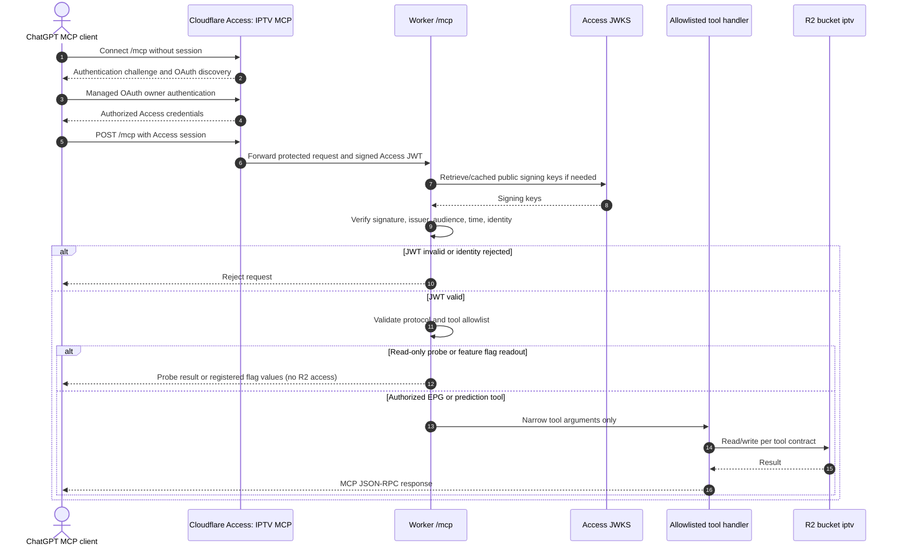

# Authentication and MCP request boundary

**Scope:** owner-only remote MCP authentication and tool invocation. Sources: [MCP contract](../reference/api/mcp.md), [MCP implementation](../../src/mcp.js), [deployment runbook](../runbooks/deployment.md), [ADR-0004](../adr/0004-mcp-access-boundary.md), [ADR-0039](../adr/0039-allowlisted-feature-flag-readout.md).

Cloudflare Access protects the `/mcp` endpoint under the separate **IPTV MCP** application with Managed OAuth and owner-only policy. The Worker also independently verifies the Access JWT, including the application audience. The remainder of the Worker stays behind `All Workers`; `/mcp/` is not the exact MCP route.

MCP uses stateless Streamable HTTP with JSON replies. `probe_read`, `probe_echo` and `feature_flags` do **not** access storage. `feature_flags` reads only the registered feature flag bindings by name and echoes a value only when it consists of that flag's known tokens ([ADR 0039](../adr/0039-allowlisted-feature-flag-readout.md)). Other tools have explicitly defined side effects: some diagnostics read R2 and some status operations may perform recovery writes. EPG and prediction writer tools can change R2, **but only if invoked**. They cannot accept arbitrary URLs, API paths or R2 keys. Neither GitHub deployment nor enabling a connection starts a prediction run.

An Access JWT must not be forwarded into an internal continuation hop or exposed in logs. Policy, application audience and live authorization are deployment settings, **not** a code-only test result. External ChatGPT Scheduled Tasks have separate state and approvals. See [MCP operations](../runbooks/mcp-connectivity.md) and [scheduled tasks ADR](../adr/0005-external-chatgpt-tasks.md).

## Owner-only routes of the EPG diagnostic canary (AIR-455)

`/api/epg/diagnostic/*` is not an MCP surface: no MCP tool is added. The routes sit behind the Worker-wide Cloudflare Access like the other `/api/` owner routes, and the Worker verifies the owner itself on every method: it reuses the signed-assertion verifier of the MCP route (`mcpVerifyAccessWith`: RS256 signature against the team's keys, issuer, expiry, not-before, issued-at, identity) with an audience of its own (`EPG_DIAGNOSTIC_ACCESS_AUD`, not the `IPTV MCP` application's) and requires the `email` claim to equal `EPG_DIAGNOSTIC_OWNER_EMAIL`. Unconfigured values or an unreachable key set close the routes (`503`), any other failure is `403`, all before a read or write. The existing same-origin rule for POST applies, and each writing action needs a confirmation string in its body. These are guards against accident, not authorization: every writing action needs an operation-specific owner GO ([ADR 0124](../adr/0124-epg-diagnostic-canary-run-contract.md)). The owner adds a dedicated Access application for `/api/epg/diagnostic/*` and sets the audience and e-mail at provisioning (AIR-456); until then the routes answer `503 access_not_configured`.
