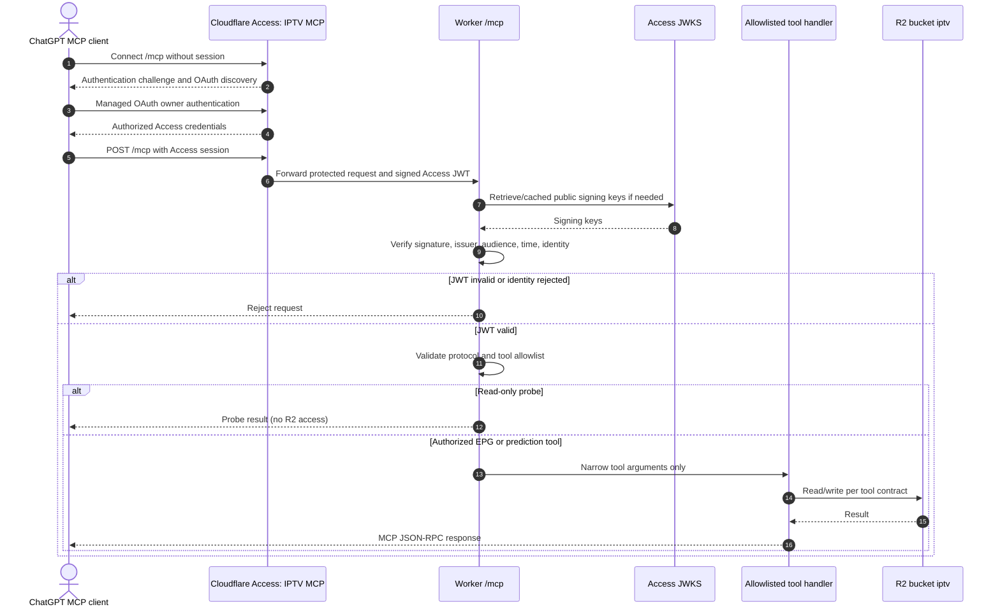

# Authentication and MCP request boundary

**Scope:** owner-only remote MCP authentication and tool invocation. Sources: [MCP contract](../reference/api/mcp.md), [MCP implementation](../../src/mcp.js), [deployment runbook](../runbooks/deployment.md), [ADR-0004](../adr/0004-mcp-access-boundary.md).

Cloudflare Access protects the `/mcp` endpoint under the separate **IPTV MCP** application with Managed OAuth and owner-only policy. The Worker also independently verifies the Access JWT, including the application audience. The remainder of the Worker stays behind `All Workers`; `/mcp/` is not the exact MCP route.

MCP uses stateless Streamable HTTP with JSON replies. `probe_read` and `probe_echo` do **not** access storage. Other tools have explicitly defined side effects: some diagnostics read R2 and some status operations may perform recovery writes. EPG and prediction writer tools can change R2, **but only if invoked**. They cannot accept arbitrary URLs, API paths or R2 keys. Neither GitHub deployment nor enabling a connection starts a prediction run.

An Access JWT must not be forwarded into an internal continuation hop or exposed in logs. Policy, application audience and live authorization are deployment settings, **not** a code-only test result. External ChatGPT Scheduled Tasks have separate state and approvals. See [MCP operations](../runbooks/mcp-connectivity.md) and [scheduled tasks ADR](../adr/0005-external-chatgpt-tasks.md).
