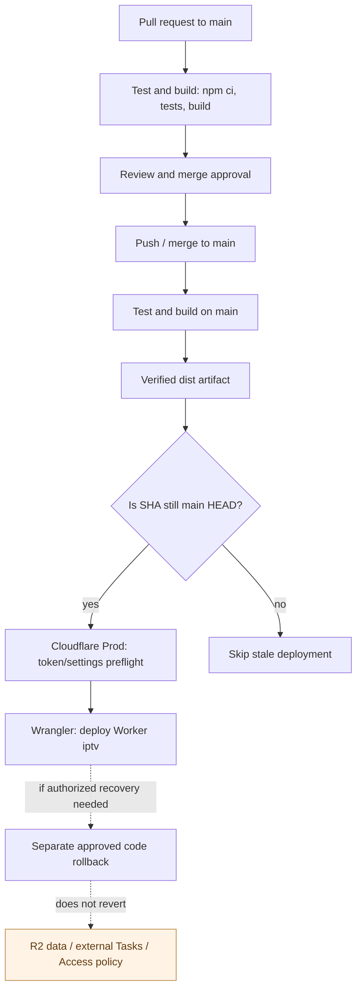

# Deployment and rollback boundaries

**Scope:** normal GitHub Actions code delivery, not production data recovery. Verified from [workflow source](../../.github/workflows/ci.yml), [Wrangler configuration](../../wrangler.jsonc), [deployment runbook](../runbooks/deployment.md) and [ADR-0003](../adr/0003-github-ci-deployment.md).

PR checks do **not** publish to Cloudflare. A successful `main` run builds and uploads a verified artifact; the deploy job consumes that artifact, checks freshness, performs credentials/settings preflight and deploys only on `main`. The freshness check limits stale publishes but is not atomic with publication.

A successful deploy proves **code publication**, not EPG completion, prediction execution, scheduled-task state, OAuth configuration changes or any R2/D1 migration. Rollback of the Worker version cannot undo persisted R2 writes, restore external ChatGPT Tasks or alter Cloudflare Access policies. Production recovery remains governed by the [rollback runbook](../runbooks/recovery/cloudflare-worker-rollback.md) and separate owner approval.

**Future boundary:** a D1 authority cutover would require independently approved migration stages; it is **not** part of this diagram. See [migration ADR](../adr/0017-staged-d1-migration.md).
