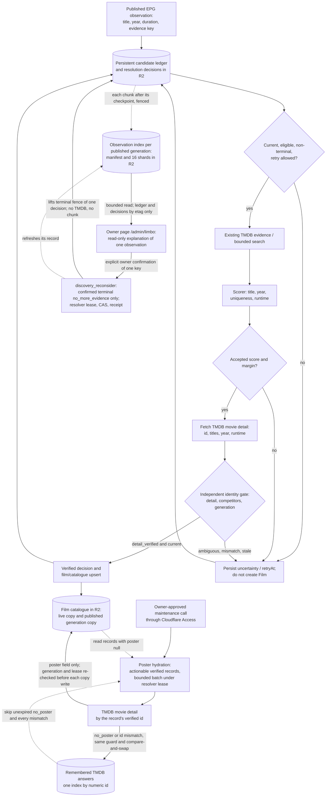

# Discovery, scored resolution and verification gate

The discovery ledger tracks **observations**, not canonical Film records. A high score is only a hypothesis until independent movie-detail verification and the current-generation fence pass. Sources: [scored resolution reference](../reference/domain/scored-resolution.md), [candidate discovery](../reference/domain/candidate-discovery.md) (the optional variant search is retired), [observation ADR](../adr/0007-persistent-discovery-evidence.md), [detail gate ADR](../adr/0010-scored-detail-verification.md), [scorer](../../src/domain/scored-resolution.js) and [gate](../../src/domain/resolution-acceptance.js).

Before an observation reaches the ledger, and again before each resolver chunk, the [non-film screen](../reference/domain/nonfilm-screening.md) removes high-confidence series episodes and TV shows by title, or by XMLTV `episode-num` during the EPG scan. A reliable watchlist/catalog match or a verified decision outranks that screen. A stored `excluded_nonfilm` decision that the current rule no longer reproduces makes the observation eligible again in the normal cycle; it is not cleaned up or backfilled.

The scorer combines duplicate rows by **TMDB ID** before calculating uniqueness; multiple distinct editions with compatible titles and years remain competitors. `accepted`, `trusted: true`, an alias or another observation's verified decision is insufficient to write a Film. The detail gate checks the exact accepted ID, compatible title/year/runtime, competing editions, and the same pinned programme generation. A rejected, ambiguous or stale result must not be silently promoted.

The scored gate is the only resolver: the former `SCORED_RESOLUTION` rollout variable is retired from code ([ADR 0036](../adr/0036-scored-resolution-only.md)), and rolling the resolver back is a code revert, not a setting. The resolver does not plan title, year, spelling or numeral variant searches. `CANDIDATE_DISCOVERY` is retired and is not read ([ADR 0082](../adr/0082-retire-candidate-discovery.md), Proposed). The dated [AIR-68 cutover](https://trello.com/c/qbLDc6Ql) enabled scored resolution and did not approve optional variants; those experiments stay historical. A chunk's status still carries `variantCalls`, `variantErrors`, `variantThrottled` and `variantSkipped`, each 0. Each explicit discovery step processes a bounded chunk; no recursive public self-fetch or unbounded TMDB work is implied. See [one-chunk ADR](../adr/0006-one-chunk-discovery.md).

The catalogue upsert above is the only writer that creates or re-identifies catalogue records. The owner-triggered [poster hydration](../reference/api/catalog.md#poster-hydration) ([ADR 0020](../adr/0020-owner-triggered-catalog-poster-hydration.md), [ADR 0048](../adr/0048-permanent-catalog-poster-maintenance-route.md), [ADR 0063](../adr/0063-catalog-poster-negative-index.md)) is a second writer outside this flow, a permanent owner-only maintenance route with no switch of its own: it fills only the `poster` field of already verified records from TMDB detail by the same id, under the same resolver lease, and never creates a record, a decision or an identity. Its two catalogue writes are separate compare-and-swaps, not one atomic step; a stop between them is reported and completed by the next call. The same call then records a terminal TMDB refusal (`no_poster_on_tmdb` for 90 days, `tmdb_id_mismatch` for a different valid numeric id until the verified id changes) in one index keyed by the numeric TMDB id. A 200 body with no valid movie id stays retryable and is not stored. The ordinary queue skips those entries. An explicit recheck of one named id is a separate owner-confirmed call and is the only way past a remembered answer before its date. An unreadable index stops the call before the lease and before TMDB. It runs only on an owner-approved call, never on a schedule.

**Owner recovery of one observation** ([ADR 0061](../adr/0061-discovery-observation-index-and-reconsider.md)):

- **Index.** After its checkpoint, each resolver chunk writes a bounded index of the current unresolved observations that already have a decision. It is fenced by the resolver lease and written only for the published generation. The manifest names the etags of the decisions and the ledger it was built from, so any later write to either makes the index stale.
- **Owner read.** The owner page explains one observation from that index alone, never from the ledger or the decision body. A missing, torn or foreign index is unavailable, not empty.
- **Guarded action.** The one write, `discovery_reconsider`, is offered only for a confirmed terminal `no_more_evidence` on a fresh index with no live lease, protected wait, throttle or ambiguity. It changes one decision: it clears the terminal reason and the retry time and keeps the attempts and the evidence key. It writes under the resolver lease, by compare-and-swap on the decision map's etag and the decision's digest, with a stored before-image and receipt. It calls no TMDB and starts no chunk: the next ordinary chunk takes the observation through the `eligible` gate above, and an uncertain result on the same evidence makes it terminal again.

Contracts: [admin API](../reference/api/admin.md#discovery-observation-recovery-get-apiadmindiscovery-recovery), [observation index](../reference/domain/discovery-observation-index.md), [recovery assessment](../reference/domain/discovery-recovery.md).

At the end of a chunk the resolver rebuilds the prediction queue for the published programme. It renews its discovery lease before each write attempt, and the write is conditional on the queue it read ([ADR 0064](../adr/0064-prediction-queue-conditional-writes.md), Accepted 2026-10-31). A conflict it cannot resolve ends as `prediction_queue_checkpoint` in the chunk's status, never as an overwrite.

R2 remains authoritative. The separately planned D1 candidate tables are not active production authority.

**Implemented, inactive by default:** with `DISCOVERY_LEDGER_MODE=bounded`, [ADR 0034](../adr/0034-bounded-discovery-ledger.md) ([AIR-220](https://trello.com/c/uPvMc5ww)) bounds the "persistent candidate ledger" node above to the latest scan's candidates. History moves to a write-once segmented archive, which the EPG commit reads only for re-entering keys; chunks and status never read it. The diagram shows the default full ledger. It changes, under its own visual review, when the bounded mode is activated ([AIR-222](https://trello.com/c/9Y4G9DG6)).
