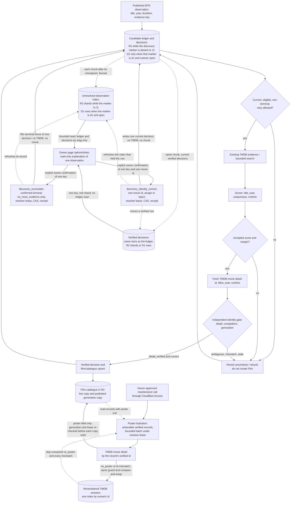

# Discovery, scored resolution and verification gate

The discovery ledger tracks **observations**, not canonical Film records. Accepted [ADR 0135](../adr/0135-epg-priority-discovery-pause.md) closes new Discovery admission from 16:55 Europe/Madrid until the owed EPG generation is published and handed off. It is not implemented and not activated, and the diagram below does not draw it. Which executor runs the next chunk is a separate flag ([ADR 0083](../adr/0083-inert-discovery-workflow.md), Accepted) and does not change scoring, acceptance, or the decision written for an observation. A high score is only a hypothesis until independent movie-detail verification and the current-generation fence pass. Sources: [scored resolution reference](../reference/domain/scored-resolution.md), [candidate discovery](../reference/domain/candidate-discovery.md) (the optional variant search is retired), [observation ADR](../adr/0007-persistent-discovery-evidence.md), [detail gate ADR](../adr/0010-scored-detail-verification.md), [scorer](../../src/domain/scored-resolution.js) and [gate](../../src/domain/resolution-acceptance.js).

Before an observation reaches the ledger, and again before each resolver chunk, the [non-film screen](../reference/domain/nonfilm-screening.md) removes high-confidence series episodes and TV shows by title, or by XMLTV `episode-num` during the EPG scan. A reliable watchlist/catalog match or a verified decision outranks that screen. A stored `excluded_nonfilm` decision that the current rule no longer reproduces makes the observation eligible again in the normal cycle; it is not cleaned up or backfilled.

The scorer combines duplicate rows by **TMDB ID** before calculating uniqueness; multiple distinct editions with compatible titles and years remain competitors. `accepted`, `trusted: true`, an alias or another observation's verified decision is insufficient to write a Film. The detail gate checks the exact accepted ID, compatible title/year/runtime, competing editions, and the same pinned programme generation. A rejected, ambiguous or stale result must not be silently promoted.

The scored gate is the only resolver: the former `SCORED_RESOLUTION` rollout variable is retired from code ([ADR 0036](../adr/0036-scored-resolution-only.md)), and rolling the resolver back is a code revert, not a setting. The resolver does not plan title, year, spelling or numeral variant searches. `CANDIDATE_DISCOVERY` is retired and is not read ([ADR 0082](../adr/0082-retire-candidate-discovery.md), Accepted 2026-11-02). The dated [AIR-68 cutover](https://trello.com/c/qbLDc6Ql) enabled scored resolution and did not approve optional variants; those experiments stay historical. A chunk's status still carries `variantCalls`, `variantErrors`, `variantThrottled` and `variantSkipped`, each 0. Each explicit discovery step processes a bounded chunk; no recursive public self-fetch or unbounded TMDB work is implied. See [one-chunk ADR](../adr/0006-one-chunk-discovery.md).

The catalogue upsert above is the only writer that creates or re-identifies catalogue records. The owner-triggered [poster hydration](../reference/api/catalog.md#poster-hydration) ([ADR 0020](../adr/0020-owner-triggered-catalog-poster-hydration.md), [ADR 0048](../adr/0048-permanent-catalog-poster-maintenance-route.md), [ADR 0063](../adr/0063-catalog-poster-negative-index.md)) is a second writer outside this flow, a permanent owner-only maintenance route with no switch of its own: it fills only the `poster` field of already verified records from TMDB detail by the same id, under the same resolver lease, and never creates a record, a decision or an identity. Its two catalogue writes are separate compare-and-swaps, not one atomic step; a stop between them is reported and completed by the next call. The same call then records a terminal TMDB refusal (`no_poster_on_tmdb` for 90 days, `tmdb_id_mismatch` for a different valid numeric id until the verified id changes) in one index keyed by the numeric TMDB id. A 200 body with no valid movie id stays retryable and is not stored. The ordinary queue skips those entries. An explicit recheck of one named id is a separate owner-confirmed call and is the only way past a remembered answer before its date. An unreadable index stops the call before the lease and before TMDB. It runs only on an owner-approved call, never on a schedule.

**Owner recovery of one observation** ([ADR 0061](../adr/0061-discovery-observation-index-and-reconsider.md)):

- **Index.** After its checkpoint, each resolver chunk writes a bounded index of the current unresolved observations that already have a decision. It is fenced by the resolver lease and written only for the published generation. The manifest names the etags of the decisions and the ledger it was built from, so any later write to either makes the index stale.
- **Owner read.** The owner page explains one observation from that index alone, never from the ledger or the decision body. A missing, torn or foreign index is unavailable, not empty.
- **Guarded reconsideration.** `discovery_reconsider` is offered only for a confirmed terminal `no_more_evidence` on a fresh index with no live lease, protected wait, throttle or ambiguity. It changes one decision: it clears the terminal reason and the retry time and keeps the attempts and the evidence key. It writes under the resolver lease, by compare-and-swap on the decision map's etag and the decision's digest, with a stored before-image and receipt. It calls no TMDB and starts no chunk: the next ordinary chunk takes the observation through the `eligible` gate above, and an uncertain result on the same evidence makes it terminal again.
- **Identity correction** ([ADR 0080](../adr/0080-discovery-identity-correction.md), Accepted 2026-11-01). `discovery_identity_correct` assigns or rejects one numeric movie id on one current decision, including one current verified decision read from the verified-observation index. A trusted choice is the observation's own confirmed movie id, or a typed id that one catalogue object supports. A title and the scorer's hypothesis are not trusted. The same lease, compare-and-swap and receipt apply. A decision that read back without a stored receipt is not reported as success; the same confirmation stores the receipt and does not write the decision again. The write is the decision. Shows follow the next ordinary chunk only when that chunk's cheap pass can touch a catalogue film that is already there. A rejection clears that decision's terminal fence. The next chunk may search for a different id and does not fetch the rejected movie. The action does not start the chunk. An unknown store marker writes nothing. While the published-EPG marker is `d1` and the discovery marker is not ready, both this action and `discovery_reconsider` stay `supported: false` and write no R2 object. When the discovery marker is `d1` and `cutover` is `open` ([ADR 0085](../adr/0085-d1-authoritative-discovery.md), Accepted 2026-11-04), both actions write the D1 decision and the receipt in one batch. A held discovery marker refuses the confirm.

Contracts: [admin API](../reference/api/admin.md#discovery-observation-recovery-get-apiadmindiscovery-recovery), [observation index](../reference/domain/discovery-observation-index.md), [recovery assessment](../reference/domain/discovery-recovery.md), [identity correction](../adr/0080-discovery-identity-correction.md).

At the end of a chunk the resolver rebuilds the prediction queue for the published programme. It renews its discovery lease before each write attempt, and the write is conditional on the queue it read ([ADR 0064](../adr/0064-prediction-queue-conditional-writes.md), Accepted 2026-10-31). A conflict it cannot resolve ends as `prediction_queue_checkpoint` in the chunk's status, never as an overwrite.

**Interrupted series.** Two hops that both end before their continuation checkpoint leave `paused` / `reason: interrupted`. The hourly task and every ordinary step keep answering `stop`. A separate confirm, `POST /api/enrichment/discovery/resolve` with `recovery: "interrupted"`, is the only new way through that stop ([ADR 0088](../adr/0088-guarded-interrupted-discovery-recovery.md), Proposed). It is not `force`, and `force` is unchanged. The confirm writes nothing unless the sync stage is `complete`, every current programme run id matches, the lease is free, no backoff is pending, the discovery authority is the R2 path or an open D1 marker, and the stored status shows the interrupted hop did not finish (`cheap_pass` without `finishedAt` is the known shape). It then runs one ordinary chunk under the existing lease and continuation compare-and-swap. A repeat confirm, a lost response whose checkpoint already landed, and a hop that is still `running` do not run a second chunk. A refusal, including an uncertain checkpoint, writes nothing. The flowchart above is unchanged. Accepting the record does not authorize a production confirm.

**Store.** Production discovery is D1 while `discovery_authority.mode` is `d1` and `cutover` is `open` ([ADR 0085](../adr/0085-d1-authoritative-discovery.md), Accepted 2026-11-04; [activation record](../evidence/d1-migration/air-320-discovery-activate-2026-11-04.md)). Migration `0011` is applied ([apply record](../evidence/d1-migration/air-320-discovery-apply-2026-11-04.md)). The inserted marker was `r2`; a later GO opened it. A deploy does not apply `0011`. While the marker is `d1`, a failed or torn read fails closed and does not serve the R2 ledger. While it is `held`, readers stay on R2 and writers fail closed. Catalog admission does not insert a Film. `tmdb` and `tmdb_tv` stay distinct. The diagram above already names that store and was visually approved by the owner on 2026-11-04. Pipeline status counts a D1 ledger in pages of 500 and does not raise the 20,000-item whole-document cap. A resolver chunk on that paged ledger selects a keyset of current actionable observations (SQL as `resolutionActionability` except the title screen) and a rotating keyset of current verified rows; it does not read every active observation or the whole decision map before TMDB work ([ADR 0109](../adr/0109-discovery-keyset-candidate-selection.md)). `remaining` is the global SQL set, not the page. The `eligible` gate in the diagram is unchanged. Status reads still page the ledger for counts. Same-evidence excluded_nonfilm reactivation when only the screen rule changes is a follow-up.

**Implemented, inactive by default:** with `DISCOVERY_LEDGER_MODE=bounded`, [ADR 0034](../adr/0034-bounded-discovery-ledger.md) ([AIR-220](https://trello.com/c/uPvMc5ww)) bounds the "persistent candidate ledger" node above to the latest scan's candidates, plus, while a backlog remains, the part of the observations absent since earlier days that one commit has not archived yet: the daily flow is archived at once and the backlog at most 4,000 observations a commit, so a ledger that was `frozen` shrinks to the scan over several commits ([ADR 0112](../adr/0112-bounded-ledger-departure-budget.md), Accepted). History moves to a write-once segmented archive, which the EPG commit reads only for re-entering keys; chunks and status never read it. The diagram shows the default full ledger. It changes, under its own visual review, when the bounded mode is activated ([AIR-222](https://trello.com/c/9Y4G9DG6)).

**Implemented, inactive by default (AIR-324).** `ensureDiscoveryWorkflow` and `reconcileDiscoveryWorkflow` reconstruct a missing published-generation intent by the existing `queueDiscovery` compare-and-swap and require a read-back receipt ([ADR 0093](../adr/0093-discovery-workflow-cron-reconcile.md), Accepted). Admission requires the current D1 EPG pointer from `PublishedEpg.currentGeneration()` to equal the Discovery `published_programme_run_id`; a lag or mismatch waits as `generation_handoff` and does not start from an old marker or R2. The existing Worker cron may call reconcile; it creates nothing while `DISCOVERY_EXECUTOR` is absent. A scheduled `projector_window` refusal is retried in that same tick after the window expiry (AIR-428), and each attempt is logged; an unscheduled caller still returns the typed refusal immediately. A held, `loading` or unreadable D1 discovery marker writes nothing. The Workflow still keeps one chunk per durable step, the generation pin and the 20-chunk rollover. Interrupted-hop recovery by the Workflow with ADR 0088 proof is not activated here; the external hourly step and the manual confirm stay as they are while the mode is external. In the same window the D1 enrichment projector, which shares the cron, defers as `generation_pending` instead of failing on the old generation's absent catalog copy (AIR-363). The flowchart above is unchanged. A deploy does not set the flag. Contract: [orchestration reliability](../reference/orchestration-reliability.md#discovery).

**Hourly report (AIR-410, [ADR 0111](../adr/0111-discovery-hourly-reports.md)).** The executor record carries one open accumulator `report` and an `outbox`. Each saved chunk checkpoint adds that chunk's summary to `report` inside the owner's compare-and-swap (each summary is one chunk, none cumulative; the chunk key in `seen` makes a replay add nothing). The scheduled hourly `reconcileDiscoveryWorkflow` ends by closing the period of its UTC hour in one compare-and-swap of the same record, moving a `discovery` event into the `outbox` and resetting the accumulator, then delivers the outbox create-only to the Events Log. A chain that crosses hours, a rollover, a recovery, a typed refusal, an idle pipeline or a confirmed empty queue (continuation `complete` and `remaining` and `cheapRemaining` both the number 0, no error) all produce the same one report; a close that cannot be persisted writes one compact `report_failed` notice (no numbers; the same canonical id as the report of the hour, which replaces it if it saves later; delivered create-only to the journal, or through a separate lossless ledger of at most 8,760 compact entries when the journal refuses it) and keeps the deltas for the next report ([ADR 0118](../adr/0118-discovery-report-failure-notice.md)); an unreadable queue beside real deltas is a persisted report with `queueUnreadable`. The close takes no lease, runs no chunk and calls no TMDB, and the outbox (64) drops nothing. The diagram above is unchanged ([contract](../reference/domain/events.md#discovery-hourly-report-discovery)).

**Ledger seal.** The active ledger of a new generation is published into D1 by a resumable job of bounded steps ([ADR 0092](../adr/0092-resumable-bounded-ledger-seal.md)), not inside the EPG commit request. The job's cursor lives in `discovery_seal` and moves in the same D1 batch as the rows; while the transfer is `loading` only the independent reads of [ADR 0091](../adr/0091-selective-reads-during-a-loading-ledger-seal.md) stay open. The diagram above is unchanged.

## Admission while a projector window is requested or held

The one Discovery lease row (`discovery_lease`, TTL 90 s) is the admission point of every chunk, seal, publish handoff and owner correction (`acquireLease`). With migration `0018` applied, `acquireLease` also refuses while the single `projector_window` row is `requested` or `held` and unexpired, and answers the typed busy `{kind:'projector_window',expiresAt}` ([ADR 0103](../adr/0103-projector-exclusive-window.md)). The chunk series and the Workflow wait until that deadline and charge nothing; the EPG seal answers a `busy` with the same kind and no lease-TTL cap. While the window is `held`, the lease row belongs to the projector, so every lease-fenced Discovery write fails in its own batch, and `writeContinuation`, `writeWorkflow` and `importSegment`, which move the generation without the lease, carry a window predicate in their own bump statement and are refused softly (`discovery_window`, with the expiry). A Workflow state write refused this way is not a step failure: nothing is written and no stall or recovery attempt is counted. Without the table, or with the flag off, none of this applies and the paths are unchanged. The ledger, decisions and catalog documents and their generation fence are unchanged.

