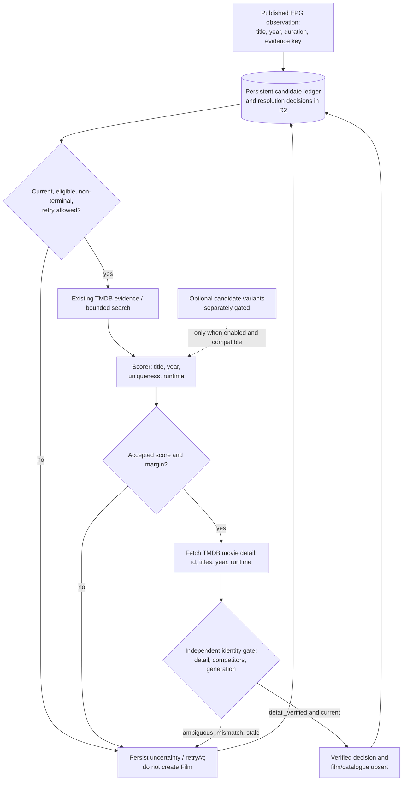

# Discovery, scored resolution and verification gate

The discovery ledger tracks **observations**, not canonical Film records. A high score is only a hypothesis until independent movie-detail verification and the current-generation fence pass. Sources: [scored resolution reference](../reference/domain/scored-resolution.md), [candidate variants](../reference/domain/candidate-discovery.md), [observation ADR](../adr/0007-persistent-discovery-evidence.md), [detail gate ADR](../adr/0010-scored-detail-verification.md), [scorer](../../src/domain/scored-resolution.js) and [gate](../../src/domain/resolution-acceptance.js).

The scorer combines duplicate rows by **TMDB ID** before calculating uniqueness; multiple distinct editions with compatible titles and years remain competitors. `accepted`, `trusted: true`, an alias or another observation's verified decision is insufficient to write a Film. The detail gate checks the exact accepted ID, compatible title/year/runtime, competing editions, and the same pinned programme generation. A rejected, ambiguous or stale result must not be silently promoted.

`CANDIDATE_DISCOVERY` is an **independent optional runtime flag** for bounded title/year variants. The dated [AIR-68 cutover](https://trello.com/c/qbLDc6Ql) enabled scored resolution but did not approve optional variants. A historical rollout result does not establish today's flag setting. Each explicit discovery step processes a bounded chunk; no recursive public self-fetch or unbounded TMDB work is implied. See [one-chunk ADR](../adr/0006-one-chunk-discovery.md).

The catalogue upsert above is the only writer that creates or re-identifies catalogue records. The owner-triggered [poster hydration](../reference/api/catalog.md#poster-hydration) is a field repair outside this flow: it fills only the `poster` field of already verified records from TMDB detail by the same id, under the same resolver lease, and never creates a record, a decision or an identity.

R2 remains authoritative. The separately planned D1 candidate tables are not active production authority.
