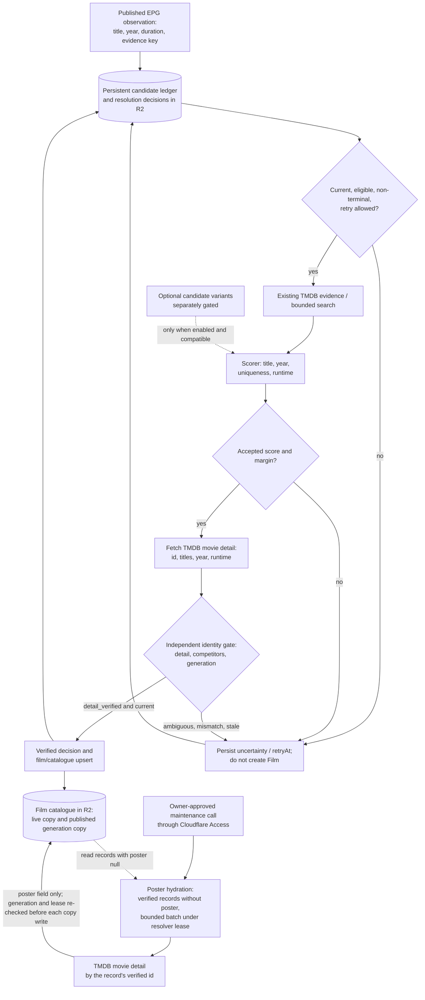

# Discovery, scored resolution and verification gate

The discovery ledger tracks **observations**, not canonical Film records. A high score is only a hypothesis until independent movie-detail verification and the current-generation fence pass. Sources: [scored resolution reference](../reference/domain/scored-resolution.md), [candidate variants](../reference/domain/candidate-discovery.md), [observation ADR](../adr/0007-persistent-discovery-evidence.md), [detail gate ADR](../adr/0010-scored-detail-verification.md), [scorer](../../src/domain/scored-resolution.js) and [gate](../../src/domain/resolution-acceptance.js).

Before an observation reaches the ledger, and again before each resolver chunk, the [non-film screen](../reference/domain/nonfilm-screening.md) removes high-confidence series episodes and TV shows by title, or by XMLTV `episode-num` during the EPG scan. A reliable watchlist/catalog match or a verified decision outranks that screen. A stored `excluded_nonfilm` decision that the current rule no longer reproduces makes the observation eligible again in the normal cycle; it is not cleaned up or backfilled.

The scorer combines duplicate rows by **TMDB ID** before calculating uniqueness; multiple distinct editions with compatible titles and years remain competitors. `accepted`, `trusted: true`, an alias or another observation's verified decision is insufficient to write a Film. The detail gate checks the exact accepted ID, compatible title/year/runtime, competing editions, and the same pinned programme generation. A rejected, ambiguous or stale result must not be silently promoted.

The scored gate is the only resolver: the former `SCORED_RESOLUTION` rollout variable is retired from code ([ADR 0036](../adr/0036-scored-resolution-only.md)), and rolling the resolver back is a code revert, not a setting. `CANDIDATE_DISCOVERY` is an **independent optional runtime flag** (`on` only) for bounded title/year variants. The dated [AIR-68 cutover](https://trello.com/c/qbLDc6Ql) enabled scored resolution but did not approve optional variants. A historical rollout result does not establish today's flag setting. Each explicit discovery step processes a bounded chunk; no recursive public self-fetch or unbounded TMDB work is implied. See [one-chunk ADR](../adr/0006-one-chunk-discovery.md).

The catalogue upsert above is the only writer that creates or re-identifies catalogue records. The owner-triggered [poster hydration](../reference/api/catalog.md#poster-hydration) ([ADR 0020](../adr/0020-owner-triggered-catalog-poster-hydration.md), [ADR 0048](../adr/0048-permanent-catalog-poster-maintenance-route.md)) is a second writer outside this flow, a permanent owner-only maintenance route with no switch of its own: it fills only the `poster` field of already verified records from TMDB detail by the same id, under the same resolver lease, and never creates a record, a decision or an identity. Its two catalogue writes are separate compare-and-swaps, not one atomic step; a stop between them is reported and completed by the next call. It runs only on an owner-approved call, never on a schedule.

At the end of a chunk the resolver rebuilds the prediction queue for the published programme. It renews its discovery lease before each write attempt, and the write is conditional on the queue it read ([ADR 0061](../adr/0061-prediction-queue-conditional-writes.md), Proposed). A conflict it cannot resolve ends as `prediction_queue_checkpoint` in the chunk's status, never as an overwrite.

R2 remains authoritative. The separately planned D1 candidate tables are not active production authority.

**Implemented, inactive by default:** with `DISCOVERY_LEDGER_MODE=bounded`, [ADR 0034](../adr/0034-bounded-discovery-ledger.md) ([AIR-220](https://trello.com/c/uPvMc5ww)) bounds the "persistent candidate ledger" node above to the latest scan's candidates. History moves to a write-once segmented archive, which the EPG commit reads only for re-entering keys; chunks and status never read it. The diagram shows the default full ledger. It changes, under its own visual review, when the bounded mode is activated ([AIR-222](https://trello.com/c/9Y4G9DG6)).
