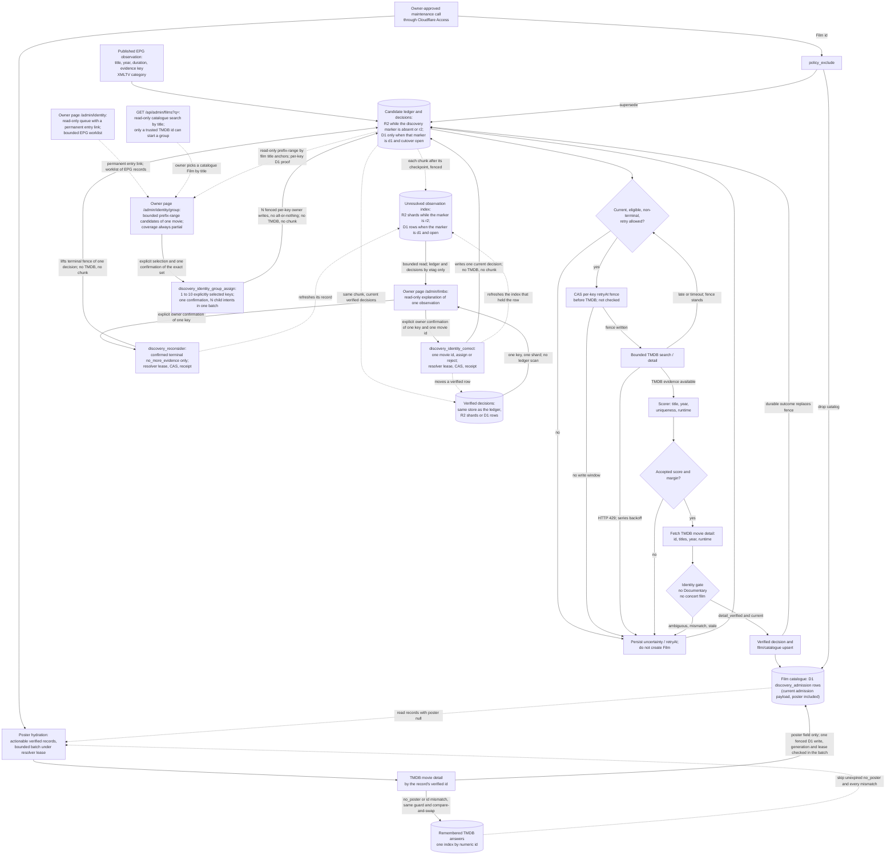
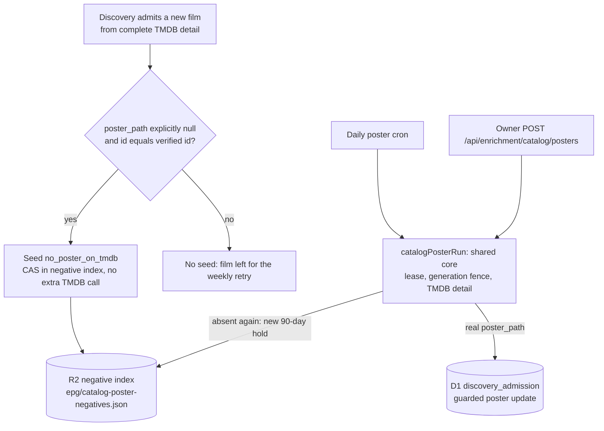

# Discovery, scored resolution and verification gate

The discovery ledger tracks **observations**, not canonical Film records. Accepted [ADR 0135](../adr/0135-epg-priority-discovery-pause.md) closes new Discovery admission from 16:55 Europe/Madrid until the owed EPG generation is published and handed off. The pause is live; with [ADR 0175](../adr/0175-epg-priority-holds-until-run-complete.md) (Accepted; code delivered by AIR-539, migration `0026` applied to production on 19 Nov 2026 under a separate owner GO) the hand-off also needs the run's durable completion certificate (`finalized_run_id`), so a new chunk is refused (`epg_priority`, detail `awaiting_complete`) from the pointer switch until the EPG run is `stage=complete`. A chunk already in flight keeps renewing and finishing. The diagram below does not draw the gate. Which executor runs the next chunk is a separate flag ([ADR 0083](../adr/0083-inert-discovery-workflow.md), Accepted) and does not change scoring, acceptance, or the decision written for an observation. A high score is only a hypothesis until independent movie-detail verification and the current-generation fence pass. Sources: [scored resolution reference](../reference/domain/scored-resolution.md), [candidate discovery](../reference/domain/candidate-discovery.md) (the optional variant search is retired), [observation ADR](../adr/0007-persistent-discovery-evidence.md), [detail gate ADR](../adr/0010-scored-detail-verification.md), [scorer](../../src/domain/scored-resolution.js) and [gate](../../src/domain/resolution-acceptance.js).

Before an observation reaches the ledger, and again before each resolver chunk, the [non-film screen](../reference/domain/nonfilm-screening.md) removes high-confidence series episodes and TV shows by title, or by XMLTV `episode-num` during the EPG scan. A reliable watchlist/catalog match or a verified decision outranks that screen. A stored `excluded_nonfilm` decision that the current rule no longer reproduces makes the observation eligible again in the normal cycle; it is not cleaned up or backfilled.

The scorer combines duplicate rows by **TMDB ID** before calculating uniqueness; multiple distinct editions with compatible titles and years remain competitors. `accepted`, `trusted: true`, an alias or another observation's verified decision is insufficient to write a Film. The detail gate checks the exact accepted ID, compatible title/year/runtime, competing editions, and the same pinned programme generation. It then refuses any TMDB Documentary and any recording of a real concert performance ([ADR 0150](../adr/0150-documentary-and-concert-film-exclusion.md)). Owner confirmation of the identity does not admit either proven type. A rejected, ambiguous, documentary, concert-recording or stale result must not be silently promoted. The refusal does not move the published EPG generation ([ADR 0142](../adr/0142-epg-owned-generation-addressed-discovery-slots.md)).

The scored gate is the only resolver: the former `SCORED_RESOLUTION` rollout variable is retired from code ([ADR 0036](../adr/0036-scored-resolution-only.md)), and rolling the resolver back is a code revert, not a setting. The resolver does not plan title, year, spelling or numeral variant searches. `CANDIDATE_DISCOVERY` is retired and is not read ([ADR 0082](../adr/0082-retire-candidate-discovery.md), Accepted 2026-11-02). The dated [AIR-68 cutover](https://trello.com/c/qbLDc6Ql) enabled scored resolution and did not approve optional variants; those experiments stay historical. A chunk's status still carries `variantCalls`, `variantErrors`, `variantThrottled` and `variantSkipped`, each 0. Each explicit discovery step processes a bounded chunk; no recursive public self-fetch or unbounded TMDB work is implied. See [one-chunk ADR](../adr/0006-one-chunk-discovery.md).

The catalogue upsert above is the only writer that creates or re-identifies catalogue records. The owner-triggered [poster hydration](../reference/api/catalog.md#poster-hydration) ([ADR 0020](../adr/0020-owner-triggered-catalog-poster-hydration.md), [ADR 0048](../adr/0048-permanent-catalog-poster-maintenance-route.md), [ADR 0063](../adr/0063-catalog-poster-negative-index.md)) is a second writer outside this flow, a permanent owner-only maintenance route with no switch of its own: it fills only the `poster` field of already verified records from TMDB detail by the same id, under the same resolver lease, and never creates a record, a decision or an identity. With Discovery on D1 its write is one fenced D1 batch on the `discovery_admission` row (AIR-515) and a later admission keeps a stored poster of the same identity; the former R2 catalogue copies (`epg/discovered-films.json` and the generation copy) are frozen historical data: the built Worker neither reads nor writes them, and an authority that is not `d1`/`open` is a `503`, not a fallback. The same call then records a terminal TMDB refusal (`no_poster_on_tmdb` for 90 days, `tmdb_id_mismatch` for a different valid numeric id until the verified id changes) in one index keyed by the numeric TMDB id. A 200 body with no valid movie id stays retryable and is not stored. The ordinary queue skips those entries. An explicit recheck of one named id is a separate owner-confirmed call and is the only way past a remembered answer before its date. An unreadable index stops the call before the lease and before TMDB. It runs only on an owner-approved call, never on a schedule.

**Owner recovery of one observation** ([ADR 0061](../adr/0061-discovery-observation-index-and-reconsider.md)):

- **Index.** After its checkpoint, each resolver chunk writes a bounded index of the current unresolved observations that already have a decision. It is fenced by the resolver lease and written only for the published generation. The manifest names the etags of the decisions and the ledger it was built from, so any later write to either makes the index stale.
- **Owner read.** The owner page explains one observation from that index alone, never from the ledger or the decision body. A missing, torn or foreign index is unavailable, not empty.
- **Guarded reconsideration.** `discovery_reconsider` is offered only for a confirmed terminal `no_more_evidence` on a fresh index with no live lease, protected wait, throttle or ambiguity. It changes one decision: it clears the terminal reason and the retry time and keeps the attempts and the evidence key. It writes under the resolver lease, by compare-and-swap on the decision map's etag and the decision's digest, with a stored before-image and receipt. It calls no TMDB and starts no chunk: the next ordinary chunk takes the observation through the `eligible` gate above, and an uncertain result on the same evidence makes it terminal again.
- **Policy exclusion** ([ADR 0153](../adr/0153-catalog-policy-exclusion.md), Proposed). `catalog_policy_exclude` retires one already admitted Documentary or concert recording: related decisions (same `tmdb_id` set in preview and writer, cap 12), the current admission, current-generation discovery-basis shows of those keys (the completed-programme overlay only; sealed `title_year` rows stay), and the film's prediction-queue rows (`settleQueueFilms` then `refreshPredictionQueue`). `GET /api/programme` withholds a proven Documentary or concert from the presented `films` and `catalogFilms` even when the sealed document still lists a watchlist `title_year` member; `GET /api/watchlist` is unchanged. It is not `discovery_identity_correct`. It does not move the published EPG generation and does not delete ratings or prediction bodies. Shipping the route authorizes no production write. The AIR-500 reclass is not a GO write set.
- **Identity correction** ([ADR 0080](../adr/0080-discovery-identity-correction.md), Accepted 2026-11-01). `discovery_identity_correct` assigns or rejects one numeric movie id on one current decision, including one current verified decision read from the verified-observation index. A trusted choice is the observation's own confirmed movie id, or a typed id that one catalogue object supports. A title and the scorer's hypothesis are not trusted. The same lease, compare-and-swap and receipt apply. A decision that read back without a stored receipt is not reported as success; the same confirmation stores the receipt and does not write the decision again. The write is the decision. Shows follow the next ordinary chunk only when that chunk's cheap pass can touch a catalogue film that is already there. A rejection clears that decision's terminal fence. The next chunk may search for a different id and does not fetch the rejected movie. The action does not start the chunk. An unknown store marker writes nothing. While the published-EPG marker is `d1` and the discovery marker is not ready, both this action and `discovery_reconsider` stay `supported: false` and write no R2 object. When the discovery marker is `d1` and `cutover` is `open` ([ADR 0085](../adr/0085-d1-authoritative-discovery.md), Accepted 2026-11-04), both actions write the D1 decision and the receipt in one batch. A held discovery marker refuses the confirm.

- **Group assignment** ([ADR 0181](../adr/0181-owner-confirmed-group-assign-of-selected-observations.md), Accepted 2026-11-20). `discovery_identity_group_assign` assigns **one** movie to 1 to 10 explicitly selected observations, as a convenience over single-key owner writes: each key is written by the same fenced `ownerDecision` with its own intent, history row and receipt. The owner starts without knowing an id: the page opens on a bounded worklist of EPG records (the read-only `GET /api/admin/identity-work`, always shown as a partial scope) and a catalogue search by title (the existing read-only `GET /api/admin/films?q=`); only a catalogue Film with a trusted, non-conflicting numeric TMDB id can be chosen, and a numeric id typed by hand is an optional path. Candidates come from bounded primary-key prefix-range reads by the normalized titles of the catalogue Film (at most four anchors, at most 50 candidates, always `coverage: partial`, every count shown); each key needs a complete per-key D1 proof and passes the unchanged single-key gate plus a runtime check, the revoked-assign fence and the owner-assignment and scorer conflicts. Confirm binds exactly the selected keys (never an eligible subset) and writes all N child intents in one D1 batch; execute passes an issuance barrier, then writes the keys one by one under one lease with a drift fence (programme run unchanged, generation only moved by this run's own writes), lease renewal before each key and a 60-second run budget. Outcomes are per key (`applied`, `conflict`, `refused`, `skipped`, `expired`, `not_attempted`, `unknown`); an unknown outcome stops the run. No table, no migration, no TMDB call, no chunk.
- **Owner evidence rows** ([ADR 0215](../adr/0215-identity-evidence-full-model.md) decision 6, card E2c, delivered dormant). The one fenced `ownerDecision` batch of an assign, reject or revoke (each child of a group is its own intent and batch) carries, while the `discovery_owner` writer is `pending` or `on`, the evidence statements of [d1-schema](../reference/data/d1-schema.md#identity-evidence-writer-control-schema-v42-adr-0215-accepted-not-applied): an insert and an assertion per row and one assertion that the history revision written is the row's `source_order`. They are prepared before the intent turns `running`, so an eligible step that cannot yield a row is refused (`conflict`) with the intent still `approved`. With the writer absent or `off` the batch commits the same domain effect, and the ADR 0178 fences, the decision hash CAS and the canonical claim are unchanged. The diagram above is unchanged.
Contracts: [admin API](../reference/api/admin.md#discovery-observation-recovery-get-apiadmindiscovery-recovery), [observation index](../reference/domain/discovery-observation-index.md), [recovery assessment](../reference/domain/discovery-recovery.md), [identity correction](../adr/0080-discovery-identity-correction.md).

At the end of a chunk the resolver rebuilds the prediction queue for the published programme. It renews its discovery lease before each write attempt, and the write is conditional on the queue it read ([ADR 0064](../adr/0064-prediction-queue-conditional-writes.md), Accepted 2026-10-31). A conflict it cannot resolve ends as `prediction_queue_checkpoint` in the chunk's status, never as an overwrite.

**Interrupted series.** Two hops that both end before their continuation checkpoint leave `paused` / `reason: interrupted`. The hourly task and every ordinary step keep answering `stop`. A separate confirm, `POST /api/enrichment/discovery/resolve` with `recovery: "interrupted"`, is the only new way through that stop ([ADR 0088](../adr/0088-guarded-interrupted-discovery-recovery.md), Proposed). It is not `force`, and `force` is unchanged. The confirm writes nothing unless the sync stage is `complete`, every current programme run id matches, the lease is free, no backoff is pending, the discovery authority is the R2 path or an open D1 marker, and the stored status shows the interrupted hop did not finish (`cheap_pass` without `finishedAt` is the known shape). It then runs one ordinary chunk under the existing lease and continuation compare-and-swap. A repeat confirm, a lost response whose checkpoint already landed, and a hop that is still `running` do not run a second chunk. A refusal, including an uncertain checkpoint, writes nothing. The flowchart above is unchanged. Accepting the record does not authorize a production confirm.

**Store.** Production discovery is D1 while `discovery_authority.mode` is `d1` and `cutover` is `open` ([ADR 0085](../adr/0085-d1-authoritative-discovery.md), Accepted 2026-11-04; [activation record](../evidence/d1-migration/air-320-discovery-activate-2026-11-04.md)). Migration `0011` is applied ([apply record](../evidence/d1-migration/air-320-discovery-apply-2026-11-04.md)). The inserted marker was `r2`; a later GO opened it. A deploy does not apply `0011`. While the marker is `d1`, a failed or torn read fails closed and does not serve the R2 ledger. While it is `held`, readers stay on R2 and writers fail closed. Catalog admission does not insert a Film. `tmdb` and `tmdb_tv` stay distinct. The diagram above already names that store and was visually approved by the owner on 2026-11-04. Pipeline status counts a D1 ledger in pages of 500 and does not raise the 20,000-item whole-document cap. A resolver chunk on that paged ledger selects a keyset of current actionable observations (SQL as `resolutionActionability` except the title screen) and a rotating keyset of current verified rows; it does not read every active observation or the whole decision map before TMDB work ([ADR 0109](../adr/0109-discovery-keyset-candidate-selection.md)). `remaining` is the global SQL set, not the page. A paged-chunk candidate is CAS-fenced with a five-minute per-key `retryAt` (`deferReason: wall_budget`) **before** TMDB and is not counted as checked; a saved identity overwrites that fence, and a late or timed-out request keeps it so the hop does not pause the series ([ADR 0148](../adr/0148-discovery-budget-defer-fairness.md)). Selection-only overruns (no fence written) and TMDB 429 still set a series backoff. The `eligible` gate in the diagram includes that retry fence. Status reads still page the ledger for counts. Same-evidence excluded_nonfilm reactivation when only the screen rule changes is a follow-up.

**Bounded archive (production seal).** [ADR 0034](../adr/0034-bounded-discovery-ledger.md) bounds the "persistent candidate ledger" node above to the latest scan's candidates, plus, while a backlog remains, the part of the observations absent since earlier days that one commit has not archived yet: the daily flow is archived at once and the backlog at most 4,000 observations a commit ([ADR 0112](../adr/0112-bounded-ledger-departure-budget.md), Accepted). History moves to a write-once segmented archive, which the EPG commit reads only for re-entering keys; chunks and status never read it. The production Worker always runs that bounded protocol; the former `DISCOVERY_LEDGER_MODE` switch is retired and ignored ([ADR 0156](../adr/0156-retire-discovery-ledger-mode.md)). The flowchart node is the candidate ledger and decisions, not the R2 archive layout, and is unchanged.

**Permanent executor (AIR-324 cutover, AIR-325 selector retirement).** `ensureDiscoveryWorkflow` and `reconcileDiscoveryWorkflow` reconstruct a missing published-generation intent by the existing `queueDiscovery` compare-and-swap and require a read-back receipt ([ADR 0093](../adr/0093-discovery-workflow-cron-reconcile.md), Accepted). Admission requires the current D1 EPG pointer from `PublishedEpg.currentGeneration()` to equal the Discovery `published_programme_run_id`; a lag or mismatch waits as `generation_handoff` and does not start from an old marker or R2. The existing Worker cron may call reconcile; it creates nothing without the Workflow binding and D1 admission; the retired `DISCOVERY_EXECUTOR` variable is ignored. A scheduled `projector_window` refusal is retried in that same tick after the window expiry (AIR-428), and each attempt is logged; an unscheduled caller still returns the typed refusal immediately. A held, `loading` or unreadable D1 discovery marker writes nothing. The Workflow still keeps one chunk per durable step, the generation pin and the 20-chunk rollover. Interrupted-hop recovery by the Workflow with ADR 0088 proof is not activated here; the manual confirm is refused (`executor_workflow`) and the HTTP step only delegates. In the same window the D1 enrichment projector, which shares the cron, defers as `generation_pending` instead of failing on the old generation's absent catalog copy (AIR-363). The flowchart above is unchanged. A deploy sets no variable. Contract: [orchestration reliability](../reference/orchestration-reliability.md#discovery).

**Hourly report (AIR-410, [ADR 0111](../adr/0111-discovery-hourly-reports.md)).** The executor record carries one open accumulator `report` and an `outbox`. Each saved chunk checkpoint adds that chunk's summary to `report` inside the owner's compare-and-swap (each summary is one chunk, none cumulative; the chunk key in `seen` makes a replay add nothing). The scheduled hourly `reconcileDiscoveryWorkflow` ends by closing the period of its UTC hour in one compare-and-swap of the same record, moving a `discovery` event into the `outbox` and resetting the accumulator, then delivers the outbox create-only to the Events Log. A chain that crosses hours, a rollover, a recovery, a typed refusal, an idle pipeline or a confirmed empty queue (continuation `complete` and `remaining` and `cheapRemaining` both the number 0, no error; or, since [AIR-595](https://trello.com/c/dPjrNIbQ), a series stopped on `backlog_empty` whose continuation is paused on `chunk_budget` with no chunk left and whose last chunk's status, same hop and generation, has every queue part 0) all produce the same one report; a close that cannot be persisted writes one compact `report_failed` notice (no numbers; the same canonical id as the report of the hour, which replaces it if it saves later; delivered create-only to the journal, or through a separate lossless ledger of at most 8,760 compact entries when the journal refuses it; since [ADR 0209](../adr/0209-discovery-report-fault-ledger-in-two-objects.md) that ledger is kept in two R2 objects so a rollback evicts nothing, with the bound best effort across simultaneous writers) and keeps the deltas for the next report ([ADR 0118](../adr/0118-discovery-report-failure-notice.md)); a close refused by the EPG-priority pause names it (`epg_priority`) rather than a lost compare-and-swap; an unreadable queue beside real deltas is a persisted report with `queueUnreadable`. The close takes no lease, runs no chunk and calls no TMDB, and the outbox (64) drops nothing. The diagram above is unchanged ([contract](../reference/domain/events.md#discovery-hourly-report-discovery)).

**One queue classification for every reader.** Whether the queue of the published generation is empty, owed, waiting on the EPG-priority pause or unconfirmed is decided once, by the pure [Discovery queue state](../reference/api/enrichment.md#discovery-queue-state) over the small records of one bounded read, and the footer, the Monitor, the hourly report, the operational and detailed status and the admin data health all present that one answer. A series that drains while the legacy alias sweep is still open stops on `backlog_empty` with its continuation paused on `chunk_budget` and no chunk left; nothing runs again for that generation (an execution policy this classification does not change), and its old gate is never read as a backlog.

**Ledger seal.** The active ledger of a new generation is published into D1 by a resumable job of bounded steps ([ADR 0092](../adr/0092-resumable-bounded-ledger-seal.md)), not inside the EPG commit request. The job's cursor lives in `discovery_seal` and moves in the same D1 batch as the rows; while the transfer is `loading` only the independent reads of [ADR 0091](../adr/0091-selective-reads-during-a-loading-ledger-seal.md) stay open. The diagram above is unchanged.

## Admission while a projector window is requested or held

The one Discovery lease row (`discovery_lease`, TTL 90 s) is the admission point of every chunk, seal, publish handoff and owner correction (`acquireLease`). With migration `0018` applied, `acquireLease` also refuses while the single `projector_window` row is `requested` or `held` and unexpired, and answers the typed busy `{kind:'projector_window',expiresAt}` ([ADR 0103](../adr/0103-projector-exclusive-window.md)). The chunk series and the Workflow wait until that deadline and charge nothing; the EPG seal answers a `busy` with the same kind and no lease-TTL cap. While the window is `held`, the lease row belongs to the projector, so every lease-fenced Discovery write fails in its own batch, and `writeContinuation`, `writeWorkflow` and `importSegment`, which move the generation without the lease, carry a window predicate in their own bump statement and are refused softly (`discovery_window`, with the expiry). A Workflow state write refused this way is not a step failure: nothing is written and no stall or recovery attempt is counted. Without the table, or with the flag off, none of this applies and the paths are unchanged. The ledger, decisions and catalog documents and their generation fence are unchanged.

## Known-film title collision at scan ([ADR 0151](../adr/0151-epg-known-film-title-collision.md), Accepted)

Before any of that, a programme on a channel whose policy is `deny_all` is dropped, and on a `known_only` channel (or one the Channel snapshot does not hold) only a reliably identified Film continues, so Discovery never builds an unknown candidate from them ([Channel policy](../reference/domain/candidate-discovery.md#channel-policy-in-the-epg-scan), [diagram](epg-and-availability.md#channel-policy-in-the-epg-scan-adr-0187)). `scanEPG` builds one alias index from the watchlist and the catalog films already passed in (`catalogOnly`). A slot is a watchlist Film only when that index leaves a single trusted identity. With a year in the title, the identity must be within one year and must not sit beyond the runtime contradiction band (`max(45 minutes, 40% of runtime)`). Without a year, exactly one identity must sit inside the near runtime band (`max(8 minutes, 12%)`) and every other identity that shares the normalized title must be outside the contradiction band. Anything unresolved, including a catalog homonym that is not on the watchlist, stays an ordinary discovery observation and does not attach a Film showing. A catalog-only match records its TMDB id on that slot. The observation carries the id only when every retained slot confirms the same one, and `scan_confirmed` later uses the slot's own id. The scan does not call TMDB. Days 2–7 of the feed still keep only a unique non-catalog watchlist match; a collision in that horizon is dropped rather than assigned. Addressed assignment of a later verified decision is unchanged apart from that per-slot confirmation.

## Alias provenance at scan ([ADR 0158](../adr/0158-epg-title-alias-provenance.md), Accepted)

An EPG title is evidence of an airing, not of a title of the Film. `touchCanonicalFilm` adds a title to a Film's `aliases` only when its normalized key is one the Film already has (a cosmetic spelling) or when the observation was verified by a TMDB detail read or by the owner; an observation that was verified by an alias cannot teach a new key. A catalog record carries `movieTitles`, the titles TMDB gave that movie, written only by `catalogFilmFromDetail`. In `scanEPG` a single `catalogOnly` Film confirms a slot only when the slot's normalized title is a key of its title, original title or `movieTitles`; otherwise the slot stays an ordinary discovery observation with the uncertain reason `alias_without_movie_provenance`, no `confirmedTmdbId` and no `confirmedSlots` entry. The scan index covers `aliases`, `movieTitles` and, for a catalog-only Film, its title and original title. An alias without provenance still counts as a competitor, so it can block a watchlist Film but not confirm a catalog one. A watchlist Film keeps every alias it has. The bounded revalidation of ADR 0142 decision 6 also records `movieTitles` (one fenced `upsertAdmissions`, written before the decision that anchors the duration, so a skipped write or a short budget defers the observation instead of losing the provenance) after it reconfirms a duration of a catalog-only Film through the movie-detail gate. The paged chunk revalidates up to four such legacy decisions before the candidates that have no decision (one detail call each, only while a request and its writes fit), so those candidates cannot use every call and all the time first. It finds them with its own keyset read and cursor, not from the replay or touch page, which are two independent cursors that meet by chance; other drifted decisions keep their place after the candidates. An unfinished lap of that read keeps the series open (`stage` `partial`, no `complete` from `continuationAfterChunk`), bounded by the lap, by 40 sweep chunks per programme run and by the hop budget. No new store or writer, and the scan still makes no TMDB call.

## Identity evidence on the decision write (E2a, [ADR 0215](../adr/0215-identity-evidence-full-model.md), dormant)

This section adds no diagram: no runtime flow changes while the writer is `off`. The decision write already commits one batch under the lease and the generation fence (`writeDecisionDelta` per key on the chunk path, `writeDecisions` for the whole document). Card E2a ([AIR-617](https://trello.com/c/IfAZDYDj)) appends to that same batch two statements of the `discovery_decision` writer, placed before the history insert: a conditional insert of one unbound `film_identity_evidence` row and an assertion on it. Both are conditional on the history row's own predicate (no decision with this hash is stored yet), and the transition must have **performed a check** (`decisionCheckPerformed`): the decision becomes verified, or its source, TMDB id or media kind changes (a known alias confirmed by a detail check), or its anchor gains a reconfirmed duration. A new hash alone is not enough: a failed-only revalidation, a metadata or deferral rewrite and a `checkedAt`-only change of an inherited verification add no row. An unchanged, repeated, deferred, excluded, owner (`identitySource: 'owner'`) or `identitySource`-less decision adds none. The revalidation caller passes its explicit outcome (`check`, true only when a duration was reconfirmed); every other producer either moves a decision into `verified` or changes its source or id, which the transition shows. On the document path the predecessor is read outside the batch, so it is checked twice: an unreadable or unverifiable stored decision (read error, payload not matching its hash) is **not** an absent decision and, while the writer records, refuses the write before the transfer opens (`discovery_unavailable`, nothing written), and an in-batch assertion fails the batch if the stored decision is no longer that predecessor (as for any document batch that fails after opening the transfer, recovery is the existing one); with the writer `off` neither changes behavior. A marker carried from an earlier owner action (`ownerIdentity`, `rejectedTmdbIds`) is history, not a discriminator: an automated detail check of another id after an owner rejection writes its row.

- **Row.** `candidate_for(discovery_observation:<observation key>, tmdb_movie|tmdb_tv:<tmdbId>)`, `asserts`, route `discovery_scan`; method `tmdb_detail_check` for `identitySource: 'tmdb_detail'` (including the revalidation that turns a known alias into a detail check, which is a new hash and a new key), method `known_alias` with `source_scope` `known_epg_alias` or `known_alias_year_runtime` for the alias sources; root = the observation key (a detail row and an alias row of one observation share a root and are never independent); observation time = the decision's `checkedAt`. A value the ledger model refuses (an id or time outside its shape) is a decision that states no recordable check: no row, the decision still commits.
- **Writer state.** The row is inserted only while the writer's control row is `pending` or `on`; no row, or a schema without the control tables, is `off`. Before migration 0042 the batch carries one commit-time guard that the control tables are still absent, so a batch prepared before the migration cannot commit after it without its row. Production writes nothing until an owner-approved activation package ([runbook](../runbooks/identity-evidence-writer-activation.md)); nothing in the code flips a control row.
- **Atomicity.** The row, its history row and the decision commit together or not at all: a lost fence or lease, a hold, a vanished observation, a changed decision (the existing CAS) or a same-key row with another semantic identity rolls all of it back (a collision surfaces as `discovery_fence`). A response lost after the commit is diagnosed from the stored decision and counts as written; a replay adds no second row (same key).
- **A refusal is re-evaluated, not parked for an hour (AIR-687).** When a chunk's write or read is refused with `discovery_fence`, the refused hop writes nothing more and the executor reads the published pointer, the authority gate and the stored lease back (read-only). Unless that state positively shows the series is superseded (another run published, or the authority bound to another run), it schedules a short, backed-off re-evaluation (30 s, doubling, capped at five minutes) instead of the next hour boundary; the next chunk takes its own lease and is fenced again on every read and write, and a hold, a loading transfer or a window applies its own busy time there. A superseded run keeps the fail-closed `error` record. A same-owner conflict while the Workflow saves its own checkpoint sleeps briefly and retries without repeating the chunk. No diagram changes: the Workflow still reads the checkpoint's `retryAt`.
- **Cap.** One key adds two statements (8 per chunk-path batch); the document path counts them in its existing split, so every batch stays within `STATEMENT_CAP` (40).
- **Not changed.** The Discovery algorithm, the admission and its minting claim (no row), any Film revision or canonical receipt, any reader, any authority. Nothing reads the ledger to decide anything ([ADR 0213](../adr/0213-film-identity-evidence-ledger.md) decision 8).

## Addressed slot assignment ([ADR 0142](../adr/0142-epg-owned-generation-addressed-discovery-slots.md), stage 2)

Discovery no longer patches the published programme document or moves the published generation when it identifies a broadcast. After a decision is verified (and on the batched replay that opens every paged chunk, see below), `assignObservationSlots` writes one `published_epg_show` row per eligible slot of the observation, with `basis='discovery'`, under the Discovery lease and fence. The row is inserted only while the published authority is `d1`/`open` at the observation's EPG run, the stored decision is `verified` for that Film and TMDB id, the observation is active in that run, the Film is a `programme` member of that run (or a `tmdb_<id>` catalog Film with a `current` admission) and no row of any Film holds the slot. Per-slot eligibility is the owner rule, the scan-confirmed TMDB id, or the verified-duration anchor (`src/domain/slot-evidence.js`); a legacy decision with several recorded durations has no anchor. Every decision writer deletes the rows of an observation in the same batch when the decision leaves `verified` or changes Film. The published generation and membership never move. A new EPG run starts without assigned rows; the batched replay recreates them. That replay (`replayUnassignedSlots`) is the first phase of every paged chunk, before the ledger count and the TMDB candidates, and owns a fixed slice of the chunk budget (10 of 40 seconds) so unresolved work can neither starve it nor be starved by it. It selects only verified observations of the published run that still have a slot no row holds, a keyset page of 40 at a time, reads their decisions, free slots, members and admissions with set queries, applies the same per-slot eligibility rule, and writes the rows through the same guarded per-slot statement in fenced batches (`STATEMENT_CAP - 2` statements each, one Discovery generation step per batch). Coordinates are copied from the current run's observation rows, never from an earlier run. The slot-absence probes (the replay's two selections and the guard inside the insert) name the existing `published_epg_show_by_generation (programme_run_id, start_ms)` index, because the planner otherwise scans the run by the primary-key prefix once the run holds thousands of rows; the ownership rule is unchanged. The replay checks its deadline before every write group, the first included, and a page that has no time left writes nothing and keeps the cursor where it began. Its cursor (`replayAfter`) is stored with the Discovery status together with the run it belongs to and is ignored when the published run has changed. A lap starts at the first key and ends at the end of the key space; a completed lap (`replayLapAt`, run-scoped) rests for 30 minutes, so the observations that cannot be assigned now are not scanned in every chunk, and the next lap picks up those that became assignable; a chunk is `partial` until one lap has covered every key, and an observation that can never be assigned (evidence drift, a Film with no record, a slot held by another Film) is visited once per lap and does not keep the series open. A chunk whose replay wrote rows and has more to restore is not backed off even when no TMDB request fit, so the recovery of a new generation is paced by chunk duration and not by the five-minute series back-off. The per-observation `assignObservationSlots` call remains for a decision a chunk has just written. Removal is scoped to the published run (rows of historical runs stay) and follows the TMDB identity: a status that leaves `verified`, a changed TMDB id or a changed Film id deletes the rows in the decision's batch. A member Film is accepted only when the sealed programme document of the run carries the decision's TMDB id. A legacy decision without `anchor` infers one only when it was verified by `tmdb_detail` and records exactly one duration. The `authority != d1` branch of the old attach (R2 programme document) is kept unchanged; under D1 it writes nothing.

### Bounded revalidation of a drifted duration (ADR 0142, stage 3)

The replay reports each slot that no rule makes eligible as `evidence_drift` with its duration in whole minutes. After the candidates without a decision, and only with the TMDB calls and the time that the chunk has left (never beyond `PAGED_TMDB_CALLS`, 16), the paged chunk revalidates the drifted durations of a verified, non-owner observation: one detail call for the stored TMDB id, then each duration in ascending order is scored and gated **alone**, without the stored decision as a confirmation. The same TMDB id accepted by the scorer and the detail gate puts the duration into `anchor`; any other result puts it into `failedDurations` (and a different preferred id into `proposedTmdbId`). The decision is rewritten through `writeDecisionDelta` with the same status, TMDB id and Film id, so no assigned row is deleted, and a reconfirmed slot is assigned straight away. A duration in `anchor` or `failedDurations` gets no further call. Twelve failed durations end automatic revalidation for that observation for good (`revalidation_exhausted`); a TMDB failure, a rate limit or an exhausted budget records nothing and counts nothing. The chunk summary carries `revalidation` (`observations`, `revalidated`, `revalidation_failed`, `revalidation_exhausted`, `deferred`) beside `assignment`. The Admin presentation of drifted observations is not part of this change and needs the owner's separate visual approval.

## Recovery after a stop: the fast tick (AIR-534, [ADR 0174](../adr/0174-discovery-only-fast-recovery-cron.md))

A recoverable stop of a Discovery Workflow records `recovery.dueAt`. The successor no longer waits for the next hourly cron: a Discovery-only cron every two minutes (`1-59/2 * * * *`) reads the Workflow record and, once the due time has passed and the existing admission accepts, hands the case to the existing reconcile, which creates the deterministic successor id under the existing CAS. A missing record or a record of an older generation than the published one (a missed EPG-publication start) is handed over the same way. A live instance of the published generation, a recovery not yet due, a terminal stop and a quarantine are left alone with no write. The fast tick runs no chunk, no TMDB call and no hourly report. The flow is drawn in [scheduling and orchestration](scheduling-and-orchestration.md); a false `programme_changed` from a generation CAS collision is handled inside the chunk by a bounded retry and defer (see the [AIR-534 evidence](../evidence/discovery/air-534-false-programme-changed-2026-11-18.md)).

## Catalog posters: admission seed and the weekly retry ([ADR 0179](../adr/0179-weekly-automatic-catalog-poster-retry.md))

A catalog film without a poster has two automatic paths besides the owner route, both D1 only and both using the existing guards. **Seed:** when Discovery admits a new film from a complete TMDB movie detail whose id equals the verified id and whose `poster_path` is explicitly `null`, it records `no_poster_on_tmdb` (90-day hold) in the negative index by compare-and-swap, with no second TMDB request; an index failure never blocks the admission. **Weekly retry:** the daily poster cron calls the one shared core `catalogPosterRun` (also wrapped by the owner `POST /api/enrichment/catalog/posters`), which re-asks TMDB only for verified films whose hold has expired or that have no entry, and writes a poster only through the guarded D1 conditional update. `tmdb_id_mismatch` is never rechecked automatically. The paths are implemented and tested offline; production behaviour is unproven until the cron is activated by a separate owner decision.

## Accepted design (not implemented): Discovery and the Letterboxd Sync ([ADR 0186](../adr/0186-letterboxd-sync-and-independent-watchlist-authority.md), Accepted; not implemented)

**Status (21 Nov 2026, [AIR-569](https://trello.com/c/yaXv2oj6)):** delivered dormant. A Watchlist snapshot commit never rebuilds Discovery and Discovery never reads Watchlist state. A new Film joins the visible watchlist with its showings through a read-time composition only (trusted identity and a stored confirmed show row, including Discovery-assigned rows of the pinned generation); it writes nothing and does not move the programme generation, so a concurrent Discovery slot assignment is neither blocked nor duplicated.

Discovery keeps its lease, the EPG-priority pause and its own admissions. The proposal adds a one-way isolation rule: a Letterboxd Sync step never reads the Discovery lease, the resolver lease or the pause, so a held lease or a closed pause cannot delay a Watchlist or Ratings run, and Discovery never reads Letterboxd run state. A Film that Discovery admits and a Film the Letterboxd Sync admits meet only in the canonical Film writers, which use compare-and-swap and receipts, so two concurrent admissions of one Film yield one Film and an idempotent second writer. Discovery stays a reader of the Watchlist snapshot membership and writes no membership.
