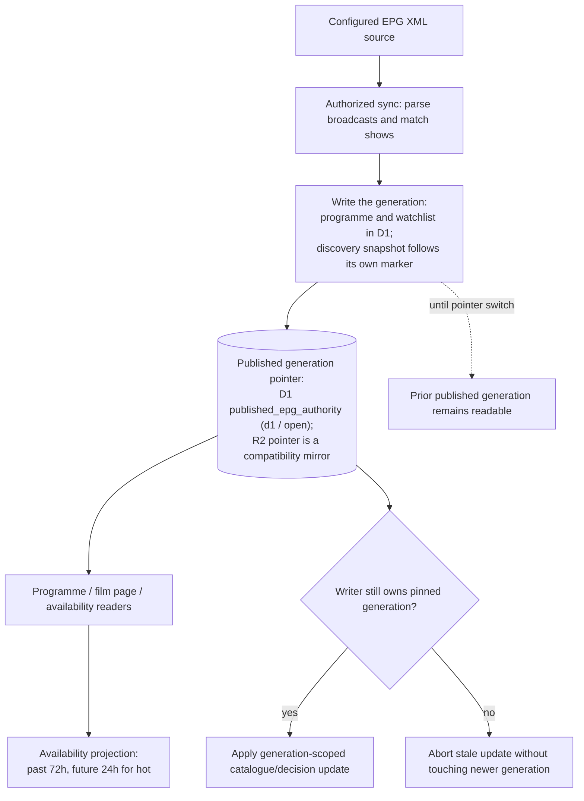

# EPG publication and availability

The active programme is a **published-generation projection**, not an append-only lifetime schedule. Sources: [EPG publication ADR](../adr/0008-atomic-epg-publication.md), [Film/Person availability contract](../reference/domain/film-person.md), [discovery reference](../reference/domain/candidate-discovery.md), and [Worker routing](../../src/worker.js).

The publication pointer changes **after** the complete generation exists. A partial write does not expose mixed versions. A newly published generation replaces its current show lists; current availability does not carry forward old shows. Show observations and `epgLastAiring` are not permanent Film identity attributes. Where the published generation is known, absent or mismatched `showsProgrammeRunId` cannot prove the film is hot; explicit `shows: []` means no known availability.

After the pointer switch the commit opens the discovery series of the new generation before its memory-heavy tail (watchlist and events, prediction queue, ratings); the write is fenced to the published generation and keeps a live writer or an existing series of the same generation. See [ADR 0030](../adr/0030-discovery-queued-at-publication.md). The tail's prediction queue rebuild is a conditional write that rebuilds on conflict with another queue writer ([ADR 0064](../adr/0064-prediction-queue-conditional-writes.md), Accepted 2026-10-31). A conflict it cannot resolve is recorded as `enrichmentQueueError` and does not fail the commit.

Availability calculations use a 72-hour lookback for hot showings and a 24-hour future planning window; the last known airing supports a 72-hour availability horizon. These domain computations are not equivalent to ingesting a new EPG. Late resolver activity must respect the pinned generation before writing programme or decisions.

**Current production (3 November 2026):** [ADR 0079](../adr/0079-d1-authoritative-published-epg.md) (Accepted) is activated: migration `0008` applied, `published_epg_authority.mode=d1`, `cutover=open`. D1 owns the published generation, programme/watchlist membership and generation fence. `programme.json`, `watchlist.json` and `epg/published-generation.json` are R2 compatibility mirrors, not a fallback on a D1 failure. Discovery decisions and continuation remain R2. [ADR 0085](../adr/0085-d1-authoritative-discovery.md) (Accepted 2026-11-04, [AIR-320](https://trello.com/c/4cA5GlJn)) routes them through D1 only after migration `0011` and a separate marker GO. `0009` is applied. `0010` is applied. `0011` is not. The revised staging/current-state label was visually approved by the owner on 2026-11-04; the original diagram was approved on 1 November. [Production evidence](../evidence/d1-migration/air-319-production-cutover-2026-11-03.md) records a first successful post-cutover generation: a scheduled-task-created run completed by one owner-authorized manual step on 3 November (published run `00ff34fa…`). Raw D1/R2 parity and programme/watchlist/availability consumers remain pending separate safe verification.

**Proposed Cloudflare executor recovery.** Under the shared reliability contract ([ADR 0089](../adr/0089-shared-orchestration-reliability-contract.md), Proposed), an EPG executor publishes at most once per Europe/Madrid date after 17:00 local time. A failure before the D1 pointer switch leaves the earlier generation published; after a lost response, reading the pointer decides whether this run is already published. Mirror repair writes R2 mirrors only from the currently published D1 generation. Publication may queue Discovery's fenced intent as a fast path, but not in one transaction with the pointer switch; Discovery's `ensure` reconstructs the intent from the published generation if it is missing, and EPG never waits for it. The flowchart above is unchanged; the executor is drawn on the [scheduling page](scheduling-and-orchestration.md#proposed-cloudflare-executors-and-shared-recovery). Contract: [orchestration reliability](../reference/orchestration-reliability.md#epg).
