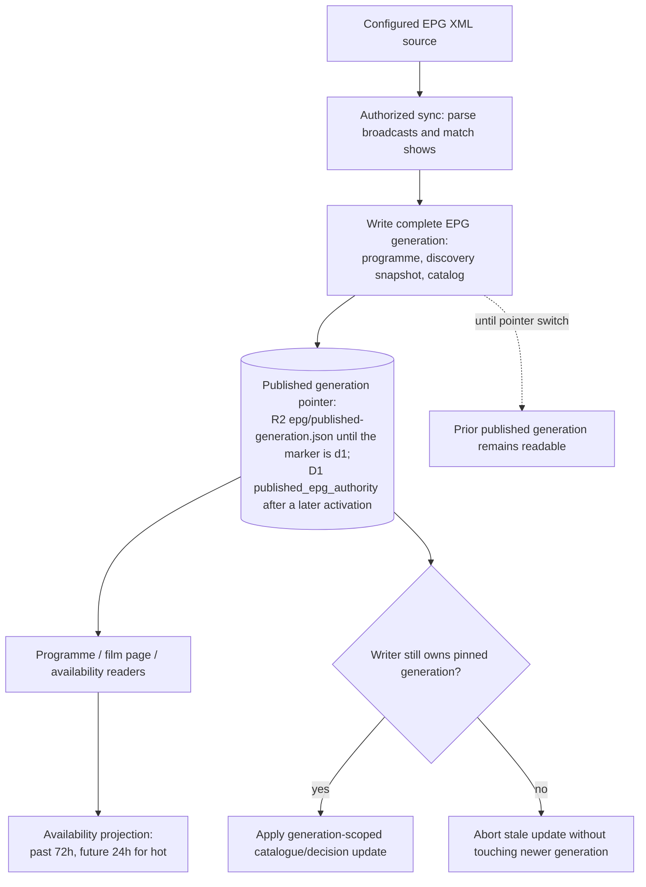

# EPG publication and availability

The active programme is a **published-generation projection**, not an append-only lifetime schedule. Sources: [EPG publication ADR](../adr/0008-atomic-epg-publication.md), [Film/Person availability contract](../reference/domain/film-person.md), [discovery reference](../reference/domain/candidate-discovery.md), and [Worker routing](../../src/worker.js).

The publication pointer changes **after** the complete generation exists. A partial write does not expose mixed versions. A newly published generation replaces its current show lists; current availability does not carry forward old shows. Show observations and `epgLastAiring` are not permanent Film identity attributes. Where the published generation is known, absent or mismatched `showsProgrammeRunId` cannot prove the film is hot; explicit `shows: []` means no known availability.

After the pointer switch the commit opens the discovery series of the new generation before its memory-heavy tail (watchlist and events, prediction queue, ratings); the write is fenced to the published generation and keeps a live writer or an existing series of the same generation. See [ADR 0030](../adr/0030-discovery-queued-at-publication.md). The tail's prediction queue rebuild is a conditional write that rebuilds on conflict with another queue writer ([ADR 0064](../adr/0064-prediction-queue-conditional-writes.md), Accepted 2026-10-31). A conflict it cannot resolve is recorded as `enrichmentQueueError` and does not fail the commit.

Availability calculations use a 72-hour lookback for hot showings and a 24-hour future planning window; the last known airing supports a 72-hour availability horizon. These domain computations are not equivalent to ingesting a new EPG. Late resolver activity must respect the pinned generation before writing programme or decisions.

**Current/future boundary:** production still publishes through R2. [ADR 0079](../adr/0079-d1-authoritative-published-epg.md) (Proposed) makes D1 the published generation only after migration `0008` is applied and a later activation sets `published_epg_authority.mode` to `d1`. Until that activation the pointer node is the R2 object. After it, the same node is the D1 row, and `epg/published-generation.json` is the compatibility mirror, not a fallback to another generation. Discovery decisions stay R2. The v1 D1 tables that reference `film(id)` are not this publisher. See [D1 schema](../reference/data/d1-schema.md). The changed diagram needs a separate visual approval; proposing the ADR does not grant it.
