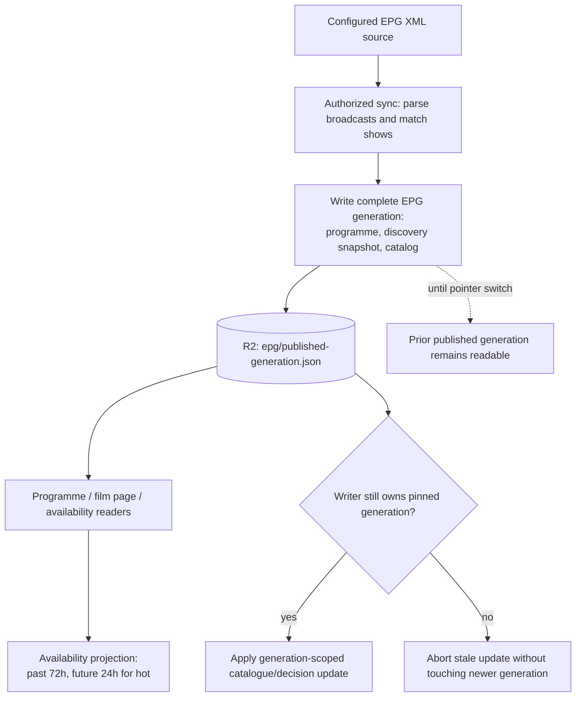

# EPG publication and availability

The active programme is a **published-generation projection**, not an append-only lifetime schedule. Sources: [EPG publication ADR](../adr/0008-atomic-epg-publication.md), [Film/Person availability contract](../reference/domain/film-person.md), [discovery reference](../reference/domain/candidate-discovery.md), and [Worker routing](../../src/worker.js).

The publication pointer changes **after** the complete generation exists. A partial write does not expose mixed versions. A newly published generation replaces its current show lists; current availability does not carry forward old shows. Show observations and `epgLastAiring` are not permanent Film identity attributes. Where the published generation is known, absent or mismatched `showsProgrammeRunId` cannot prove the film is hot; explicit `shows: []` means no known availability.

Availability calculations use a 72-hour lookback for hot showings and a 24-hour future planning window; the last known airing supports a 72-hour availability horizon. These domain computations are not equivalent to ingesting a new EPG. Late resolver activity must respect the pinned generation before writing programme or decisions.

**Current/future boundary:** this diagram describes the authoritative R2 publication lifecycle. The local D1 generation schema is a future migration path, not the active reader/writer. See [D1 ADR](../adr/0001-d1-schema-v1.md) and [migration plan](../adr/0017-staged-d1-migration.md).
