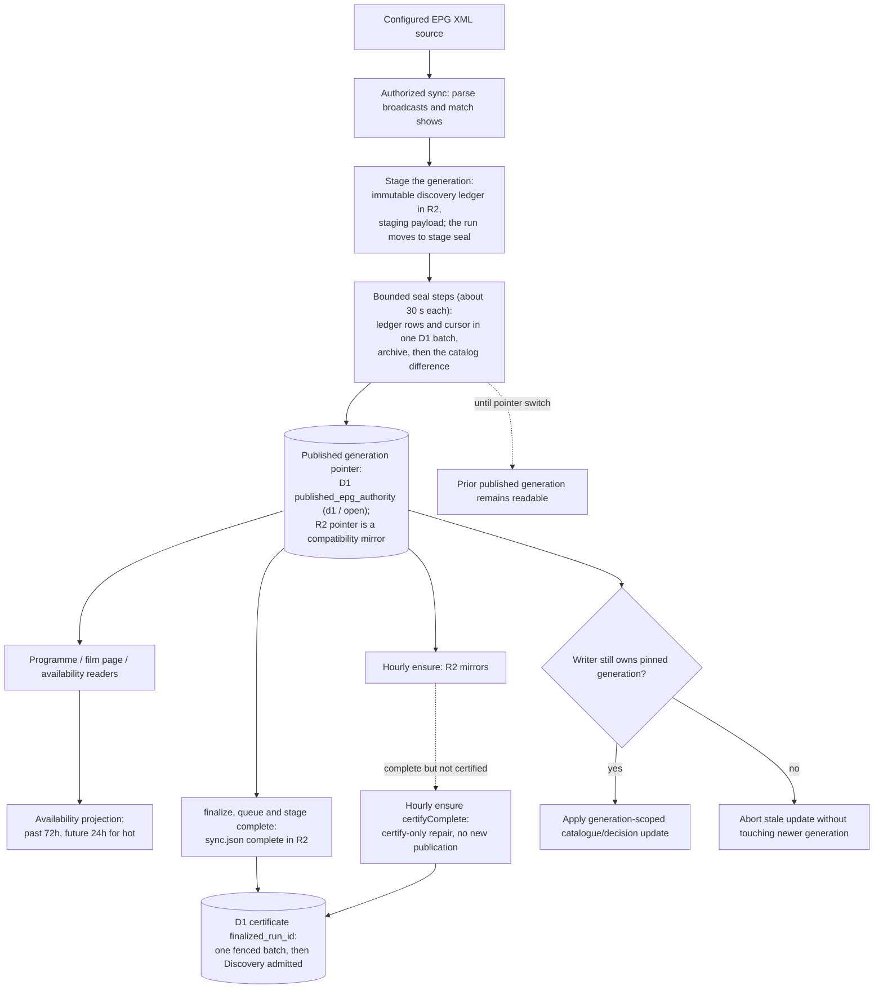
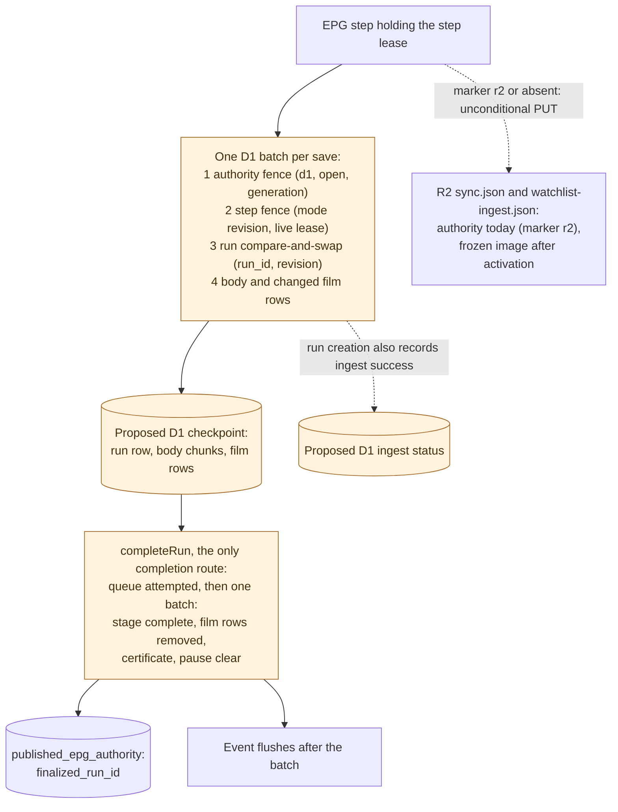
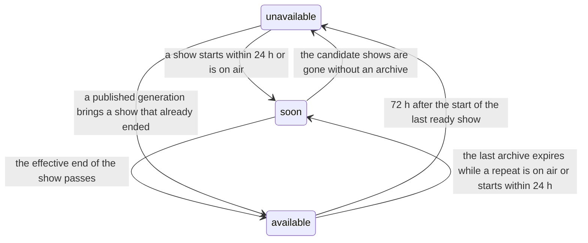
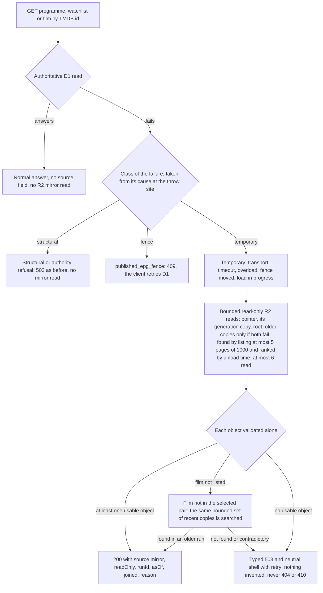
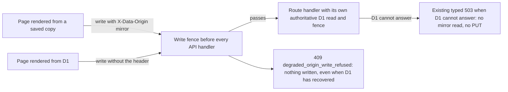
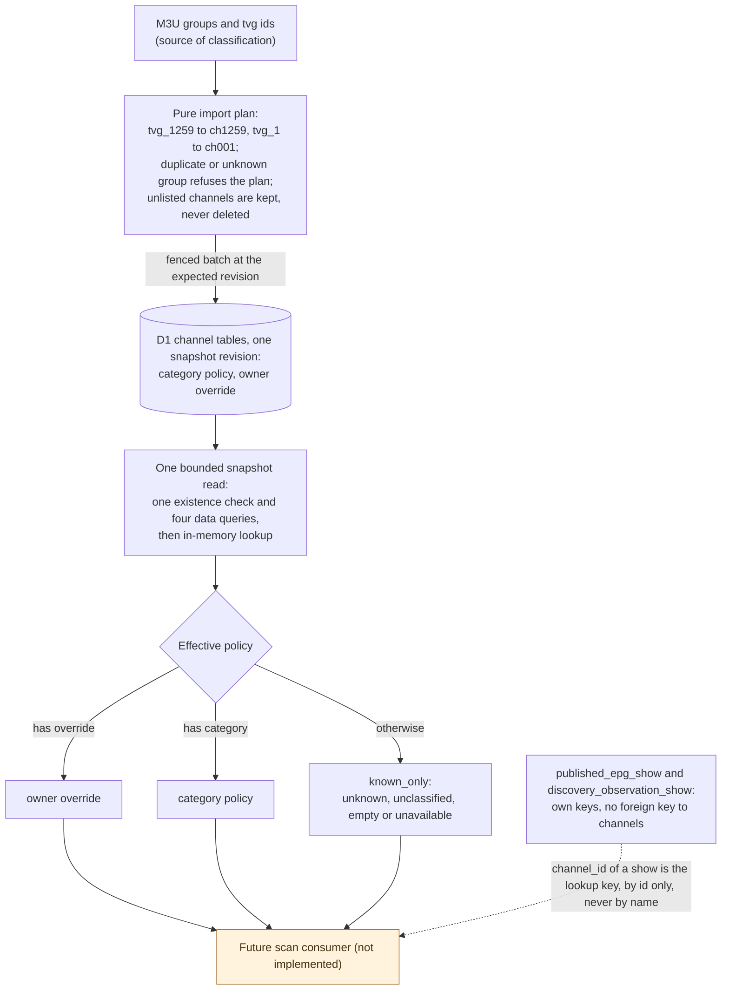

# EPG publication and availability

The active programme is a **published-generation projection**, not an append-only lifetime schedule. Accepted [ADR 0135](../adr/0135-epg-priority-discovery-pause.md) gives this publication priority over new Discovery admission until the generation is handed off. The pause is live in production; [ADR 0175](../adr/0175-epg-priority-holds-until-run-complete.md) (Accepted; code delivered by [AIR-539](https://trello.com/c/2eYDrWBS), migration `0026` applied to production on 19 Nov 2026 under a separate owner GO) moves its release from the pointer switch to a durable completion certificate, drawn below as the last step. Sources: [EPG publication ADR](../adr/0008-atomic-epg-publication.md), [Film/Person availability contract](../reference/domain/film-person.md), [discovery reference](../reference/domain/candidate-discovery.md), and [Worker routing](../../src/worker.js).

## The run checkpoint in D1 ([ADR 0185](../adr/0185-epg-checkpoint-d1-authority.md), Accepted; dormant, schema not applied)

Today the run checkpoint `sync.json` and the ingest status `watchlist-ingest.json` are R2 objects written by unconditional PUT after a separate step-lease read (the first diagram). The accepted design moves both behind their own marker. The code and the migration file are delivered and **dormant**: nothing applies the schema or switches the marker. The diagram below is the write path that holds **only after a separately approved activation**; the shaded nodes do not exist in production, and with the marker `r2` or absent the dashed arrow is the only path.

A save is refused, and writes nothing, when the authority generation, the step lease, the run revision or the stage order does not match; a run can reach `complete` only through the one completion operation, which both the seal route and the single-call route use, so the order queue attempted, then complete, then certificate holds on every route. Completion, certificate and pause clear are one batch only in `d1` mode; the certificate update is conditional so a non-matching certificate still lets the run complete and the hourly repair certifies it. In `r2` mode the order stays: complete in R2, certificate, then flushes.

Prediction scoring does not read this publication as permission to run. Hot and cold order use a completed snapshot of these shows, or last-known completed priority for 36 hours, and an unsealed generation does not block the prediction queue ([ADR 0154](../adr/0154-prediction-eligibility-independent-of-epg.md)).

## Film availability lifecycle

On the published shows a film is, at every instant, in one of three states ([ADR 0114](../adr/0114-film-availability-lifecycle.md), [reference](../reference/domain/film-availability.md)). The state is a **snapshot recomputed from the shows** at each instant and is never stored, so any of the three can be the first one seen; the diagram lists the transitions time or a new generation can cause. A repeat or a show on air never changes `available` while a ready recording exists. A ready archive outranks live and future; a show on air is not an archive until it ends; `soon` turns `available` at the show's effective end (the EPG end, else start plus the film runtime; a schedule-based calculation, not a provider probe).

The 72-hour catch-up and the rolling 24 hours are the existing [EPG horizons](../reference/domain/epg-horizons.md); the 168-hour retention is storage only.

The publication pointer changes **after** the complete generation exists, and with D1-authoritative discovery after its ledger is sealed ([ADR 0092](../adr/0092-resumable-bounded-ledger-seal.md)): the commit stages the generation and returns, bounded `epg_sync_step` calls seal the ledger, update the catalog and publish, and the previous generation stays readable meanwhile. A partial write does not expose mixed versions. A newly published generation replaces its current show lists; current availability does not carry forward old shows. Show observations and `epgLastAiring` are not permanent Film identity attributes. Where the published generation is known, absent or mismatched `showsProgrammeRunId` cannot prove the film is hot; explicit `shows: []` means no known availability.

After the pointer switch the commit queues the discovery series of the new generation before its memory-heavy tail (with the ADR 0175 certificate column present, that series is admitted only after the run is `stage=complete` and certified; the pointer switch no longer releases the pause) (watchlist and events, prediction queue, ratings); the write is fenced to the published generation and keeps a live writer or an existing series of the same generation. See [ADR 0030](../adr/0030-discovery-queued-at-publication.md). Under a live D1 pin `persistWatchlist` does not call `saveWatchlist`: the publish commit already wrote the watchlist, and a second `generation + 1` is forbidden ([ADR 0142](../adr/0142-epg-owned-generation-addressed-discovery-slots.md) decision 14). If the pin cannot be read, the tail writes nothing and the error propagates so the bounded step can retry. A successful read that yields `null` still copies `watchlist.json` when `updatedAt` differs (R2 authority). The tail's prediction queue rebuild is a conditional write that rebuilds on conflict with another queue writer ([ADR 0064](../adr/0064-prediction-queue-conditional-writes.md), Accepted 2026-10-31). A conflict it cannot resolve is recorded as `enrichmentQueueError` and does not fail the commit.

A watchlist showing is attached only when the alias index leaves one trusted identity ([ADR 0151](../adr/0151-epg-known-film-title-collision.md), Accepted). The same normalized title on two catalog identities, with no year in the EPG title and runtimes inside each other's contradiction band, is not a Film showing: the slot is an ordinary discovery observation. A year within one of exactly one identity still attaches that film, unless the runtime is beyond `max(45 minutes, 40%)`. A catalog confirmation is stored per slot and becomes the observation's confirmed id only when every retained slot agrees. `stats.identityCollision` counts withheld hot-window slots. The publication diagram is unchanged.

Retention and display are separate from hot processing ([EPG horizons](../reference/domain/epg-horizons.md)): the published generation keeps reliable watchlist shows up to 168 hours ahead, and the 24-hour future window below remains the hot discovery, resolver, prediction and catalog horizon. Availability calculations use a 72-hour lookback for hot showings and a 24-hour future planning window; the last known airing supports a 72-hour availability horizon. These domain computations are not equivalent to ingesting a new EPG. Late resolver activity must respect the pinned generation before writing programme or decisions.

**Current production (3 November 2026):** [ADR 0079](../adr/0079-d1-authoritative-published-epg.md) (Accepted) is activated: migration `0008` applied, `published_epg_authority.mode=d1`, `cutover=open`. D1 owns the published generation, programme/watchlist membership and generation fence. `programme.json`, `watchlist.json` and `epg/published-generation.json` are R2 compatibility mirrors, not a fallback on a D1 failure. GET and HEAD of programme, watchlist, catalog availability and Admin read the pinned D1 generation and do not repair those mirrors; the existing hourly `EpgOrchestration.ensure` and the publication tail do ([ADR 0108](../adr/0108-epg-mirror-reconciliation-writer.md)). Discovery decisions and admission follow the discovery marker. [ADR 0085](../adr/0085-d1-authoritative-discovery.md) (Accepted 2026-11-04, [AIR-320](https://trello.com/c/4cA5GlJn)) is activated: migration `0011` applied, `discovery_authority.mode=d1`, `cutover=open` at generation 1 ([activation record](../evidence/d1-migration/air-320-discovery-activate-2026-11-04.md)). `0009`, `0010` and `0011` are applied. The revised staging/current-state label was visually approved by the owner on 2026-11-04; the original diagram was approved on 1 November. [Production evidence](../evidence/d1-migration/air-319-production-cutover-2026-11-03.md) records a first successful post-cutover generation: a scheduled-task-created run completed by one owner-authorized manual step on 3 November (published run `00ff34fa…`). Raw D1/R2 parity and programme/watchlist/availability consumers remain pending separate safe verification.

**Proposed Cloudflare executor recovery.** Under the shared reliability contract ([ADR 0089](../adr/0089-shared-orchestration-reliability-contract.md), Accepted; not activated), an EPG executor publishes at most once per Europe/Madrid date after 17:00 local time. A failure before the D1 pointer switch leaves the earlier generation published; after a lost response, reading the pointer decides whether this run is already published. Mirror repair writes R2 mirrors only from the currently published D1 generation. Publication may queue Discovery's fenced intent as a fast path, but not in one transaction with the pointer switch; Discovery's `ensure` reconstructs the intent from the published generation if it is missing, and EPG never waits for it. The flowchart above is unchanged; the executor is drawn on the [scheduling page](scheduling-and-orchestration.md#proposed-cloudflare-executors-and-shared-recovery). Contract: [orchestration reliability](../reference/orchestration-reliability.md#epg).

## Completed programme read ([ADR 0142](../adr/0142-epg-owned-generation-addressed-discovery-slots.md), stage 4a)

The published programme has two reads. The **sealed read** (`PublishedEpg.readDocument`) returns the document the EPG sync stored; it is internal to publication (staging, the publish commit, the watchlist part, membership checks). The **completed read** (`PublishedEpg.readCompletedProgramme`, and `readDocumentAt` for the `programme` kind) adds the rows Discovery assigned to the run (`published_epg_show.basis = 'discovery'`) with one statement: each member's `shows` are completed and sorted by `(start, channelId)` with `availableUntil` recomputed, and the Films of the run that are not members are listed in the additive `catalogFilms` (identity and shows only; no Film data yet). With no assigned row the completed programme equals the sealed document. Assigned rows never change `published_epg_authority.generation`, the members or the watchlist document, so the existing generation check around a read still proves the sealed part, and every Discovery writer changes the assigned rows of an observation in one transaction.

Everything a reader or an R2 mirror sees is the completed programme: `GET /api/programme`, the catalog and film routes through `readDocumentAt`, the Admin snapshot, `repairMirrors` (the hourly reconcile rewrites the R2 programme mirrors when an assignment landed since the last write; that lag is accepted). the revert that carried a Discovery generation guard is retired ([ADR 0162](../adr/0162-d1-only-authority-retire-rollback-toolchain.md)), so no flip of the marker exists to guard. `authoritativeSnapshot` (the Film/Person projector input) also uses the completed programme. Because the offline connector copy must hold what the projector reads, `published_epg_show` joined the moving Discovery copy tables (`DISCOVERY_COPY_TABLES`: copied last and re-read by the resync, so the copy is 40 tables). The prediction queue rebuild (`buildPredictionQueue`) under a D1 pin takes each Film's showings from the same completed programme (`films` and `catalogFilms` by TMDB id) and never reads `hotEnteredAt`: the late tie-break is the earliest start among those showings, then `discoveredAt`, then the id. A D1 pin whose `programmeRunId` is not the caller's completed programme is not treated as R2: the rebuild reloads that pinned generation, or fails closed (`published_epg_unavailable`) and writes no queue. Outside D1 the record's own `shows` still rank the queue, still without `hotEnteredAt`. Under a live D1 pin, `replaceCatalogAvailability`, `mergeCatalogIdentity` (the D1 publish/seal catalog path) and `touchCanonicalFilm` / `catalogFilmFromDetail` keep identity data and aliases and do not rewrite `shows`, `availableUntil`, `showsProgrammeRunId`, `epgLastAiring` or `hotEnteredAt`; R2 still stamps those fields. Discovery assignment, replay and those catalog writers execute no statement on `film_alias` (owner decision R3).

### Availability-field consumers

| Field | D1 published authority | R2 published authority |
| --- | --- | --- |
| `shows` | Completed programme (`films` + `catalogFilms`) for `GET /api/programme` (`presentCatalogFilms`), Finds (`catalogAvailable` via `withCompletedShows`), the film page (`catalogFilmPage`), the prediction queue (`buildPredictionQueue`), prediction coverage (`canonicalCoverageSummary` / footer and Event snapshots / MCP diagnostics), Admin snapshot, `authoritativeSnapshot` / Film/Person `observedShows` (members and `catalogFilms`, matched by id or TMDB), and mirror repair. Catalog record `shows` are not a second source. | Record `shows` of `epg/discovered-films.json` / admission payload for Finds, the film page, the prediction queue, coverage and Film/Person when the sealed programme has no `catalogFilms`. EPG sync (`replaceCatalogAvailability`) and Discovery (`touchCanonicalFilm`) still write them. |
| `availableUntil` | Recomputed from completed `shows` on the programme route. | `withAvailability` / `availabilityDeadline` on watchlist/programme Films. |
| `showsProgrammeRunId` | Pin of the completed read. Finds/film page still require the overlaid run id to equal the pin. | Same-run gate on the record. |
| `epgLastAiring` | Derived from completed `shows` where a reader needs a latest start. `predictionPriority` may still fall back to a stored value when `shows` are empty (R2). | `filmIsHot` fallback and `replaceCatalogAvailability` / `touchCanonicalFilm` writes. |
| `hotEnteredAt` | Not read. Queue late tie-break is earliest start, then `discoveredAt`, then id. Not written under D1. | Not read. Still written by `touchCanonicalFilm` on R2. |
| `aliases` | Identity data on the catalog record and, for a watchlist Film, on the verified decision/observation. Scan and Discovery alias indexes (`src/sources.js`, `src/discovery.js`), Finds title rule, UI search (`public/app.js`). Never written into the programme document. Never written to canonical `film_alias` by Discovery. | Same identity writers. |

Stale availability bytes on a D1 admission payload are dropped on the next identity write (`touchCanonicalFilm`, or `mergeCatalogIdentity` when the staged record's identity actually changed or the Film is staged-only). Untouched live rows keep leftover bytes so `sealCatalogStep` does not rewrite the catalog. `replaceCatalogAvailability` still does not rewrite or strip the whole catalog in one pass. D1 readers ignore leftover bytes until that write. Film/Person `projectFilm` / `observedShows` takes shows from the completed programme (`films` matched by id or TMDB, then `catalogFilms`) when `catalogFilms` is present (the D1 projector stamps `[]` when the pin has no assigned rows). A Film absent from that list has zero shows; body `shows` / `epgLastAiring` are not a second source. The R2 projector path still uses the member record, then the Film body. The programme screen does not list presented `catalogFilms` in the watchlist grid; they remain a completed-read field for Finds, the film page and coverage. Not remaining from the completed-read work: natural-run delay measurement.

## Moving a live EPG Workflow onto a deployed version

The EPG Workflow instance runs the Worker version it was created on. The owner-only `epg_workflow_rollover` operator ([ADR 0176](../adr/0176-controlled-epg-workflow-rollover.md), [sequence](scheduling-and-orchestration.md#controlled-epg-workflow-rollover-adr-0176-proposed)) hands the run to the next series of the same run key while the instance sleeps. The published pointer, `sync.json`, the staging and the Discovery handoff are untouched: the successor continues from the same run and checkpoint, and no publication is repeated.

## Degraded read from R2 mirrors ([ADR 0177](../adr/0177-read-only-mirror-fallback-for-film-and-programme.md))

D1 remains the only authority. When the authoritative read of the programme, the watchlist or one film fails for a **temporary** storage reason, the Worker may answer from the R2 compatibility mirrors that the hourly `ensure` and the publication tail already maintain ([ADR 0108](../adr/0108-epg-mirror-reconciliation-writer.md)). The answer is read-only, labelled and never a confirmed absence. Contract: [degraded reads](../reference/api/degraded-reads.md); diagnosis: [runbook](../runbooks/mirror-fallback-diagnostics.md).

The mirror is read per object. The root `programme.json` is valid by its own `runId` even when `epg/published-generation.json` lags it; a programme and a watchlist are joined only as a best-effort heuristic (same run key, or the root pair of the pointer's run), and the response says so. Older generation copies are ranked by their upload time, not by their UUID run id. No `available`, `soon`, hot or last-chance state is recomputed from a stale snapshot: the schedule is shown as saved at its own time.

The page keeps the last good authoritative result only in memory. A saved-copy answer never replaces it, but any failed refresh makes the page read-only until an authoritative read succeeds; the normal source and the write actions return only then. The write fence is global, but the loss of present-tense claims is scoped to the data being rendered: a saved programme, or one film that came from a saved copy, keeps its historical schedule without archive, on-air, soon or last-chance claims, while a separately valid authoritative programme keeps its availability even when another film is shown from a mirror. When D1 answers again, films shown from a saved copy are asked again.

## Channel policy (dormant contract, [ADR 0187](../adr/0187-epg-channel-authority.md), Proposed)

Channels get their own D1 tables with a provider category, a per-category policy and an optional owner override. **No scan reads them today**; the diagram shows the contract a later, separately approved reader would use, and it changes nothing in the publication flow above. The contract is in [EPG Channel](../reference/domain/epg-channel.md).

