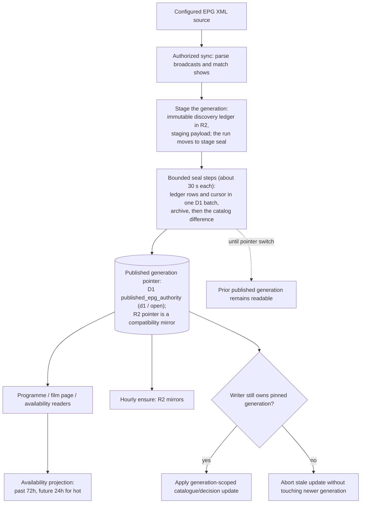
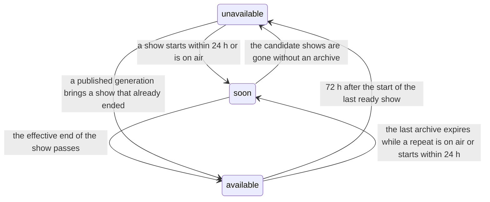

# EPG publication and availability

The active programme is a **published-generation projection**, not an append-only lifetime schedule. Accepted [ADR 0135](../adr/0135-epg-priority-discovery-pause.md) gives this publication priority over new Discovery admission until the generation is handed off. Its gate code is delivered inert (AIR-459) and is not activated, and the diagram below does not draw it. Sources: [EPG publication ADR](../adr/0008-atomic-epg-publication.md), [Film/Person availability contract](../reference/domain/film-person.md), [discovery reference](../reference/domain/candidate-discovery.md), and [Worker routing](../../src/worker.js).

## Film availability lifecycle

On the published shows a film is, at every instant, in one of three states ([ADR 0114](../adr/0114-film-availability-lifecycle.md), [reference](../reference/domain/film-availability.md)). The state is a **snapshot recomputed from the shows** at each instant and is never stored, so any of the three can be the first one seen; the diagram lists the transitions time or a new generation can cause. A repeat or a show on air never changes `available` while a ready recording exists. A ready archive outranks live and future; a show on air is not an archive until it ends; `soon` turns `available` at the show's effective end (the EPG end, else start plus the film runtime; a schedule-based calculation, not a provider probe).

The 72-hour catch-up and the rolling 24 hours are the existing [EPG horizons](../reference/domain/epg-horizons.md); the 168-hour retention is storage only.

The publication pointer changes **after** the complete generation exists, and with D1-authoritative discovery after its ledger is sealed ([ADR 0092](../adr/0092-resumable-bounded-ledger-seal.md)): the commit stages the generation and returns, bounded `epg_sync_step` calls seal the ledger, update the catalog and publish, and the previous generation stays readable meanwhile. A partial write does not expose mixed versions. A newly published generation replaces its current show lists; current availability does not carry forward old shows. Show observations and `epgLastAiring` are not permanent Film identity attributes. Where the published generation is known, absent or mismatched `showsProgrammeRunId` cannot prove the film is hot; explicit `shows: []` means no known availability.

After the pointer switch the commit opens the discovery series of the new generation before its memory-heavy tail (watchlist and events, prediction queue, ratings); the write is fenced to the published generation and keeps a live writer or an existing series of the same generation. See [ADR 0030](../adr/0030-discovery-queued-at-publication.md). Under a live D1 pin `persistWatchlist` does not call `saveWatchlist`: the publish commit already wrote the watchlist, and a second `generation + 1` is forbidden ([ADR 0142](../adr/0142-epg-owned-generation-addressed-discovery-slots.md) decision 14). If the pin cannot be read, the tail writes nothing and the error propagates so the bounded step can retry. A successful read that yields `null` still copies `watchlist.json` when `updatedAt` differs (R2 authority). The tail's prediction queue rebuild is a conditional write that rebuilds on conflict with another queue writer ([ADR 0064](../adr/0064-prediction-queue-conditional-writes.md), Accepted 2026-10-31). A conflict it cannot resolve is recorded as `enrichmentQueueError` and does not fail the commit.

Retention and display are separate from hot processing ([EPG horizons](../reference/domain/epg-horizons.md)): the published generation keeps reliable watchlist shows up to 168 hours ahead, and the 24-hour future window below remains the hot discovery, resolver, prediction and catalog horizon. Availability calculations use a 72-hour lookback for hot showings and a 24-hour future planning window; the last known airing supports a 72-hour availability horizon. These domain computations are not equivalent to ingesting a new EPG. Late resolver activity must respect the pinned generation before writing programme or decisions.

**Current production (3 November 2026):** [ADR 0079](../adr/0079-d1-authoritative-published-epg.md) (Accepted) is activated: migration `0008` applied, `published_epg_authority.mode=d1`, `cutover=open`. D1 owns the published generation, programme/watchlist membership and generation fence. `programme.json`, `watchlist.json` and `epg/published-generation.json` are R2 compatibility mirrors, not a fallback on a D1 failure. GET and HEAD of programme, watchlist, catalog availability and Admin read the pinned D1 generation and do not repair those mirrors; the existing hourly `EpgOrchestration.ensure` and the publication/revert tails do ([ADR 0108](../adr/0108-epg-mirror-reconciliation-writer.md)). Discovery decisions and admission follow the discovery marker. [ADR 0085](../adr/0085-d1-authoritative-discovery.md) (Accepted 2026-11-04, [AIR-320](https://trello.com/c/4cA5GlJn)) is activated: migration `0011` applied, `discovery_authority.mode=d1`, `cutover=open` at generation 1 ([activation record](../evidence/d1-migration/air-320-discovery-activate-2026-11-04.md)). `0009`, `0010` and `0011` are applied. The revised staging/current-state label was visually approved by the owner on 2026-11-04; the original diagram was approved on 1 November. [Production evidence](../evidence/d1-migration/air-319-production-cutover-2026-11-03.md) records a first successful post-cutover generation: a scheduled-task-created run completed by one owner-authorized manual step on 3 November (published run `00ff34fa…`). Raw D1/R2 parity and programme/watchlist/availability consumers remain pending separate safe verification.

**Proposed Cloudflare executor recovery.** Under the shared reliability contract ([ADR 0089](../adr/0089-shared-orchestration-reliability-contract.md), Accepted; not activated), an EPG executor publishes at most once per Europe/Madrid date after 17:00 local time. A failure before the D1 pointer switch leaves the earlier generation published; after a lost response, reading the pointer decides whether this run is already published. Mirror repair writes R2 mirrors only from the currently published D1 generation. Publication may queue Discovery's fenced intent as a fast path, but not in one transaction with the pointer switch; Discovery's `ensure` reconstructs the intent from the published generation if it is missing, and EPG never waits for it. The flowchart above is unchanged; the executor is drawn on the [scheduling page](scheduling-and-orchestration.md#proposed-cloudflare-executors-and-shared-recovery). Contract: [orchestration reliability](../reference/orchestration-reliability.md#epg).

## Completed programme read ([ADR 0142](../adr/0142-epg-owned-generation-addressed-discovery-slots.md), stage 4a)

The published programme has two reads. The **sealed read** (`PublishedEpg.readDocument`) returns the document the EPG sync stored; it is internal to publication (staging, the publish commit, the watchlist part, membership checks, `importPublished`). The **completed read** (`PublishedEpg.readCompletedProgramme`, and `readDocumentAt` for the `programme` kind) adds the rows Discovery assigned to the run (`published_epg_show.basis = 'discovery'`) with one statement: each member's `shows` are completed and sorted by `(start, channelId)` with `availableUntil` recomputed, and the Films of the run that are not members are listed in the additive `catalogFilms` (identity and shows only; no Film data yet). With no assigned row the completed programme equals the sealed document. Assigned rows never change `published_epg_authority.generation`, the members or the watchlist document, so the existing generation check around a read still proves the sealed part, and every Discovery writer changes the assigned rows of an observation in one transaction.

Everything a reader or an R2 mirror sees is the completed programme: `GET /api/programme`, the catalog and film routes through `readDocumentAt`, the Admin snapshot, `repairMirrors` (the hourly reconcile rewrites the R2 programme mirrors when an assignment landed since the last write; that lag is accepted) and the programme comparisons of `revertPublished` and `activatePublished`. `revertPublished` reads `discovery_authority.generation` before it reconciles the mirrors and its mode flip requires the same generation, so a Discovery assignment or correction between the comparison and the flip fails the revert with `published_epg_fence` and nothing is flipped; after the flip the insert guard (`mode = 'd1'`) refuses every assignment. `authoritativeSnapshot` (the Film/Person projector input) and `scripts/published-epg-production.mjs` mirror parity (activation, hold, revert readback) also use the completed programme. Because the offline connector copy must hold what the projector reads, `published_epg_show` joined the moving Discovery copy tables (`DISCOVERY_COPY_TABLES`: copied last and re-read by the resync, so the copy is 40 tables). The revert reads `discovery_authority.generation` fail-closed: an unreadable, missing or non-finite value aborts before any flip. The prediction queue rebuild (`buildPredictionQueue`) under a D1 pin takes each Film's showings from the same completed programme (`films` and `catalogFilms` by TMDB id) and never reads `hotEnteredAt`: the late tie-break is the earliest start among those showings, then `discoveredAt`, then the id. A D1 pin whose `programmeRunId` is not the caller's completed programme is not treated as R2: the rebuild reloads that pinned generation, or fails closed (`published_epg_unavailable`) and writes no queue. Outside D1 the record's own `shows` still rank the queue, still without `hotEnteredAt`. Under a live D1 pin, `replaceCatalogAvailability`, `mergeCatalogIdentity` (the D1 publish/seal catalog path) and `touchCanonicalFilm` / `catalogFilmFromDetail` keep identity data and aliases and do not rewrite `shows`, `availableUntil`, `showsProgrammeRunId`, `epgLastAiring` or `hotEnteredAt`; R2 still stamps those fields. Discovery assignment, replay and those catalog writers execute no statement on `film_alias` (owner decision R3).

### Availability-field consumers

| Field | D1 published authority | R2 published authority |
| --- | --- | --- |
| `shows` | Completed programme (`films` + `catalogFilms`) for `GET /api/programme` (`presentCatalogFilms`), Finds (`catalogAvailable` via `withCompletedShows`), the film page (`catalogFilmPage`), the prediction queue (`buildPredictionQueue`), prediction coverage (`canonicalCoverageSummary` / footer and Event snapshots / MCP diagnostics), Admin snapshot, `authoritativeSnapshot` / Film/Person `observedShows` (members and `catalogFilms`, matched by id or TMDB), mirror repair and revert/activate comparisons. Catalog record `shows` are not a second source. | Record `shows` of `epg/discovered-films.json` / admission payload for Finds, the film page, the prediction queue, coverage and Film/Person when the sealed programme has no `catalogFilms`. EPG sync (`replaceCatalogAvailability`) and Discovery (`touchCanonicalFilm`) still write them. |
| `availableUntil` | Recomputed from completed `shows` on the programme route. | `withAvailability` / `availabilityDeadline` on watchlist/programme Films. |
| `showsProgrammeRunId` | Pin of the completed read. Finds/film page still require the overlaid run id to equal the pin. | Same-run gate on the record. |
| `epgLastAiring` | Derived from completed `shows` where a reader needs a latest start. `predictionPriority` may still fall back to a stored value when `shows` are empty (R2). | `filmIsHot` fallback and `replaceCatalogAvailability` / `touchCanonicalFilm` writes. |
| `hotEnteredAt` | Not read. Queue late tie-break is earliest start, then `discoveredAt`, then id. Not written under D1. | Not read. Still written by `touchCanonicalFilm` on R2. |
| `aliases` | Identity data on the catalog record and, for a watchlist Film, on the verified decision/observation. Scan and Discovery alias indexes (`src/sources.js`, `src/discovery.js`), Finds title rule, UI search (`public/app.js`). Never written into the programme document. Never written to canonical `film_alias` by Discovery. | Same identity writers. |

Stale availability bytes may remain on D1 admission payloads until a later identity write; D1 readers ignore them. Film/Person `projectFilm` / `observedShows` takes shows from the completed programme (`films` matched by id or TMDB, then `catalogFilms`) when `catalogFilms` is present (the D1 projector stamps `[]` when the pin has no assigned rows). A Film absent from that list has zero shows; body `shows` / `epgLastAiring` are not a second source. The R2 projector path still uses the member record, then the Film body. The programme screen lists presented `catalogFilms` in the watchlist grid with a NEW badge; they are not watchlist members. Owner visual acceptance of that layout is still required. Not remaining from the completed-read work: stripping stored bytes, natural-run delay measurement.
