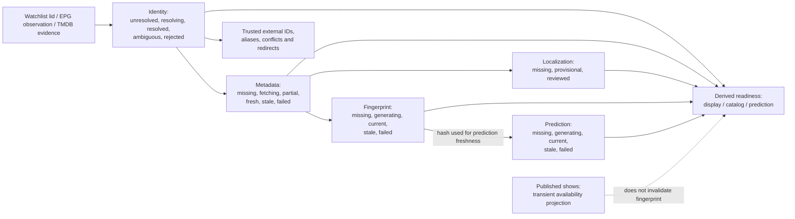

# Film / Person lifecycle and identity

This diagram illustrates **five independent Film state dimensions** in the storage-neutral domain contract, not a monolithic database status machine or a claim that D1 has replaced R2. Sources: [Film/Person reference](../reference/domain/film-person.md), [identity ADR](../adr/0009-canonical-film-person-identity.md), [domain model](../../src/domain/film-person.js), [reader](../../src/domain/film-person-reader.js) and [backfill](../../src/domain/film-person-backfill.js).

Identity is not inferred from title alone: the watchlist keeps its Letterboxd identity; trusted external TMDB IDs and provenance govern linking; conflicting verified identities produce **collisions**, not automatic merges. `film:...` IDs are different from `normalizedTitle|year` observation keys. Person identities are role-/authority-specific and are not auto-merged by matching a displayed name. A reviewed localized title cannot be downgraded by an automatic translation.

Five dimensions have independent transition guards. A new Taste Profile version makes a prediction stale **without** invalidating its film fingerprint. Changes to showtimes do not invalidate either artifact. `displayReady`, `catalogReady` and `predictionReady` are derived views, not sixth lifecycle statuses. The domain's `*.lifecycle.json` sidecars and dry-run backfill are projections/measurements, not authority to overwrite production objects.

**Current/future boundary:** existing Worker read/write paths and authoritative R2 objects continue to serve the site. The canonical domain model, offline D1 repositories and proposed import/cutover are distinct stages; do not depict them as one deployed transactional entity store. See [D1 schema](../reference/data/d1-schema.md) and [staged migration ADR](../adr/0017-staged-d1-migration.md).
