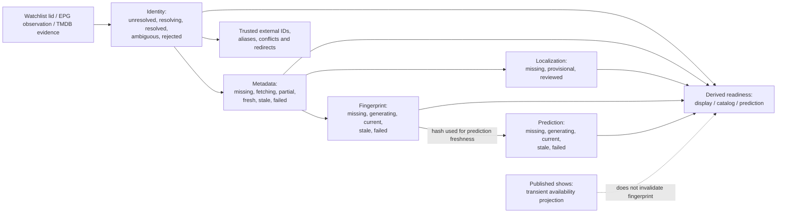
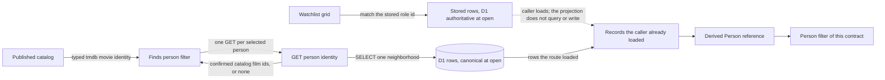
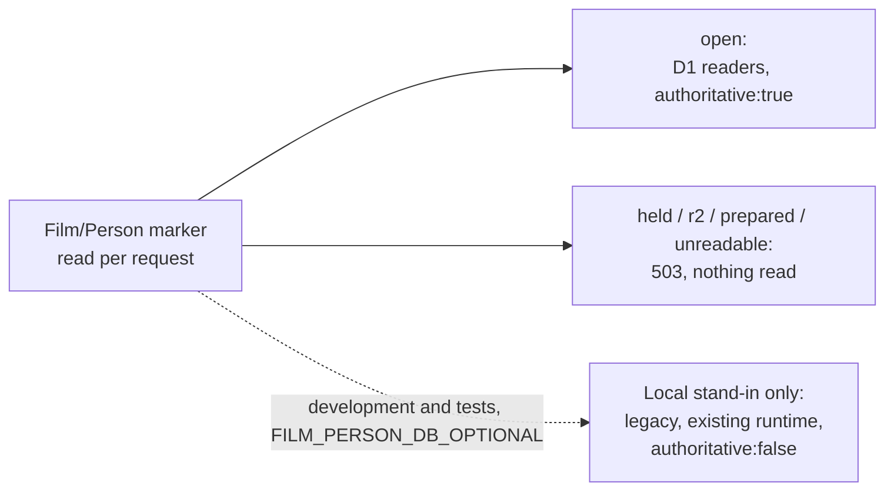
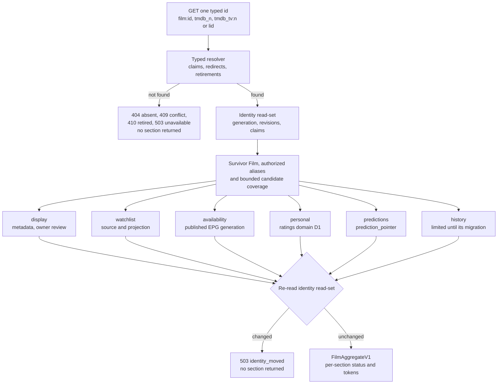
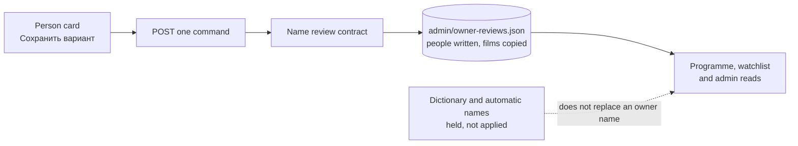
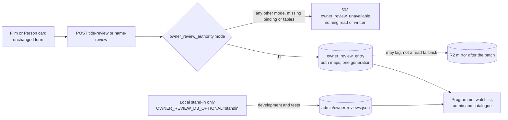
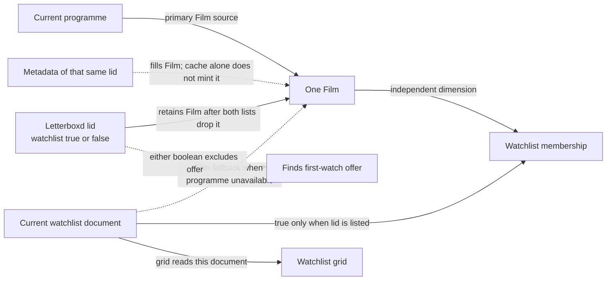
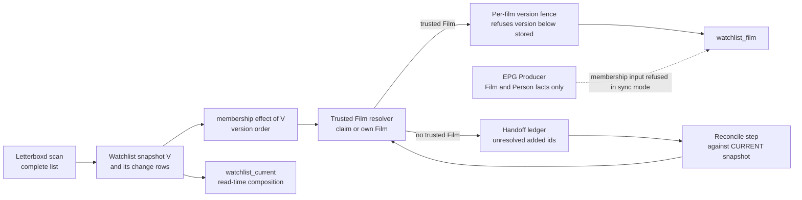

# Film / Person lifecycle and identity

This diagram illustrates **five independent Film state dimensions** in the storage-neutral domain contract, not a monolithic database status machine. Canonical Film/Person storage is D1-authoritative at `open` (generation 2 as of 16 Nov 2026 UTC); the Mermaid below is unchanged. Sources: [Film/Person reference](../reference/domain/film-person.md), [identity ADR](../adr/0009-canonical-film-person-identity.md), [domain model](../../src/domain/film-person.js), [reader](../../src/domain/film-person-reader.js) and [backfill](../../src/domain/film-person-backfill.js). A second diagram shows the derived Person reference. It is not a stored map. The watchlist grid does not call it. One read route does, and the Finds actor and director filter reads that route ([ADR 0059](../adr/0059-person-identity-projection.md), [ADR 0062](../adr/0062-d1-person-identity-read.md), [ADR 0065](../adr/0065-finds-person-filter-d1-read.md), [projection](../reference/domain/person-identity-projection.md)).

Identity is not inferred from title alone: the watchlist keeps its Letterboxd identity; a Letterboxd film slug is an untrusted `letterboxd_slug` alias of the Film carrying its lid, never an identity or a link reason, and a slug on two Films is a reported collision ([ADR 0052](../adr/0052-letterboxd-slug-film-alias.md)); a TMDB TV entry is a separate `tmdb_tv` identity whose numbers are never compared with movie ids, and a retired TMDB movie id leaves the trusted identity only through an owner-confirmed retirement that keeps it as evidence ([ADR 0057](../adr/0057-tmdb-tv-identity-and-retired-movie-ids.md), Accepted), which the lifecycle reader (the offline domain contract; no deployed runtime applies it since AIR-537 slice 3) applies from the optional R2 object `identity/tmdb-retirements.json` over whatever the records say ([contract](../reference/domain/film-person.md#runtime-projection)); trusted external TMDB IDs and provenance govern linking; conflicting verified identities produce **collisions**, not automatic merges. `film:...` IDs are different from `normalizedTitle|year` observation keys. Person identities are role-/authority-specific and are not auto-merged by matching a displayed name. A reviewed localized title cannot be downgraded by an automatic translation. The Worker applies this localization rule on every programme and watchlist read and at the EPG commit, with no runtime switch; only the metadata sync's localization is still selected by `LIFECYCLE_LOCALIZATION` ([ADR 0037](../adr/0037-domain-localization-only.md)). An owner-confirmed title or name is read from `admin/owner-reviews.json` and stamped before the dictionary ([ADR 0072](../adr/0072-owner-reviewed-localization-overlay.md), Accepted) while the owner-review marker is absent or `r2`. The object is not a new lifecycle status. The diagram above is unchanged.

Accepted [ADR 0218](../adr/0218-film-lifecycle-dimensions-revision.md) (accepted target, partly implemented: stages 1 and 3) will persist only control state in `film_dimension` and derive the rest from the ADR 0216 sections; the diagram shows the current contract and is unchanged. Stage 3 ([AIR-662](https://trello.com/c/P8cCPv1V)) is in the writers only: a Film title source and its effective localization row are written in one fenced batch (Film revision CAS plus the owner-review token), a ranked title write creates the missing identity row as a `titleSource` carrier with the neutral status `unresolved` and no verdict ([ADR 0220](../adr/0220-identity-row-created-by-ranked-title-write-is-a-titlesource-carrier.md), Proposed), and no producer or merge moves a metadata lock ([reference](../reference/domain/film-person.md#readiness-is-derived-not-a-new-entity-status)). Five dimensions have independent transition guards. A new Taste Profile version makes a prediction stale **without** invalidating its film fingerprint. Changes to showtimes do not invalidate either artifact. `displayReady`, `catalogReady` and `predictionReady` are derived views, not sixth lifecycle statuses. The domain's `*.lifecycle.json` sidecars and dry-run backfill are projections/measurements, not authority to overwrite production objects. The metadata dimension's decision clocks that `film_metadata` does not store were historically copied into D1 `film_sync_state` by the enrichment projector at schema version 5 ([ADR 0070](../adr/0070-metadatasync-freshness-clocks.md)). The projector was removed in AIR-537 slice 3; at `d1`/`open`, the fenced canonical Film writers now maintain `film_sync_state` through `writeFilmFacts` (`src/canonical-film-writers.js`). While the schema v6 marker is absent or `r2`, `metadataSync` still branches on `metadata.json`. When that marker is `d1`, the same branch reads the D1 cache ([ADR 0073](../adr/0073-metadata-cache-d1-authority.md)). This adds no arrow above.

Person records stay role- and source-specific. The derived reference below is how a watchlist filter and a catalog filter name one human. The watchlist grid still matches the role-specific id on the stored credit. `GET /api/d1/persons/<role>/<key>/identity` loads that person's D1 neighborhood and calls the reference. The Finds actor and director filter is the one page reader of that GET ([ADR 0065](../adr/0065-finds-person-filter-d1-read.md)). With no person selected it makes no request. It keeps a catalog film only from an unbounded trusted answer whose cross-source link is `co_credit` for the selected role, and only when `film:tmdb:<n>` is the same typed movie id as the published catalog row (`tmdb_<n>`, `canonicalIdentity` `tmdb:<n>`). A name, a TV id, a retired id, a bounded neighborhood or an error adds no film. At `open` D1 is the canonical Film/Person store; the derived reference still does not query or write. A shared name is a review, not a member. The arrow from stored rows means a caller loaded them first. The projection does not query and does not write.

## Canonical authority (ADR 0099)

[ADR 0099](../adr/0099-canonical-film-person-d1-authority.md) (Accepted) is the marker contract (`r2`, `prepared`, `open`, `held`). **Current production (16 Nov 2026 UTC):** `d1`/`open` generation 2 ([evidence](../evidence/d1-migration/air-499-film-person-open-2026-11-16.md)); fenced adapters write (`writerRoute` → canonical); the former compare-only projector was removed in AIR-537 slice 3; freeze readers at `open` read D1. Activated call sites: `catalogReaderGate` (programme, watchlist, catalog, admin, footer/export), Discovery `upsertAdmissions`, `metadataSync`, rated admission/retention (`persistScan` and the verified-film commits), and Producer Workflow from `EpgOrchestration.ensure`. **Historical implementation slice (pre-`open`):** schema `0013` inserted the marker as `r2` and at apply time changed no authority: the enrichment projector remained the only writer in `r2` and `prepared`. Schema `0014` and `src/localization-sources.js` ([AIR-368](https://trello.com/c/RxZ3aOQB)) add stored automatic localization sources and the owner > reviewed dictionary > automatic resolution, also inactive: a compare-only adapter and a fenced writer that nothing calls, so the localization flow of this page is unchanged. Schema `0015` and `src/film-admission.js` ([AIR-369](https://trello.com/c/GlAKWxvw)) add D1 rows and fenced writers for verified rated-only admissions and the watchlist retention fact, inactive and without a caller, so the admission and retention flow of this page is unchanged. Schema `0016` and `src/tmdb-retirement-decisions.js` ([AIR-370](https://trello.com/c/wZmtK9tS)) add the append-only owner TMDB retirement decision history, also inactive: no writer or loader runs, so the retirement flow of this page is unchanged. The marker-gated canonical bulk read model (`src/canonical-read-model.js`, [AIR-372](https://trello.com/c/weKsBJdQ)) is likewise prepared and inactive: no reader calls it, so every read path of this page is unchanged. Producer adapters and the single-writer routing ([AIR-371](https://trello.com/c/gt1afd0C), `src/canonical-producers.js`) are likewise inactive: one routing decision from the marker (legacy, `r2` and `prepared`: the adapters write nothing, and since AIR-537 slice 3 no projector exists to write either; `open`: the adapters are the only writers (the projector that was compare-only here was removed in AIR-537 slice 3); `held` and an unreadable marker fail closed and never return to R2), a projector fence assertion (for a projector batch that no longer exists) so an in-flight batch would lose once the marker moved, planners for EPG identity, Discovery admission, rated admission, retention, TMDB retirement and automatic localization, a bounded compare-only shadow and a handoff readiness check that stays not ready while producer writes remain uncovered (metadata, dimensions, sync clocks, watchlist membership, person dimensions). AIR-374 P2b adds the dormant Person-side state writers (`src/canonical-person-state.js`: the `person_dimension` rows, the held-value alias and conflict, and standalone `localization_conflict` rows, each one fenced batch that never downgrades an owner or reviewed localization and replays by content; see the [reference](../reference/domain/film-person.md)); they run only from `open` and change no diagram yet. The `prepared` → `open` handoff is live (generation 2). No diagram changes here.

**Cross-domain write receipts (P2c, [ADR 0119](../adr/0119-durable-canonical-write-receipts.md), owner decision 5 of [ADR 0117](../adr/0117-film-person-d1-handoff-owner-decisions.md)):** schema `0019` adds `canonical_write_receipt` in the existing D1 and the dormant `src/canonical-receipts.js` protocol: a receipt is recorded `pending` under the marker fence, and the writer's fenced batch performs the canonical mutation AND moves the receipt to `applied` atomically (required; a separate-mark path exists only behind a named, currently empty, exception list); an unknown outcome is settled by reading the target back and comparing the content digest (equal: only the receipt was lost; different: the same request id is replayed, at most five times on a stored backoff), and a canonical change above the verified, sealed activation baseline (recorded from one snapshot, retryable, never partial) with no applied receipt is `unreceipted`, never safe (revisions at or below the baseline are `pre_receipt_baseline`, and no receipt is fabricated for history). The table is append-only (no pruning). A digest match without valid request-specific evidence (checked by the module against the receipt) never counts as applied (it goes to review), and a retry after another writer advanced the revision is revalidated or abandoned for repair, never blind. The table is writable only at `open`; at `prepared` it stays empty. **Historical (prepared-era):** the table was introduced in code first. **Current:** schema `0019` is applied; producers that write at `open` attach receipts in the same fenced batch.

### Reader gate (AIR-374 P4)

**Current at `open`:** the gate reads D1. **ADR 0162 (AIR-79 slice 7):** `readAuthority` serves only `d1`/`open`. `held` is the separate fail-closed forward-fix gate (`film_person_held`, `open` to `held` to `open` with the SQL fences). An installed `r2` or `prepared` marker, a missing binding or `schema_contract`, a contract below 13, a missing or partial set of the four `film_person_*` tables (including `canonical_revision`), a contract at 13 or later with none of them, a malformed marker, baseline or fence row and any D1 error answer `film_person_unavailable` before any R2 read and before any D1 write. `readMarker` is the non-serving reader of the operator tooling (`transitionAuthority`, handoff and baseline reports). The only non-open answer is the explicit local stand-in `FILM_PERSON_DB_OPTIONAL=standin` (tests and `scripts/local-dev.mjs`, never `wrangler.jsonc`), and only for a domain that is not installed at all. The diagram below shows the current gate: `open` reads D1, every other state is refused, and only the explicit local stand-in answers from R2. (Historically `prepared` was dormant with the existing runtime unchanged; no such state is served since ADR 0162.)

The marker is read before `GET /api/d1/*`, before the catalog film route's canonical fallback and before the film history identity bridge (AIR-475: at `open` the film route reads the canonical Film by its trusted TMDB claim, independent of Discovery and of a rated admission, and `GET /api/enrichment/history` resolves the verified storage ids of a Film through the same D1 identity claims; both are SELECT-only, both re-read the marker generation before answering). Only `open` reads D1 for them; `held` and every unreadable state answer `503` and never reach R2, and at `open` the frozen R2 receipt is not read (owner decision 4). The marker is read again after the fallback's D1 reads and, for `GET /api/d1/*`, after every view and overlay read, immediately before the answer: an answer is returned only while the marker has the same state and generation it had at the start (any GET that has a marker, not only `open`), otherwise `503`; the catalog film route's R2 path does the same; a legacy database (no marker table) compares as unchanged legacy and keeps its historical output. Historical: other readers of the canonical mirrors had not yet moved when this was written (the freeze readers read D1 at `open`); see the [P4 evidence](../evidence/d1-migration/air-374-p4-readers-offline-2026-11-11.md).

**Slice 2 (P4b): the titles.json consumers.** `GET /api/programme` and `GET /api/watchlist` read the marker first on every request. `legacy`, `r2` and `prepared` kept the R2 `titles.json` read (historical; since ADR 0162 they are `503` and only the local stand-in keeps it); at `open` the same provisional title rows are read from D1 in bounded statements, one per chunk of 1500 ids (`catalogTitlesFromD1`: the provisional `film_dimension` localization row and the Film's trusted, non-conflicting TMDB claim, in the shape of a `titles.json` row, with the owner-review overlay and the dictionary applied by the existing presentation code); `held` and an unreadable marker are `503` before any read and never reach R2. The marker is read again (`catalogReaderStill`, state and generation) at the last async boundary, after every awaited read of the route (titles, owner reviews, `sync.json`) and right before the successful answer, on both routes in every marker state and for the empty watchlist shape too, so a `prepared` to `open`, `open` to `held` or new-generation move between the gate and the answer is refused rather than answered. Named differences from the R2 path: a Film that D1 holds only under a redirect, or a provisional row without a trusted TMDB claim, gets no cached title (the document's own title is shown); both are the cases the R2 row would not have applied either on a consistent projection. The remaining readers and the classification (freeze or exception) are the exported `CANONICAL_READER_REGISTRY` of `src/canonical-catalog-reader.js`. Slice 3 (AIR-499) moved the catalog film optional metadata, `GET /api/catalog/available` metadata and `ratingsFilmLabels` to `catalogMetadataFromD1` at `open`; those three capture one marker and re-read it after `predictionFreshness` (labels: after titles) before a successful answer, and a D1 TMDB id follows the admission identity rule (every claim of the typed value, not only trusted non-conflicting rows). Slice 4 (AIR-499) moves the four Admin freeze readers the same way: `GET /api/admin/*` snapshot dictionaries (`titles.json` / `people.json` via `catalogTitlesFromD1` / `catalogPeopleFromD1`), `GET /api/admin/health`, `GET /api/admin/limbo` and `POST /api/admin/letterboxd-archive/preview` (`catalogMetadataFromD1` for the ZIP/programme ids, not the whole frozen object). Those four capture the marker once (`adminLoadSnapshot` / `lbaCompare`) and re-read it after the last awaited work before a successful answer; `held` / unreadable / generation move are typed `503` without R2 fallback. Slice 5 (AIR-499) moves the last two freeze readers in `src/enrichment.js`: `GET /api/enrichment/footer/status` loads a bounded D1 `catalogMetadataFromD1` map of ids from the watchlist, programme, catalog and view-index so `catalogLidTmdb` still links Letterboxd ids without dumping frozen `metadata.json`; `GET /api/enrichment/diagnostics/export?group=global` projects the same facts plus `catalogTitlesFromD1` and never GETs those two frozen keys. Both capture one marker and re-read it after the last awaited work (footer: after `predictionFreshness`).

**Handoff and recovery ([ADR 0117](../adr/0117-film-person-d1-handoff-owner-decisions.md), [runbook](../runbooks/film-person-open-handoff.md)):** `prepared` to `open` is one fenced batch under the projector lease and exclusive window, executed once on 16 Nov 2026 by an owner-only MCP operator that AIR-537 slice 2 has since retired (it cannot be repeated, and no `prepared` marker can be served). That flip is recorded as generation 2 ([evidence](../evidence/d1-migration/air-499-film-person-open-2026-11-16.md)). After `open`, recovery is `held` (fail closed) plus a forward fix `held` to `open` proven on a safe copy. After D1-only writes exist, a return to `r2` or a git revert is not a rollback. At `open` the canonical R2 `titles.json`/`people.json` mirrors are frozen.

Historical: the enrichment projector asserted the marker and generation in every write batch ([ADR 0116](../adr/0116-projector-marker-and-generation-fence-on-every-batch.md), AIR-374) until AIR-537 slice 3 removed it; the guard SQL stays single-sourced in `src/film-person-authority.js` (pinned by `tests/projector-marker-guard.mjs`) and the dormant `projectorFence` consumes it.

Readiness before the handoff (AIR-374 P6, offline, dormant): `handoffReadiness` is computed from the marker, the schema contract, the lease and window rows, three counts and frozen registries (former gaps with their fenced writers and differential coverage, producer wiring, readers, the receipts protocol). It reads only and writes nothing; with the current repository it reports not ready (`empty_class_not_loaded` for the H1 classes). `metadata_sync` and `rated_admission_retention` are wired (typed Film identity, durable intent only for an unsettled batch; rated admission walks a watchlist scan with a cursor of at most 12 units). Freeze `reader_not_moved` is cleared. That registry is not rewritten for activation. The operator's `activationReadiness` is the H2 gate: GET programme/watchlist already move to D1 at `open`; remaining freeze writers are frozen R2 mirrors, not dual D1 writers. The differential harness (`tests/canonical-differential.mjs`) replays the removed projector's write path from the retained repository module as a regression baseline at `prepared` and the canonical writers at `open` from one identical starting database and classifies every difference; no runtime topology, data flow or trust boundary changes.

## Accepted design (resolver and sections dormant): unified Film read contract ([ADR 0216](../adr/0216-canonical-film-lifecycle-and-unified-read-contract.md), Accepted)

A canonical Film exists independently of its facts. The accepted `FilmAggregateV1` is a read-only composition per request over the existing domain readers. It adds no table, writer or authority. The resolver captures an identity read-set (marker generation, per-Film revisions, claim rows, redirects, retirement decisions) and re-reads it after every section; any movement fails the whole answer. Other sections report their own status and tokens. The typed resolver and its fence exist as dormant code (`src/film-aggregate-resolver.js`, [AIR-646](https://trello.com/c/OzZ7uZZj): one statement per capture round, bounded in SQL, final keyed re-read that also runs when a section reader fails; the retirement ledger is read through the `movie_id` index that AIR-667 delivers before activation; see the [reference](../reference/domain/film-person.md#unified-film-read-contract-adr-0216-accepted-resolver-and-sections-delivered-dormant)); The sections, the G1 candidate coverage and the bounded owner-ancestry traversal of the display section (a recursive walk through the new `film_redirect_by_target` index, migration 0043) exist as dormant code too (`src/film-aggregate.js`, [AIR-647](https://trello.com/c/WKSwJOwm), contract [FilmAggregateV1](../reference/api/film-aggregate.md)). Neither is bundled and no route calls them; activation is [AIR-648](https://trello.com/c/zh0cfDWK), after both indexes it needs are applied and read back in the coordinated migration window. Nothing below is deployed. Derived readiness (ADR 0218 decision 4) is a pure, dormant function over this body (`src/film-readiness.js`, AIR-665): it adds no statement, section, table or writer.

### Multi-alias history reader (AIR-650, offline, not live)

The diagram above shows `history` as limited until its migration, and that is still the whole live behavior. The migration's reader is delivered offline and dormant ([film history](../reference/api/film-history.md#multi-alias-history-air-650-offline-not-live), ADR 0216 decision 6a): it reads every authorized alias of the survivor, takes the ratings facts from the same bounded G1 evidence the candidate coverage proved (never a second read), deduplicates one fact reached through several aliases, compares current values by value, and binds its cursor to the canonical survivor, the alias set, the identity read-set digest, the candidate-coverage token and the source tokens. A moved binding is `409 history_changed` with `identity_moved`, `alias_set_changed`, `coverage_changed` or `source_changed`, and incomplete coverage, an unreadable or invalid source or an incomplete Diary read is `partial`, never `present`; every source needs a token and a real recheck, with work bounds enforced at the source. It has no route and no consumer; the legacy history route, the aggregate's `history` section and the strict single-lid bridge of `POST /api/started` and prediction recovery are unchanged until a separately accepted consumer migration ([AIR-651](https://trello.com/c/qOmC8529)). No diagram changes.

### Identity consumer: prediction recovery intent

The owner-only prediction recovery preview and confirm ([ADR 0165](../adr/0165-scoped-prediction-recovery-intent.md), Accepted) read a film's canonical identity only through `catalogFilmIdentityBridge` at `open`: the one trusted, non-conflicting typed claim of a Film without a redirect. A stored id that is not that claim, an absent, retired or conflicting identity, or any marker state other than `open` refuses the film. A retained Film outside the queue's admission is refused in v1; it is never admitted as a side effect of a recovery read or confirm.

## Owner name confirmation

**Visual review: owner approved on 2026-11-01** ([owner decision](https://trello.com/c/yKtj1ahy#comment-6ae70775d9cef4bee9fb0090)) after reviewing PR #294 HEAD `adc7768ee25b41ae04af878569e35d4fd09090c9`. The store follows the independently accepted [ADR 0072](../adr/0072-owner-reviewed-localization-overlay.md). Neither approval authorizes a production data write. It is not the identity diagram above. The owner adds one name variant on a Person card. The same POST writes the `people` map of one R2 object and copies `films`, then reads that object back before it reports success. «Добавить вариант» leaves the current name and adds the alias. «Сделать предпочтительным» overlays the new preferred name, and the previous preferred name stays selectable. A dictionary or automatic name is held once and is not applied. The identity GET does not read the object, and a saved role link does not replace a role id. The figure keeps the approved label **Сохранить вариант** and the approved arrows. The live catalogue sends the same POST from the two buttons above.

## Owner-review marker

**Visual review: approved 2026-11-02** ([owner decision](https://trello.com/c/RBxi5Pcf#comment-6ae7c9c667f360d012b09f40)). This is separate from the 2026-11-01 approval of the name-confirmation figure above. The «текущее предпочтительное» radio stays. The live catalogue sends that same POST from «Добавить вариант» or «Сделать предпочтительным». The store path below is the same. [ADR 0081](../adr/0081-d1-authoritative-owner-reviews.md) (Accepted) chooses the store after that same POST. While `owner_review_authority` is absent, or its `mode` is `r2`, the write is still the R2 object in the approved figure. When `mode` is `d1`, both maps commit as rows at one generation and the R2 object is a mirror written afterwards. A lagging mirror is not a fallback. Migration `0009` is applied. Activation at 2026-11-03 23:13 UTC set the marker to `d1` at generation 1, so the `d1` branch is the live store ([activation record](../evidence/d1-migration/air-314-owner-review-activate-2026-11-03.md)). The figure below is unchanged.

[ADR 0162](../adr/0162-d1-only-authority-retire-rollback-toolchain.md) (Accepted 2026-11-17) leaves `d1` as the only served marker: a marker in mode `r2`, a missing binding, a missing `schema_contract` or missing tables is refused, and only the explicit local stand-in keeps the R2 object. The import, activate and revert tooling is retired. The writer fence stays: a commit is refused unless `writes` is `open`. The name-confirmation figure above shows that stand-in store.

## Watchlist fact keeps the Film

**AIR-532 (text only, no diagram change; [ADR 0173](../adr/0173-watchlist-retention-observed-at-is-state-start.md), Proposed).** `film_retention.observed_at` is the start of the Film's current watchlist state. A scan that repeats the stored boolean writes no Film row; the daily scan moves only the single-row watermark `film_retention_scan` (schema 25), which orders observations: one older than the newest admitted scan is stale for every Film. The writer, the marker fence, the per-Film revision and the receipts are unchanged. Until the owner-approved apply of migration `0025` the producer keeps rewriting `observed_at` on every scan, so the no-op benefit is not active on deploy alone; at schema 25 a missing watermark table fails closed, and two database triggers enforce the same ordering for any writer, so a code revert after the apply stays safe. Rows inherited from before the apply hold the last pre-activation confirmation, not a recorded state start.

**Visual review: owner approved 2026-11-04** ([explicit owner decision](https://trello.com/c/SBvIwv6P#comment-6aeafa5843c0dab3d80ec717)); fifth diagram, [ADR 0086](../adr/0086-durable-watchlist-film-retention.md) Accepted. This approval does not authorize production D1 writes or merge. It does not replace the four diagrams above. A Letterboxd lid whose view-index `watchlist` is `true` or `false` stays one Film after the current programme and watchlist drop it. Metadata fills that Film and does not mint one on its own. A cache row whose id names another film is not that body, and the lid stays. Membership is true only while the current watchlist document names the lid. The grid reads that document, not the Film. Either boolean keeps the film out of the Finds first-watch offer, including a catalog id `tmdb_<n>` when the lid bridges to `n` by one agreed stored id. Two stored ids, or none, do not bridge. A watched or rated entry still excludes it on its own. `watchlist: false` is not a watched mark. Historical (ADR 0086, 4 Nov 2026): at that time R2 stayed the Film authority and accepting the ADR did not authorize the projector write; the projector was removed in AIR-537 slice 3 and Film retention is now the D1 `film_retention` class.

**Current/future boundary:** canonical Film/Person is D1-authoritative at `open` generation 2; frozen R2 `titles.json` / `people.json` are not a fallback. The person identity GET reads D1 and calls the derived reference. Finds reads that GET for a selected actor or director and still takes eligibility from the published catalog. The watchlist grid still matches the stored role id. Owner reviews are D1-authoritative: the marker is `d1` at generation 1 ([activation record](../evidence/d1-migration/air-314-owner-review-activate-2026-11-03.md)). A later general page cutover onto SQL stays distinct; do not depict it as one deployed transactional entity store. See [D1 schema](../reference/data/d1-schema.md) and [staged migration ADR](../adr/0017-staged-d1-migration.md). A first natural Producer Workflow pass at `open` is unproven.

## Rated archive admission

This section adds no diagram. [ADR 0087](../adr/0087-rated-archive-film-admission.md) is Accepted. [ADR 0090](../adr/0090-rated-identity-redirect-proof-and-retry.md) is Accepted: the HTML shortlink tag is optional when the Worker already followed `boxd.it/<code>` onto the film page, `writes` follows a persisted candidate mutation, and a `shortlink_missing` review returns to pending only through an owner retry of named codes. A confirmed rated ZIP stores unknown rated rows by archive SHA-256 and short `boxd.it` code. That registration is not a Film and writes no watchlist fact. One later owner request verifies one admitting or pending code, or one named pending code. The cursor does not hide an earlier pending code. The request fences the intended movie, admits that one source code, and only then writes the rating. A second short code for the same movie stops for review and does not replace the first Film. A verified movie is `tmdb_<n>` on `letterboxd/admissions/verified-films.json`, with no `watchlist` field. At `open` that entry is the writer's compare-and-swap step before the D1 admission (`film_rated_admission`), not a serving input ([admission audit](../evidence/d1-migration/air-555-verified-films-admission-audit-2026-11-24.md)). Further explicit requests on that same route may store synopsis and credits only when the fetched page still matches the admitted movie; they are not the enrichment cron. Historically the reader and the (since removed) enrichment projector read that object. A thin archive stub yields to a richer discovered film of the same movie id. A missing object admits nobody, so deploying this path does not upsert a rated-only Film. The same movie already reached by an EPG airing stays one Film. Finds eligibility is unchanged. **Historical:** R2 stayed the Film authority. **Current:** D1 is the Film authority at `open`.

Storage note (AIR-374 P2a, [ADR 0120](../adr/0120-canonical-film-writers-identity-metadata-membership.md)): **Current at `open`:** the lifecycle rows above (identity, metadata and the effective localization) and the Film's identity title, metadata body, sync clocks and watchlist membership are written by one fenced batch per Film (`writeFilmFacts`, `src/canonical-film-writers.js`), reached from the wired producers. It never lets an automatic value replace a reviewed or owner one and it materialises the effective localization in the same batch as an automatic source. **Historical:** until `open` the projector was the only writer; the diagrams here still describe the domain contract.

## Rated-only Diary admission (AIR-489, [ADR 0166](../adr/0166-diary-rated-only-identity-bridge.md))

A Film behind a rated-only Diary id is admitted by the existing `applyRatedAdmissionRetention` (receipt `identity: "diary_page"`), exactly like a rated-archive Film, after a verified Letterboxd page and TMDB movie check. The admission writes the trusted `tmdb` claim and the `letterboxd_short_code` alias; it still writes no trusted `letterboxd` claim, so `catalogFilmIdentityBridge` stays `absent` for these Films and the bridge lives in the ratings facts alias (`tmdb:<n>`). A separate module adds that claim to an existing Film when the authoritative Ratings link and fact record, the canonical TMDB ownership and the absence of any competing claim all agree ([ADR 0184](../adr/0184-ratings-confirmed-letterboxd-claim-on-existing-film.md), Accepted). The module is bundled, and its in-code activation constant is on from the AIR-559 activation PR on, a separate owner-approved production activation (see the [backfill runbook](../runbooks/letterboxd-claim-backfill.md)). The Diary identity step and the baseline import (verified links only, after the chunk receipt) offer it the links they have just made durable; the Diary step offers only pairs it verified itself, the rated-candidate step is not wired (movie-only link, no lid), and a pair made by an inferred title/year export match is marked on its fact record before it is linked and refused by the module's own proof (AIR-559; pairs linked by the import before that mark existed are not detected); an id whose claim is not yet proved keeps a bounded `claim_pending` entry in the Diary identity document, served by later ordinary steps. Diagrams unchanged: no component, authority or flow changes, only one more fenced unit on the existing admission path.

## Identity evidence ledger ([ADR 0213](../adr/0213-film-identity-evidence-ledger.md), Accepted; dormant)

This section adds no diagram: no runtime flow changes. The **target** is that each Letterboxd admission route records the identity check it performed as a typed, append-only evidence row beside the canonical claim: `restricts same_work` (`title_year_search`) from the inferred import, `asserts same_work` (`page_check`) from the Diary, the Watchlist admission and the rated archive, written in the admission's own fenced batch, or through the receipted `identity_evidence` operation when keep-first makes the admission a no-op (a second archive, a later page check). **Current:** only the schema file (`migrations/0041_film_identity_evidence.sql`, not applied) and the dormant writer helper (`src/identity-evidence.js`, not bundled) exist ([D1 schema](../reference/data/d1-schema.md#film-identity-evidence-ledger-schema-v41-adr-0213-accepted-not-applied)). Card A1 wires the admission routes at ADR 0207 mode `d1`; the migration is applied by card M1 under its own owner GO. The ledger decides nothing: the canonical claim, the ADR 0184 claim planner (the Ratings marks) and the ADR 0170 inventory (its exact archive join) are unchanged, and every reader is a later owner decision.

### Evidence writer control and the domain path ([ADR 0215](../adr/0215-identity-evidence-full-model.md), Accepted; card EC [AIR-637](https://trello.com/c/t35hqplw); dormant)

This subsection adds no diagram: no runtime flow changes and, until a writer is activated, nothing writes the new tables. Since card E2c ([AIR-619](https://trello.com/c/eXzl5TI8)) the Worker bundle carries the helpers, but only the Discovery writers (E2a decision, E2c owner) and the ADR 0184 claim unit (E2b, [AIR-618](https://trello.com/c/4RqJUcyf), below) call them, and each writer's control row decides whether they insert anything. It records the contract the writer cards (E2a-E2c) use. A **domain-path** evidence row (an observation as a candidate for a TMDB movie) is written inside the Discovery batch under the **domain's** fence, with no canonical receipt and no Film revision move; the Film/Person marker still fences every Film-bound row. Each writer has a control row (`off`, `pending`, `on`; absent = `off`) and inserts only while `pending` or `on`; the batch also asserts that the row with its key has the planned semantic identity (including `source_order` for owner rows), so a mismatch rolls the domain step back while a valid duplicate passes. A scoped withdrawal (an owner revoke) may name its target's key before the target exists (a forward withdrawal); the target must then be the same proposition. A batch prepared before the control tables exist carries a commit-time guard, so it cannot commit after ECM and an activation without its row. Coverage starts at a drained `pending -> on` flip, and a rollback to a version without the writer is recorded as a break with the writer set `off` ([runbook](../runbooks/identity-evidence-writer-activation.md)). Owner precedence uses `source_order` within one causal scope, never `seq`.

### Discovery owner evidence ([ADR 0215](../adr/0215-identity-evidence-full-model.md) decision 6, card E2c [AIR-619](https://trello.com/c/eXzl5TI8); delivered dormant)

This subsection adds no diagram: the owner write is the same one fenced D1 batch, with evidence statements spliced in. **Target:** while the `discovery_owner` writer is `pending` or `on`, the batch of an owner intent (`commitOwnerWrite`: assign, reject, revoke) also writes, atomically with the decision history row, the decision compare-and-swap and the intent receipt, one unbound `candidate_for(observation, tmdb_movie)` row of route `owner_action` and method `owner_statement` (assign `asserts`, reject `refutes`, revoke a `refutes` scoped to the exact key of the revoked intent's row, a replacement its own row plus a scoped withdrawal), each carrying `source_order` = the history revision of that batch. Reconsider writes no row. The ADR 0178 fences stay in Discovery and decide what it may re-confirm; the ledger decides nothing, and the canonical claim is unchanged on a revoke (ADR 0215 choice 0215-5). **Current:** the code is delivered and the writer is absent/`off` (migration `0042` is not applied, the control row does not exist): the batch carries only inert statements and commits the same domain effect as before. Activation (`off -> pending`, drain, `pending -> on`) is the shared owner-approved package of the three E2 writers, not part of this card ([runbook](../runbooks/identity-evidence-writer-activation.md)).

## Discovery admission producer (P3c, [ADR 0134](../adr/0134-discovery-admission-producer-wiring.md))

`upsertAdmissions` (the D1 Discovery admission writer) now hands the films it just wrote to the canonical Discovery admission unit. Below the marker `open` that is one marker read, cached per database binding for 60 s, and nothing is written. At `open` the unit admits at most 10 written films per call through one atomic fenced `mutateFilm` batch with the applied receipt, settles the origin's own due receipts and sweeps at most 5 current movie admissions that have no trusted canonical Film, and it never throws into the Discovery chunk. This section is prose only: the Mermaid diagrams above are unchanged. **Current:** the marker is `open`, so this path is the live Discovery admission writer. **Historical:** dormant until `open`.

## Canonical Watchlist membership projection (AIR-582, [ADR 0203](../adr/0203-watchlist-membership-letterboxd-single-writer-projection.md), Accepted)

**Status:** code delivered dormant (schema `0037`, marker `producer`); a deploy applied or switched nothing. Before the switch the three legacy effects ran and the EPG Producer (held) owned `watchlist_film`. **The owner-GO switch happened on 23 Nov 2026 UTC (marker `sync`, generation 1, baseline at Watchlist version 4; [evidence](../evidence/d1-migration/air-572-membership-switch-2026-11-23.md)).** After the switch, the Letterboxd Sync is the **only** writer of `watchlist_film`: a fourth causal effect `membership` applies each published Watchlist version, a per-film version fence refuses a late older version, ids without a trusted Film go to a durable handoff ledger that never blocks the slot, and the Producer plans and writes no membership.

The Producer never writes the dotted edge once the marker is `sync`: it plans no `watchlist` key and no release unit, and the Film writer refuses the input. `GET /api/watchlist` and `GET /api/programme` read `watchlist_current` as before. Rollout order and the guarded switch are in [the runbook](../runbooks/watchlist-authority-d1.md#membership-projection-schema-37-adr-0203).

## Producer Workflow chain

[ADR 0141](../adr/0141-producer-workflow-chain-protocol.md) is implemented: `canonical_producer_chain` (migration `0023`, applied 16 Nov 2026, empty at apply; [evidence](../evidence/d1-migration/air-499-0023-apply-2026-11-16.md)), GATE / RETRY_GATE, CLAIM before `create()`, sealed EPG documents only (`readDocument` / `readMembers`, not the completed programme), a full resumable pass labelled `P:g`, chain-owned receipt reconcile, hand-off / TAKEOVER, and hourly launch only from `reconcileProducerChain`. **Current:** the marker is `open`; `PRODUCER_WORKFLOW` is bound; `reconcileProducerChain` may launch. A first natural pass at `open` is not yet recorded as accepted. **Historical:** launches stayed off while the marker was `prepared`. This section is prose only; the diagrams above are unchanged.

### Producer recovery, identity and delivery hold (AIR-572)

The `step.do.bind(step)` call that failed every Producer Workflow instance at its first step (the Cloudflare step is an RPC stub with no `.bind`) is replaced by a direct `step.do(name, fn)`; nonce, claim, fence, receipt and hand-off are unchanged. Targets are now formed by a bounded trusted-claim resolver, so a lid already claimed by `film:tmdb:<n>` addresses that owner and never creates a second Film ([reference](../reference/domain/film-person.md#producer-target-identity-air-572)). Both entrypoints (`reconcileProducerChain` and `runProducerWorkflow`) sat behind a static default-DENY hold (`PRODUCER_DELIVERY_HOLD=true`), so deploying the fix started no write on the next hourly tick; the Monitor reported `held_by_delivery`. The constant is now `false` (the guard still holds on any other value), and the Monitor judges the live Producer by durable progress ([monitor reference](../reference/api/monitor.md#canonical-producer-stream)). No flow or authority changed by that delivery. The membership source question was settled by [ADR 0203](../adr/0203-watchlist-membership-letterboxd-single-writer-projection.md) (the Letterboxd Sync writes `watchlist_film`); after the production switch the hold was lifted by a separate AIR-572 change: from its deploy the hourly reconcile launches the Producer for the published run, writing Film/Person facts without membership.

## Accepted design (not implemented): admission of a new Letterboxd watchlist id ([ADR 0186](../adr/0186-letterboxd-sync-and-independent-watchlist-authority.md), Accepted; not implemented)

**Status (21 Nov 2026, [AIR-569](https://trello.com/c/yaXv2oj6)):** the membership side is delivered dormant: `watchlist_admission_pending` is created by the promotion batch for every added id (deduplicated by `lid`, cap `admission_ledger_full`, a returning superseded id re-opens its row), and a removal changes membership only. The bounded same-run check of ADR 0166 and the resolution of pending rows are [AIR-570](https://trello.com/c/JSXgFWzp); this card never guesses an identity and never touches a canonical Film.

After a complete Watchlist scan commits a new snapshot version, each new Letterboxd id is resolved by the bounded same-run check of the Diary bridge (the Letterboxd film page and the TMDB movie must agree, at most three ids per step). The only outcomes are an admitted Film with a verified TMDB identity, written through the existing admission and retention writers (and the proof-gated claim where it applies), or an id kept in a durable pending-admission ledger with its provenance, backoff and a terminal state (every run retries the due rows, including after no-op scans). Since AIR-599 the Diary phase and this step share one retry contract and one attempt count (transport failures are never charged, a 404 is; age never ends a row; terminal only at the cap or by the owner), and the admission batch asserts the Letterboxd Sync epoch ([contract](../reference/integrations/letterboxd-ratings.md#one-retry-contract-for-both-callers-air-599-adr-0207-decision-4b)). A title or year match never admits a Film. A membership commit is not rolled back by a failed admission, and the admission work list lives with the Letterboxd run rather than the EPG checkpoint. A watched or rated mark may explain a removal but is never read as its proven cause.

Accepted [ADR 0217](../adr/0217-source-independent-film-admission.md) (AIR-643, architecture only, **not live behavior**) lets a verified Letterboxd film with no TMDB movie be admitted as `film:lb:<lid>` through the ADR 0207 coordinator once its cards are delivered and activated. Nothing above describes it until then, and its diagram comes with the implementation delivery.

### Claim bridge evidence: the canonical path ([ADR 0215](../adr/0215-identity-evidence-full-model.md) decision 5, choice 0215-8b = C; card E2b [AIR-618](https://trello.com/c/4RqJUcyf); dormant)

This subsection adds no diagram: with the `claim_alias_bridge` writer `off` or absent the claim write is byte-for-byte the existing one. A Diary or Watchlist step that has just **page-checked** a Letterboxd id, admitted it and linked it on the Ratings side hands the **digest of that very check** (the same digest as its admission receipt) to `ensureLetterboxdClaims` together with the pair. The claim unit then adds one Film-bound `film_has_id(film, letterboxd_lid)` row (`alias_bridge`, root = that digest) to the claim's own fenced `mutateFilm` batch, **under the Film/Person fence and the claim's receipt**: insert and an identity assertion are two more statements of the same batch, so a collision (a row of the same key with another semantic identity) rolls the claim back, and a valid duplicate passes. The insert is conditional on the writer being `pending` or `on` **at commit**, so a flip between planning and committing is exact, and a batch prepared on a schema without the control tables carries a commit-time absence guard. A pair offered by any other path (the existing trusted bridge, a `link_failed` or interrupted-link repair, a `claim_pending` retry, the import path, the owner backfill) was not page-checked by that step: it is **rootless** and writes no row; a root is never looked up from a matching `same_work` row and never inferred from a receipt. The first committed attempt decides, so a claim applied without a row stays without one, and a re-add of the same root adds nothing. Nothing reads the row (ADR 0213 decision 8).

### Discovery decision writer ([ADR 0215](../adr/0215-identity-evidence-full-model.md) Table 3, Accepted; card E2a [AIR-617](https://trello.com/c/IfAZDYDj); dormant)

This subsection adds no diagram: no runtime flow changes. The `discovery_decision` writer is a **domain-path** writer: its unbound evidence row (no Film) joins the Discovery decision batch, which is fenced by the Discovery authority and lease, not by the Film/Person marker, and writes no Film revision and no canonical receipt. The mapping, atomicity and statement cap are in [Discovery and resolution](discovery-and-resolution.md#identity-evidence-on-the-decision-write-e2a-adr-0215-dormant); the control row and the activation steps are in the [activation runbook](../runbooks/identity-evidence-writer-activation.md). Until an owner-approved activation the writer is `off` and the batch writes no row.

### Reconstruction import path ([ADR 0215](../adr/0215-identity-evidence-full-model.md), Accepted, decision 7; card ER [AIR-639](https://trello.com/c/wmCtyd2b); dormant)

This subsection adds no diagram: no runtime flow changes, nothing writes the new tables and no Worker imports the operators. It records the contract the later family cards (E3a-E3c) use. The import is **not** a Film mutation: its chunk batch is fenced by the run's own state, lease and receipts (not by the Film/Person marker or a Film revision), reads the staged rows it inserts, and writes only `film_identity_evidence` rows of origin `reconstruction`; a Film-bound staged row is still refused by the ledger's own marker trigger unless the marker is `d1`/`open`. Lifecycle of a run: dry run (writes nothing) to a manifest and its SHA-256, the owner's GO naming that digest, load and atomic seal (immutable staging, read back and digest recomputed twice), then ordered chunks under a lease with an attempt number. A lost response is settled by the chunk's receipt; a resumed attempt takes a new lease (judged on the database's own clock) and a chunk sent under a stale or expired one fails the receipt's fence; a stale attempt cannot stop its successor. R2 objects are re-read by ETag before every submission. A listed source record that changed or disappeared (`source_moved`), a key present with another semantic identity (`collision`), an R2 object whose ETag moved, or a mismatching staging stops the run, and the owner re-runs the dry run for a new digest and a new GO. Late and backdated source records are outside the frozen cohort: they are not imported and do not stop the run.
