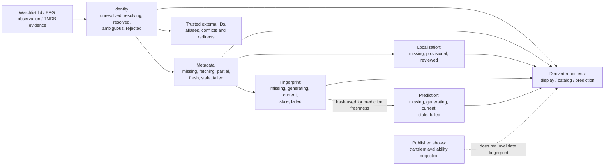
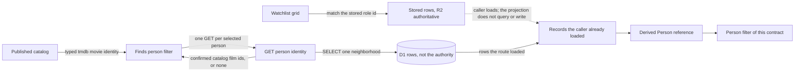
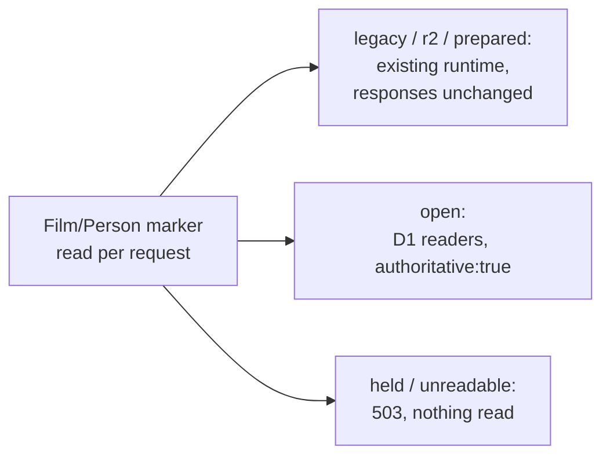
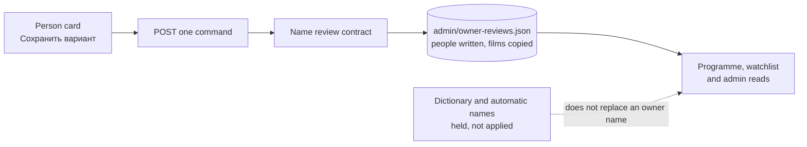
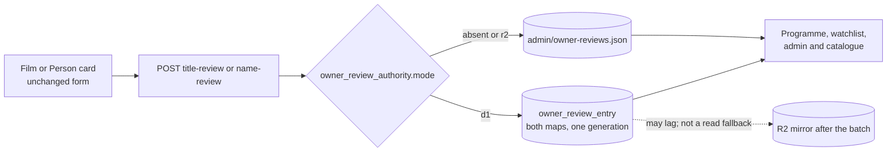
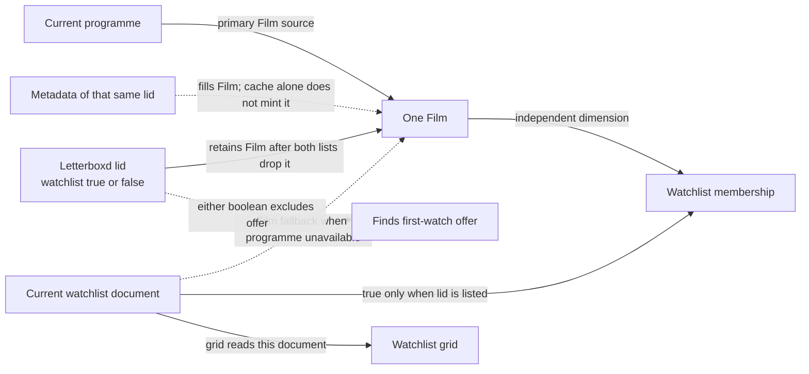

# Film / Person lifecycle and identity

This diagram illustrates **five independent Film state dimensions** in the storage-neutral domain contract, not a monolithic database status machine or a claim that D1 has replaced R2. Sources: [Film/Person reference](../reference/domain/film-person.md), [identity ADR](../adr/0009-canonical-film-person-identity.md), [domain model](../../src/domain/film-person.js), [reader](../../src/domain/film-person-reader.js) and [backfill](../../src/domain/film-person-backfill.js). A second diagram shows the derived Person reference. It is not a stored map. The watchlist grid does not call it. One read route does, and the Finds actor and director filter reads that route ([ADR 0059](../adr/0059-person-identity-projection.md), [ADR 0062](../adr/0062-d1-person-identity-read.md), [ADR 0065](../adr/0065-finds-person-filter-d1-read.md), [projection](../reference/domain/person-identity-projection.md)).

Identity is not inferred from title alone: the watchlist keeps its Letterboxd identity; a Letterboxd film slug is an untrusted `letterboxd_slug` alias of the Film carrying its lid, never an identity or a link reason, and a slug on two Films is a reported collision ([ADR 0052](../adr/0052-letterboxd-slug-film-alias.md)); a TMDB TV entry is a separate `tmdb_tv` identity whose numbers are never compared with movie ids, and a retired TMDB movie id leaves the trusted identity only through an owner-confirmed retirement that keeps it as evidence ([ADR 0057](../adr/0057-tmdb-tv-identity-and-retired-movie-ids.md), Accepted), which the lifecycle reader applies from the optional R2 object `identity/tmdb-retirements.json` over whatever the records say ([contract](../reference/domain/film-person.md#runtime-projection)); trusted external TMDB IDs and provenance govern linking; conflicting verified identities produce **collisions**, not automatic merges. `film:...` IDs are different from `normalizedTitle|year` observation keys. Person identities are role-/authority-specific and are not auto-merged by matching a displayed name. A reviewed localized title cannot be downgraded by an automatic translation. The Worker applies this localization rule on every programme and watchlist read and at the EPG commit, with no runtime switch; only the metadata sync's localization is still selected by `LIFECYCLE_LOCALIZATION` ([ADR 0037](../adr/0037-domain-localization-only.md)). An owner-confirmed title or name is read from `admin/owner-reviews.json` and stamped before the dictionary ([ADR 0072](../adr/0072-owner-reviewed-localization-overlay.md), Accepted) while the owner-review marker is absent or `r2`. The object is not a new lifecycle status. The diagram above is unchanged.

Five dimensions have independent transition guards. A new Taste Profile version makes a prediction stale **without** invalidating its film fingerprint. Changes to showtimes do not invalidate either artifact. `displayReady`, `catalogReady` and `predictionReady` are derived views, not sixth lifecycle statuses. The domain's `*.lifecycle.json` sidecars and dry-run backfill are projections/measurements, not authority to overwrite production objects. The metadata dimension's decision clocks that `film_metadata` does not store are copied into D1 `film_sync_state` by the same enrichment projector at schema version 5 ([ADR 0070](../adr/0070-metadatasync-freshness-clocks.md)). While the schema v6 marker is absent or `r2`, `metadataSync` still branches on `metadata.json`. When that marker is `d1`, the same branch reads the D1 cache ([ADR 0073](../adr/0073-metadata-cache-d1-authority.md)). This adds no arrow above.

Person records stay role- and source-specific. The derived reference below is how a watchlist filter and a catalog filter name one human. The watchlist grid still matches the role-specific id on the stored credit. `GET /api/d1/persons/<role>/<key>/identity` loads that person's D1 neighborhood and calls the reference. The Finds actor and director filter is the one page reader of that GET ([ADR 0065](../adr/0065-finds-person-filter-d1-read.md)). With no person selected it makes no request. It keeps a catalog film only from an unbounded trusted answer whose cross-source link is `co_credit` for the selected role, and only when `film:tmdb:<n>` is the same typed movie id as the published catalog row (`tmdb_<n>`, `canonicalIdentity` `tmdb:<n>`). A name, a TV id, a retired id, a bounded neighborhood or an error adds no film. D1 stays a projection of R2. A shared name is a review, not a member. The arrow from stored rows means a caller loaded them first. The projection does not query and does not write.

## Planned canonical authority (ADR 0099, not deployed)

[ADR 0099](../adr/0099-canonical-film-person-d1-authority.md) (Accepted) plans a D1 authority for canonical Film and Person under a marker (`r2`, `prepared`, `open`, `held`). The first step, schema `0013` with the marker, a per-entity revision, a baseline gate and a fenced mutation API, is in the repository and changes no authority: the enrichment projector remains the only writer in `r2` and `prepared`, and no reader changes. Schema `0014` and `src/localization-sources.js` ([AIR-368](https://trello.com/c/RxZ3aOQB)) add stored automatic localization sources and the owner > reviewed dictionary > automatic resolution, also inactive: a compare-only adapter and a fenced writer that nothing calls, so the localization flow of this page is unchanged. Schema `0015` and `src/film-admission.js` ([AIR-369](https://trello.com/c/GlAKWxvw)) add D1 rows and fenced writers for verified rated-only admissions and the watchlist retention fact, inactive and without a caller, so the admission and retention flow of this page is unchanged. Schema `0016` and `src/tmdb-retirement-decisions.js` ([AIR-370](https://trello.com/c/wZmtK9tS)) add the append-only owner TMDB retirement decision history, also inactive: no writer or loader runs, so the retirement flow of this page is unchanged. The marker-gated canonical bulk read model (`src/canonical-read-model.js`, [AIR-372](https://trello.com/c/weKsBJdQ)) is likewise prepared and inactive: no reader calls it, so every read path of this page is unchanged. Producer adapters and the single-writer routing ([AIR-371](https://trello.com/c/gt1afd0C), `src/canonical-producers.js`) are likewise inactive: one routing decision from the marker (legacy, `r2` and `prepared`: the projector is the only canonical writer and the adapters write nothing; `open`: the adapters are the only writers and the projector is compare-only; `held` and an unreadable marker fail closed and never return to R2), a projector fence assertion a future projector batch would carry so an in-flight projector batch loses once the marker moves, planners for EPG identity, Discovery admission, rated admission, retention, TMDB retirement and automatic localization, a bounded compare-only shadow and a handoff readiness check that stays not ready while producer writes remain uncovered (metadata, dimensions, sync clocks, watchlist membership, person dimensions). AIR-374 P2b adds the dormant Person-side state writers (`src/canonical-person-state.js`: the `person_dimension` rows, the held-value alias and conflict, and standalone `localization_conflict` rows, each one fenced batch that never downgrades an owner or reviewed localization and replays by content; see the [reference](../reference/domain/film-person.md)); they run only from `open` and change no diagram yet. The real handoff is AIR-374. No diagram changes here; the sequence is drawn when a later card changes the real flow.

**Cross-domain write receipts (P2c, [ADR 0119](../adr/0119-durable-canonical-write-receipts.md), owner decision 5 of [ADR 0117](../adr/0117-film-person-d1-handoff-owner-decisions.md)):** schema `0019` adds `canonical_write_receipt` in the existing D1 and the dormant `src/canonical-receipts.js` protocol: a receipt is recorded `pending` under the marker fence, the writer's fenced commit runs, and the receipt is marked `applied`; an unknown outcome is settled by reading the target back and comparing the content digest (equal: only the receipt was lost; different: the same request id is replayed, at most five times on a stored backoff), and a canonical change above the activation baseline with no applied receipt is `unreceipted`, never safe (revisions at or below the baseline are `pre_receipt_baseline`). A digest match without request-specific proof never counts as applied (it goes to review), and a retry after another writer advanced the revision is revalidated or abandoned for repair, never blind. The table is writable only at `open`; at `prepared` it stays empty. Introduced in code only: the schema is not applied, no producer is wired, and nothing schedules a reconcile.
### Reader gate (AIR-374 P4, dormant at `prepared`)

The marker is read before `GET /api/d1/*` and before the catalog film route's rated-archive fallback. Only `open` reads D1 for them; `held` and every unreadable state answer `503` and never reach R2, and at `open` the frozen R2 receipt is not read (owner decision 4). The marker is read again after the fallback's D1 reads and, for `GET /api/d1/*`, after every view and overlay read, immediately before the answer: an answer is returned only while the marker has the same state and generation it had at the start (any GET that has a marker, not only `open`), otherwise `503`; the catalog film route's R2 path does the same; a legacy database (no marker table) compares as unchanged legacy and keeps its historical output. Other readers of the canonical mirrors are not yet moved; see the [P4 evidence](../evidence/d1-migration/air-374-p4-readers-offline-2026-11-11.md).

**Handoff and recovery (design, [ADR 0117](../adr/0117-film-person-d1-handoff-owner-decisions.md), [runbook](../runbooks/film-person-open-handoff.md)):** `prepared` to `open` is one fenced batch under the projector lease and exclusive window; after `open`, recovery is `held` (fail closed) plus a forward fix `held` to `open` proven on a safe copy. After D1-only writes exist, a return to `r2` or a git revert is not a rollback. At `open` the canonical R2 `titles.json`/`people.json` mirrors are frozen. Nothing here is executed or authorized.

The projector asserts the marker and generation in every write batch, not only the grouped one ([ADR 0116](../adr/0116-projector-marker-and-generation-fence-on-every-batch.md), AIR-374); the guard SQL is single-sourced in `src/film-person-authority.js` and the dormant `projectorFence` consumes it.

## Owner name confirmation

**Visual review: owner approved on 2026-11-01** ([owner decision](https://trello.com/c/yKtj1ahy#comment-6ae70775d9cef4bee9fb0090)) after reviewing PR #294 HEAD `adc7768ee25b41ae04af878569e35d4fd09090c9`. The store follows the independently accepted [ADR 0072](../adr/0072-owner-reviewed-localization-overlay.md). Neither approval authorizes a production data write. It is not the identity diagram above. The owner adds one name variant on a Person card. The same POST writes the `people` map of one R2 object and copies `films`, then reads that object back before it reports success. «Добавить вариант» leaves the current name and adds the alias. «Сделать предпочтительным» overlays the new preferred name, and the previous preferred name stays selectable. A dictionary or automatic name is held once and is not applied. The identity GET does not read the object, and a saved role link does not replace a role id. The figure keeps the approved label **Сохранить вариант** and the approved arrows. The live catalogue sends the same POST from the two buttons above.

## Owner-review marker

**Visual review: approved 2026-11-02** ([owner decision](https://trello.com/c/RBxi5Pcf#comment-6ae7c9c667f360d012b09f40)). This is separate from the 2026-11-01 approval of the name-confirmation figure above. The «текущее предпочтительное» radio stays. The live catalogue sends that same POST from «Добавить вариант» or «Сделать предпочтительным». The store path below is the same. [ADR 0081](../adr/0081-d1-authoritative-owner-reviews.md) (Accepted) chooses the store after that same POST. While `owner_review_authority` is absent, or its `mode` is `r2`, the write is still the R2 object in the approved figure. When `mode` is `d1`, both maps commit as rows at one generation and the R2 object is a mirror written afterwards. A lagging mirror is not a fallback. Migration `0009` is applied. Activation at 2026-11-03 23:13 UTC set the marker to `d1` at generation 1, so the `d1` branch is the live store ([activation record](../evidence/d1-migration/air-314-owner-review-activate-2026-11-03.md)). The figure below is unchanged.

## Watchlist fact keeps the Film

**Visual review: owner approved 2026-11-04** ([explicit owner decision](https://trello.com/c/SBvIwv6P#comment-6aeafa5843c0dab3d80ec717)); fifth diagram, [ADR 0086](../adr/0086-durable-watchlist-film-retention.md) Accepted. This approval does not authorize production D1 writes or merge. It does not replace the four diagrams above. A Letterboxd lid whose view-index `watchlist` is `true` or `false` stays one Film after the current programme and watchlist drop it. Metadata fills that Film and does not mint one on its own. A cache row whose id names another film is not that body, and the lid stays. Membership is true only while the current watchlist document names the lid. The grid reads that document, not the Film. Either boolean keeps the film out of the Finds first-watch offer, including a catalog id `tmdb_<n>` when the lid bridges to `n` by one agreed stored id. Two stored ids, or none, do not bridge. A watched or rated entry still excludes it on its own. `watchlist: false` is not a watched mark. R2 stays the Film authority. Accepting the ADR does not authorize the projector write; that deploy is a separate owner approval.

**Current/future boundary:** existing Worker read/write paths and authoritative R2 objects continue to serve the site. The person identity GET reads D1 and calls the derived reference. Finds reads that GET for a selected actor or director and still takes eligibility from the published catalog. The watchlist grid does not. D1 is not the authority for Films or Persons. Owner reviews are D1-authoritative: the marker is `d1` at generation 1 ([activation record](../evidence/d1-migration/air-314-owner-review-activate-2026-11-03.md)). The canonical domain model, offline D1 repositories and a later general page cutover stay distinct; do not depict them as one deployed transactional entity store. See [D1 schema](../reference/data/d1-schema.md) and [staged migration ADR](../adr/0017-staged-d1-migration.md).

## Rated archive admission

This section adds no diagram. [ADR 0087](../adr/0087-rated-archive-film-admission.md) is Accepted. [ADR 0090](../adr/0090-rated-identity-redirect-proof-and-retry.md) is Proposed: the HTML shortlink tag is optional when the Worker already followed `boxd.it/<code>` onto the film page, `writes` follows a persisted candidate mutation, and a `shortlink_missing` review returns to pending only through an owner retry of named codes. A confirmed rated ZIP stores unknown rated rows by archive SHA-256 and short `boxd.it` code. That registration is not a Film and writes no watchlist fact. One later owner request verifies one admitting or pending code, or one named pending code. The cursor does not hide an earlier pending code. The request fences the intended movie, admits that one source code, and only then writes the rating. A second short code for the same movie stops for review and does not replace the first Film. A verified movie is `tmdb_<n>` on `letterboxd/admissions/verified-films.json`, with no `watchlist` field. Further explicit requests on that same route may store synopsis and credits only when the fetched page still matches the admitted movie; they are not the enrichment cron. The reader and the enrichment projector already in the diagram above read that object. A thin archive stub yields to a richer discovered film of the same movie id. A missing object admits nobody, so deploying this path does not upsert a rated-only Film. The same movie already reached by an EPG airing stays one Film. Finds eligibility is unchanged. R2 stays the Film authority.

Storage note (AIR-374 P2a, dormant, [ADR 0120](../adr/0120-canonical-film-writers-identity-metadata-membership.md)): after the owner-approved `open`, the lifecycle rows above (identity, metadata and the effective localization) and the Film's identity title, metadata body, sync clocks and watchlist membership are written by one fenced batch per Film (`writeFilmFacts`, `src/canonical-film-writers.js`). It never lets an automatic value replace a reviewed or owner one and it materialises the effective localization in the same batch as an automatic source. Until `open` the projector is the only writer; the diagrams here describe the domain contract, not an activated D1 writer.
