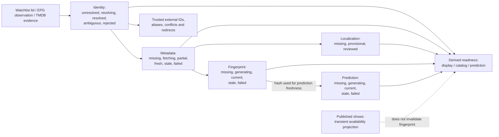
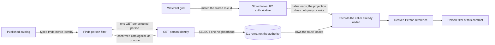
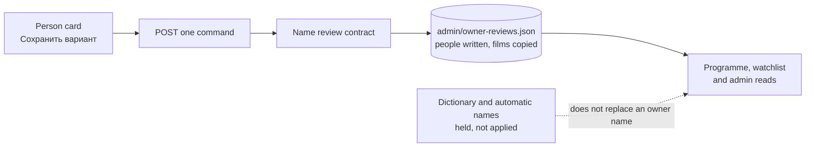
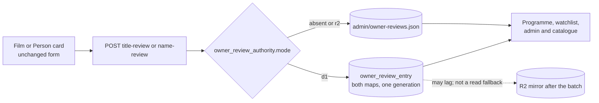

# Film / Person lifecycle and identity

This diagram illustrates **five independent Film state dimensions** in the storage-neutral domain contract, not a monolithic database status machine or a claim that D1 has replaced R2. Sources: [Film/Person reference](../reference/domain/film-person.md), [identity ADR](../adr/0009-canonical-film-person-identity.md), [domain model](../../src/domain/film-person.js), [reader](../../src/domain/film-person-reader.js) and [backfill](../../src/domain/film-person-backfill.js). A second diagram shows the derived Person reference. It is not a stored map. The watchlist grid does not call it. One read route does, and the Finds actor and director filter reads that route ([ADR 0059](../adr/0059-person-identity-projection.md), [ADR 0062](../adr/0062-d1-person-identity-read.md), [ADR 0065](../adr/0065-finds-person-filter-d1-read.md), [projection](../reference/domain/person-identity-projection.md)).

Identity is not inferred from title alone: the watchlist keeps its Letterboxd identity; a Letterboxd film slug is an untrusted `letterboxd_slug` alias of the Film carrying its lid, never an identity or a link reason, and a slug on two Films is a reported collision ([ADR 0052](../adr/0052-letterboxd-slug-film-alias.md)); a TMDB TV entry is a separate `tmdb_tv` identity whose numbers are never compared with movie ids, and a retired TMDB movie id leaves the trusted identity only through an owner-confirmed retirement that keeps it as evidence ([ADR 0057](../adr/0057-tmdb-tv-identity-and-retired-movie-ids.md), Accepted), which the lifecycle reader applies from the optional R2 object `identity/tmdb-retirements.json` over whatever the records say ([contract](../reference/domain/film-person.md#runtime-projection)); trusted external TMDB IDs and provenance govern linking; conflicting verified identities produce **collisions**, not automatic merges. `film:...` IDs are different from `normalizedTitle|year` observation keys. Person identities are role-/authority-specific and are not auto-merged by matching a displayed name. A reviewed localized title cannot be downgraded by an automatic translation. The Worker applies this localization rule on every programme and watchlist read and at the EPG commit, with no runtime switch; only the metadata sync's localization is still selected by `LIFECYCLE_LOCALIZATION` ([ADR 0037](../adr/0037-domain-localization-only.md)). An owner-confirmed title or name is read from `admin/owner-reviews.json` and stamped before the dictionary ([ADR 0072](../adr/0072-owner-reviewed-localization-overlay.md), Accepted) while the owner-review marker is absent or `r2`. The object is not a new lifecycle status. The diagram above is unchanged.

Five dimensions have independent transition guards. A new Taste Profile version makes a prediction stale **without** invalidating its film fingerprint. Changes to showtimes do not invalidate either artifact. `displayReady`, `catalogReady` and `predictionReady` are derived views, not sixth lifecycle statuses. The domain's `*.lifecycle.json` sidecars and dry-run backfill are projections/measurements, not authority to overwrite production objects. The metadata dimension's decision clocks that `film_metadata` does not store are copied into D1 `film_sync_state` by the same enrichment projector at schema version 5 ([ADR 0070](../adr/0070-metadatasync-freshness-clocks.md)). While the schema v6 marker is absent or `r2`, `metadataSync` still branches on `metadata.json`. When that marker is `d1`, the same branch reads the D1 cache ([ADR 0073](../adr/0073-metadata-cache-d1-authority.md)). This adds no arrow above.

Person records stay role- and source-specific. The derived reference below is how a watchlist filter and a catalog filter name one human. The watchlist grid still matches the role-specific id on the stored credit. `GET /api/d1/persons/<role>/<key>/identity` loads that person's D1 neighborhood and calls the reference. The Finds actor and director filter is the one page reader of that GET ([ADR 0065](../adr/0065-finds-person-filter-d1-read.md)). With no person selected it makes no request. It keeps a catalog film only from an unbounded trusted answer whose cross-source link is `co_credit` for the selected role, and only when `film:tmdb:<n>` is the same typed movie id as the published catalog row (`tmdb_<n>`, `canonicalIdentity` `tmdb:<n>`). A name, a TV id, a retired id, a bounded neighborhood or an error adds no film. D1 stays a projection of R2. A shared name is a review, not a member. The arrow from stored rows means a caller loaded them first. The projection does not query and does not write.

## Owner name confirmation

**Visual review: owner approved on 2026-11-01** ([AIR-54 owner decision](https://trello.com/c/yKtj1ahy#comment-6ae70775d9cef4bee9fb0090)) after reviewing PR #294 HEAD `adc7768ee25b41ae04af878569e35d4fd09090c9`. The store follows the independently accepted [ADR 0072](../adr/0072-owner-reviewed-localization-overlay.md). Neither approval authorizes a production data write. It is not the identity diagram above. The owner adds one name variant on a Person card. The same POST writes the `people` map of one R2 object and copies `films`, then reads that object back before it reports success. With the preferred checkbox off, readers keep the current name and gain the alias. With it on, they overlay the new preferred name, and the previous preferred name stays selectable. A dictionary or automatic name is held once and is not applied. The identity GET does not read the object, and a saved role link does not replace a role id. The button label in the figure is **Сохранить вариант**. That label is the only change since the approved render and is **proposed for visual review**. The arrows are the approved flow.

## Owner-review marker

**Visual review: proposed.** This diagram is not part of the 2026-11-01 approval of the name-confirmation figure above. The form, the button **Сохранить вариант**, the checkbox and the «текущее предпочтительное» radio do not change. [ADR 0080](../adr/0080-d1-authoritative-owner-reviews.md) (Proposed) chooses the store after that same POST. While `owner_review_authority` is absent, or its `mode` is `r2`, the write is still the R2 object in the approved figure. When `mode` is `d1`, both maps commit as rows at one generation and the R2 object is a mirror written afterwards. A lagging mirror is not a fallback. Migration `0009` is not applied, so the `d1` branch is not live.

**Current/future boundary:** existing Worker read/write paths and authoritative R2 objects continue to serve the site. The person identity GET reads D1 and calls the derived reference. Finds reads that GET for a selected actor or director and still takes eligibility from the published catalog. The watchlist grid does not. D1 is not the authority for Films, Persons or owner reviews. Owner reviews become D1-authoritative only after their own marker is `d1`, which this delivery does not set. The canonical domain model, offline D1 repositories and a later general page cutover stay distinct; do not depict them as one deployed transactional entity store. See [D1 schema](../reference/data/d1-schema.md) and [staged migration ADR](../adr/0017-staged-d1-migration.md).
