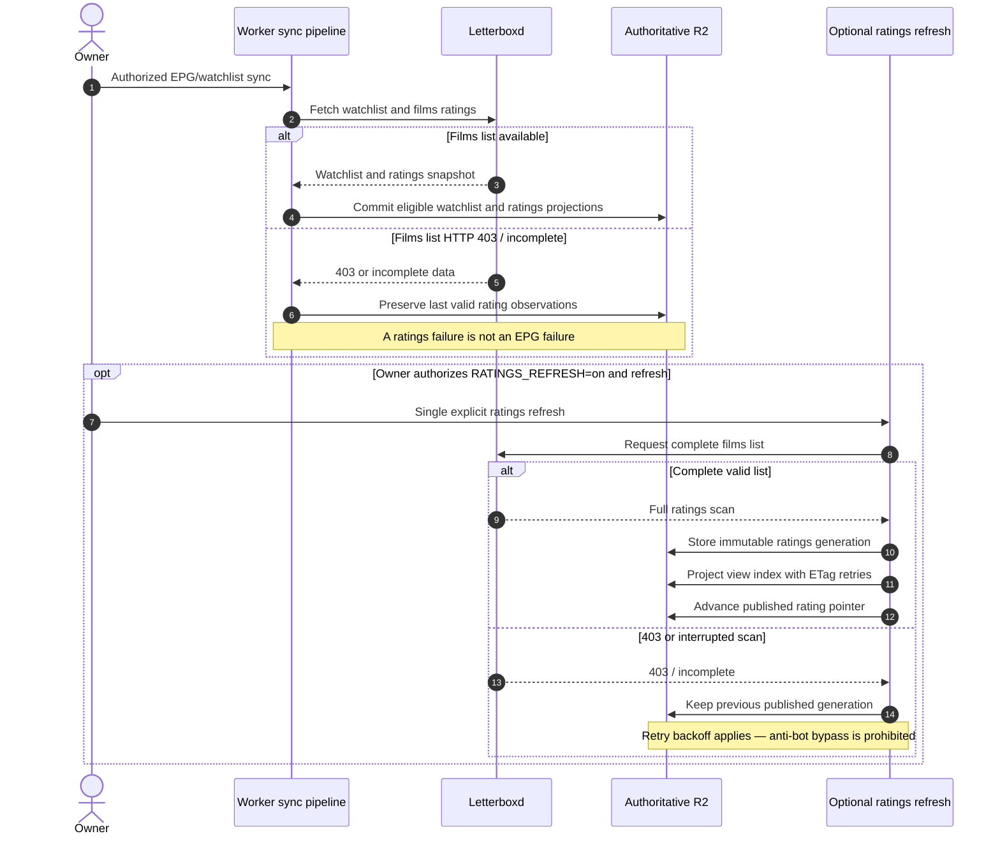
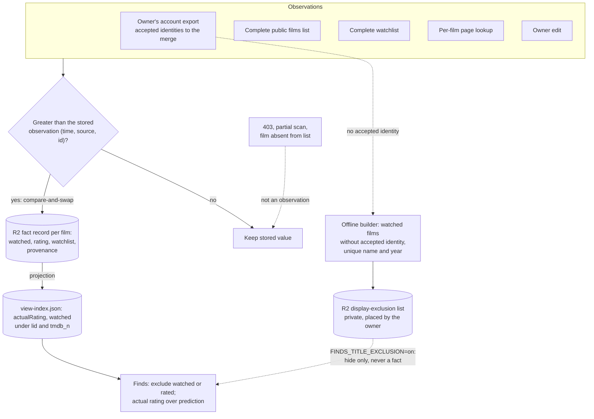

# Letterboxd ingestion and last-good ratings

This sequence distinguishes the routine watchlist/EPG synchronization from the separately gated ratings refresh. **A Letterboxd HTTP 403 is an observed upstream failure, not a reason to bypass the challenge.** Sources: [Letterboxd ratings contract](../reference/integrations/letterboxd-ratings.md), [last-good ADR](../adr/0018-letterboxd-last-good-ratings.md), [Worker sources](../../src/sources.js), [enrichment API](../reference/api/enrichment.md).

The **separately flagged** `POST /api/enrichment/ratings/refresh` is not automatically scheduled. The pending generation and last-success pointer allow a safe continuation of an interrupted projection without repeating Letterboxd reads. Its lease and ETag retry protect concurrent writers to `enrichment/view-index.json`. A per-film repair is distinct from a complete scan; it does not move `lastSuccessAt`.

For operational truth, check the current `RATINGS_REFRESH` binding before claiming that manual refresh is enabled; the source default is not evidence of current production configuration. No retrieval, bypass, ratings repair, or refresh is performed by this documentation change.

## Watched, rating and watchlist as separate facts (behind `LETTERBOXD_FACTS`)

**Accepted ([ADR-0023](../adr/0023-letterboxd-user-facts.md), [ADR-0024](../adr/0024-letterboxd-scan-summary.md)); the routine writers and the baseline importer are implemented behind `LETTERBOXD_FACTS` and `LETTERBOXD_BASELINE_IMPORT`, off by default; finds exclude watched and rated films by TMDB identity with either value of the gate ([catalog API](../reference/api/catalog.md#watched-and-rated-films)); a separate display-only title exclusion ([ADR-0028](../adr/0028-finds-display-only-watched-exclusion.md); namesake guards by list tag in [ADR-0033](../adr/0033-finds-exclusion-namesake-relaxation.md)) is implemented behind `FINDS_TITLE_EXCLUSION`, off by default.** With the gate off, the films-list scan still writes `actualRating` straight into the view index and assigns `null` to watchlist films it does not see. With it on, every source writes observations into one fact record per film, only a greater observation (by time, then source rank, then observation id) replaces a value, a complete scan is stored once as a summary observation, and the view index is rebuilt from the records. Contract: [Letterboxd user facts](../reference/integrations/letterboxd-user-facts.md).

A fact record also carries `ratingHistory`, the append-only list of the film's rating changes, written in the same compare-and-swap as the rating; the projection does not read it ([ADR 0038](../adr/0038-durable-rating-and-prediction-lineage.md), [user facts contract](../reference/integrations/letterboxd-user-facts.md)). Unresolved export rows (no accepted identity) never reach the merge; they stay in the importer's private report until a separate identity verification. The dashed path is display-only: the offline builder writes their normalized names and years to a private list, and with the switch on Finds hide a catalog film whose original title and year match it uniquely. Finds read that list without writing anything, and the match never becomes a fact, a rating or an identity link ([catalog API](../reference/api/catalog.md#display-only-title-exclusion), [runbook](../runbooks/finds-display-exclusion.md)).
