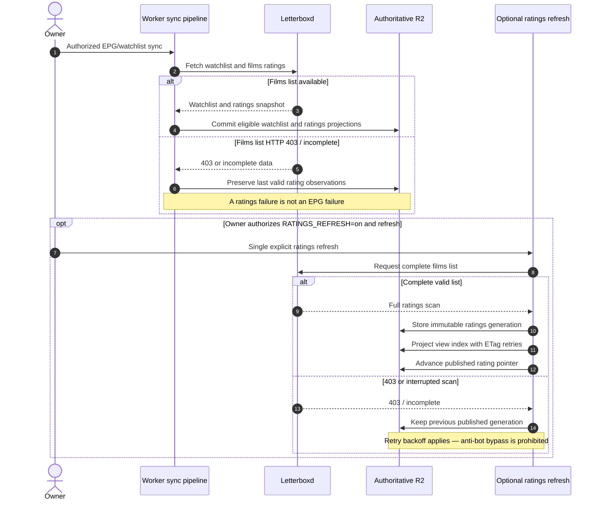
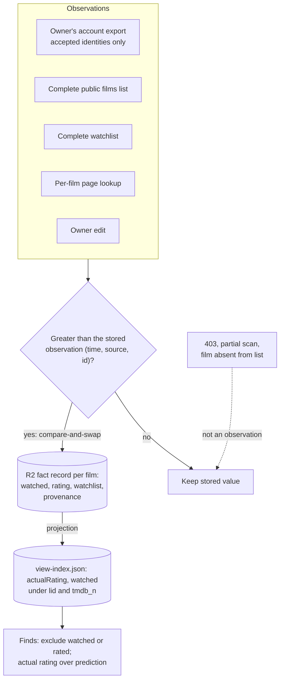

# Letterboxd ingestion and last-good ratings

This sequence distinguishes the routine watchlist/EPG synchronization from the separately gated ratings refresh. **A Letterboxd HTTP 403 is an observed upstream failure, not a reason to bypass the challenge.** Sources: [Letterboxd ratings contract](../reference/integrations/letterboxd-ratings.md), [last-good ADR](../adr/0018-letterboxd-last-good-ratings.md), [Worker sources](../../src/sources.js), [enrichment API](../reference/api/enrichment.md).

The **separately flagged** `POST /api/enrichment/ratings/refresh` is not automatically scheduled. The pending generation and last-success pointer allow a safe continuation of an interrupted projection without repeating Letterboxd reads. Its lease and ETag retry protect concurrent writers to `enrichment/view-index.json`. A per-film repair is distinct from a complete scan; it does not move `lastSuccessAt`.

For operational truth, check the current `RATINGS_REFRESH` binding before claiming that manual refresh is enabled; the source default is not evidence of current production configuration. No retrieval, bypass, ratings repair, or refresh is performed by this documentation change.

## Proposed: watched, rating and watchlist as separate facts

**Not implemented; proposed by [ADR-0023](../adr/0023-letterboxd-user-facts.md) and pending owner approval.** Today the films-list scan writes `actualRating` straight into the view index and assigns `null` to watchlist films it does not see. Under the proposal every source writes observations into one fact record per canonical film, only a greater observation (by time, then source rank, then observation id) replaces a value, and the view index is rebuilt from the records. Contract: [Letterboxd user facts](../reference/integrations/letterboxd-user-facts.md).

Unresolved export rows (no accepted identity) never reach the merge; they stay in the importer's private report until a separate identity verification.
