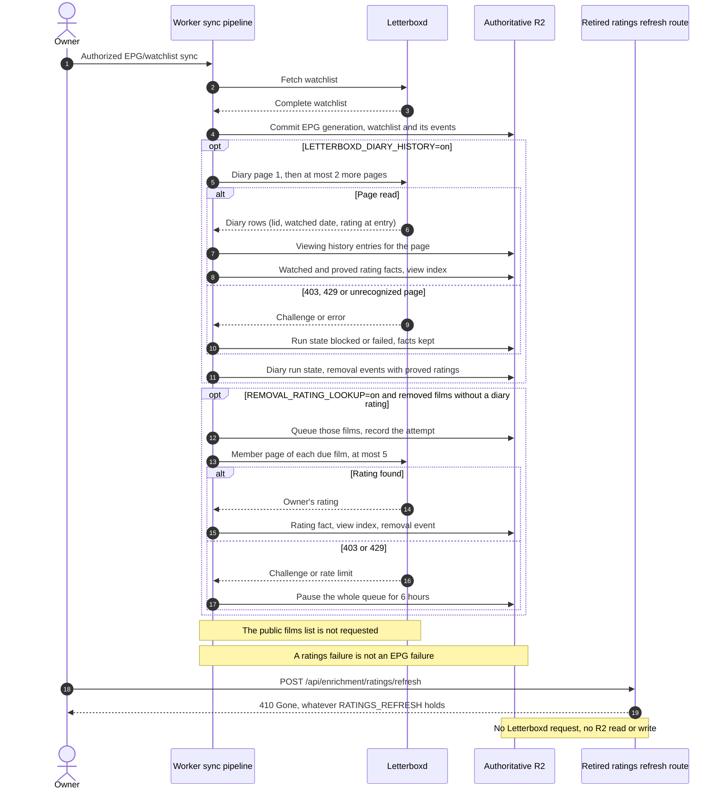
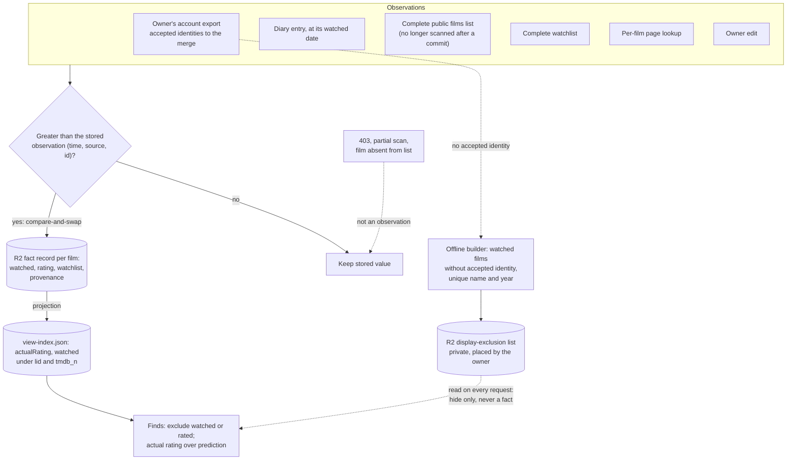
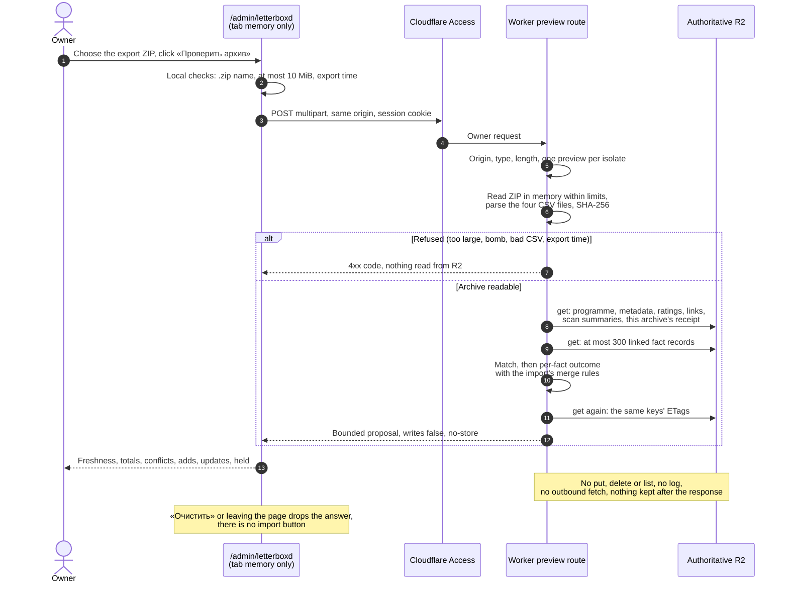

# Letterboxd ingestion and last-good ratings

This sequence distinguishes the routine watchlist/EPG synchronization from the retired ratings-only refresh route. **A Letterboxd HTTP 403 is an observed upstream failure, not a reason to bypass the challenge.** Sources: [Letterboxd ratings contract](../reference/integrations/letterboxd-ratings.md), [last-good ADR](../adr/0018-letterboxd-last-good-ratings.md), [retirement ADR](../adr/0040-retire-ratings-only-refresh.md), [removal lookup ADR](../adr/0043-removal-rating-lookup-queue.md), [diary history ADR](../adr/0049-letterboxd-diary-viewing-history.md), [Diary-first ratings ADR](../adr/0054-diary-first-epg-ratings.md), [archive preview ADR](../adr/0066-ephemeral-letterboxd-archive-preview.md), [Worker sources](../../src/sources.js), [enrichment API](../reference/api/enrichment.md).

The ratings after a commit are **Diary-first** ([ADR 0054](../adr/0054-diary-first-epg-ratings.md)). The first optional block is the **Diary viewing history** of [ADR 0049](../adr/0049-letterboxd-diary-viewing-history.md), off by default. It is a bounded, incremental read of the owner's diary. After each page's history commit, every film on that page becomes a watched fact; a rating fact is added where the diary proves one. That rating is the one at the film's latest watched date, observed at that date, so a newer observation from any source wins ([contract](../reference/integrations/letterboxd-diary-history.md#rating-facts)).

The second optional block is the **removal lookup** of [ADR 0043](../adr/0043-removal-rating-lookup-queue.md), off by default. It now runs after the diary, and only for films the watchlist diff removed that the diary gave no rating. They are looked up on their own member pages through a bounded queue in `enrichment/removal-rating-lookups.json`, and it never fails the commit ([contract](../reference/integrations/letterboxd-ratings.md#removed-films)). The 31-page public films list is no longer scanned after a commit.

The diagram shows the default `RATINGS_PIPELINE=inline`. With `separate` after the owner-approved storage migration, both blocks leave the commit: it only adds the removed films to the queue as references to their removal event, and a separate leased ratings run reads the Diary and makes the lookups ([scheduling](scheduling-and-orchestration.md#the-separate-ratings-pipeline-deployed-inactive-by-default), [contract](../reference/integrations/letterboxd-ratings.md#separate-ratings-pipeline)).

The owner-triggered `POST /api/enrichment/ratings/refresh` of AIR-64 is **retired** ([ADR 0040](../adr/0040-retire-ratings-only-refresh.md)): it answers `410 Gone` before it parses the body, so no value of `RATINGS_REFRESH` opens it, and it neither calls Letterboxd nor touches R2. Ratings reach the view index through the EPG commit shown above, the per-film lookup and the owner edit. The objects the refresh wrote under `enrichment/ratings/` stay in R2 untouched, and `GET /api/enrichment/ratings/status` still reads them; `enabled` is always `false`. Writers of `enrichment/view-index.json` keep their ETag retries.

## Watched, rating and watchlist as separate facts

**Accepted ([ADR-0023](../adr/0023-letterboxd-user-facts.md), [ADR-0024](../adr/0024-letterboxd-scan-summary.md)); the routine writers always record facts, with no switch: `LETTERBOXD_FACTS` is retired ([ADR 0055](../adr/0055-retire-letterboxd-facts-switch.md)); the baseline importer is a permanent owner-only maintenance route with no switch ([ADR 0053](../adr/0053-permanent-letterboxd-baseline-import-route.md)); finds exclude watched and rated films by TMDB identity ([catalog API](../reference/api/catalog.md#watched-and-rated-films)); a separate display-only title exclusion ([ADR-0028](../adr/0028-finds-display-only-watched-exclusion.md); namesake guards by list tag in [ADR-0033](../adr/0033-finds-exclusion-namesake-relaxation.md)) runs on every request without a switch; `FINDS_TITLE_EXCLUSION` is retired ([ADR-0041](../adr/0041-retire-finds-title-exclusion-switch.md)).** The EPG commit no longer scans the films list ([ADR 0054](../adr/0054-diary-first-epg-ratings.md)); a stored films-list summary still acts as the floor of every later observation. Every source writes observations into one fact record per film, only a greater observation (by time, then source rank, then observation id) replaces a value, a complete scan is stored once as a summary observation, and the view index is rebuilt from the records. Contract: [Letterboxd user facts](../reference/integrations/letterboxd-user-facts.md).

A fact record also carries `ratingHistory`, the append-only list of the film's rating changes, written in the same compare-and-swap as the rating; the projection does not read it ([ADR 0038](../adr/0038-durable-rating-and-prediction-lineage.md), [user facts contract](../reference/integrations/letterboxd-user-facts.md)). Unresolved export rows (no accepted identity) never reach the merge; they stay in the importer's private report until a separate identity verification. The dashed path is display-only: the offline builder writes their normalized names and years to a private list, and Finds hide a catalog film whose original title and year match it uniquely, on every request and without a switch ([ADR-0041](../adr/0041-retire-finds-title-exclusion-switch.md)). Finds read that list without writing anything, and the match never becomes a fact, a rating or an identity link ([catalog API](../reference/api/catalog.md#display-only-title-exclusion), [runbook](../runbooks/finds-display-exclusion.md)).

## Owner archive preview (no write)

**Proposed ([ADR 0066](../adr/0066-ephemeral-letterboxd-archive-preview.md)).** The owner checks an account export from `/admin/letterboxd` before any import. The archive travels in one same-origin POST under the existing Access session, lives only in that request and is never stored; the Worker reads single named R2 objects through a get-only wrapper and answers with a bounded proposal. There is no apply step on this path: the import stays the separately approved [baseline route](../runbooks/letterboxd-baseline-import.md). Contract: [admin API](../reference/api/admin.md#letterboxd-archive-preview-post-apiadminletterboxd-archivepreview).

The preview's baseline is always `unknown`: the import stores per-chunk receipts and no summary, so the answer only says whether **this** archive's receipt exists. «Нужен свежий архив» appears when the export is older than the data health threshold or R2 holds a newer rating for some film.
