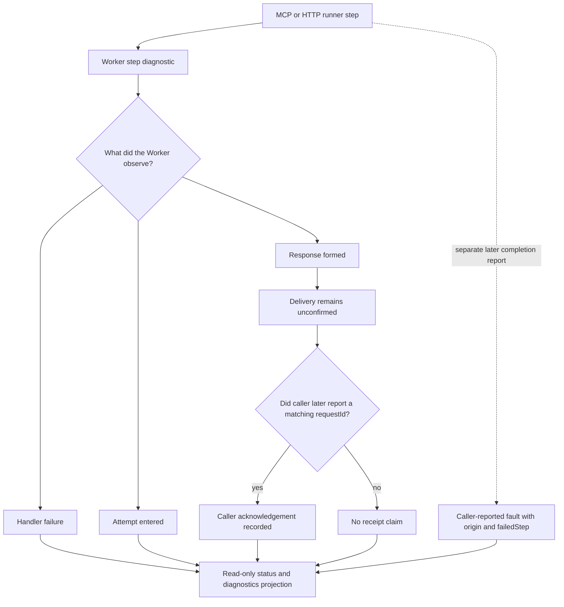
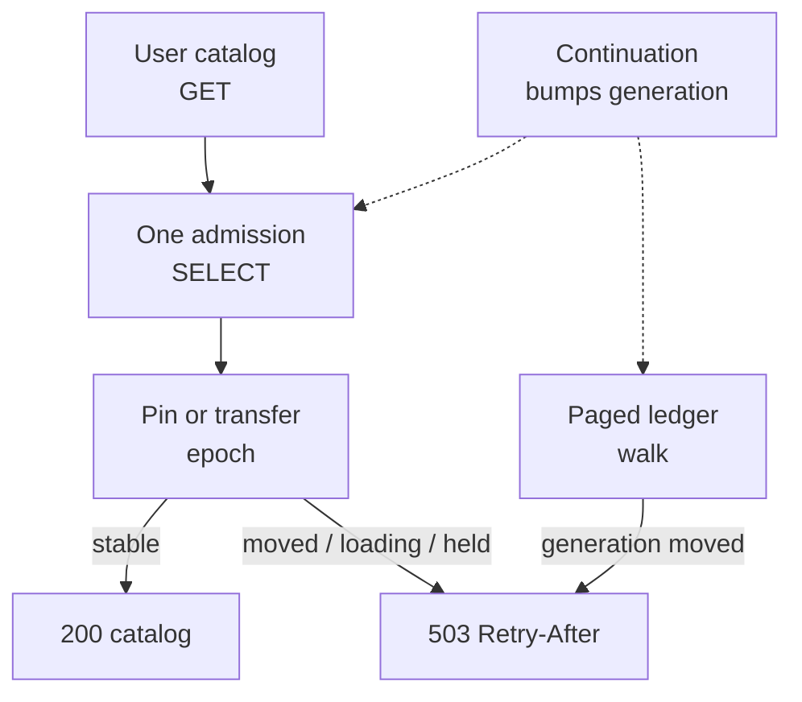
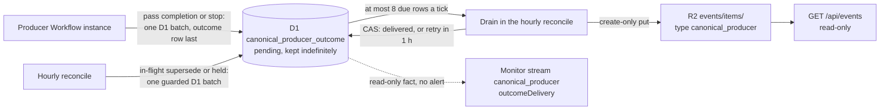
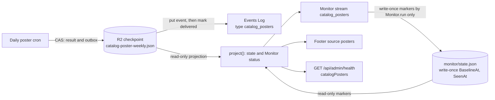

# Observability and failure attribution

A recorded server response is **not proof that a client received it**. Worker diagnostics, caller-attributed faults and historical evidence must remain distinct. Sources: [run diagnostics contract](../reference/api/run-diagnostics.md), [prediction diagnostics](../reference/api/prediction-diagnostics.md), [failure provenance ADR](../adr/0016-run-diagnostic-provenance.md) and [prediction operations](../runbooks/prediction-operations.md).

A step can be `entered`, `produced` or `failed`. The persisted server record retains `delivery: unconfirmed`; a later caller-supplied `receivedRequestId` can acknowledge only the matching step. External stops without attributed fault data remain `external_unattributed`. A caller's `origin` is recorded as a **caller report**, not reclassified as a server-observed cause. One item validation failure and retry backoff are not automatically system failures.

The owner-only diagnostic MCP tools [documented here](../reference/api/prediction-diagnostics.md) expose bounded queue state and per-film evidence; they do not themselves retry items, restart runs or migrate storage. Historical Events and dated investigation reports are **not** proof of present task scheduling, provider health or live flags. Always distinguish request attempt, formed response, caller acknowledgement, completed run and external Scheduled Task execution.

## EPG continuation step diagnostics

The same attempt / formed-response / failure distinction applies to the EPG resolver continuation. Each `epg_sync_step` or discovery resolve request that reaches the Worker handler is one **step entry** with two channels of different reliability. The Worker log gets an `entered` line before any storage access, a `checkpointed` line as soon as the step's discovery hop has stored its checkpoint, and a `completed` (a response was formed, whatever its status) or `failed` (the handler threw) line afterwards, all carrying the same entry `id`; this is the arrival evidence. The ring `epg/resolver-continuation-diagnostics.json` (last 20 entries, read through `GET /api/enrichment/pipeline/status` / `epg_pipeline_status` as `continuationDiagnostics`) receives the same entry best effort, `entered` first, `checkpointed` next and the outcome last, and the final log line says whether each write succeeded (`recorded`). A later step closes an entry that never got its terminal phase as `interrupted`, recording only what is known: whether the hop had committed (`true`/`false` from `checkpointed`, unknown from `entered`) and `cause: unknown`. The entry records the caller boundary (`mcp`, `http`, `internal`), the route and branch taken, the `discovery` contract returned and the `advanceDiscovery` trace: continuation record before, lease state, continuation health (whether a `running` record is a live writer or an orphan whose lease expired without a checkpoint), any orphan recovery taken (settled from the persisted chunk status, resumed, or closed on a generation conflict), decision, hop id, chunk outcome and the record after.

What the data can and cannot establish: a `completed` entry whose branch explains why no chunk was saved (`lease_live`, `contract` with `wait`/`stop`, `missing_secret`, a chunk `error`, or `saved.owned: false`) is server-observed; an `entered` log line with no outcome line of the same `id` shows the request was interrupted after arrival, and a `checkpointed` line without an outcome shows it was interrupted after its chunk committed; an `interrupted` ring entry shows the same when the outcome write failed or the isolate died. None of these proves an error or names a cause: the platform outcome of the invocation (for example `exceededMemory`) is a separate Workers Logs event joined through the request id. A series whose hops end before their checkpoint twice in a row fails closed (`interrupted`, `stop`) rather than being resumed by every scheduled call. A gated confirm can run one later chunk when the stored status shows that hop did not finish ([ADR 0088](../adr/0088-guarded-interrupted-discovery-recovery.md), Proposed); the hourly task still cannot, and a missing or contradictory checkpoint is `owner_investigation` rather than a guess at the cause. The absence of a ring entry is only *no persisted evidence* (the write can fail silently and 20 later steps evict it). The absence of both log lines within the log retention window shows that no request reached the Worker handler; it does not show where it stopped, because a request rejected by Cloudflare Access (`401`/`403`), dropped by the client or never sent leaves the same absence. Entries carry codes from closed vocabularies, UUIDs, timestamps and counts only (thrown messages are classified, never copied), and recording them never retries or dispatches anything. The fields are in [the MCP contract](../reference/api/mcp.md#continuation-diagnostics-air-151); the reading procedure is in [the connectivity runbook](../runbooks/mcp-connectivity.md#diagnosing-a-stalled-epg-continuation).

The hourly cron's Discovery reconcile (`reconcileDiscoveryWorkflow`) is independent of whether the cron invocation itself succeeded. Each attempt, including `projector_window`, `write_conflict`, `d1_unavailable`, `recovery_waiting` and a started successor, emits one Workers Log object `event=discovery_workflow_reconcile` with `scheduled`, `attempt`, `started`, `reason`, `programmeRunId`, `instanceId`, `series` and `windowUntil` or `dueAt` when present. Absence of that line in a cron that also ran the projector means the reconcile outcome was not recorded (the 10 November 2026 `step_cap` gap, [AIR-428 evidence](../evidence/orchestration/air-428-discovery-step-cap-recovery-2026-11-10.md)).

The two-minute Discovery recovery tick ([ADR 0174](../adr/0174-discovery-only-fast-recovery-cron.md)) emits `event=discovery_recovery_tick` when a recovery or a handoff is involved or the tick could not decide: `kind` is `recovery` or `handoff` (no record or an older generation than the published one), `state` is `waiting`, `started`, `overdue`, `refused` or `failed`, with `reason` (the typed refusal or failure: `fast_tick_error`, `instance_status_unknown`, `published_unreadable`, `workflow_unavailable`), `dueAt`, `recoveryDelayMs` (due time to successor start), `overdueMs`, `incident` (true on any outcome more than five minutes past due, a late success included), `programmeRunId`, `instanceId` and `series`. A tick that logs nothing is a healthy live instance of the published generation, a recovery not yet due, a terminal stop or a quarantine; any failure to decide is logged as `failed`. The tick writes no Event and closes no hourly report.

`GET /api/enrichment/pipeline/status` always adds (the retired `DISCOVERY_EXECUTOR` variable is ignored, AIR-325) a read-only `discoveryExecutor`: the configured mode, whether a Workflow instance is the owner, the generation, instance and series, the phase, what it is waiting for, the last chunk summary, recovery attempts and `recoveryDue`, `recoveryState` (`none`, `waiting`, `overdue`), `recoveryOverdueMs`, `recoveryIncident` (overdue more than five minutes), whether the record is `stalled`, and whether work is still pending or eligible, taken only from the shared [Discovery queue state](../reference/api/enrichment.md#discovery-queue-state) (pending is "not proven empty"). A record that merely says `running` is not an owner once the platform reports that instance finished or absent, or once the record is older than 15 minutes and is not sleeping until a future `waitingUntil`. `degraded` stays true for an uncertain or unknown phase, an unknown live status, a stall, a stop that still has a backlog, and a recovery wait or quarantine. The read does not create a Workflow or run a chunk. `delegated` on a continuation response means the request handed the series to that executor; it is not `complete`, and it is not written into the continuation record. EPG, discovery, predictions and ratings stay separate statuses.

**Two Discovery status levels ([ADR 0115](../adr/0115-discovery-operational-status-view.md)).** The detailed pipeline status walks the whole ledger under a snapshot fence of the Discovery authority generation, so while Discovery commits it can answer `discovery_fence`; that is the expected outcome of an expensive read, not a Workflow failure. The operational view (`view=operational`) is the health read: one batch of single-row SELECTs (authority row, transfer, status, continuation, workflow, lease, projector window), one consistent snapshot, no ledger, decision or catalog read, no TMDB, no write. It reports the phase, next action, executor and lease liveness and the last checkpoint's stored backlog with its own time and `known | stale | unknown`; an unreadable record is named in `unavailable`, a held cutover is `authority.state: held`, and an unavailable authority is a typed answer with no invented records.

**One Discovery queue classification.** The footer row «Распознавание», the hourly Monitor, the hourly Events report, the operational and detailed status and the admin data health read the small Discovery records through one bounded reader (the operational snapshot above, or the same small R2 objects outside D1 authority, plus the EPG-priority pause read only) and classify them with one pure rule ([Discovery queue state](../reference/api/enrichment.md#discovery-queue-state)): `empty` only on a strict proof of the published generation (the status of the continuation's own last hop with all four queue parts zero and no error, no quarantine and no live Discovery writer, plus either a `complete` continuation or a drained series: executor stopped on `backlog_empty`, `chunk_budget` with no chunk left), owed work as `backlog`, `running`, `failed` or `blocked`, the EPG-priority pause as `paused`, and everything unproven, including owed work whose admission gate cannot be read or moved to another generation, as `unknown`. The Monitor measures an unknown state by its own clock and keeps an open Discovery incident open until a valid disposition. A drained series therefore reads «очередь пуста» in the footer, raises no Monitor stall and is no pending work in the readout, whatever gate time its continuation still carries. Each consumer keeps its own presentation and confirmation policy (the Monitor's three-hour rule, the footer's gate grace, the Events snapshot of its hour), never its own reading of the facts. Nothing is persisted for it.

**User catalog versus the generation fence ([ADR 0147](../adr/0147-discovery-user-read-snapshot-fence.md)).** `GET /api/catalog/available` and `GET /api/enrichment/view` read the catalog as one admission snapshot. They do not fail because continuation or status writers moved `discovery_authority.generation`. A real pin change, a non-seal `loading` transfer, or an unreadable or refused authority (a held cutover, a marker in mode `r2`: `discovery_unavailable`) is HTTP 503 with `code` and `Retry-After: 1`, logged only if it still escapes as an unhandled route error. A 502 `discovery_fence` on those two paths is a defect, not an expected wait.

A committed taste-profile publication records one `taste_profile` event after the current pointer moves ([Events](../reference/domain/events.md)). The pointer and the event are not one transaction. A failed event put leaves the committed profile in place and says so on the publication response. The recovery is a replay of that same publication request: it does not move current again and creates the missing event once, and only when the immutable version body is marked `tasteProfileEventExpected`. A version without that marker is left without an event. It does not scan older versions and it does not run from a schedule. `GET /api/events` is unchanged and is still not a safe production read.

## Proposed shared orchestration read model

For pipelines moved to Cloudflare executors, [ADR 0089](../adr/0089-shared-orchestration-reliability-contract.md) (Accepted; not yet implemented) specifies one `orchestration` read model per domain on the existing status routes ([fields](../reference/orchestration-reliability.md#read-model)). It separates a healthy wait or a scheduled cooldown from a stall: `waiting` and `cooldown` have a known future wake, while `stalled` has due work, no durable progress within the domain threshold and no future wake. Failures carry one class (`transient`, `permanent`, `unsafe`) and a fingerprint, with the consecutive and total counts against their caps. The same provenance rule applies: a formed response, a Workflow create or a lease is not durable progress; only a read-back checkpoint is. The read model is read-only and is the input for external alerts. It is not implemented in production; the diagnostics above remain the current evidence.

No live operations are introduced by this page.

## Letterboxd Sync read model (dormant)

`LetterboxdSync.readModel` reads only (no write, no repair): mode and epoch, the current slot with its window, the next slot, `sources.ratings` and `sources.watchlist` each with their own `lastSuccessAt` and last outcome, the Watchlist `watchlist_stale` warning above 24 hours, the outcome of reconciliation (operational only), the last eight slots, the count of pending slot Events and the derived health (`late`, `stalled`, `failed`, `missed`, `quarantined`). It is served as `status().letterboxdSync` and as the `letterboxd` monitor stream (issues `letterboxd_ratings_failed`, `letterboxd_watchlist_failed`, `letterboxd_ratings_rate_limited` and `letterboxd_watchlist_rate_limited` per source, `letterboxd_slot_late`, `letterboxd_slot_stalled`, `letterboxd_slot_missed`, `letterboxd_slots_failed`, `letterboxd_quarantined`, `letterboxd_unreadable`, `letterboxd_watchlist_stale`, `letterboxd_events_backlog`), only while the executor is `switching` or `cloudflare`. Exactly two Events per slot (`ratings`, `watchlist`) come from the slot outbox, whatever the outcome.

**Shared Letterboxd check (AIR-599, [ADR 0207 decision 4b](../adr/0207-letterboxd-admissions-coordinated-in-d1-only.md)).** While the Letterboxd stream exists, the monitor adds ONE read-only fact reader of the check both callers share (the Diary phase and the Watchlist admission step): the newest check that got an answer (`lastCheckAt` in the Diary check document, falling back to the newest charged entry), the work still owed an answer (entries below the cap that are due or retained after a transport or not-now outcome, the backlog, and ledger rows that are due or retained after a transport stop) with the oldest queue time of that work (an entry's `queuedAt`, a backlog record's `queuedAt`, the first-seen snapshot header of a ledger row: every owed item has a durable one), and the ledger's overdue rows. Issues, each `degraded`: `letterboxd_identity_check_stale` (owed work and no answered check for 24 hours, the clock starting at the LATER of the last answer and the oldest owed item, so a queue that has only ever met transport failures alerts after 24 hours and work that just arrived does not), `letterboxd_admission_overdue` (a ledger row pending longer than 14 days, including rows of unknown age whose first-seen snapshot was pruned; age never ends a row), `letterboxd_identity_cap_refused` (the 200-entry document refused new ids, which wait in the backlog), `letterboxd_identity_backlog_full` (the 2,000-id backlog is full) and `letterboxd_identity_check_unreadable` (the document or the ledger could not be read: an unreadable source is a fact, never "nothing waiting"). The reader writes nothing.

## Ratings orchestration read model (AIR-347)

`ratings_sync_status.orchestration` is implemented and read-only: health idle/healthy/waiting/cooldown/stalled/quarantined/failed_permanent, stall threshold two hours after the 17:30 Madrid due time. A failed read yields `health: unknown` and does not break the status.

## Ratings run result in the user Events Log (AIR-361)

The user-facing «События» journal carries one `ratings` event per terminal Ratings run. It is a product view of the run record, separate from Cloudflare monitoring and alerting. The D1 terminal commit and the R2 event put are not atomic, so the event is reconciled from the record (written after the commit, repeated at the next look, carried bounded when the record is replaced) and is idempotent by run id. See the [events reference](../reference/domain/events.md#ratings-run-result-ratings).

## Discovery hourly report in the user Events Log (AIR-410)

The user-facing «События» journal carries one `discovery` event per **scheduled hourly firing**, with the deltas since the previous report, whatever the Workflow is doing ([ADR 0111](../adr/0111-discovery-hourly-reports.md), which replaces the per-chain tick model of the first AIR-410 delivery). It is a product view of the executor record, separate from monitoring and alerting, and it changes no Discovery step, schedule, lease or authority. Chunk checkpoints add their summary to one accumulator in the executor record (deduplicated by chunk key); the hourly cron closes the period in one compare-and-swap into a capped `outbox`, and the event is written create-only under the generation and UTC hour after that. A lost put is delivered by the next firing without repeating a chunk or a TMDB request; a close that cannot be persisted writes one compact `report_failed` notice without numbers, logs one typed line (`discovery_hour_close_failed`, with `notice` delivered, queued or lost) and leaves the deltas for the next report ([ADR 0118](../adr/0118-discovery-report-failure-notice.md)); a missed hour is not backfilled. A close refused by the EPG-priority pause ([ADR 0135](../adr/0135-epg-priority-discovery-pause.md)) is that notice with the reason `epg_priority`, shown as «Discovery приостановлен на время обновления программы» with a warning badge, not as a failed report; a genuine lost compare-and-swap stays `write_conflict` ([AIR-595](https://trello.com/c/dPjrNIbQ)). See the [events reference](../reference/domain/events.md#discovery-hourly-report-discovery).

## Deferred prediction start and repeated orphan starts (ADR 0193)

A deferred start leaves four separate facts that are never merged into "success": the start's step-timing counters (`deferredAccepted`, `deferredReplay`, `deferredUnavailable`, `keyed`), the sanitized `prediction_start_prepared` line of the Workflow step (`phase`, `code`, `prepareMs`, preflights, refresh rounds, claim renewals; no key, no payload), the create-only outcome record `enrichment/batch-start/<runId>.json` (`ready`, `refused`, `failed`), the attempt marker `enrichment/batch-start/attempt/<runId>.json` and the Workflow instance list. A receipt, `start=200` and `already_running` are not progress. **Repeated orphan starts** are one more reason of the one shared AIR-556 verdict (`predictionStallAssessment`, used by the Footer and the Monitor; not a second monitor): with eligible work, at least three ownerless starts since the last confirmed progress (a start turned away with `already_running`, or a run abandoned without a film; a run still `running` is not counted) and at least 20 minutes without progress give `no_progress` with `reason: 'repeated_orphan_starts'`, and the Monitor issue `predictions_no_progress` names the count. The 60-minute rule is unchanged. Since [ADR 0210](../adr/0210-prediction-no-progress-verdict-survives-live-runs.md) (AIR-596, Accepted) both verdicts are decided before a live lease, so a series of runs that each take the lease and never commit stays `no_progress` at every tick; the progress clock is the run history, the queue's `lastBatch` and the Monitor's stored clock (never a tick, a start or a moved counter), and an open incident is held, not recovered, on a tick that cannot read the queue.

## Prediction start latency and the ordering writer (AIR-588)

The facts that judge the AIR-588 measures are separate and are never merged into "recovered": the start's `prediction_step_timing` line (`wallMs`, the stages, `notes.orderingDeferred`, `notes.claimChecks`, `notes.answerBytes` and `notes.envelopeAnswer`), the hourly writer's `prediction_ordering_reconcile` line (`outcome` `rebuilt`, `current`, `skipped` with a `reason` or `failed` with a `code`, and `ms`; codes only, no film id), and the run's own submits and durable commits. A short start or a `rebuilt` tick is not recovery; natural `batch_submit` commits are ([ADR 0204](../adr/0204-prediction-ordering-drift-leaves-the-start.md), [ADR 0205](../adr/0205-batch-start-compact-ready-envelope.md)).

## Cloudflare-native monitor (AIR-349)

An inert monitor reads the stored status of EPG, Discovery, Ratings and the prediction queue on the hourly cron, judges it with a pure policy and alerts the owner through one deliberately chosen channel: a generic webhook or, per [ADR 0097](../adr/0097-monitor-telegram-bot-api-transport.md), the Telegram Bot API (a fixed outbound endpoint, a bot token in a Worker secret and a chat id in a Worker variable, at-least-once with a 429 hold). It diagnoses and reports only and does not observe a Cloudflare-wide outage unless an external dead-man service receives its heartbeat. See [ADR 0095](../adr/0095-cloudflare-native-production-monitor.md), the [monitor API](../reference/api/monitor.md) and the [runbook](../runbooks/monitoring.md).

## Canonical Producer stream (AIR-572)

The Producer was invisible for a week because no monitor stream judged it: 113 of 113 Workflow instances `errored` with zero steps while the EPG stayed healthy. `canonical_producer` now sits beside the other streams in the same hourly `Monitor.run`. It reads at most four bounded D1 rows (published `P:g`, its chain by primary key, its run by indexed generation), treats only a change of the run's own counters or cursor as progress (never a publication, takeover, lease renewal or heartbeat), alerts after 2 hours without it and at once on a stop, and reports a deliberate delivery hold as `held_by_delivery`, never healthy. Details and the state table: [monitor reference](../reference/api/monitor.md#canonical-producer-stream) and [runbook](../runbooks/monitoring.md#canonical-producer-canonical_producer_-alerts-air-572-adr-0141).

## Canonical Producer outcomes in the user Events Log (AIR-594)

Beside the Monitor stream, the user-facing «События» journal carries one `canonical_producer` event per Producer outcome: a completed pass `P:g`, a recorded stop `(P, epoch)`, an in-flight pass superseded by a newer publication, or a held automatic retry ([ADR 0208](../adr/0208-producer-outcome-events-delivery-store.md), Accepted, option B). The outcome is a D1 row of `canonical_producer_outcome`, inserted last and asserted in the same batch as the transition, so a transition is never committed without its outcome. The hourly reconcile delivers pending rows create-only to the R2 journal after all its decisions; a refused put leaves the row pending and never blocks the Producer. Rows are kept indefinitely. Until migration `0038` is applied (a separate owner GO) the schema probe proves the table absent and nothing is reported. See the [events reference](../reference/domain/events.md#canonical-producer-outcome-report-canonical_producer).

## Catalog poster weekly retry: one fact source, three surfaces

The automatic weekly poster retry ([ADR 0179](../adr/0179-weekly-automatic-catalog-poster-retry.md)) records its operational facts in one R2 object, `epg/catalog-poster-weekly.json` (run status, week, retry time, last summary and a bounded outbox of frozen events). The Monitor stream `catalog_posters`, the footer source `posters` and the Events Log type `catalog_posters` all derive from that object and from nothing else, through the same pure projection, so they cannot disagree. Every read is one object read: no TMDB request, no write, no repair. An absent, unreadable or invalid object is never healthy.

Domain states, in predicate order: `unknown`, `lost`, `failed`, `stalled`, `grace`, `overdue`, `waiting`, `healthy_idle`, mapped to the Monitor vocabulary (`healthy`, `waiting`, `delayed`, `degraded`; a `failed` run is `degraded` with `critical: true` since [ADR 0206](../adr/0206-monitor-four-states-one-reminder-interval.md)); the table is in the [monitor reference](../reference/api/monitor.md#catalog-poster-stream). The bootstrap grace exists only before the first valid checkpoint; once a valid checkpoint has been seen, an absent one is `lost` and actionable. An idle daily firing writes nothing and is deliberately not detectable; the Sunday sweep is monitored from its receipt, and daily firings only when a pending run was due. The documented residual risk is the joint loss of the checkpoint and the Monitor state document, which returns the stream to one bootstrap grace.

## Auxiliary prediction state in D1: failures and visibility (ADR 0194; dormant)

With the marker at `d1` an unavailable authority answers `502 {"error":"prediction_aux_unavailable"}` on the runner routes and writes nothing; a part of the manifest that fails its digest answers `manifest_unavailable`; a stale lease, gate token or marker generation fails the batch whole (`prediction_aux_cas`); a held stage that would pass its count or aggregate byte cap is refused (`prediction_aux_budget`). The event outbox status (`eventOutboxStatus`) reports pending, quarantined, the oldest pending time, the active skipped count with its cap (256) and the count of cap refusals; a cap refusal never changes the refused request's answer. Quarantined rows keep their payload and never take a drain slot. Offline measurement and limits: [evidence](../evidence/prediction/air-553-aux-state-d1-dormant-offline-2026-11-22.md).
