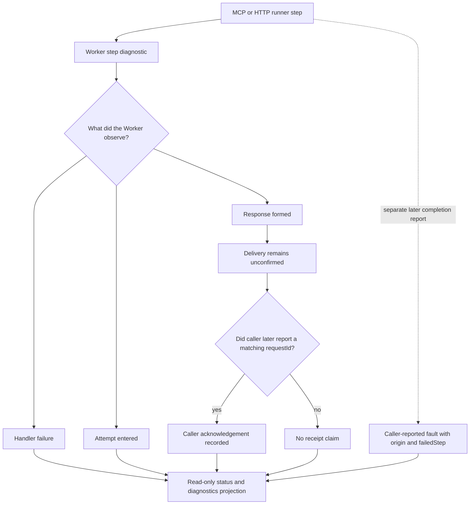

# Observability and failure attribution

A recorded server response is **not proof that a client received it**. Worker diagnostics, caller-attributed faults and historical evidence must remain distinct. Sources: [run diagnostics contract](../reference/api/run-diagnostics.md), [prediction diagnostics](../reference/api/prediction-diagnostics.md), [failure provenance ADR](../adr/0016-run-diagnostic-provenance.md) and [prediction operations](../runbooks/prediction-operations.md).

A step can be `entered`, `produced` or `failed`. The persisted server record retains `delivery: unconfirmed`; a later caller-supplied `receivedRequestId` can acknowledge only the matching step. External stops without attributed fault data remain `external_unattributed`. A caller's `origin` is recorded as a **caller report**, not reclassified as a server-observed cause. One item validation failure and retry backoff are not automatically system failures.

The owner-only diagnostic MCP tools [documented here](../reference/api/prediction-diagnostics.md) expose bounded queue state and per-film evidence; they do not themselves retry items, restart runs or migrate storage. Historical Events and dated investigation reports are **not** proof of present task scheduling, provider health or live flags. Always distinguish request attempt, formed response, caller acknowledgement, completed run and external Scheduled Task execution.

## EPG continuation step diagnostics

The same attempt / formed-response / failure distinction applies to the EPG resolver continuation ([AIR-151](https://trello.com/c/iZ7TR7y0)). Each `epg_sync_step` or discovery resolve request that reaches the Worker is one **step entry**: `entered` is written before the work, then replaced by `completed` (a response was formed, whatever its status) or `failed` (the handler threw). The entry records the caller boundary (`mcp`, `http`, `internal`), the route and branch taken, the `discovery` contract returned and the `advanceDiscovery` trace: continuation record before, lease state, decision, hop id, chunk outcome and the record after. The last 20 entries live in `epg/resolver-continuation-diagnostics.json`, read through `GET /api/enrichment/pipeline/status` / `epg_pipeline_status` as `continuationDiagnostics`, and each entry is also one structured Worker log line (`event: epg_continuation`). This makes three situations distinguishable from read-only data: no entry around the scheduled time (the call never reached the Worker), an `entered` entry without outcome (the request was interrupted before a response), and a `completed` entry whose branch explains why no chunk was saved (`lease_live`, `contract` with `wait`/`stop`, `missing_secret`, a chunk `error`, or `saved.owned: false`). Entries carry codes, counts and timestamps only, and recording them never retries or dispatches anything. The fields are in [the MCP contract](../reference/api/mcp.md#continuation-diagnostics-air-151); the reading procedure is in [the connectivity runbook](../runbooks/mcp-connectivity.md#diagnosing-a-stalled-epg-continuation).

No live operations are introduced by this page.
