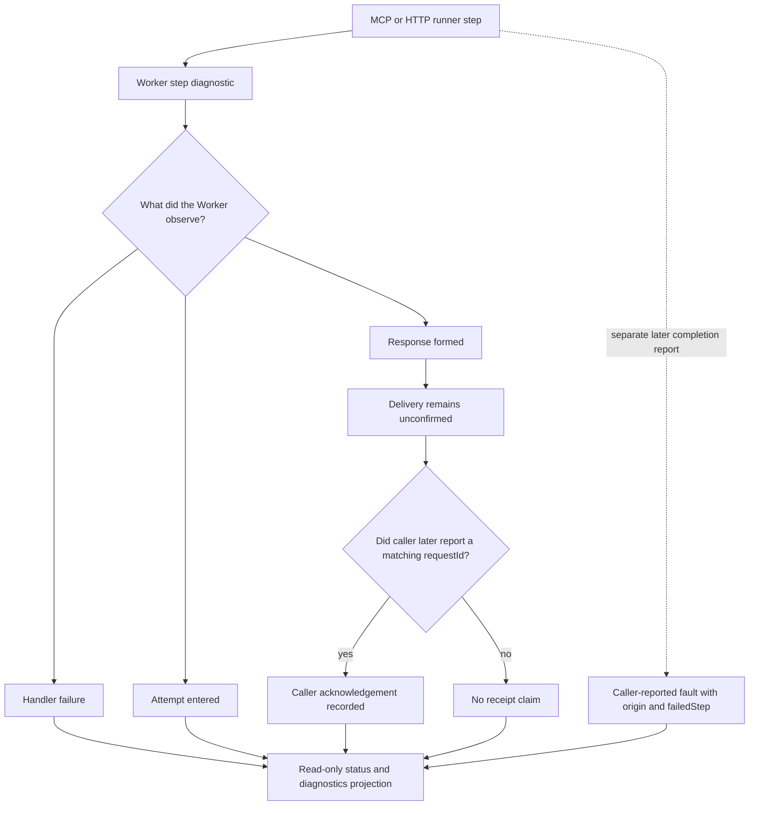

# Observability and failure attribution

A recorded server response is **not proof that a client received it**. Worker diagnostics, caller-attributed faults and historical evidence must remain distinct. Sources: [run diagnostics contract](../reference/api/run-diagnostics.md), [prediction diagnostics](../reference/api/prediction-diagnostics.md), [failure provenance ADR](../adr/0016-run-diagnostic-provenance.md) and [prediction operations](../runbooks/prediction-operations.md).

A step can be `entered`, `produced` or `failed`. The persisted server record retains `delivery: unconfirmed`; a later caller-supplied `receivedRequestId` can acknowledge only the matching step. External stops without attributed fault data remain `external_unattributed`. A caller's `origin` is recorded as a **caller report**, not reclassified as a server-observed cause. One item validation failure and retry backoff are not automatically system failures.

The owner-only diagnostic MCP tools [documented here](../reference/api/prediction-diagnostics.md) expose bounded queue state and per-film evidence; they do not themselves retry items, restart runs or migrate storage. Historical Events and dated investigation reports are **not** proof of present task scheduling, provider health or live flags. Always distinguish request attempt, formed response, caller acknowledgement, completed run and external Scheduled Task execution.

## EPG continuation step diagnostics

The same attempt / formed-response / failure distinction applies to the EPG resolver continuation. Each `epg_sync_step` or discovery resolve request that reaches the Worker handler is one **step entry** with two channels of different reliability. The Worker log gets an `entered` line before any storage access, a `checkpointed` line as soon as the step's discovery hop has stored its checkpoint, and a `completed` (a response was formed, whatever its status) or `failed` (the handler threw) line afterwards, all carrying the same entry `id`; this is the arrival evidence. The ring `epg/resolver-continuation-diagnostics.json` (last 20 entries, read through `GET /api/enrichment/pipeline/status` / `epg_pipeline_status` as `continuationDiagnostics`) receives the same entry best effort, `entered` first, `checkpointed` next and the outcome last, and the final log line says whether each write succeeded (`recorded`). A later step closes an entry that never got its terminal phase as `interrupted`, recording only what is known: whether the hop had committed (`true`/`false` from `checkpointed`, unknown from `entered`) and `cause: unknown`. The entry records the caller boundary (`mcp`, `http`, `internal`), the route and branch taken, the `discovery` contract returned and the `advanceDiscovery` trace: continuation record before, lease state, continuation health (whether a `running` record is a live writer or an orphan whose lease expired without a checkpoint), any orphan recovery taken (settled from the persisted chunk status, resumed, or closed on a generation conflict), decision, hop id, chunk outcome and the record after.

What the data can and cannot establish: a `completed` entry whose branch explains why no chunk was saved (`lease_live`, `contract` with `wait`/`stop`, `missing_secret`, a chunk `error`, or `saved.owned: false`) is server-observed; an `entered` log line with no outcome line of the same `id` shows the request was interrupted after arrival, and a `checkpointed` line without an outcome shows it was interrupted after its chunk committed; an `interrupted` ring entry shows the same when the outcome write failed or the isolate died. None of these proves an error or names a cause: the platform outcome of the invocation (for example `exceededMemory`) is a separate Workers Logs event joined through the request id. A series whose hops end before their checkpoint twice in a row fails closed (`interrupted`, `stop`) rather than being resumed by every scheduled call. A gated confirm can run one later chunk when the stored status shows that hop did not finish ([ADR 0088](../adr/0088-guarded-interrupted-discovery-recovery.md), Proposed); the hourly task still cannot, and a missing or contradictory checkpoint is `owner_investigation` rather than a guess at the cause. The absence of a ring entry is only *no persisted evidence* (the write can fail silently and 20 later steps evict it). The absence of both log lines within the log retention window shows that no request reached the Worker handler; it does not show where it stopped, because a request rejected by Cloudflare Access (`401`/`403`), dropped by the client or never sent leaves the same absence. Entries carry codes from closed vocabularies, UUIDs, timestamps and counts only (thrown messages are classified, never copied), and recording them never retries or dispatches anything. The fields are in [the MCP contract](../reference/api/mcp.md#continuation-diagnostics-air-151); the reading procedure is in [the connectivity runbook](../runbooks/mcp-connectivity.md#diagnosing-a-stalled-epg-continuation).

When `DISCOVERY_EXECUTOR` is absent, pipeline status does not add an executor field and these continuation diagnostics stay as they are. When it is `workflow` or `invalid`, `GET /api/enrichment/pipeline/status` adds a read-only `discoveryExecutor`: the configured mode, whether a Workflow instance is the owner, the generation, instance and series, the phase, what it is waiting for, the last chunk summary, recovery attempts and `recoveryDue`, whether the record is `stalled`, and whether work is still pending. A record that merely says `running` is not an owner once the platform reports that instance finished or absent, or once the record is older than 15 minutes and is not sleeping until a future `waitingUntil`. `degraded` stays true for an invalid mode, an uncertain or unknown phase, an unknown live status, a stall, a stop that still has a backlog, and a recovery wait or quarantine. The read does not create a Workflow or run a chunk. `delegated` on a continuation response means the request handed the series to that executor; it is not `complete`, and it is not written into the continuation record. EPG, discovery, predictions and ratings stay separate statuses.

A committed taste-profile publication records one `taste_profile` event after the current pointer moves ([Events](../reference/domain/events.md)). The pointer and the event are not one transaction. A failed event put leaves the committed profile in place and says so on the publication response. The recovery is a replay of that same publication request: it does not move current again and creates the missing event once, and only when the immutable version body is marked `tasteProfileEventExpected`. A version without that marker is left without an event. It does not scan older versions and it does not run from a schedule. `GET /api/events` is unchanged and is still not a safe production read.

## Proposed shared orchestration read model

For pipelines moved to Cloudflare executors, [ADR 0089](../adr/0089-shared-orchestration-reliability-contract.md) (Accepted; not yet implemented) specifies one `orchestration` read model per domain on the existing status routes ([fields](../reference/orchestration-reliability.md#read-model)). It separates a healthy wait or a scheduled cooldown from a stall: `waiting` and `cooldown` have a known future wake, while `stalled` has due work, no durable progress within the domain threshold and no future wake. Failures carry one class (`transient`, `permanent`, `unsafe`) and a fingerprint, with the consecutive and total counts against their caps. The same provenance rule applies: a formed response, a Workflow create or a lease is not durable progress; only a read-back checkpoint is. The read model is read-only and is the input for external alerts. It is not implemented in production; the diagnostics above remain the current evidence.

No live operations are introduced by this page.

## Ratings orchestration read model (AIR-347)

`ratings_sync_status.orchestration` is implemented and read-only: health idle/healthy/waiting/cooldown/stalled/quarantined/failed_permanent, stall threshold two hours after the 17:30 Madrid due time. A failed read yields `health: unknown` and does not break the status.
