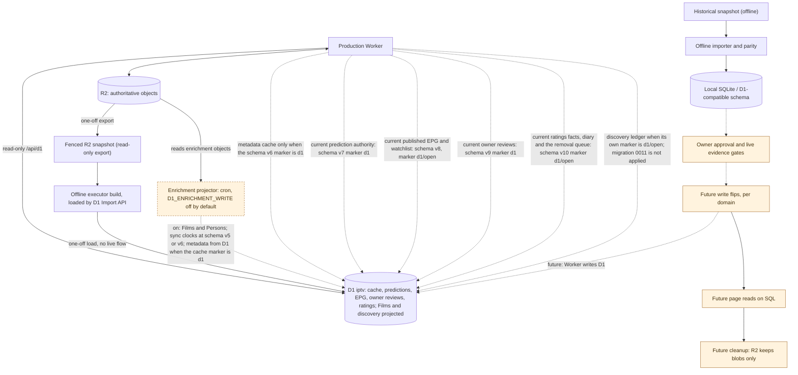

# Persistence authority and staged migration

**Current production (4 November 2026):** D1 `iptv` has schema v10 as of 2026-11-04 06:48 UTC ([ratings apply](../evidence/d1-migration/air-318-ratings-apply-2026-11-04.md)). The ratings marker was set to `d1` / `open` at generation 1 on 2026-11-04 08:02 UTC ([ratings activation](../evidence/d1-migration/air-318-ratings-activate-2026-11-04.md)), with 475 documents and 891 view rows. A manual MCP run at 08:28 UTC left generation 12 ([manual run](../evidence/d1-migration/air-318-ratings-manual-run-2026-11-04.md)). Readers and writers of those documents use D1 and do not fall back to R2. Metadata cache, the mutable prediction domain, published EPG/watchlist generation and owner reviews remain active as separate D1 authorities. The operator's 08:08 Madrid readback reported `published_epg_authority.mode=d1`, `cutover=open`, `generation=1`, `watchlist_generation=1` and `programme_run_id=71820185-3cc1-4303-b674-14293dca938b`. That was the activation baseline. At 20:22 UTC a daily-task-created EPG run completed after one explicitly owner-authorized step; read-only MCP status and downstream queue reads agree on newly published run `00ff34fa…`, and a fenced 22:09 UTC read-only comparison proved D1 member/show consistency and byte-identical R2 mirrors for generation 2 ([dated production evidence](../evidence/d1-migration/air-319-production-cutover-2026-11-03.md)). R2 remains authoritative for Films/Persons and discovery; published R2 JSON and pointer are compatibility mirrors. Ratings facts are D1. Owner reviews are D1-authoritative: `owner_review_authority.mode` is `d1` at generation 1 ([activation record](../evidence/d1-migration/air-314-owner-review-activate-2026-11-03.md)). Migration `0011` is not applied. Discovery stays on R2 until `0011` is applied and a separate marker GO sets `discovery_authority` to `d1` / `open` ([ADR 0085](../adr/0085-d1-authoritative-discovery.md), Accepted 2026-11-04). `0011` requires a complete schema v10, including the ratings tables. `D1_ENRICHMENT_WRITE=on` and the Film/Person projector continue independently.

The historical archive is not live production. Offline import receipts, schema compatibility and replay parity are evidence, not authorization. An incomplete or conflicting import must report gaps; it must not invent Film identities or silently omit unportable data. No R2/D1 shared transaction exists, so read/write migration must be staged with separate acceptance and recovery boundaries. Inside the future live backfill, the one large unit (a programme generation) is written to D1 staging tables in bounded chunks and published by one commit request ([ADR-0021](../adr/0021-staged-atomic-generation-import.md)); this changes no node or arrow above, and the staging tables are read by no runtime path.

The prediction family is portable only when every prediction record links an immutable version object. Records written before that rule were linked by a one-time, separately approved materialization inside the Worker (planned from a fenced snapshot, written under the prediction writer lease) that stayed within `worker <--> r2`; see [ADR-0026](../adr/0026-historical-prediction-version-materialization.md). It ran on 28 October 2026, before the backfill and not as part of it, and its route is retired ([ADR 0050](../adr/0050-retire-prediction-materialization-route.md)).

A fingerprint or prediction bundle stored under a retired Film id, whose survivor holds its own newer payload, is not imported: the importer records it as superseded by the canonical payload and leaves the object in R2 ([ADR-0029](../adr/0029-superseded-redirect-payloads.md)). This is a ledger rule inside the offline import and changes no node or arrow above.

Two R2 families stay R2-only and add no row ([ADR 0061](../adr/0061-discovery-observation-index-and-reconsider.md)):

- The discovery observation index under `epg/generations/<run>/discovery-observations/` is a derived projection of the ledger and the decisions and falls under the generation archive family.
- The guarded owner action records under `admin/actions/` are run records.

Both stay within `worker <--> r2` and change no node or arrow above.

The catalog poster negative index `epg/catalog-poster-negatives.json` ([ADR 0063](../adr/0063-catalog-poster-negative-index.md)) is the same kind of object: one R2 JSON the poster maintenance route reads and writes under its existing lease, classified with the other runtime coordination keys and not imported. It changes no node or arrow above.

Owner-reviewed localization is `admin/owner-reviews.json` while `owner_review_authority` is absent or its `mode` is `r2` ([ADR 0072](../adr/0072-owner-reviewed-localization-overlay.md), Accepted). The Film title route and the Person name route each replace one map and copy the other. Programme, watchlist, admin search and the D1 catalogue apply that overlay in memory onto the programme they already pinned. The overlay does not move the published EPG pointer, rewrite `programme.json`, or change watchlist order. [ADR 0081](../adr/0081-d1-authoritative-owner-reviews.md) (Accepted) adds the dashed Worker-to-D1 arrow labeled for owner reviews. That arrow is the live path when `owner_review_authority.mode` is `d1`. Production was activated at 2026-11-03 23:13 UTC: mode `d1`, generation 1, seven rows, and the object unchanged ([activation record](../evidence/d1-migration/air-314-owner-review-activate-2026-11-03.md)). The arrow itself was visually approved on 2026-11-02 ([owner decision](https://trello.com/c/RBxi5Pcf#comment-6ae7c9c667f360d012b09f40)). While the marker stays `r2`, D1 is not the authority for these reviews, a save claims `generation` before the object put, and the next projector run can copy an owner localization onto a dimension. That is the projector following R2, not the authority flip. Before the tables exist the projector does not read the object. While `mode` is `d1`, the projector reads the rows.

The immutable fingerprint body and generation record ([ADR-0035](../adr/0035-selective-fingerprint-transition-compatibility.md) section 2) that the current `fingerprint.json` names are mapped through it and add no row; older generations stay in R2 as unreferenced history. This is also a ledger rule inside the offline import and changes no node or arrow above.

The dashed projector arrow writes Films and Persons when `D1_ENRICHMENT_WRITE=on`. Sync clocks (`film_sync_state`) ride that same arrow at schema v5 or later ([ADR 0070](../adr/0070-metadatasync-freshness-clocks.md)). Production is schema v10, and the projector still writes only its enrichment domain. The cron and the flag do not change. The second dashed arrow is the metadata cache ([ADR 0073](../adr/0073-metadata-cache-d1-authority.md)). It follows `metadata_cache_authority.mode`, including when a later migration has raised the contract version past 6, as long as the cache tables and a valid marker are present. The third dashed arrow is the prediction domain ([ADR 0078](../adr/0078-d1-authoritative-prediction-domain.md)). It is unused while migration `0007` is absent or the marker is `r2`. On schema version 7 or newer an `r2` save advances `generation` and records an intent before the object put, and deletes that intent only after the put returns. A put that throws keeps the intent. `--apply` sends no statement until the operator has drained producers and the runner and writer leases are idle and readable. A deploy is not that drain. `--revert` writes and deletes only in the production bucket on the account endpoint, and a mirror it has already changed is reported as a partial or unknown write if a later mirror fails. Load and activation hold `writes` and refuse that intent. The queue is stored in chunks. The production operator sends each unit as one `{sql}` request. When the marker is `d1`, mutable prediction state is D1 and R2 keeps the immutable bodies and a mirror. The projector does not write that domain. At schema version 7 or newer, no prediction tables means that the domain is not installed: the projector remains valid and predictions stay on R2. A partial set of prediction tables, or a complete set without a valid marker, fails closed before a projection write. Production has applied `0007` and its prediction marker is `d1`. Cache rows stay unused while `metadata_cache_authority.mode` is absent or `r2`. On schema v6 an `r2` save advances `cache_generation` before the object put, so activation cannot commit under that writer. Production's cache marker is `d1`, so `beginSync` and `metadataSync` read and write the cache in D1, and the projector takes metadata records from that cache instead of from `metadata.json`. Version 6 or later without the cache tables or a valid marker fails that run before a write. The fourth dashed arrow is the published EPG ([ADR 0079](../adr/0079-d1-authoritative-published-epg.md), Accepted). Migration `0008` is applied, and a separate owner-approved activation made the published marker `d1/open`. That activation is refused unless the operator has acknowledged that every watchlist and EPG writer stays drained for the whole command. An idle lease sample is not that drain. Before activation, publication stayed on R2; it now uses D1 as authority, leaving R2 mirrors. The published-EPG arrow was [visually approved by the owner on 2026-11-01](https://trello.com/c/pQL8NUTC#comment-6ae7b1d91923578e9aaaca44); production activation is separately gated. The fifth dashed arrow is owner reviews ([ADR 0081](../adr/0081-d1-authoritative-owner-reviews.md), Accepted). **That arrow was visually approved on 2 November 2026. Production activation at 23:13 UTC on 3 November set the marker to `d1`, so the arrow is the live path.** Migration `0009` is applied and does not by itself set the marker. It refuses a database that is not already a complete version 8, so the supported order is `0007`, then `0008`, then `0009`. It does not move the cache marker, the prediction marker or the published-EPG marker.

The sixth dashed arrow is the ratings domain ([ADR 0084](../adr/0084-d1-authoritative-ratings.md), Accepted 2026-11-04). Migration `0010` was applied at 2026-11-04 06:48 UTC ([apply record](../evidence/d1-migration/air-318-ratings-apply-2026-11-04.md)). Production was a complete version 9, including the owner-review tables, and that was the operational path to version 10. The apply read back as `mode` `r2`, `cutover` `open`, generation 0, with no document rows and no view rows. A separate load at 2026-11-04 07:48 UTC copied 475 objects and rebuilt 891 view rows, and advanced the marker to generation 1. `mode` stayed `r2` and `cutover` stayed `open` ([load record](../evidence/d1-migration/air-318-ratings-load-2026-11-04.md)). The file still accepts a complete version 8 in tests. It does not rewrite `0009`, and `0009` does not install after the contract is already 10. The inserted marker is `mode` `r2` and `cutover` `open`. The arrow is the live path: activation at 2026-11-04 08:02 UTC set `mode` `d1` and `cutover` `open` at generation 1 ([activation record](../evidence/d1-migration/air-318-ratings-activate-2026-11-04.md)). A manual MCP run at 08:28 UTC left generation 12 ([manual run](../evidence/d1-migration/air-318-ratings-manual-run-2026-11-04.md)). While the marker was absent or `r2`, facts, the diary cursor and history, the ratings run and the removal queue stayed in R2. Those writers now use D1 and do not fall back to R2. Events, archive receipts, ZIP bytes and HTML snapshots stay in R2. **The earlier label of this arrow was [visually approved on 2026-11-04](https://github.com/vladimino/iptv-watchlist/pull/342#issuecomment-6620434921) while it was not live. The label now names the open marker, so the rendered diagram needs a fresh owner visual approval.**

The seventh dashed arrow is the discovery ledger ([ADR 0085](../adr/0085-d1-authoritative-discovery.md), Accepted 2026-11-04). It is unused until `0011` is applied and a later GO sets `discovery_authority` to `d1` with `cutover` `open`. Applying `0011` inserts `mode` `r2` and copies nothing. A deploy does not apply `0011`. `0011` refuses to run before a complete schema v10, including the ratings tables from `0010`. Production has that schema v10, and `0011` is still not applied. The arrow is not live.

The D1 data came through a one-off path, not a live flow: a fenced read-only snapshot of R2, a local build by the backfill executor, and one load through the D1 Import API ([runbook](../runbooks/d1-backfill.md)). The executor opens only the database `iptv`. Each unit is one multi-statement `{sql}` query, the request the scratch measurement sent, and a response that does not prove every statement is not sent again. There is no second database and no probe table ([ADR 0076](../adr/0076-backfill-single-database-batch.md)). This changes no node or arrow above. Between reloads, the active enrichment projector keeps D1 Films, Persons and credits following R2, and those rows may trail it by up to an hour. R2 stays the truth for those domains. The metadata cache is the exception: its marker is `d1`, so that working set is D1 and `metadata.json` is the mirror. Other domains (candidates, decisions, discovery) stay on R2 until their own steps; mutable predictions and the ratings documents are D1-authoritative. A reload seeds the projector's change keys and replays the D1-only steps ([runbook](../runbooks/d1-backfill.md#reload-with-the-enrichment-projector-air-275-phase-2)). The projector's enrichment objects include the optional owner-approved `identity/tmdb-retirements.json` ([ADR 0057](../adr/0057-tmdb-tv-identity-and-retired-movie-ids.md)): when it exists, the projection applies it and D1 follows the corrected identity like any other R2 change; the snapshot loader, the offline import and the seed read it the same way. This changes no node or arrow above.

`GET /api/d1/persons/<role>/<key>/identity` is a read-only D1 catalog read. It loads one person's neighborhood and calls the derived Person reference ([ADR 0062](../adr/0062-d1-person-identity-read.md)). The Finds actor and director filter is the one page reader of that GET ([ADR 0065](../adr/0065-finds-person-filter-d1-read.md)): it requests only a selected person, and it keeps a film only from an unbounded verified coCredit whose `film:tmdb:<n>` is the published catalog row's typed movie id. The watchlist grid still matches the stored role id. R2 stays the authority. This changes no node or arrow above.

**Not deployed:** a general write flip and a general page cutover onto SQL. The metadata cache, mutable predictions, published EPG and owner reviews are four activated D1 domains. The cache marker is `d1`, so `beginSync` and `metadataSync` treat that cache as the working set and `metadata.json` as the mirror. The prediction marker is also `d1`, and the runner persists mutable state in D1 with immutable bodies in R2. Films, Persons and discovery are not D1-authoritative; metadata cache, mutable predictions, published EPG, owner reviews and ratings are. The discovery arrow is not that authority. The published EPG arrow now documents the active D1 marker; its first actual post-cutover generation was successfully published by manual continuation of a scheduled run, while raw D1/R2 and consumer acceptance are still gated. Owner reviews are a separate activated domain: the marker is `d1` at generation 1. The Finds person filter above is a reader of one GET, not that cutover. The remaining steps are the phases of [AIR-275](https://trello.com/c/4x7hH0gI): per-domain write flips (D1 becomes the truth, the R2 JSON stays a cache for pages not yet moved), page reads on SQL, then a cleanup that leaves R2 holding blobs only. The earlier shadow-write and shadow-read stages were dropped by the owner as disproportionate for this project. Each orange node is a planned step, not a claim that it is done or an instruction to perform it.
