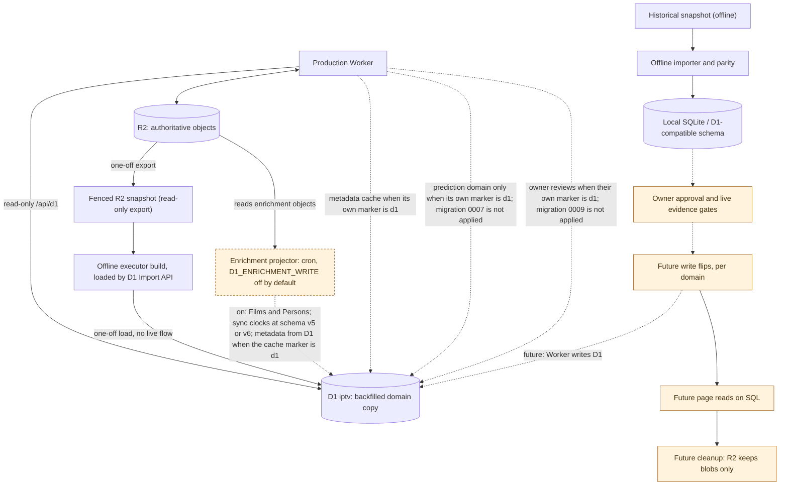

# Persistence authority and staged migration

**Production today:** R2 bucket `iptv` is authoritative for Films, Persons, EPG, predictions, ratings and the other domains. The D1 database `iptv` carries schema v6 and a backfilled copy of that R2 domain. Migration `0006` is applied. Migration `0007` is not applied, so the prediction marker does not exist and predictions stay on R2 ([ADR 0078](../adr/0078-d1-authoritative-prediction-domain.md)). Migration `0009` is not applied, so owner reviews stay on `admin/owner-reviews.json` ([ADR 0081](../adr/0081-d1-authoritative-owner-reviews.md), Proposed). The metadata cache marker is `d1`: `beginSync` and `metadataSync` use `metadata_cache`, and `metadata.json` is the mirror ([cutover](../evidence/d1-migration/air-313-metadata-cache-cutover-2026-11-01.md)). That is the only D1 authority. The Worker is bound to the database and pages read it only through the read-only [D1 catalog views](../reference/api/d1-catalog.md). The [enrichment projector](../adr/0056-d1-enrichment-write-through.md) is deployed and enabled in production (`D1_ENRICHMENT_WRITE=on`); it keeps D1's Films, Persons and credits following authoritative R2, and it reads metadata records from the cache while the marker is `d1`. The flag's absent/off default shown in the diagram is a deployment safeguard, not the current production setting. See [D1 contract](../reference/data/d1-schema.md), [ADR-0001](../adr/0001-d1-schema-v1.md), [migration ADR](../adr/0017-staged-d1-migration.md) and [offline evidence](../evidence/d1-migration/air-73-offline-run.md).

The historical archive is not live production. Offline import receipts, schema compatibility and replay parity are evidence, not authorization. An incomplete or conflicting import must report gaps; it must not invent Film identities or silently omit unportable data. No R2/D1 shared transaction exists, so read/write migration must be staged with separate acceptance and recovery boundaries. Inside the future live backfill, the one large unit (a programme generation) is written to D1 staging tables in bounded chunks and published by one commit request ([ADR-0021](../adr/0021-staged-atomic-generation-import.md)); this changes no node or arrow above, and the staging tables are read by no runtime path.

The prediction family is portable only when every prediction record links an immutable version object. Records written before that rule were linked by a one-time, separately approved materialization inside the Worker (planned from a fenced snapshot, written under the prediction writer lease) that stayed within `worker <--> r2`; see [ADR-0026](../adr/0026-historical-prediction-version-materialization.md). It ran on 28 October 2026, before the backfill and not as part of it, and its route is retired ([ADR 0050](../adr/0050-retire-prediction-materialization-route.md)).

A fingerprint or prediction bundle stored under a retired Film id, whose survivor holds its own newer payload, is not imported: the importer records it as superseded by the canonical payload and leaves the object in R2 ([ADR-0029](../adr/0029-superseded-redirect-payloads.md)). This is a ledger rule inside the offline import and changes no node or arrow above.

Two R2 families stay R2-only and add no row ([ADR 0061](../adr/0061-discovery-observation-index-and-reconsider.md)):

- The discovery observation index under `epg/generations/<run>/discovery-observations/` is a derived projection of the ledger and the decisions and falls under the generation archive family.
- The guarded owner action records under `admin/actions/` are run records.

Both stay within `worker <--> r2` and change no node or arrow above.

The catalog poster negative index `epg/catalog-poster-negatives.json` ([ADR 0063](../adr/0063-catalog-poster-negative-index.md)) is the same kind of object: one R2 JSON the poster maintenance route reads and writes under its existing lease, classified with the other runtime coordination keys and not imported. It changes no node or arrow above.

Owner-reviewed localization is `admin/owner-reviews.json` while `owner_review_authority` is absent or its `mode` is `r2` ([ADR 0072](../adr/0072-owner-reviewed-localization-overlay.md), Accepted). The Film title route and the Person name route each replace one map and copy the other. Programme, watchlist, admin search and the D1 catalogue apply that overlay in memory onto the programme they already pinned. The overlay does not move the published EPG pointer, rewrite `programme.json`, or change watchlist order. [ADR 0081](../adr/0081-d1-authoritative-owner-reviews.md) (Proposed) adds the dashed Worker-to-D1 arrow labeled for owner reviews. That arrow is used only when `owner_review_authority.mode` is `d1`. Migration `0009` is not applied, so production has no such marker and the arrow is not live. **The new arrow is proposed for visual review.** Until the marker is `d1`, D1 is not the authority for these reviews. Before the tables exist the projector does not read the object. After they exist, and while the marker stays `r2`, the next projector run can copy an owner localization onto a dimension; that is the projector following R2, not the authority flip.

The immutable fingerprint body and generation record ([ADR-0035](../adr/0035-selective-fingerprint-transition-compatibility.md) section 2) that the current `fingerprint.json` names are mapped through it and add no row; older generations stay in R2 as unreferenced history. This is also a ledger rule inside the offline import and changes no node or arrow above.

The dashed projector arrow writes Films and Persons when `D1_ENRICHMENT_WRITE=on`. Sync clocks (`film_sync_state`) ride that same arrow at schema v5 or later ([ADR 0070](../adr/0070-metadatasync-freshness-clocks.md)). Production is schema v6, so that write is the current cron. The cron and the flag do not change. The metadata-cache arrow ([ADR 0073](../adr/0073-metadata-cache-d1-authority.md)) follows `metadata_cache_authority.mode`, including when a later migration has raised the contract version past 6, as long as the cache tables and a valid marker are present. The prediction arrow ([ADR 0078](../adr/0078-d1-authoritative-prediction-domain.md)) is unused while migration `0007` is unapplied or the marker is `r2`. On schema version 7 or newer an `r2` save advances `generation` and records an intent before the object put, and deletes that intent only after the put returns. A put that throws keeps the intent. `--apply` sends no statement until the operator has drained producers and the runner and writer leases are idle and readable. A deploy is not that drain. `--revert` writes and deletes only in the production bucket on the account endpoint, and a mirror it has already changed is reported as a partial or unknown write if a later mirror fails. Load and activation hold `writes` and refuse that intent. The queue is stored in chunks. The production operator sends each unit as one `{sql}` request. When the marker is `d1`, mutable prediction state is D1 and R2 keeps the immutable bodies and a mirror. The projector does not write that domain. At schema version 7 or newer, no prediction tables means that the domain is not installed: the projector remains valid and predictions stay on R2. A partial set of prediction tables, or a complete set without a valid marker, fails closed before a projection write. Production has not applied `0007`. Cache rows stay unused while `metadata_cache_authority.mode` is absent or `r2`. On schema v6 an `r2` save advances `cache_generation` before the object put, so activation cannot commit under that writer. Production's cache marker is `d1`, so `beginSync` and `metadataSync` read and write the cache in D1, and the projector takes metadata records from that cache instead of from `metadata.json`. Version 6 or later without the cache tables or a valid marker fails that run before a write. The owner-review arrow is the separate marker above. It does not move the cache marker or the prediction marker, and neither of those markers moves it. Migration `0009` is not applied.

The D1 data came through a one-off path, not a live flow: a fenced read-only snapshot of R2, a local build by the backfill executor, and one load through the D1 Import API ([runbook](../runbooks/d1-backfill.md)). The executor opens only the database `iptv`. Each unit is one multi-statement `{sql}` query, the request the scratch measurement sent, and a response that does not prove every statement is not sent again. There is no second database and no probe table ([ADR 0076](../adr/0076-backfill-single-database-batch.md)). This changes no node or arrow above. Between reloads, the active enrichment projector keeps D1 Films, Persons and credits following R2, and those rows may trail it by up to an hour. R2 stays the truth for those domains. The metadata cache is the exception: its marker is `d1`, so that working set is D1 and `metadata.json` is the mirror. Other domains (candidates, decisions, predictions, ratings) follow R2 only through a reload until their own step. A reload seeds the projector's change keys and replays the D1-only steps ([runbook](../runbooks/d1-backfill.md#reload-with-the-enrichment-projector-air-275-phase-2)). The projector's enrichment objects include the optional owner-approved `identity/tmdb-retirements.json` ([ADR 0057](../adr/0057-tmdb-tv-identity-and-retired-movie-ids.md)): when it exists, the projection applies it and D1 follows the corrected identity like any other R2 change; the snapshot loader, the offline import and the seed read it the same way. This changes no node or arrow above.

`GET /api/d1/persons/<role>/<key>/identity` is a read-only D1 catalog read. It loads one person's neighborhood and calls the derived Person reference ([ADR 0062](../adr/0062-d1-person-identity-read.md)). The Finds actor and director filter is the one page reader of that GET ([ADR 0065](../adr/0065-finds-person-filter-d1-read.md)): it requests only a selected person, and it keeps a film only from an unbounded verified coCredit whose `film:tmdb:<n>` is the published catalog row's typed movie id. The watchlist grid still matches the stored role id. R2 stays the authority. This changes no node or arrow above.

**Not deployed:** a general write flip and a general page cutover onto SQL. The metadata cache is the exception already in production: its marker is `d1`, so `beginSync` and `metadataSync` treat that cache as the working set and `metadata.json` as the mirror. Owner reviews are not that exception. Their marker does not exist until `0009` is applied, and applying the file leaves it at `r2`. Films, Persons, EPG, predictions, ratings and the other domains are not D1-authoritative. The Finds person filter above is a reader of one GET, not that cutover. The remaining steps are the phases of [AIR-275](https://trello.com/c/4x7hH0gI): per-domain write flips (D1 becomes the truth, the R2 JSON stays a cache for pages not yet moved), page reads on SQL, then a cleanup that leaves R2 holding blobs only. The earlier shadow-write and shadow-read stages were dropped by the owner as disproportionate for this project. Each orange node is a planned step, not a claim that it is done or an instruction to perform it.
