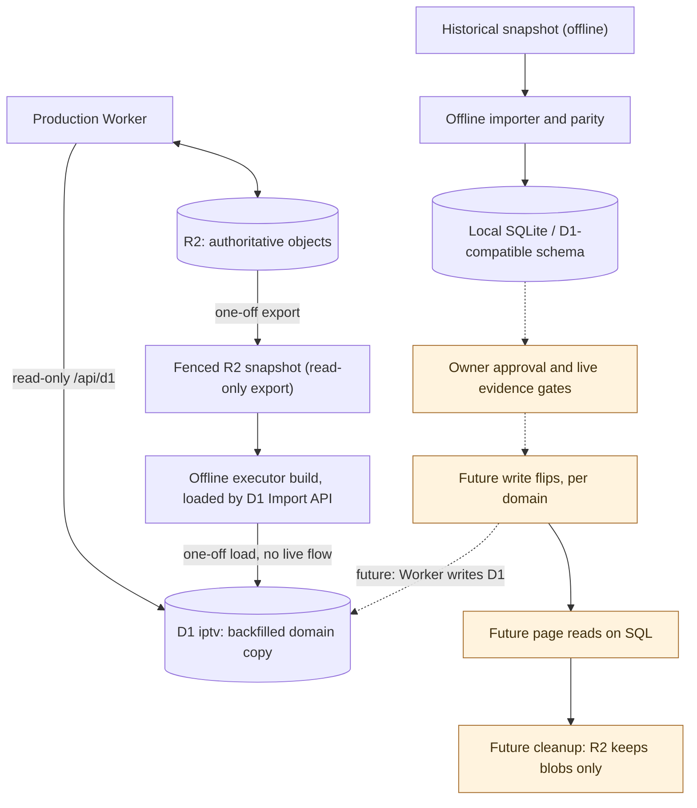

# Persistence authority and staged migration

**Production today:** R2 bucket `iptv` is authoritative. The D1 database `iptv` carries schema v3 and a backfilled copy of the R2 domain (Films, Persons, credits, candidates, decisions, predictions and fingerprint pointers). The Worker is bound to it and reads it only through the read-only [D1 catalog views](../reference/api/d1-catalog.md); no writer uses it yet. See [D1 contract](../reference/data/d1-schema.md), [ADR-0001](../adr/0001-d1-schema-v1.md), [migration ADR](../adr/0017-staged-d1-migration.md) and [offline evidence](../evidence/d1-migration/air-73-offline-run.md).

The historical archive is not live production. Offline import receipts, schema compatibility and replay parity are evidence, not authorization. An incomplete or conflicting import must report gaps; it must not invent Film identities or silently omit unportable data. No R2/D1 shared transaction exists, so read/write migration must be staged with separate acceptance and recovery boundaries. Inside the future live backfill, the one large unit (a programme generation) is written to D1 staging tables in bounded chunks and published by one commit request ([ADR-0021](../adr/0021-staged-atomic-generation-import.md)); this changes no node or arrow above, and the staging tables are read by no runtime path.

The prediction family is portable only when every prediction record links an immutable version object. Records written before that rule are linked by a one-time, separately approved materialization inside the Worker (planned from a fenced snapshot, written under the prediction writer lease) that stays within `worker <--> r2`; see [ADR-0026](../adr/0026-historical-prediction-version-materialization.md). It precedes the backfill and is not part of it.

A fingerprint or prediction bundle stored under a retired Film id, whose survivor holds its own newer payload, is not imported: the importer records it as superseded by the canonical payload and leaves the object in R2 ([ADR-0029](../adr/0029-superseded-redirect-payloads.md)). This is a ledger rule inside the offline import and changes no node or arrow above.

The immutable fingerprint body and generation record ([ADR-0035](../adr/0035-selective-fingerprint-transition-compatibility.md) section 2) that the current `fingerprint.json` names are mapped through it and add no row; older generations stay in R2 as unreferenced history. This is also a ledger rule inside the offline import and changes no node or arrow above.

The D1 data came through a one-off path, not a live flow: a fenced read-only snapshot of R2, a local build by the backfill executor, and one load through the D1 Import API ([runbook](../runbooks/d1-backfill.md)). D1 does not follow R2 until a write flip makes the Worker write D1 directly, or until a separately approved reload repeats that path.

**Not deployed:** any D1 writer in the Worker and any existing page reading D1. The remaining steps are the phases of [AIR-275](https://trello.com/c/4x7hH0gI): per-domain write flips (D1 becomes the truth, the R2 JSON stays a cache for pages not yet moved), page reads on SQL, then a cleanup that leaves R2 holding blobs only. The earlier shadow-write and shadow-read stages were dropped by the owner as disproportionate for this project. Each orange node is a planned step, not a claim that it is done or an instruction to perform it.
