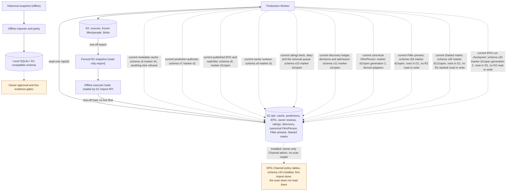

# Persistence authority and staged migration

**Current production (16 November 2026 UTC):** D1 `iptv` is schema **23**. Canonical Film/Person is D1-authoritative (`film_person_authority` `mode=d1`, `cutover=open`, generation 2, [open evidence](../evidence/d1-migration/air-499-film-person-open-2026-11-16.md)): fenced adapters write; the enrichment projector that was compare-only for that domain was removed in AIR-537 slice 3; frozen R2 `titles.json` / `people.json` are not a fallback. Discovery (`d1`/`open`), ratings (`d1`/`open`, generation 12), published EPG/watchlist (`d1`/`open`), owner reviews (`d1`, generation 1), metadata cache and mutable predictions remain separately activated D1 authorities. The hourly cron does not call the projector ([ADR 0155](../adr/0155-retire-enrichment-projector-cron.md)); `D1_ENRICHMENT_WRITE` is retired and ignored. Canonical Film/Person writes stay on the fenced adapters.

**Historical (4 November 2026):** D1 `iptv` had schema v11 as of 2026-11-04 12:45 UTC ([discovery apply](../evidence/d1-migration/air-320-discovery-apply-2026-11-04.md)). Schema v10 landed at 06:48 UTC ([ratings apply](../evidence/d1-migration/air-318-ratings-apply-2026-11-04.md)). The ratings marker was set to `d1` / `open` at generation 1 on 2026-11-04 08:02 UTC ([ratings activation](../evidence/d1-migration/air-318-ratings-activate-2026-11-04.md)), with 475 documents and 891 view rows. A manual MCP run at 08:28 UTC left generation 12 ([manual run](../evidence/d1-migration/air-318-ratings-manual-run-2026-11-04.md)). Readers and writers of those documents use D1 and do not fall back to R2. Metadata cache, the mutable prediction domain, published EPG/watchlist generation and owner reviews remain active as separate D1 authorities. The operator's 08:08 Madrid readback reported `published_epg_authority.mode=d1`, `cutover=open`, `generation=1`, `watchlist_generation=1` and `programme_run_id=71820185-3cc1-4303-b674-14293dca938b`. That was the activation baseline. At 20:22 UTC a daily-task-created EPG run completed after one explicitly owner-authorized step; read-only MCP status and downstream queue reads agree on newly published run `00ff34fa…`, and a fenced 22:09 UTC read-only comparison proved D1 member/show consistency and byte-identical R2 mirrors for generation 2 ([dated production evidence](../evidence/d1-migration/air-319-production-cutover-2026-11-03.md)). Discovery is D1-authoritative: `discovery_authority.mode` is `d1`, `cutover` is `open`, generation 1, 36999 observations ([activation record](../evidence/d1-migration/air-320-discovery-activate-2026-11-04.md)). Ratings facts are D1. Owner reviews are D1-authoritative: `owner_review_authority.mode` is `d1` at generation 1 ([activation record](../evidence/d1-migration/air-314-owner-review-activate-2026-11-03.md)). Canonical Film/Person was not yet `open` on that date.

Assigned Discovery rows live in the same published-EPG tables as the sealed scan: `published_epg_show` with `basis='discovery'`, under the published `programme_run_id`. They are not a second store and they do not move `published_epg_authority.generation`. The R2 programme objects stay compatibility mirrors of the completed read ([ADR 0142](../adr/0142-epg-owned-generation-addressed-discovery-slots.md)). The flowchart above is unchanged.

A Letterboxd lid whose `watchlist` fact (`ratings_view`) is a boolean stays in the enrichment view after the current programme and watchlist drop it ([ADR 0086](../adr/0086-durable-watchlist-film-retention.md), Accepted). Historical (the enrichment projector was removed in AIR-537 slice 3; no deploy upserts a Film from this view now): while the projector was enabled, a deploy of this view would have upserted a Film that view newly contained and would still have removed only watchlist membership when a Film left the view. An admitted lid with no usable metadata does not replace credits, metadata, trusted external ids or identity dimensions already stored. At `open` the Film is D1-authoritative; this retention view is not a second R2 authority. The flowchart labels current authority. Rows with no watchlist boolean are not imported by that run.

User reads of the D1 catalog (`discovered-films.json`) close on authority, programme run and transfer, not on every bump of `discovery_authority.generation`. Continuation and status writers still increment that generation for paged ledger and decision walks (historically also for the projector, removed in AIR-537 slice 3). The flowchart above is unchanged ([ADR 0147](../adr/0147-discovery-user-read-snapshot-fence.md)).

Historical (the projector was removed in AIR-537 slice 3; nothing reads these inputs this way now): while the discovery authority was D1, the projector read the discovery inputs through that authority and not from R2: the catalog of the published generation (the `epg/generations/<run>/discovered-films.json` key, which has no R2 object under D1 authority) and the shared decisions (`epg/discovery-resolution.json`, whose R2 object is frozen at the cutover). A read that was D1-owned never falls back to R2, and the authority (ready D1 mode, cutover, run, generation) is checked again right before the D1 write, the counterpart of the etag check on an R2 input: any change defers the run with nothing written. Only an authority that is not D1 when the run begins keeps the R2 objects as the source ([AIR-375 evidence](../evidence/d1-migration/air-375-projector-input-missing-2026-11-07.md)). The diagram below does not draw the authority read.

Historical: the same projector also read `letterboxd/admissions/verified-films.json` ([ADR 0087](../adr/0087-rated-archive-film-admission.md), Accepted). A missing object admits nobody, so deploying that read does not upsert a rated-only Film. A present object is a verified movie id with no watchlist membership. When that object already carries synopsis or credits, the projector copies those fields and still does not mint a second Film. A richer discovered film of the same movie id replaces a thin archive stub. An identity step that writes the object, followed by this cron, would upsert that Film, and that write is a separate owner approval. Metadata of the rated film is a later explicit identity request, not this cron. The flowchart above stays unchanged.

The historical archive is not live production. Offline import receipts, schema compatibility and replay parity are evidence, not authorization. An incomplete or conflicting import must report gaps; it must not invent Film identities or silently omit unportable data. No R2/D1 shared transaction exists, so read/write migration must be staged with separate acceptance and recovery boundaries. Inside the future live backfill, the one large unit (a programme generation) is written to D1 staging tables in bounded chunks and published by one commit request ([ADR-0021](../adr/0021-staged-atomic-generation-import.md)); this changes no node or arrow above, and the staging tables are read by no runtime path.

The prediction family is portable only when every prediction record links an immutable version object. Records written before that rule were linked by a one-time, separately approved materialization inside the Worker (planned from a fenced snapshot, written under the prediction writer lease) that stayed within `worker <--> r2`; see [ADR-0026](../adr/0026-historical-prediction-version-materialization.md). It ran on 28 October 2026, before the backfill and not as part of it, and its route is retired ([ADR 0050](../adr/0050-retire-prediction-materialization-route.md)).

The batch runner v2 may also write one create-only R2 object per prediction version, `enrichment/films/<filmId>/predictions/assessments/<predictionSha256>.json` ([ADR 0132](../adr/0132-prediction-assessment-artifact.md)): a private per-film diagnostic that stays inside `worker <--> r2`, adds no D1 row, pointer, index or projector input (the D1 enrichment projector, removed in AIR-537 slice 3, never read that prefix) and is read only through the controlled read-only R2 snapshot export, whose full-bucket listing includes the prefix. This changes no node or arrow above.

A fingerprint or prediction bundle stored under a retired Film id, whose survivor holds its own newer payload, is not imported: the importer records it as superseded by the canonical payload and leaves the object in R2 ([ADR-0029](../adr/0029-superseded-redirect-payloads.md)). This is a ledger rule inside the offline import and changes no node or arrow above.

Since ADR 0218 stage 2 ([AIR-661](https://trello.com/c/1Rv634jd)) the offline import writes only to a target carrying the offline import target contract (a write gate keyed on its own session, never installed on production D1), keeps control and unknown-legacy identity and localization rows and the title they protect, leaves `metadata`, `fingerprint` and `prediction` dimension rows untouched, and its retirement refuses a Film holding a protected row. These are rules inside the offline import and change no node or arrow above; see the [D1 schema contract](../reference/data/d1-schema.md).

Two R2 families stay R2-only and add no row ([ADR 0061](../adr/0061-discovery-observation-index-and-reconsider.md)):

- The discovery observation index under `epg/generations/<run>/discovery-observations/` is a derived projection of the ledger and the decisions and falls under the generation archive family.
- The guarded owner action records under `admin/actions/` are run records.

Both stay within `worker <--> r2` and change no node or arrow above.

With Discovery `d1`/`open` the catalog poster is a field of the `discovery_admission` payload and its one writer is `DiscoveryAuthority.applyPosters` (AIR-515); the R2 catalog objects are not written by poster hydration.
The catalog poster negative index `epg/catalog-poster-negatives.json` ([ADR 0063](../adr/0063-catalog-poster-negative-index.md)) is the same kind of object: one R2 JSON the poster maintenance route reads and writes under its existing lease, classified with the other runtime coordination keys and not imported. It changes no node or arrow above.

Owner-reviewed localization is `admin/owner-reviews.json` while `owner_review_authority` is absent or its `mode` is `r2` ([ADR 0072](../adr/0072-owner-reviewed-localization-overlay.md), Accepted). The Film title route and the Person name route each replace one map and copy the other. Programme, watchlist, admin search and the D1 catalogue apply that overlay in memory onto the programme they already pinned. The overlay does not move the published EPG pointer, rewrite `programme.json`, or change watchlist order. [ADR 0081](../adr/0081-d1-authoritative-owner-reviews.md) (Accepted) adds the dashed Worker-to-D1 arrow labeled for owner reviews. That arrow is the live path when `owner_review_authority.mode` is `d1`. Production was activated at 2026-11-03 23:13 UTC: mode `d1`, generation 1, seven rows, and the object unchanged ([activation record](../evidence/d1-migration/air-314-owner-review-activate-2026-11-03.md)). The arrow itself was visually approved on 2026-11-02 ([owner decision](https://trello.com/c/RBxi5Pcf#comment-6ae7c9c667f360d012b09f40)). Historical (the projector described in this passage was removed in AIR-537 slice 3; production owner reviews are `d1`): while the marker stayed `r2`, D1 was not the authority for these reviews, a save claimed `generation` before the object put, and the next projector run can copy an owner localization onto a dimension. That is the projector following R2, not the authority flip. Before the tables exist the projector does not read the object. While `mode` is `d1`, the projector reads the rows.

The immutable fingerprint body and generation record ([ADR-0035](../adr/0035-selective-fingerprint-transition-compatibility.md) section 2) that the current `fingerprint.json` names are mapped through it and add no row; older generations stay in R2 as unreferenced history. This is also a ledger rule inside the offline import and changes no node or arrow above.

The enrichment projector is not part of the current production flow and has no node above: its hourly invocation is retired ([ADR 0155](../adr/0155-retire-enrichment-projector-cron.md), Accepted) and its selectors are removed, so the projector code was removed in AIR-537 slice 3 and the paragraphs about it on this page are historical context. Canonical Film/Person writes, including canonical `film_sync_state`, are the fenced adapters (`metadata_sync` and the other producer units) while `film_person_authority` is `d1`/`open` (generation 2). Historically, sync clocks for domains the projector then owned rode projector batches at schema v5 or later ([ADR 0070](../adr/0070-metadatasync-freshness-clocks.md)). Production is schema 23. A first natural Producer Workflow pass at `open` is unproven. The next dashed arrow is the metadata cache ([ADR 0073](../adr/0073-metadata-cache-d1-authority.md)). It follows `metadata_cache_authority.mode`, including when a later migration has raised the contract version past 6, as long as the cache tables and a valid marker are present. The third dashed arrow is the prediction domain ([ADR 0078](../adr/0078-d1-authoritative-prediction-domain.md)). It is unused while migration `0007` is absent or the marker is `r2`. On schema version 7 or newer an `r2` save advances `generation` and records an intent before the object put, and deletes that intent only after the put returns. A put that throws keeps the intent. `--apply` sends no statement until the operator has drained producers and the runner and writer leases are idle and readable. A deploy is not that drain. `--revert` writes and deletes only in the production bucket on the account endpoint, and a mirror it has already changed is reported as a partial or unknown write if a later mirror fails. Load and activation hold `writes` and refuse that intent. The queue is stored in chunks. The production operator sends each unit as one `{sql}` request. When the marker is `d1`, mutable prediction state is D1 and R2 keeps the immutable bodies and a mirror. The projector does not write that domain. At schema version 7 or newer, no prediction tables means that the domain is not installed: the projector remains valid and predictions stay on R2. A partial set of prediction tables, or a complete set without a valid marker, fails closed before a projection write. Production has applied `0007` and its prediction marker is `d1`. Cache rows stay unused while `metadata_cache_authority.mode` is absent or `r2`. On schema v6 an `r2` save advances `cache_generation` before the object put, so activation cannot commit under that writer. Production's cache marker is `d1`, so `beginSync` and `metadataSync` read and write the cache in D1, and the projector takes metadata records from that cache instead of from `metadata.json`. Version 6 or later without the cache tables or a valid marker fails that run before a write. The fourth dashed arrow is the published EPG ([ADR 0079](../adr/0079-d1-authoritative-published-epg.md), Accepted). Migration `0008` is applied, and a separate owner-approved activation made the published marker `d1/open`. That activation is refused unless the operator has acknowledged that every watchlist and EPG writer stays drained for the whole command. An idle lease sample is not that drain. Before activation, publication stayed on R2; it now uses D1 as authority, leaving R2 mirrors. The published-EPG arrow was [visually approved by the owner on 2026-11-01](https://trello.com/c/pQL8NUTC#comment-6ae7b1d91923578e9aaaca44); production activation is separately gated. The fifth dashed arrow is owner reviews ([ADR 0081](../adr/0081-d1-authoritative-owner-reviews.md), Accepted). **That arrow was visually approved on 2 November 2026. Production activation at 23:13 UTC on 3 November set the marker to `d1`, so the arrow is the live path.** Migration `0009` is applied and does not by itself set the marker. It refuses a database that is not already a complete version 8, so the supported order is `0007`, then `0008`, then `0009`. It does not move the cache marker, the prediction marker or the published-EPG marker.

The sixth dashed arrow is the ratings domain ([ADR 0084](../adr/0084-d1-authoritative-ratings.md), Accepted 2026-11-04). Migration `0010` was applied at 2026-11-04 06:48 UTC ([apply record](../evidence/d1-migration/air-318-ratings-apply-2026-11-04.md)). Production was a complete version 9, including the owner-review tables, and that was the operational path to version 10. The apply read back as `mode` `r2`, `cutover` `open`, generation 0, with no document rows and no view rows. A separate load at 2026-11-04 07:48 UTC copied 475 objects and rebuilt 891 view rows, and advanced the marker to generation 1. `mode` stayed `r2` and `cutover` stayed `open` ([load record](../evidence/d1-migration/air-318-ratings-load-2026-11-04.md)). The file still accepts a complete version 8 in tests. It does not rewrite `0009`, and `0009` does not install after the contract is already 10. The inserted marker is `mode` `r2` and `cutover` `open`. The arrow is the live path: activation at 2026-11-04 08:02 UTC set `mode` `d1` and `cutover` `open` at generation 1 ([activation record](../evidence/d1-migration/air-318-ratings-activate-2026-11-04.md)). A manual MCP run at 08:28 UTC left generation 12 ([manual run](../evidence/d1-migration/air-318-ratings-manual-run-2026-11-04.md)). While the marker was absent or `r2`, facts, the diary cursor and history, the ratings run and the removal queue stayed in R2. Those writers now use D1 and do not fall back to R2. Events, archive receipts, ZIP bytes and HTML snapshots stay in R2. **The earlier label of this arrow was [visually approved on 2026-11-04](https://github.com/vladimino/iptv-watchlist/pull/342#issuecomment-6620434921) while it was not live. The label now names the open marker, so the rendered diagram needs a fresh owner visual approval.**

The seventh dashed arrow is the discovery ledger ([ADR 0085](../adr/0085-d1-authoritative-discovery.md), Accepted 2026-11-04). Migration `0011` was applied at 2026-11-04 12:45 UTC ([apply record](../evidence/d1-migration/air-320-discovery-apply-2026-11-04.md)). The apply left `mode` `r2`, generation 0 and no observations. A later load stored 36999 observations. Activation at 22:27 UTC set `mode` `d1` and `cutover` `open` at generation 1 ([activation record](../evidence/d1-migration/air-320-discovery-activate-2026-11-04.md)). A deploy does not apply `0011`. The arrow is the live path. The D1 node names discovery and canonical Film/Person as authoritative domains. **The Film/Person node and projector labels changed after the 16 Nov 2026 `open` flip; the rendered diagram needs a fresh visual review (routine Mermaid, not a new ADR).**

The D1 data came through a one-off path, not a live flow: a fenced read-only snapshot of R2, a local build by the backfill executor, and one load through the D1 Import API ([runbook](../runbooks/d1-backfill.md)). The executor opens only the database `iptv`. Each unit is one multi-statement `{sql}` query, the request the scratch measurement sent, and a response that does not prove every statement is not sent again. There is no second database and no probe table ([ADR 0076](../adr/0076-backfill-single-database-batch.md)). This changes no node or arrow above. **Historical (before 16 Nov 2026 UTC):** between reloads the enrichment projector kept D1 Films, Persons and credits following R2, and those rows could trail it by up to an hour. R2 was then the truth for those domains. **Current:** canonical Film/Person is `d1`/`open` generation 2 and the fenced adapters are its writers; the enrichment projector was removed in AIR-537 slice 3; frozen R2 `titles.json` / `people.json` are not a fallback. The metadata cache remains D1 with `metadata.json` as the mirror. Mutable predictions, ratings documents and discovery stay D1-authoritative on their own markers. **Historical (retired in AIR-537 slice 3):** a reload used to seed the projector's change keys and replay the D1-only steps ([runbook](../runbooks/d1-backfill.md#reload-with-the-enrichment-projector-air-275-phase-2), now non-executable), and the projector's enrichment objects included the optional owner-approved `identity/tmdb-retirements.json` ([ADR 0057](../adr/0057-tmdb-tv-identity-and-retired-movie-ids.md)), which it applied so that D1 followed the corrected identity like any other R2 change. Nothing applies that object now. This changes no node or arrow above.

`GET /api/d1/persons/<role>/<key>/identity` is a read-only D1 catalog read. It loads one person's neighborhood and calls the derived Person reference ([ADR 0062](../adr/0062-d1-person-identity-read.md)). The Finds actor and director filter is the one page reader of that GET ([ADR 0065](../adr/0065-finds-person-filter-d1-read.md)): it requests only a selected person, and it keeps a film only from an unbounded verified coCredit whose `film:tmdb:<n>` is the published catalog row's typed movie id. The watchlist grid still matches the stored role id. At `open` D1 is the canonical Film/Person store; this GET is still a read of one neighborhood, not a second writer. This changes no extra node beyond the Film/Person authority labels above.

## Authority per domain

Authority is per domain, not per database. A domain is D1-authoritative only while its own marker says so; an installed table, imported rows or an R2 mirror alone prove nothing. Read the markers live before acting.

| Domain | Marker | Authoritative store | R2 still holds |
| --- | --- | --- | --- |
| Canonical Film/Person | `film_person_authority` `d1`/`open` | D1, fenced adapters (the retired projector was compare-only; removed in AIR-537 slice 3) | Immutable sources, frozen `titles.json` / `people.json` mirrors (not a fallback) |
| Metadata cache | `metadata_cache_authority` `d1` | D1 working set | `metadata.json` mirror |
| Mutable predictions | `prediction_domain_authority` `d1` | D1 queue, lease, profile and current/history pointers | Immutable fingerprint, prediction and profile version bodies |
| Published EPG and watchlist | `published_epg_authority` `d1`/`open` | D1 generation | Compatibility mirrors, raw XMLTV inputs, seal payloads and receipts |
| Letterboxd admission coordination (**target**, not current; marker in the repository, not applied) | `letterboxd_admission_authority` `r2` → `closed` → `d1` ([schema 46](../reference/data/d1-schema.md#letterboxd-admission-authority-schema-v46-adr-0207-decision-1-accepted-air-602-in-the-repository-not-applied), [ADR 0207](../adr/0207-letterboxd-admissions-coordinated-in-d1-only.md)) | While `r2` (or the migration absent): the R2 object `letterboxd/admissions/verified-films.json` coordinates the writers in front of the D1 admission writer. At `d1`: the D1 admission coordinator alone. The mutable import coordination documents (rated candidates, inferred chunk intent, receipt and candidates result) follow the same marker into the D1 Ratings document store ([ADR 0222](../adr/0222-letterboxd-import-coordination-documents-in-d1.md), a complete import manifest required, no R2 projection or fallback) | The object, frozen as historical evidence at `d1`; before that it is mutable coordination. The import documents stay in R2 as frozen history after the flip |
| Discovery | discovery marker `d1`/`open` | D1 ledger, decisions, admission, continuation and lease | Immutable observation segments, archive and R2 ledger copies |
| Ratings documents | `ratings_domain_authority` `d1`/`open` | D1 documents | Ratings and removal events, raw Letterboxd inputs |
| Owner reviews | `owner_review_authority` `d1` | D1 rows | `admin/owner-reviews.json` mirror |
| View index (derived read model) | D1 only: the view is always derived from `prediction_pointer`, `prediction_fingerprint` and `ratings_view`; no selector (`VIEW_INDEX_SOURCE` is retired, [ADR 0192](../adr/0192-retire-view-index-selector-and-raw-object.md)) | `derivedViewIndex` builds the key set and fields from D1 rows on every read | The raw object `enrichment/view-index.json` is retired: no reader and no writer, stale from the first deploy of the retirement on. It is not deleted and the Cloudflare binding is not removed by the code change; both are separate owner decisions ([contract](../reference/domain/view-index-read-model.md)) |
| EPG run checkpoint and ingest status | `epg_checkpoint_authority` (schema v30; `d1` / `open` / generation 2 since 21 Nov 2026 18:47 UTC, [cutover evidence](../evidence/d1-migration/air-551-checkpoint-cutover-2026-11-21.md); first natural run on D1 accepted 22 Nov 2026, [H5 evidence](../evidence/d1-migration/air-551-h5-natural-run-2026-11-22.md)) | D1 checkpoint rows: one run row, body chunks, film rows during the run, receipts, and `epg_ingest_status` | The R2 objects `sync.json` and `watchlist-ingest.json` are a frozen image from the import, unread and unwritten (no fallback; production reads marker `r2` or absent tables as closed, [ADR 0199](../adr/0199-retire-the-epg-checkpoint-r2-arm.md)) |
| Filter presets | `filter_preset_authority` (schema v28; `d1`/`open` since 20 Nov 2026, generation 1 at the activation and 3 observed at the stage 2 preflight after owner edits) | D1 rows (R2 `ui/filter-presets.json` until the activation) | The object, unread and unwritten after activation (no fallback) |
| Started marks | `started_authority` (schema v29; `d1`/generation 1/`open` since 20 Nov 2026) | D1 `started_mark` rows (R2 `started/<id>.json` until the activation) | The objects, unread and unwritten after activation (no fallback); the event journal `events/items/` stays R2 |
| EPG Channel policy | none: tables installed (schema v32, first import done), no marker and no EPG scan reader; only the owner-only Channel admin reads and writes them; specified by [ADR 0187](../adr/0187-epg-channel-authority.md) (Accepted design, dormant implementation) | none until a separately approved reader exists; the show tables and the active scan are unchanged | Not applicable: nothing is served from these tables |

What a domain does when its marker is not open is per domain, not universal. Canonical Film/Person `held` or unreadable fails closed: reads answer `503` or unavailable and never reach R2. The published EPG is served only at `d1`/`open`: a marker in mode `r2`, a held cutover or a partly installed set of tables is refused with `published_epg_unavailable` ([ADR 0162](../adr/0162-d1-only-authority-retire-rollback-toolchain.md)), mirror repair does not run and a publisher fails closed instead of writing R2; only the explicit local stand-in (`PUBLISHED_EPG_DB_OPTIONAL`) serves the R2 generation, and only when the tables are not installed. Ratings and predictions fail closed when their marker or tables are missing (`RATINGS_DB_REQUIRED` and `PREDICTION_DB_REQUIRED` are `on` in `wrangler.jsonc`); ratings also refuse a marker in mode `r2` or a held cutover for readers and writers, and predictions refuse a marker in mode `r2`, a contract below 7 and a database without the domain tables in production (`writes` `held` is the normal state after activation and is served) ([ADR 0162](../adr/0162-d1-only-authority-retire-rollback-toolchain.md)). Owner reviews and the metadata cache fail closed when the binding, schema, tables or marker are missing or invalid, or the marker is not `d1` (a local-only `standin` mode exists for development and tests), and Discovery is served only at `d1`/`open`: an installed marker in mode `r2` or a held cutover, and an unreadable authority, are refused with `discovery_unavailable` instead of reading the R2 ledger (a missing binding, schema or set of tables is refused too unless the explicit local stand-in `DISCOVERY_DB_OPTIONAL` is set, and then only for a domain that is not installed at all). The `standin` and `OPTIONAL` modes exist only for local runs and tests. The R2 branches that remain in code for these domains are the cutover and revert toolchain, local and test stand-ins, and the held-reader contract; the [retirement audit](../evidence/d1-migration/air-79-legacy-r2-runtime-audit-2026-11-17.md) classifies each one. Two findings were recorded there: one mutable R2 writer path (catalog poster hydration of the discovered-films catalog, still open) and one stale R2 metadata reader (the started-film event lookup, closed by AIR-516: `POST /api/started` now reads the canonical D1 Film and fails closed). Only the first is an R2 write authority; the second was a reader of a frozen mirror and never evidence that R2 owns canonical Film/Person metadata. GET of programme and watchlist does not write the R2 compatibility mirrors; the hourly EPG `ensure` and the publication tail do. The Finds person filter above is a reader of one GET, not a cutover. Recovery boundaries are in the [D1 authority and recovery runbook](../runbooks/recovery/d1-authority-and-time-travel.md); a code rollback reverts none of this.

## EPG checkpoint authority (schema v30, D1 since 21 Nov 2026)

[ADR 0185](../adr/0185-epg-checkpoint-d1-authority.md) (Accepted) co-locates the EPG run checkpoint and the watchlist ingest status with the D1 control state and the publication certificate, behind a per-domain marker inserted as `r2` by `migrations/0030_epg_checkpoint_authority.sql`. The owner-approved cutover of 21 Nov 2026 held writes, imported the complete run with digest parity, activated the marker (`d1`, generation 2) and released it (`open`) ([cutover evidence](../evidence/d1-migration/air-551-checkpoint-cutover-2026-11-21.md)); the first natural EPG run on D1 (22 Nov 2026) completed with the checkpoint rows as the only writer and the frozen R2 objects unchanged ([H5 evidence](../evidence/d1-migration/air-551-h5-natural-run-2026-11-22.md)). The write path and the stage order are in [EPG publication and availability](epg-and-availability.md#the-run-checkpoint-in-d1-adr-0185-and-adr-0199-d1-authoritative-since-21-nov-2026). **The R2 arm is retired for production** ([ADR 0199](../adr/0199-retire-the-epg-checkpoint-r2-arm.md)): the Worker serves the keys only at marker `d1`; marker `r2`, tables absent or any unreadable state is closed (`epg_checkpoint_unavailable`), never R2, and the explicit local stand-in `EPG_CHECKPOINT_DB_OPTIONAL` is the only R2 path. Recovery is roll-forward in D1 ([recovery runbook](../runbooks/recovery/d1-authority-and-time-travel.md)); a code rollback reverts no row or marker.

## Canonical Film/Person marker (ADR 0099, `d1`/`open` generation 2 since 16 Nov 2026)

**Status (16 Nov 2026, UTC):** after the 11 Nov `prepared` baseline ([evidence](../evidence/d1-migration/air-373-baseline-prepared-2026-11-11.md)), an owner L3 MCP `apply` moved `film_person_authority` from `prepared` generation 1 to `d1`/`open` generation 2 ([evidence](../evidence/d1-migration/air-499-film-person-open-2026-11-16.md)). Canonical writers are the fenced adapters; the enrichment projector that was compare-only for this domain was removed in AIR-537 slice 3. There is no SQL path back to `r2`. A natural daily EPG / Producer Workflow pass at `open` is not yet recorded. The descriptions below retain the original migration design; migrations `0013`–`0016` are applied in production as noted above.

**Historical:** migration `0013` ([schema reference](../reference/data/d1-schema.md#canonical-filmperson-authority-schema-v13)) was applied before the baseline. It added the `film_person_authority` marker (inserted as `r2`), its fence, a per-entity revision and a baseline gate, and at apply time moved no authority. Producer routing adds no schema: one canonical writer per marker state (the projector in legacy, `r2` and `prepared`; the fenced adapters in `open`). **Current:** the marker is `d1`/`open` generation 2, so the adapters write; the projector that was compare-only here was removed in AIR-537 slice 3. Migration `0014` ([schema reference](../reference/data/d1-schema.md#automatic-localization-sources-schema-v14), [AIR-368](https://trello.com/c/RxZ3aOQB)) is also applied in production: it adds two empty automatic-localization source tables after a complete version 13 and moves no authority. Migration `0015` ([schema reference](../reference/data/d1-schema.md#verified-rated-admission-and-retention-schema-v15), [AIR-369](https://trello.com/c/GlAKWxvw)) is also applied in production: two empty tables for verified rated admission and the watchlist retention fact after a complete version 14, no authority moved. No diagram changes.

Historical (the tooling below was removed in AIR-537 slice 2; the move is complete and production Film/Person is `d1`/`open`): the baseline that the move to `prepared` needed could be recorded on one of three explicit paths (strict, `cutover_minimum` v1, `cutover_accepted` v2; v1 is superseded by the [11 Nov 2026 amendment](../adr/0110-film-person-operator-copy-and-accepted-discrepancies.md#amendment-2026-11-11)). The third ([ADR 0110](../adr/0110-film-person-operator-copy-and-accepted-discrepancies.md), Accepted; [runbook](../runbooks/film-person-baseline.md#connector-path-offline-code-nothing-executed)) accepts unexplained missing or extra rows up to the exact counts measured on 11 Nov 2026 (total 1,605) and a D1 side that is an operator copy made through the Cloudflare API connector. It was offline tooling outside the Worker bundle: it added no store, writer, marker or schedule, and the diagrams on this page are unchanged. At `prepared` R2 was the authority and the projector the only writer.

## Filter presets authority (schema v28, D1 since 20 Nov 2026)

`migrations/0028_filter_preset_authority.sql` adds a per-domain marker, one revision row and the preset rows for the saved main-page filters. The marker was `r2` until the owner-approved activation on 20 Nov 2026 ([cutover evidence](../evidence/d1-migration/air-549-filter-presets-cutover-2026-11-20.md)); it reads `d1` with writes `open` (generation 1 at the activation, 3 at the stage 2 preflight the same day after owner edits; read the live generation, it advances with every write), so D1 rows are the only authority and R2 `ui/filter-presets.json` is stale. Before activation R2 was the only authority, and the Worker reads the marker per request, serves R2 when the marker is `r2` or the database proves it is pre-migration, and answers `503` (never R2) when the marker, the binding or the schema cannot be trusted, including after activation. A hold stops new R2 writes, and a fence write on the R2 object stops writes admitted earlier. The import holds preset writes (`writes` `held`), loads the rows with the marker still `r2`, and one guarded update with a row-by-row parity check switches `mode` to `d1`; from then on R2 is neither read nor written for presets, and a stale R2 `ETag` is refused so clients refresh. User state of this kind has no other writer: the Events journal and Started marks are a separate domain. The graph at the top shows the switch as the `Filter presets` arrow to D1; R2 `ui/filter-presets.json` is not drawn as a presets authority because nothing reads or writes it for presets any more (the stale object stays in the bucket until a separately approved decommission). Reference: [programme filters](../reference/domain/programme-filters.md#saved-filter-presets-api-and-storage-contract); procedure: [runbook](../runbooks/filter-presets-cutover.md).

## Started marks authority (schema v29, D1 since 20 Nov 2026)

`migrations/0029_started_authority.sql` adds the marker of this domain (`started_authority`, independent of the Filter presets marker), the batch fence and one row per mark (`started_mark`, the whole R2 object: `started`, `startedAt`, the stored `lastEvent`, a per-row revision). The marker was `r2` until the owner-approved activation on 20 Nov 2026 ([cutover evidence](../evidence/d1-migration/air-549-started-marks-cutover-2026-11-20.md)); it now reads `d1`, generation 1, so the D1 rows are the only authority and the R2 objects `started/<id>.json` are stale. Before activation the R2 objects were the only authority, and the Worker reads the marker per request, serves R2 when the marker is `r2` or the database proves it is pre-migration (tables absent and `schema_contract` below 29), and answers `503` (never R2) when the marker, the binding or the schema cannot be trusted, including after activation. A hold stops every mark write, and the R2 branch reads the marker again right before its object write; an R2 mark write has no compare-and-swap, so the cutover procedure drains in-flight writers and proves the listing unchanged (ETags) after the drain instead of relying on the hold alone. After the activation a mark commit is one D1 batch with a compare-and-swap on the row's own revision, so two requests for one id cannot both win and two ids never contend. The mark is committed before the event is written, as before, and the event id is stored with the mark, so a repeat after a partial failure delivers the same event; a later transition first delivers the stored event and commits only after that succeeded, so no event is lost. The event journal `events/items/` is a separate domain and stays R2-authoritative. The graph at the top shows the switch as the `Started marks` arrow to D1; the R2 objects are not drawn as a Started marks authority because nothing reads or writes them for marks any more (the stale objects stay in the bucket until a separately approved decommission). Reference: [events](../reference/domain/events.md); procedure: [Started marks cutover](../runbooks/started-marks-cutover.md); schema: [D1 schema](../reference/data/d1-schema.md).

## Diary identity pending document (AIR-489)

`letterboxd/facts/scans/diary-identity.json` holds the bounded pending state of unresolved Diary ids. It sits inside the existing D1-owned ratings prefix `letterboxd/facts/scans/`, so no key set, migration or authority changes. Diagrams unchanged.

## Projector window (schema 18)

Migration `0018` ([migration index](../../migrations/README.md)) adds `projector_window`, one seeded `idle` row (`state` `idle`, `requested` or `held`, an `owner`, and one absolute `expires_at`). It follows a complete version 17, writes nothing else, and was applied to production on 2026-11-08 ([apply record](../evidence/d1-migration/air-383-0018-apply-2026-11-08.md)); the code treats an absent table as no window ([ADR 0103](../adr/0103-projector-exclusive-window.md)), and the flag that requests a window is off. The row is a mutual-exclusion flag with an expiry and is never compared to data. The retired projector was its only writer (request, grant and release, moving the existing `discovery_lease` row with it in one batch); it was removed in AIR-537 slice 3 and `D1_ENRICHMENT_WINDOW` is ignored, so nothing requests a window now. The table and the Discovery admission fence that refuses admission while a row is `held` are retained; no Film, Person or Discovery document changes owner.

## Canonical producer run tables (schema 20, applied 13 Nov 2026)

Migration `0020` ([migration index](../../migrations/README.md), [schema reference](../reference/data/d1-schema.md#durable-canonical-producer-run-and-unit-result-schema-v20), [ADR 0128](../adr/0128-epg-canonical-producer-durable-execution.md), Accepted as design) adds two D1 tables for the durable execution of the EPG canonical producer pass: the run row (plan identity, cursor, strike state, generation claim, dictionary version line) and one result row per unit that did not simply succeed. It followed a complete version 19, is **not applied by a deploy** and was applied on 13 Nov 2026 under a separate owner GO ([procedure](../runbooks/film-person-0020-apply.md), [evidence](../evidence/d1-migration/air-374-h1-load-2026-11-13.md)). It adds no component, flow or authority to the diagrams above: both tables start empty, are writable only while the canonical marker is `d1`/`open` (SQL triggers, so they stay empty at `r2`, `prepared` and `held`), and nothing in the Worker reads or writes them until the store and driver stages of the ADR are delivered. Production has been at schema 21 since the applies of `0020` and `0021` on 13 Nov 2026; the tables are still empty and unread.

## Canonical producer chain (schema 23, applied 16 Nov 2026)

Migration `0023` ([migration index](../../migrations/README.md), [schema reference](../reference/data/d1-schema.md#canonical-producer-chain-schema-v23-applied-16-nov-2026), [ADR 0141](../adr/0141-producer-workflow-chain-protocol.md)) adds the empty ownership row `canonical_producer_chain`. A deploy does not apply it. It was applied on 16 Nov 2026 under a separate owner GO ([procedure](../runbooks/film-person-0023-apply.md), [evidence](../evidence/d1-migration/air-499-0023-apply-2026-11-16.md)). The Worker may bind `PRODUCER_WORKFLOW`; `reconcileProducerChain` is no longer dormant solely because of the marker (`d1`/`open` generation 2). A first natural chain run at `open` is still unproven. The one-time `prepared` to `open` operator (the owner-only MCP tool `film_person_open_handoff`) was retired in AIR-537 slice 2 and cannot be repeated. The diagrams on this page are unchanged.

## Projector write path (ADR 0106; historical, removed in AIR-537 slice 3)

The enrichment projector had one canonical write path per entity and, behind `D1_ENRICHMENT_BULK` (retired and ignored), a grouped path onto the same repository ([ADR 0106](../adr/0106-bulk-projector-write-path.md), [schema reference](../reference/data/d1-schema.md)). Both write the same rows and the same change keys through the same lease or window fence; the grouped path adds nothing to the authority table above: no new writer, store, marker or schedule. A group is one read batch (the repository's traced reads with a digest of each and the Film/Person marker) and one atomic write batch that re-proves the lease or window, the marker generation and every traced read before it writes. The two batches are not one snapshot, so a failed proof rolls the batch back whole and the group is written by the per-entity path. The diagrams on this page are unchanged: the grouped path moves no data between the stores they show.

## Reads during a loading ledger seal

The D1 discovery ledger is published by a multi-batch handoff. While it is `loading`, discovery reads fail closed, except the catalog (`discovery_admission`), the status and the continuation: the handoff writes only the active ledger, the transfer row, the lease and the generation, so those three are exactly what they were before it began. They are served with a `transfer: loading` marker only when the loading transfer is a ledger seal and no admission is pending; a half-replaced catalog stays closed. The active ledger, the observation index, decisions, the score preview and every write stay closed, and nothing falls back to R2 ([ADR 0091](../adr/0091-selective-reads-during-a-loading-ledger-seal.md)). The diagrams above are unchanged: no component, store or arrow is added.

## Resumable ledger seal

Schema 12 adds `discovery_seal`, the durable cursor of the ledger seal job. A seal reads the immutable generation ledger in R2 by byte offset and writes observation rows and the cursor in one D1 batch; R2 keeps the document and a staging payload of the publication, and D1 owns the rows, the cursor and the transfer ([ADR 0092](../adr/0092-resumable-bounded-ledger-seal.md)). Without the table the Worker keeps its previous behaviour. No new store and no new arrow is added to the diagrams above.

The publication after the catalog is three bounded steps (`publish`, `finalize`, `queue`, [ADR 0096](../adr/0096-bounded-seal-publication-steps.md)) so that no step exceeds the shortest MCP client wait; the stores and arrows above are unchanged.

## Film/Person serving reader (ADR 0162, AIR-79)

Film/Person is served only at marker `d1` / cutover `open`; `held` is the fail-closed forward-fix gate. An installed `r2` or `prepared` marker, a partial or missing `film_person_*` schema and every marker, baseline or fence read error are refused (`film_person_unavailable`) before any R2 read or D1 write. The frozen `titles.json` / `people.json` mirrors are never a fallback or restore source; the immutable sources and R2 mirrors stay as before. The local stand-in is the explicit `FILM_PERSON_DB_OPTIONAL=standin` flag for a domain that is not installed at all. No migration, SQL CHECK constraint or production marker changes. Evidence: [AIR-79 Film/Person D1-only slice](../evidence/d1-migration/air-79-film-person-d1-only-2026-11-18.md).

## The Watchlist authority ([ADR 0186](../adr/0186-letterboxd-sync-and-independent-watchlist-authority.md), Accepted; schema 0031 installed, activation dormant)

| Domain | Authority today | Proposed authority |
| --- | --- | --- |
| Watchlist membership, order, version, last successful scan | The published EPG generation (`published_epg_document`, `published_epg_member`) and its R2 mirror `watchlist.json`, written by the EPG run | A new D1 domain behind marker `watchlist_authority` (inserted as `epg`; `d1` after a separate owner-approved cutover): a current pointer, immutable snapshot versions (newest eight kept) and member rows staged per attempt, a change list, a per-snapshot causal-effects journal (facts, retention, removal queue), a slot Event outbox and a mirror that reconciles to the current snapshot and a durable pending-admission ledger, written only by the Letterboxd Sync through one stage-verify-switch batch; the generation keeps a copy of the pinned version |

**Status (21 Nov 2026, [AIR-569](https://trello.com/c/yaXv2oj6), [AIR-571](https://trello.com/c/b6UrtwUG)):** the schema `migrations/0031_watchlist_authority.sql` is **installed** in production D1 (applied 21 Nov 2026, [evidence](../evidence/d1-migration/air-571-0031-apply-2026-11-21.md)); the marker is `epg` generation 0 `open`, the pointer is version 0 with no snapshot and no bootstrap import was done. The repository `src/watchlist-d1.js`, the read composition and the EPG snapshot pin are delivered and **dormant**: with the marker `epg` every reader and the EPG run behave exactly as before. An installed schema is not an activated authority. A code rollback would not revert any of it once applied. Cutover (a bootstrap import of the current published watchlist, then the marker switch) and data rollback (an export back into the generation's watchlist part) are separate owner-gated procedures.

## EPG Channel policy tables (schema v32, installed; first import done; no reader in the scan)

`migrations/0032_epg_channel_authority.sql` follows a complete version 31 and refuses anything else before a table is created. It is applied to production D1 (21 Nov 2026, [evidence](../evidence/d1-migration/air-563-0032-apply-2026-11-21.md)) and its first import is done (2,103 M3U channels, 35 categories, revision 1); a deploy never applies it. It adds the Channel, provider category and per-category policy tables and one snapshot revision with its batch fence, with no authority marker: no EPG scan, Discovery or other reader path uses them (only the owner-only Channel admin reads and writes them), so the file changes no EPG, Discovery or scan behavior. Authority, if it is ever activated, is a later decision with its own owner approval ([ADR 0187](../adr/0187-epg-channel-authority.md), Accepted design, dormant implementation). The show tables keep their keys; the new tables have no foreign key to them. Code rollback does not revert an applied schema.

## Batch_v2 auxiliary prediction state (ADR 0194, schemas v34 and v35; D1 authority since 24 Nov 2026)

The stage, source, manifest and outbox families of batch_v2 were mutable R2 objects until the cutover of 24 Nov 2026 (ledger: [AIR-546](../evidence/d1-migration/air-546-mutable-r2-inventory-2026-11-20.md)). [ADR 0194](../adr/0194-prediction-auxiliary-state-d1-checkpoint-and-outbox.md) (Accepted) moves them to D1 as one cohort behind the marker `prediction_aux_authority`; [AIR-553](https://trello.com/c/ouMIBO00) delivered the schema `0034`, the repository module, the Worker branches and an offline importer dormant; [AIR-554](https://trello.com/c/UrS1gflv) activated it: `0034` and `0035` (the import receipts and seal triggers of [ADR 0202](../adr/0202-prediction-aux-resumable-import-with-receipts.md)) were applied on 23 Nov 2026, the marker was closed at 07:55 UTC on 24 Nov, the dataset was imported in ordered receipted chunks, sealed and verified, and the marker moved to `d1` at generation 2 at 08:22:18 UTC ([cutover evidence](../evidence/prediction/air-554-cutover-2026-11-24.md)). The R2 objects are now the frozen pre-cutover image. An unreadable, partial or unknown authority is `prediction_aux_unavailable` (fail closed), never `r2`; `d1` is one-way by trigger. D1 cannot fence an R2 object, so excluding the old R2 writers at the cutover is a procedure ([runbook](../runbooks/prediction-aux-state-cutover.md)), not a marker effect. The Events journal, the deferred-start receipts, the run diagnostics projection and the assessment sidecars keep their R2 contracts.
