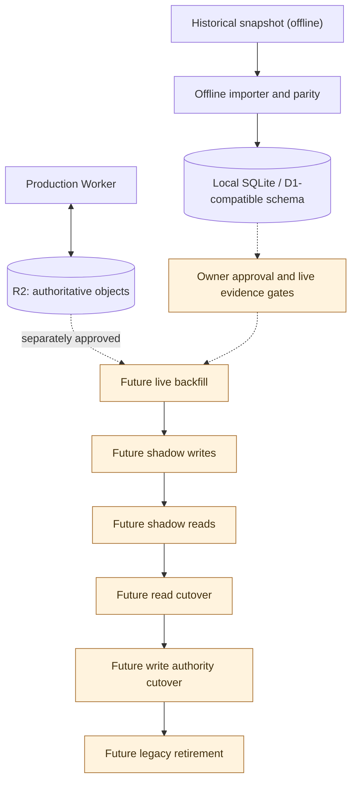

# Persistence authority and staged migration

**Production today:** R2 bucket `iptv` is authoritative. D1 is a target design with an unapplied schema and offline adapters; neither the local importer nor an ADR changes live authority. See [D1 contract](../reference/data/d1-schema.md), [ADR-0001](../adr/0001-d1-schema-v1.md), [migration ADR](../adr/0017-staged-d1-migration.md) and [offline evidence](../evidence/d1-migration/air-73-offline-run.md).

The historical archive is not live production. Offline import receipts, schema compatibility and replay parity are evidence, not authorization. An incomplete or conflicting import must report gaps; it must not invent Film identities or silently omit unportable data. No R2/D1 shared transaction exists, so read/write migration must be staged with separate acceptance and recovery boundaries. Inside the future live backfill, the one large unit (a programme generation) is written to D1 staging tables in bounded chunks and published by one commit request ([ADR-0021](../adr/0021-staged-atomic-generation-import.md)); this changes no node or arrow above, and the staging tables are read by no runtime path.

The prediction family is portable only when every prediction record links an immutable version object. Records written before that rule are linked by a one-time, separately approved materialization inside the Worker (planned from a fenced snapshot, written under the prediction writer lease) that stays within `worker <--> r2`; see [ADR-0026](../adr/0026-historical-prediction-version-materialization.md). It precedes the backfill and is not part of it.

A fingerprint or prediction bundle stored under a retired Film id, whose survivor holds its own newer payload, is not imported: the importer records it as superseded by the canonical payload and leaves the object in R2 ([ADR-0029](../adr/0029-superseded-redirect-payloads.md)). This is a ledger rule inside the offline import and changes no node or arrow above.

**Not deployed:** D1 production binding, shadow writers/readers and authoritative D1 cutover. Each orange node is a planned step, not a claim that its Trello task is completed or an instruction to perform it.
