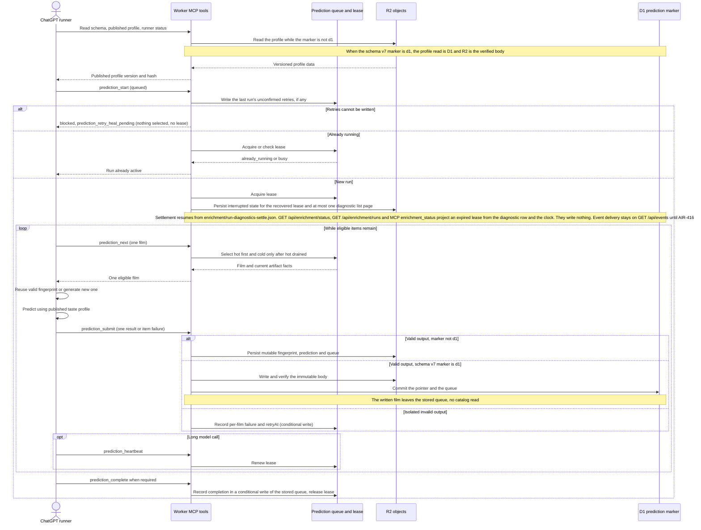
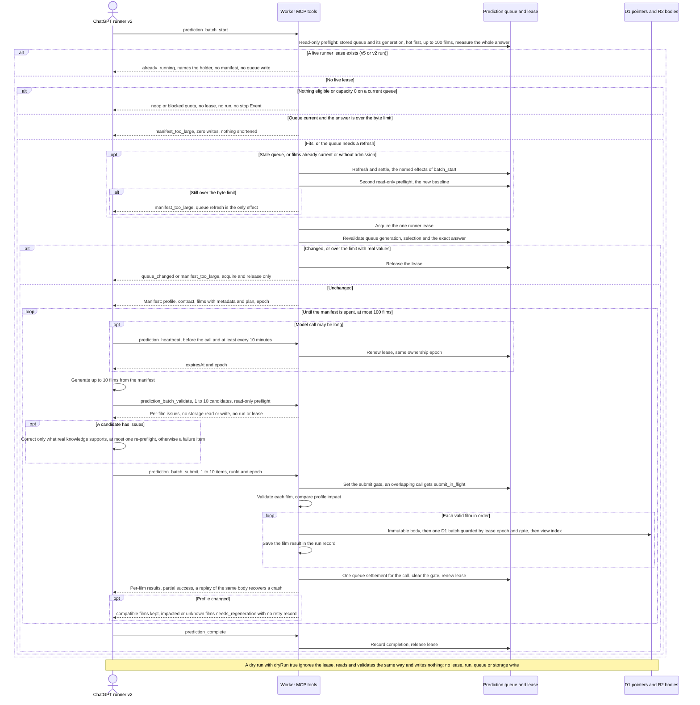
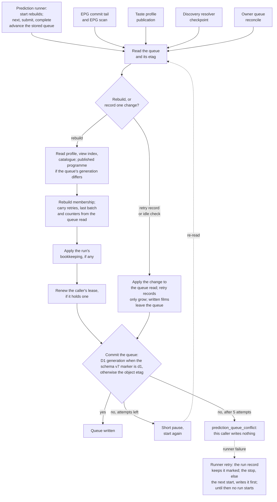

# Prediction pipeline

The external ChatGPT caller performs model generation; the Worker manages the queue, profile and validation. Mutable prediction state is D1-authoritative after the schema v7 marker activation on 3 November 2026 ([ADR 0078](../adr/0078-d1-authoritative-prediction-domain.md)). This diagram reflects the [runner contract](../reference/api/prediction-runner.md), [Film lifecycle](../reference/domain/film-person.md) and [profile ADR](../adr/0013-versioned-taste-profile.md).

Migration `0007` is applied and the production prediction marker is `d1`. In the historical `r2` mode, the persist step writes the mutable objects in R2. The contract starts at schema version 7 when this domain is installed. A later contract with none of the prediction tables stays on the objects. A partial set of those tables fails the step and does not read the objects. After the marker is `d1` the same step writes the immutable body in R2, checks it, and commits the pointer and the queue in D1 ([ADR 0078](../adr/0078-d1-authoritative-prediction-domain.md)). The `d1` branch is now live; the `r2` branch remains the compatibility/rollback contract.

The fingerprint schema/hash tracks the film independently from a personal prediction, which also requires the current profile version/hash and prompt version. A profile change makes predictions stale without forcing a fingerprint regeneration; EPG showtimes do not invalidate either. The persist step writes the immutable content body and generation record first and then `fingerprint.json` as a pointer with provenance ([fingerprint compatibility](../reference/domain/fingerprint-compatibility.md#storage)); a declared fingerprint schema or prompt transition re-queues only the films it reaches, bounded within each batch, under the transition rule ([ADR-0035](../adr/0035-selective-fingerprint-transition-compatibility.md); no switch since [ADR 0047](../adr/0047-retire-fingerprint-compatibility-switch.md)), and a run ends when the Worker's versions change under it. One malformed film output is deferred with exponential backoff rather than discarding successes. This diagram is a conceptual view of the runner protocol, not an assertion that every branch occurs on each invocation.

The "Read schema" step and the "Isolated invalid output" branch share [one validation contract](../reference/api/enrichment.md#submit-validation-contract): the schema the client reads carries the exact rules the Worker validates with, and a rejected submit returns the violated field and code from that closed vocabulary alongside the per-film failure and `retryAt`. The Worker remains the only validator and the only writer; the client's preflight is a convenience that cannot admit a payload the Worker would reject.

**Run events.** The start and the systemic stop of a run each write a durable record and then the Events Log item. A delivery that failed or was interrupted is completed by the next authorized start, inside the writer lease, from the latest run's records and a small index of earlier failures; after eight failed attempts an entry is quarantined and shown in the status read. No read delivers an event ([events](../reference/domain/events.md#delivery-of-prediction-run-events), [AIR-416](https://trello.com/c/f7FX4Elk)). The diagram's start step is unchanged: the delivery is part of it.

## Batch runner v2 (Proposed)

**Accepted design; the start and submit steps are implemented, no caller exists.** [ADR 0122](../adr/0122-prediction-batch-runner-v2-dual-protocol.md) (Accepted) defines a second protocol beside the one above. It shares the queue, the runner lease, the retry records and the D1/R2 persistence; the diagram above is unchanged and stays the live protocol. Contract: [batch runner v2](../reference/api/prediction-runner.md#batch-runner-v2-proposed-contract).

The `prediction_batch_validate` preflight ([ADR 0131](../adr/0131-batch-candidate-preflight-tool.md)) is a pure read of the contract validators: it touches no storage, run, lease, queue or profile and does not replace the validation of `batch_submit`, which stays authoritative and also checks the manifest, `inputHash` and live profile. The v5 `next` and `submit` refuse a v2 run, and `batch_submit` refuses a v5 run, so one run belongs to one protocol. A `batch_submit` is a sequence of per-film commits and one queue settlement, not an atomic unit; replaying the same body recovers a crash. A v2 run that stops leaves its unsubmitted films in the queue; the next `batch_start` selects them again, and a hot film that arrives mid-run waits for that start. Rollback is to disable the v2 Task and re-enable the v5 Task; no data moves.

## Queue writes

The prediction runner is one of several writers of the queue object `enrichment/prediction-queue.json`. Every writer, with or without a lease, goes through the same conditional write ([ADR 0064](../adr/0064-prediction-queue-conditional-writes.md), Accepted 2026-10-31).

The runner's `next`, `submit` and `complete` take the left branch only when the stored queue fails the advance gate (another programme, profile, contract or registry); otherwise they read the stored queue and record one change, so a Discovery chunk that moves the Discovery generation cannot fail them ([ADR 0113](../adr/0113-prediction-runner-advances-persisted-queue.md)). A conflict means another writer committed after this one read the queue. While the marker is not `d1`, that commit is the object etag. On schema version 7 or newer while this domain is installed and the marker is still `r2`, the writer records an intent with the generation claim and deletes it only after the put returns. A put that throws keeps the intent. A queue or lease head captured before these tables existed does not put after the marker is `d1`; the caller opens the head again. A load or activation that still sees the intent does not copy the snapshot. When the schema v7 marker is `d1`, the condition is the D1 generation, and the object is the mirror. The writer starts again from the stored queue, so no retry record, batch summary or counter is lost. A writer holding an older programme or profile cannot overwrite a newer queue. A put that throws has an unknown outcome and is not repeated. A runner failure is saved on the run record before the queue write, so a write that fails every attempt leaves it marked, not lost. The run's stop writes it again. If that fails too, the next start writes it before acquiring the runner lease, or starts nothing. Each caller's handling of `prediction_queue_conflict` is in the [runner reference](../reference/api/prediction-runner.md#queue-writes). Leases still serialize runs; they are not what keeps the queue consistent.

The [queue ADR](../adr/0015-queued-prediction-recovery.md) specifies hot priority, lease and retry limits. [Actual ratings](../reference/api/enrichment.md) remain independent evidence, not an answer passed into model prompts. The confirmed `watched` and `actualRating` values the catalogue exclusion reads follow the ratings marker ([ADR 0084](../adr/0084-d1-authoritative-ratings.md), Proposed). While migration `0010` is absent, or that marker is not `d1` with cutover `open`, they still come from the R2 view index. After that activation they come from `ratings_view`, and the R2 personal fields on the index do not compete. Prediction and fingerprint fields on the index stay. These diagrams do not change. No prediction run was started to draw this diagram.
