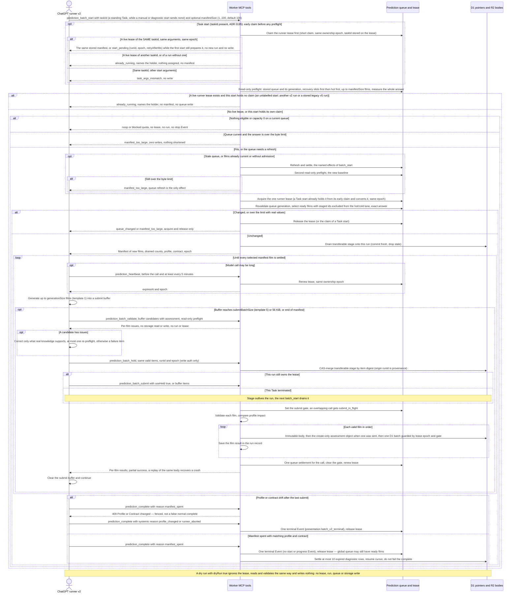
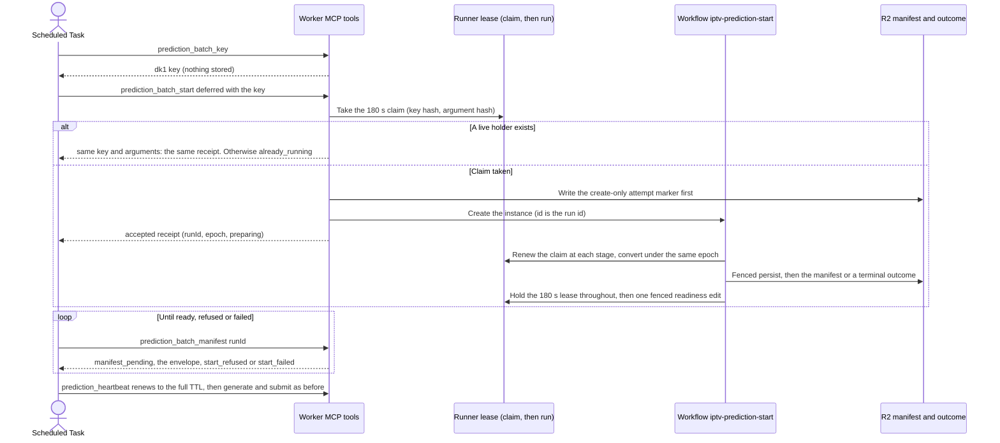
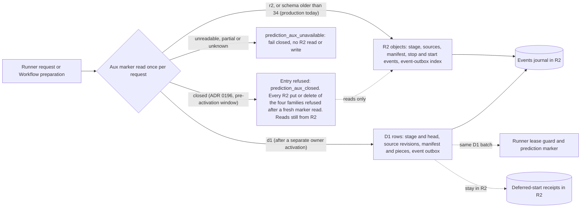
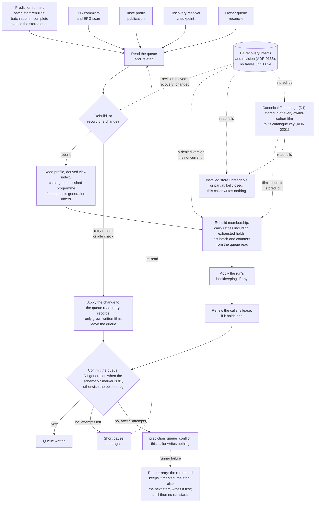

# Prediction pipeline

The external ChatGPT caller performs model generation; the Worker manages the queue, profile and validation. Mutable prediction state is D1-authoritative after the schema v7 marker activation on 3 November 2026 ([ADR 0078](../adr/0078-d1-authoritative-prediction-domain.md)). The diagrams below reflect the [runner contract](../reference/api/prediction-runner.md), [Film lifecycle](../reference/domain/film-person.md) and [profile ADR](../adr/0013-versioned-taste-profile.md).

Batch runner v2 is the only prediction protocol ([ADR 0167](../adr/0167-retire-prediction-runner-v5.md)); its flow is the [batch runner v2 diagram](#batch-runner-v2) below. The one-film v5 runner (`prediction_start`, `prediction_next`, `prediction_submit`, `prediction_validate`) is retired; its stored run records stay readable.

Migration `0007` is applied and the production prediction marker is `d1`. The batch runner commits only with the marker `d1` (`batch_runner_requires_d1` otherwise), so no runner writes predictions in the historical `r2` mode; D1 stays the prediction authority and no rollback to `r2` is planned. The contract starts at schema version 7 when this domain is installed. A later contract with none of the prediction tables stays on the objects. A partial set of those tables fails the step and does not read the objects. After the marker is `d1` the batch submit writes the immutable body in R2, checks it, and commits the pointer and the queue in D1 ([ADR 0078](../adr/0078-d1-authoritative-prediction-domain.md)). The `d1` branch is live; the `r2` object writes remain for the other prediction-domain writers (queue, profile) of that mode.

The fingerprint schema/hash tracks the film independently from a personal prediction, which also requires the current profile version/hash and prompt version. A profile change makes predictions stale without forcing a fingerprint regeneration; EPG showtimes do not invalidate either. An unfinished EPG seal does not decide whether a trusted film may be scored ([ADR 0154](../adr/0154-prediction-eligibility-independent-of-epg.md)): the stored queue stays runnable, and showtimes change only hot/cold order when they come from a completed programme snapshot (or from last-known completed priority no older than 36 hours). The batch submit writes the immutable content body and generation record first and then `fingerprint.json` as a pointer with provenance ([fingerprint compatibility](../reference/domain/fingerprint-compatibility.md#storage)); a declared fingerprint schema or prompt transition re-queues only the films it reaches, bounded within each batch, under the transition rule ([ADR-0035](../adr/0035-selective-fingerprint-transition-compatibility.md); no switch since [ADR 0047](../adr/0047-retire-fingerprint-compatibility-switch.md)), and a run ends when the Worker's versions change under it. No runner restores a fingerprint pointer to an earlier generation record after a schema or prompt rollback any more ([ADR 0167](../adr/0167-retire-prediction-runner-v5.md)); such a fingerprint is regenerated. One malformed film output is deferred with exponential backoff rather than discarding successes. After ten saved per-film retryable failures the identity stays in `retries` and leaves automatic selection ([ADR 0152](../adr/0152-prediction-retry-attempt-budget.md)); it is not marked predicted and is not a catalog exclusion. The batch runner v2 diagram is a conceptual view of the runner protocol, not an assertion that every branch occurs on each invocation.

The batch preflight and the per-film `validation_failure` of the batch submit share [one validation contract](../reference/api/enrichment.md#submit-validation-contract): the schema the client reads carries the exact rules the Worker validates with, and a rejected submit returns the violated field and code from that closed vocabulary alongside the per-film failure and `retryAt`. The Worker remains the only validator and the only writer; the client's preflight is a convenience that cannot admit a payload the Worker would reject.

**Run events.** A batch v2 run writes one terminal Event, parked as a durable record before the Events Log item ([ADR 0146](../adr/0146-batch-v2-single-terminal-prediction-event.md)); start and stop records of the retired v5 runner may still be pending. A delivery that failed or was interrupted is completed by the next authorized start, inside the writer lease, from the latest run's records and a small index of earlier failures; after eight failed attempts an entry is quarantined and shown in the status read. No read delivers an event ([events](../reference/domain/events.md#delivery-of-prediction-run-events), [AIR-416](https://trello.com/c/f7FX4Elk)). The delivery is part of the batch start.

## Batch runner v2

[ADR 0122](../adr/0122-prediction-batch-runner-v2-dual-protocol.md) defines the batch protocol and [ADR 0167](../adr/0167-retire-prediction-runner-v5.md) makes it the only one. It uses the queue, the runner lease, the retry records and the D1/R2 persistence of the retired v5 runner. Contract: [batch runner v2](../reference/api/prediction-runner.md#batch-runner-v2).

The accepted `prediction_batch_validate` preflight ([ADR 0131 (Accepted)](../adr/0131-batch-candidate-preflight-tool.md)) is a pure read of the contract validators: it touches no storage, run, lease, queue or profile and does not replace the validation of `batch_submit`, which stays authoritative and also checks the manifest, `inputHash` and live profile. [ADR 0157](../adr/0157-batch-candidate-hold-and-honest-complete.md) stores submit-ready items in a **transferable** stage (`enrichment/batch-stage.json`). The generating run's lease authorizes the write; the next `prediction_batch_start` drains fresh items onto the new run and drops stale ones. `external_termination` still releases the lease. `useHeld` remains for same-run recovery. The v5 `next` and `submit` refuse a v2 run, and `batch_submit` refuses a v5 run, so one run belongs to one protocol. A `batch_submit` is a sequence of per-film commits and one queue settlement, not an atomic unit; replaying the same body recovers a crash. A v2 run that ends with `manifest_spent` ([ADR 0136](../adr/0136-prediction-batch-manifest-size-and-spent-complete.md)) releases the lease as a normal complete while unsubmitted films of a failed short run stay in the queue for the next `batch_start`. The Events Log receives one terminal `enrichment-<runId>` with `presentation: batch_v2_terminal` and no start or progress item ([ADR 0146](../adr/0146-batch-v2-single-terminal-prediction-event.md)). A hot film that arrives mid-run waits for that start. Rollback is to disable the v2 Task and re-enable the v5 Task; no data moves.

The optional per-film assessment ([ADR 0132](../adr/0132-prediction-assessment-artifact.md), [contract](../reference/api/prediction-assessment.md)) travels only on the batch runner v2 items. Its own immutable R2 object `enrichment/films/<filmId>/predictions/assessments/<predictionSha256>.json` is written after the version object and before the guarded D1 commit, so a committed prediction has its assessment when one was sent and a failure before the commit leaves only unreferenced objects. It is a diagnostic: no rule, queue, freshness verdict, D1 row, bundle, view index entry, Event or public response reads or carries it.

### Multi-Task use of batch v2

**Keyed start and early claim (ADR 0188, additive, not drawn above).** A `prediction_batch_start` that carries an `invocationKey` takes the runner lease as a short `claim` (180 s, renewed at each stage boundary) right after the cheap guards, converts it to the run's lease under the same epoch immediately before the first persist side effect, and releases it on every exit that creates no run. A repeat of the same invocation (same key hash and argument hash, live holder, no client `batch_submit` yet) joins: it returns the stored manifest, or `start_pending` within 10 s, and never writes. The persist of a claimed start holds one internal gate token: every D1-routed authoritative write (previous-run recovery, run record, `latest-run`, queue and progress, staged drain) carries the commit guard, so a handler that lost the lease commits nothing and answers `start_claim_lost` without a stop Event or step; the R2 objects keyed by its runId (diagnostics row, sources, manifest) are written only after a held-gate check and are inert if the lease changes in the unavoidable window after that check. The frozen answer carries the converted 15 minute lease expiry. Everything else, and every start without a key, behaves as drawn. The behaviour is dormant until the Task prompts send a deterministic key.

The diagram above is one invocation. Four independent hourly Tasks run it (`:00`, `:15`, `:30`, `:45` Europe/Madrid) with `manifestSize=5`, `generationSize=1`, `submitBatchSize=5`; the flow, overlap and `already_running` handling are in [scheduling and orchestration](scheduling-and-orchestration.md#four-independent-hourly-predictions-v2-tasks). The live Task registry, not this page, is the authority for which Tasks are enabled; the per-film research, `assessment` and validation rules are the same in every Task. Selection stays queue-ordered: each short run takes the next five eligible films, and films left unsubmitted stay queued for a later start.

### Task label for the standing Tasks ([ADR 0195](../adr/0195-scheduled-task-id-as-run-owner-label.md), Proposed)

The four hourly Tasks carry a fixed label (`task00`, `task15`, `task30`, `task45`) that the Worker stores on the runner lease and the run next to `runId` and `epoch`. A start by a Task claims the lease before the heavy work (the early claim of ADR 0188). A repeat of the **same** label within its live lease and with the same arguments returns the same stored manifest (or `start_pending` while the first start prepares it) and creates no run; another label is `already_running`; a labelled run is operated, read back and completed only by its own label (`wrong_owner` otherwise, before any write). `runId`, the epoch and the compare-and-swap still fence every write; an expired or released lease starts a new run, never the old one. The start sequence above shows the early claim and the three Task outcomes; the Mermaid rendering of this page is checked on GitHub itself (see the PR). The deferred start below and ADR 0188's per-invocation key remain in code but are no longer the target of the Tasks.

### Deferred start (historical, dormant code: [ADR 0193](../adr/0193-deferred-batch-start-with-server-issued-key.md), superseded in part by [ADR 0195](../adr/0195-scheduled-task-id-as-run-owner-label.md) as the Tasks' protocol)

**Historical, not current guidance:** ADR 0195 replaces this design as the protocol of the four Tasks, which use the fixed `taskId` of the section above; the code below stays available and unchanged but no Task uses it. The synchronous start of the diagram above takes 75–90 s in production, longer than a Scheduled Task reliably waits, so this design moved the Tasks to a **deferred start**. The Task first asks the Worker for a key (`prediction_batch_key`, stateless: no lease, no run, no storage). The start then answers a receipt within seconds after taking the ADR 0188 claim and creating a Workflow instance; the preparation (the same keyed start of ADR 0188, with its fencing) runs in that instance and ends in an immutable stored manifest or a typed final outcome; the Task reads the manifest through the existing `prediction_batch_manifest` parts and heartbeats at once, because the preparation holds only a 180 s lease until the client's first heartbeat or submit. The run id is derived from the issued key and one attempt per key is enforced by a create-only marker written before the Workflow instance is created, so a retry whose receipt was lost finds its attempt, its terminal outcome or its live claim and never starts a second preparation (a claim that finds the marker already written releases itself and dispatches nothing); the manifest is stored before, but served only after, one owner-fenced readiness edit of the lease.

A caller that disappears after the receipt blocks the runner for about 3 minutes, not 15, and the next start recovers the abandoned run through the existing `recovered_stale_lease` path. The synchronous start, the keyed synchronous start and `dryRun` stay for the transition. Offline cost (see [the evidence](../evidence/prediction/air-573-deferred-start-offline-2026-11-21.md)): the key 0 D1 and 0 R2 operations, the receipt 5 D1 and 4 R2, readback 4 D1 and 2 R2; the preparation is off the caller's path.

### Auxiliary state: stage, sources, manifest and outbox ([ADR 0194](../adr/0194-prediction-auxiliary-state-d1-checkpoint-and-outbox.md), Accepted; **dormant**, production authority is still the R2 objects)

The held stage, the run sources, the persisted manifest and the event outbox have a D1 implementation behind their own marker `prediction_aux_authority` ([AIR-553](https://trello.com/c/ouMIBO00)). **Production authority today is unchanged: the R2 objects.** The diagram shows the two branches and the fail-closed case; the D1 branch is code delivered and offline-tested, not activated, and its migration `0034` is not applied to production by a deploy. The cutover is the separate owner plan [AIR-554](https://trello.com/c/UrS1gflv); see the [runbook](../runbooks/prediction-aux-state-cutover.md) and the [offline evidence](../evidence/prediction/air-553-aux-state-d1-dormant-offline-2026-11-22.md).

The marker has three modes ([ADR 0196](../adr/0196-prediction-aux-admission-closed-state.md)): `r2`, `closed` and `d1`, with the chain `r2` → `closed` → `d1` and `closed` → `r2` before an activation. `closed` is the admission close of the cutover: it is not an authority (the R2 objects stay the data and are read), and it refuses every legacy write of the four families, before the entry and again at the object-store PUT, which re-reads the marker fresh. A PUT already past its read cannot be recalled; the cutover bounds that by listings and refuses the flip on any difference (see the [runbook](../runbooks/prediction-aux-state-cutover.md)).

With the marker at `d1`: every auxiliary write is one D1 batch that asserts the marker generation (and, for run-owned writes, the runner lease with its gate token where one exists); the readiness edit of a deferred run and its manifest rows are one batch; a drain settles a staged row in the same batch as the film's prediction; a part of the manifest is read from the pieces that cover it and verified against per-piece digests; a skipped request without the lease is admitted by one insert on its identity, capped at 256 active pending records. The Events journal and the deferred-start receipts stay R2 objects.

## Queue writes

The prediction runner is one of several writers of the queue object `enrichment/prediction-queue.json`. Every writer, with or without a lease, goes through the same conditional write ([ADR 0064](../adr/0064-prediction-queue-conditional-writes.md), Accepted 2026-10-31).

The runner's batch submit and `complete` take the left branch only when the stored queue fails the advance gate (another programme, profile, contract or registry); otherwise they read the stored queue and record one change, so a Discovery chunk that moves the Discovery generation cannot fail them ([ADR 0113](../adr/0113-prediction-runner-advances-persisted-queue.md)). A conflict means another writer committed after this one read the queue. While the marker is not `d1`, that commit is the object etag. On schema version 7 or newer while this domain is installed and the marker is still `r2`, the writer records an intent with the generation claim and deletes it only after the put returns. A put that throws keeps the intent. A queue or lease head captured before these tables existed does not put after the marker is `d1`; the caller opens the head again. A load or activation that still sees the intent does not copy the snapshot. When the schema v7 marker is `d1`, the condition is the D1 generation, and the object is the mirror. The writer starts again from the stored queue, so no retry record, batch summary or counter is lost. A writer holding an older programme or profile cannot overwrite a newer queue. A put that throws has an unknown outcome and is not repeated. A runner failure is saved on the run record before the queue write, so a write that fails every attempt leaves it marked, not lost. The run's stop writes it again. If that fails too, the next start writes it before acquiring the runner lease, or starts nothing. Each caller's handling of `prediction_queue_conflict` is in the [runner reference](../reference/api/prediction-runner.md#queue-writes). Leases still serialize runs; they are not what keeps the queue consistent.

A submit writes no view-index entry: the view index is always derived from the D1 prediction and ratings rows ([view index contract](../reference/domain/view-index-read-model.md), [ADR 0192](../adr/0192-retire-view-index-selector-and-raw-object.md)), and the queue rebuild reads that derived index. `updateViewIndex` is removed. The [queue ADR](../adr/0015-queued-prediction-recovery.md) specifies hot priority, lease and retry limits. [Actual ratings](../reference/api/enrichment.md) remain independent evidence, not an answer passed into model prompts. The confirmed `watched` and `actualRating` values the catalogue exclusion reads follow the ratings marker ([ADR 0084](../adr/0084-d1-authoritative-ratings.md), Proposed). They come from `ratings_view` through the derived view index; where that marker is not `d1` with cutover `open` the read refuses (503) instead of serving a raw object. These diagrams do not change. No prediction run was started to draw this diagram.

### Scoped recovery intent is a rebuild input, not a queue writer (ADR 0165, Accepted)

An owner-confirmed recovery intent ([ADR 0165](../adr/0165-scoped-prediction-recovery-intent.md); [contract](../reference/api/admin-actions.md#scoped-prediction-recovery-intent)) is stored in D1 (`prediction_recovery_*`, migration `0024`, applied to production on 18 Nov 2026; [evidence](../evidence/d1-migration/air-478-0024-apply-2026-11-18.md)). It does not appear among the queue writers above because it never writes the queue: the owner-only confirm writes intent rows only, and the freshness rule reads them as one more input of every rebuild and of the runner's per-film checks. A denied version makes the film outstanding at the next ordinary rebuild (the advance gate answers `recovery_changed` when the intent revision moved), so the ordinary lane, priority, retry budget, lease and batch v2 validation apply. The first new version the runner commits satisfies the intent. In the diagram the intent store is a read-only input (dotted): its revision feeds the rebuild decision and its denied versions feed the rebuild; it has no edge into the commit. An installed store that cannot be read, or a partial table set, ends the caller's attempt before any queue write, so a recovery film's retry record is never dropped on an unreadable answer; only the absent migration reads as no intents.

### A recovered film keeps its stored id as the queue key ([ADR 0201](../adr/0201-recovery-admits-stored-letterboxd-id-via-catalog-film.md), Accepted)

A film the owner watched leaves the watchlist, so the admitted catalogue holds it as `tmdb_<n>` while its prediction pointer, fingerprint and lineage stay under the stored Letterboxd id. During a rebuild the queue reads the stored ids of every film an owner cohort ever named (active, settled or cancelled; at most 1000, over that the rebuild fails closed) and resolves each through the canonical Film bridge (trusted claims only, no title or year matching, eight reads at a time). A verified negative (absent, retired or conflicting identity) leaves the film unaliased; any other read failure is thrown and nothing is saved. The catalogue film is then presented under its stored id, so the derived index, the intent overlay and the manifest agree on one key, and the film is never turned back into a second `tmdb_<n>` film when its intent expires. The same rule admits a stored id in the owner-only preview and resolves its metadata in the batch read (`readFilmsById`). Films with no current catalogue entry are not admitted by it.

### Recovery slots in the batch manifest (ADR 0197, Accepted)

The selection step of the batch start ([ADR 0197](../adr/0197-recovery-slots-in-the-ordinary-batch-manifest.md)) reads the same intent overlay as the freshness rule. Before the ordinary hot-first order it fills at most `max(1, floor(N * 0.4))` of the `N` manifest slots (none for `N = 1`) with films that have an active, owner-confirmed intent and are queued in either lane, oldest confirmed cohort first, each only while its stored version is still the one the intent denies. The ordinary order then fills the remaining slots, with the fingerprint migration share applied to those; the quota is a hard cap, so films with an active intent that did not take a recovery slot stay out of the ordinary fill, and recovery probing has its own read bound. The selection reads the queue and writes nothing: lane, priority, retry records and queue membership are the rebuild's own, and the lease, validation, durable hold, idempotent submit and immutable lineage that follow the manifest are unchanged. Retry backoff and an exhausted budget are never bypassed, a pinned call is not reordered, and an unreadable recovery store ends the start before any manifest. The sequence above shows the preflight; the share is a rule inside its selection step, so no other diagram changes.
