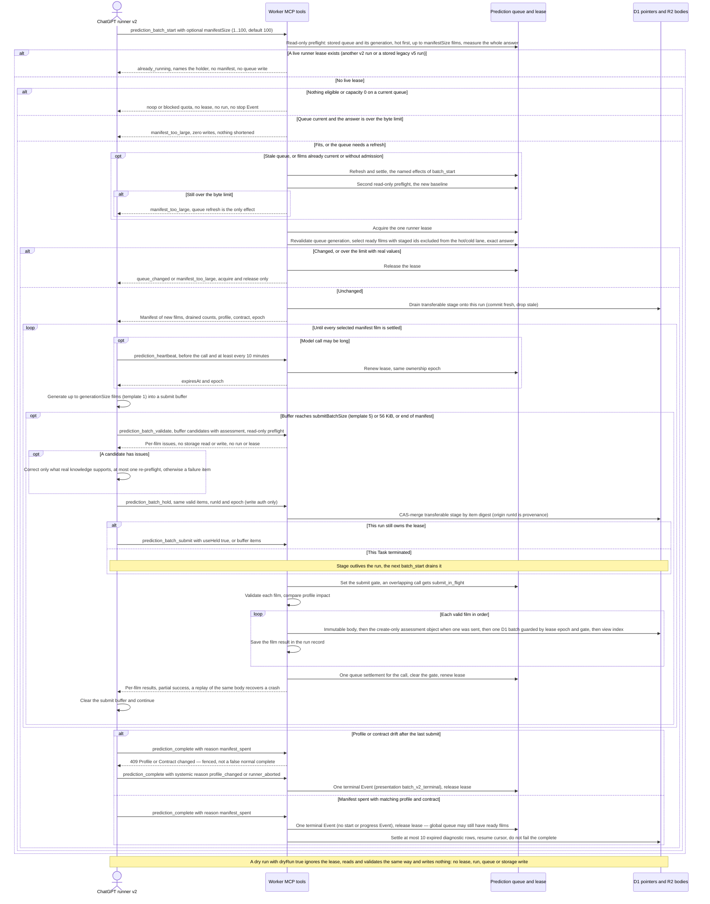
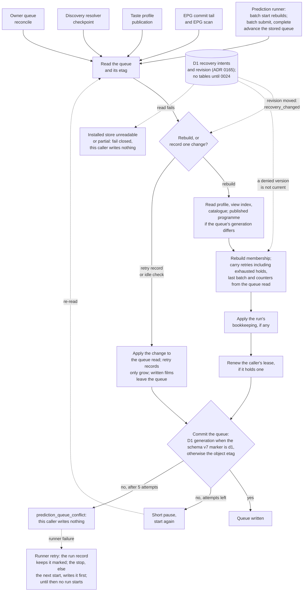

# Prediction pipeline

The external ChatGPT caller performs model generation; the Worker manages the queue, profile and validation. Mutable prediction state is D1-authoritative after the schema v7 marker activation on 3 November 2026 ([ADR 0078](../adr/0078-d1-authoritative-prediction-domain.md)). The diagrams below reflect the [runner contract](../reference/api/prediction-runner.md), [Film lifecycle](../reference/domain/film-person.md) and [profile ADR](../adr/0013-versioned-taste-profile.md).

Batch runner v2 is the only prediction protocol ([ADR 0167](../adr/0167-retire-prediction-runner-v5.md)); its flow is the [batch runner v2 diagram](#batch-runner-v2) below. The one-film v5 runner (`prediction_start`, `prediction_next`, `prediction_submit`, `prediction_validate`) is retired; its stored run records stay readable.

Migration `0007` is applied and the production prediction marker is `d1`. The batch runner commits only with the marker `d1` (`batch_runner_requires_d1` otherwise), so no runner writes predictions in the historical `r2` mode; D1 stays the prediction authority and no rollback to `r2` is planned. The contract starts at schema version 7 when this domain is installed. A later contract with none of the prediction tables stays on the objects. A partial set of those tables fails the step and does not read the objects. After the marker is `d1` the batch submit writes the immutable body in R2, checks it, and commits the pointer and the queue in D1 ([ADR 0078](../adr/0078-d1-authoritative-prediction-domain.md)). The `d1` branch is live; the `r2` object writes remain for the other prediction-domain writers (queue, profile) of that mode.

The fingerprint schema/hash tracks the film independently from a personal prediction, which also requires the current profile version/hash and prompt version. A profile change makes predictions stale without forcing a fingerprint regeneration; EPG showtimes do not invalidate either. An unfinished EPG seal does not decide whether a trusted film may be scored ([ADR 0154](../adr/0154-prediction-eligibility-independent-of-epg.md)): the stored queue stays runnable, and showtimes change only hot/cold order when they come from a completed programme snapshot (or from last-known completed priority no older than 36 hours). The batch submit writes the immutable content body and generation record first and then `fingerprint.json` as a pointer with provenance ([fingerprint compatibility](../reference/domain/fingerprint-compatibility.md#storage)); a declared fingerprint schema or prompt transition re-queues only the films it reaches, bounded within each batch, under the transition rule ([ADR-0035](../adr/0035-selective-fingerprint-transition-compatibility.md); no switch since [ADR 0047](../adr/0047-retire-fingerprint-compatibility-switch.md)), and a run ends when the Worker's versions change under it. No runner restores a fingerprint pointer to an earlier generation record after a schema or prompt rollback any more ([ADR 0167](../adr/0167-retire-prediction-runner-v5.md)); such a fingerprint is regenerated. One malformed film output is deferred with exponential backoff rather than discarding successes. After ten saved per-film retryable failures the identity stays in `retries` and leaves automatic selection ([ADR 0152](../adr/0152-prediction-retry-attempt-budget.md)); it is not marked predicted and is not a catalog exclusion. The batch runner v2 diagram is a conceptual view of the runner protocol, not an assertion that every branch occurs on each invocation.

The batch preflight and the per-film `validation_failure` of the batch submit share [one validation contract](../reference/api/enrichment.md#submit-validation-contract): the schema the client reads carries the exact rules the Worker validates with, and a rejected submit returns the violated field and code from that closed vocabulary alongside the per-film failure and `retryAt`. The Worker remains the only validator and the only writer; the client's preflight is a convenience that cannot admit a payload the Worker would reject.

**Run events.** A batch v2 run writes one terminal Event, parked as a durable record before the Events Log item ([ADR 0146](../adr/0146-batch-v2-single-terminal-prediction-event.md)); start and stop records of the retired v5 runner may still be pending. A delivery that failed or was interrupted is completed by the next authorized start, inside the writer lease, from the latest run's records and a small index of earlier failures; after eight failed attempts an entry is quarantined and shown in the status read. No read delivers an event ([events](../reference/domain/events.md#delivery-of-prediction-run-events), [AIR-416](https://trello.com/c/f7FX4Elk)). The delivery is part of the batch start.

## Batch runner v2

[ADR 0122](../adr/0122-prediction-batch-runner-v2-dual-protocol.md) defines the batch protocol and [ADR 0167](../adr/0167-retire-prediction-runner-v5.md) makes it the only one. It uses the queue, the runner lease, the retry records and the D1/R2 persistence of the retired v5 runner. Contract: [batch runner v2](../reference/api/prediction-runner.md#batch-runner-v2).

The accepted `prediction_batch_validate` preflight ([ADR 0131 (Accepted)](../adr/0131-batch-candidate-preflight-tool.md)) is a pure read of the contract validators: it touches no storage, run, lease, queue or profile and does not replace the validation of `batch_submit`, which stays authoritative and also checks the manifest, `inputHash` and live profile. [ADR 0157](../adr/0157-batch-candidate-hold-and-honest-complete.md) stores submit-ready items in a **transferable** stage (`enrichment/batch-stage.json`). The generating run's lease authorizes the write; the next `prediction_batch_start` drains fresh items onto the new run and drops stale ones. `external_termination` still releases the lease. `useHeld` remains for same-run recovery. The v5 `next` and `submit` refuse a v2 run, and `batch_submit` refuses a v5 run, so one run belongs to one protocol. A `batch_submit` is a sequence of per-film commits and one queue settlement, not an atomic unit; replaying the same body recovers a crash. A v2 run that ends with `manifest_spent` ([ADR 0136](../adr/0136-prediction-batch-manifest-size-and-spent-complete.md)) releases the lease as a normal complete while unsubmitted films of a failed short run stay in the queue for the next `batch_start`. The Events Log receives one terminal `enrichment-<runId>` with `presentation: batch_v2_terminal` and no start or progress item ([ADR 0146](../adr/0146-batch-v2-single-terminal-prediction-event.md)). A hot film that arrives mid-run waits for that start. Rollback is to disable the v2 Task and re-enable the v5 Task; no data moves.

The optional per-film assessment ([ADR 0132](../adr/0132-prediction-assessment-artifact.md), [contract](../reference/api/prediction-assessment.md)) travels only on the batch runner v2 items. Its own immutable R2 object `enrichment/films/<filmId>/predictions/assessments/<predictionSha256>.json` is written after the version object and before the guarded D1 commit, so a committed prediction has its assessment when one was sent and a failure before the commit leaves only unreferenced objects. It is a diagnostic: no rule, queue, freshness verdict, D1 row, bundle, view index entry, Event or public response reads or carries it.

### Multi-Task use of batch v2

The diagram above is one invocation. Four independent hourly Tasks run it (`:00`, `:15`, `:30`, `:45` Europe/Madrid) with `manifestSize=5`, `generationSize=1`, `submitBatchSize=5`; the flow, overlap and `already_running` handling are in [scheduling and orchestration](scheduling-and-orchestration.md#four-independent-hourly-predictions-v2-tasks). The live Task registry, not this page, is the authority for which Tasks are enabled; the per-film research, `assessment` and validation rules are the same in every Task. Selection stays queue-ordered: each short run takes the next five eligible films, and films left unsubmitted stay queued for a later start.

## Queue writes

The prediction runner is one of several writers of the queue object `enrichment/prediction-queue.json`. Every writer, with or without a lease, goes through the same conditional write ([ADR 0064](../adr/0064-prediction-queue-conditional-writes.md), Accepted 2026-10-31).

The runner's batch submit and `complete` take the left branch only when the stored queue fails the advance gate (another programme, profile, contract or registry); otherwise they read the stored queue and record one change, so a Discovery chunk that moves the Discovery generation cannot fail them ([ADR 0113](../adr/0113-prediction-runner-advances-persisted-queue.md)). A conflict means another writer committed after this one read the queue. While the marker is not `d1`, that commit is the object etag. On schema version 7 or newer while this domain is installed and the marker is still `r2`, the writer records an intent with the generation claim and deletes it only after the put returns. A put that throws keeps the intent. A queue or lease head captured before these tables existed does not put after the marker is `d1`; the caller opens the head again. A load or activation that still sees the intent does not copy the snapshot. When the schema v7 marker is `d1`, the condition is the D1 generation, and the object is the mirror. The writer starts again from the stored queue, so no retry record, batch summary or counter is lost. A writer holding an older programme or profile cannot overwrite a newer queue. A put that throws has an unknown outcome and is not repeated. A runner failure is saved on the run record before the queue write, so a write that fails every attempt leaves it marked, not lost. The run's stop writes it again. If that fails too, the next start writes it before acquiring the runner lease, or starts nothing. Each caller's handling of `prediction_queue_conflict` is in the [runner reference](../reference/api/prediction-runner.md#queue-writes). Leases still serialize runs; they are not what keeps the queue consistent.

The [queue ADR](../adr/0015-queued-prediction-recovery.md) specifies hot priority, lease and retry limits. [Actual ratings](../reference/api/enrichment.md) remain independent evidence, not an answer passed into model prompts. The confirmed `watched` and `actualRating` values the catalogue exclusion reads follow the ratings marker ([ADR 0084](../adr/0084-d1-authoritative-ratings.md), Proposed). While migration `0010` is absent, or that marker is not `d1` with cutover `open`, they still come from the R2 view index. After that activation they come from `ratings_view`, and the R2 personal fields on the index do not compete. Prediction and fingerprint fields on the index stay. These diagrams do not change. No prediction run was started to draw this diagram.

### Scoped recovery intent is a rebuild input, not a queue writer (ADR 0165, Proposed)

An owner-confirmed recovery intent ([ADR 0165](../adr/0165-scoped-prediction-recovery-intent.md); [contract](../reference/api/admin-actions.md#scoped-prediction-recovery-intent)) is stored in D1 (`prediction_recovery_*`, migration `0024`, not applied). It does not appear among the queue writers above because it never writes the queue: the owner-only confirm writes intent rows only, and the freshness rule reads them as one more input of every rebuild and of the runner's per-film checks. A denied version makes the film outstanding at the next ordinary rebuild (the advance gate answers `recovery_changed` when the intent revision moved), so the ordinary lane, priority, retry budget, lease and batch v2 validation apply. The first new version the runner commits satisfies the intent. In the diagram the intent store is a read-only input (dotted): its revision feeds the rebuild decision and its denied versions feed the rebuild; it has no edge into the commit. An installed store that cannot be read, or a partial table set, ends the caller's attempt before any queue write, so a recovery film's retry record is never dropped on an unreadable answer; only the absent migration reads as no intents.
