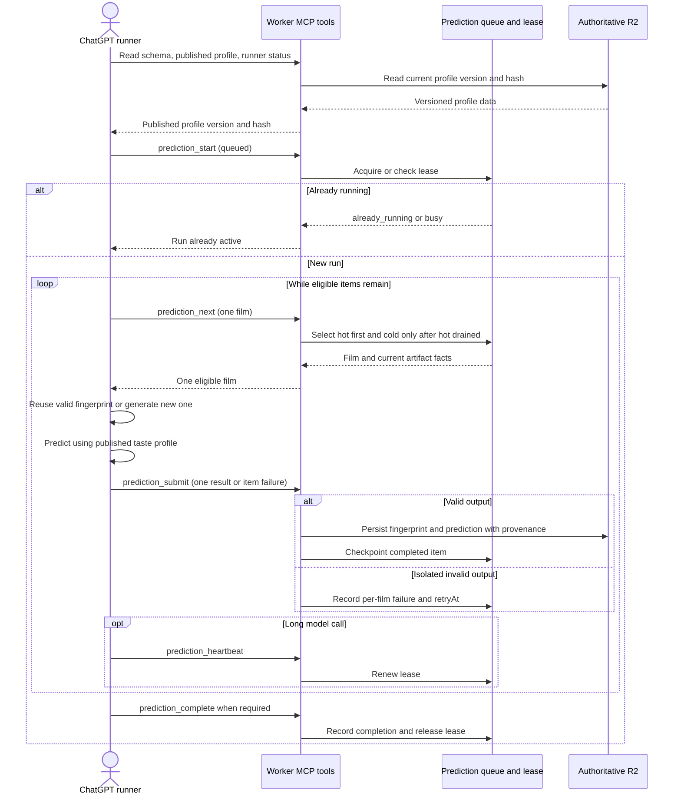

# Prediction pipeline

The external ChatGPT caller performs model generation; the Worker manages the queue, profile, validation and R2 persistence. This diagram reflects the [runner contract](../reference/api/prediction-runner.md), [Film lifecycle](../reference/domain/film-person.md) and [profile ADR](../adr/0013-versioned-taste-profile.md).

The fingerprint schema/hash tracks the film independently from a personal prediction, which also requires the current profile version/hash and prompt version. A profile change makes predictions stale without forcing a fingerprint regeneration; EPG showtimes do not invalidate either. One malformed film output is deferred with exponential backoff rather than discarding successes. This diagram is a conceptual view of the runner protocol, not an assertion that every branch occurs on each invocation.

The "Read schema" step and the "Isolated invalid output" branch share [one validation contract](../reference/api/enrichment.md#submit-validation-contract): the schema the client reads carries the exact rules the Worker validates with, and a rejected submit returns the violated field and code from that closed vocabulary alongside the per-film failure and `retryAt`. The Worker remains the only validator and the only writer; the client's preflight is a convenience that cannot admit a payload the Worker would reject.

The [queue ADR](../adr/0015-queued-prediction-recovery.md) specifies hot priority, lease and retry limits. [Actual ratings](../reference/api/enrichment.md) remain independent evidence, not an answer passed into model prompts. No prediction run was started to draw this diagram.
