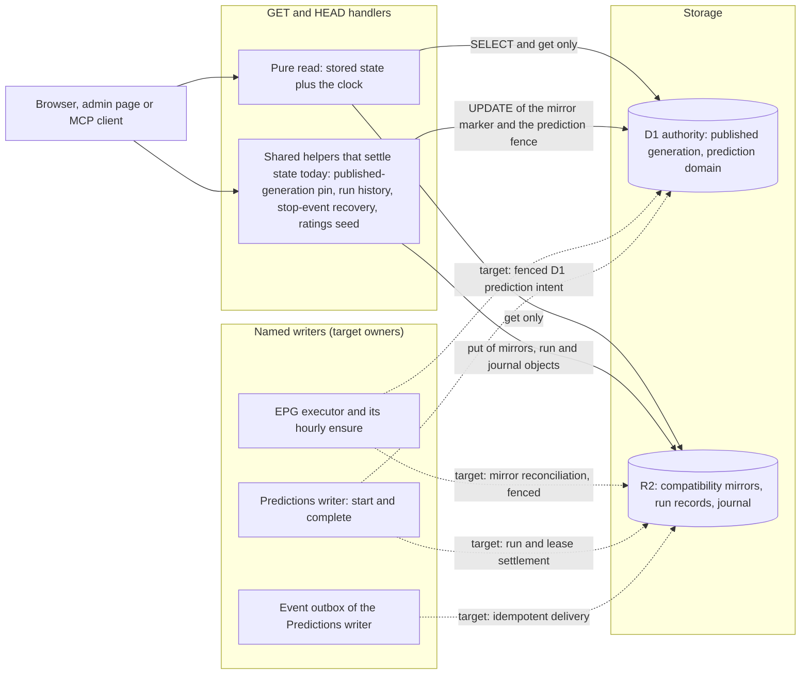

# Read paths and repair owners

This page shows what a GET, a HEAD or an MCP read tool may touch, which reads **still write today** and which writer owns each repair. It follows [ADR 0107](../adr/0107-get-head-read-side-effect-boundary.md) (Accepted) and the dated [audit](../evidence/api/air-412-get-head-audit-2026-11-10.md). Solid arrows are current behavior verified by `tests/get-write-audit.mjs`; the dashed arrows are the **target** that [AIR-413](https://trello.com/c/orvuzDW5) to [AIR-416](https://trello.com/c/f7FX4Elk) deliver one by one. Nothing here authorizes a production operation.

## How to read it

- **Every read route, page and MCP read tool ends in `pure` in the target.** Today the `helper` branch is taken by fourteen HTTP routes and three MCP tools (the exact list and the exact effects are the baseline in [read side effects](../reference/api/read-side-effects.md)).
- **The mirror repair writes even when nothing is drifted.** In D1 authority a read of the published generation runs the repair; with current mirrors it still writes the D1 marker, with missing or old mirrors it also writes five R2 objects. The marker lives in `published_epg_authority`; the R2 objects are compatibility mirrors of the D1 generation ([EPG and availability](epg-and-availability.md)).
- **Prediction recovery has two read-triggered parts.** Settling an expired run lease (run record and diagnostic row) and delivering an undelivered stop event (run record, diagnostic row, journal item, delivered flag). In the D1 prediction domain every one of those objects is a fenced D1 intent, which is why the D1 branch shows the `prediction_domain_*` statements ([prediction pipeline](prediction-pipeline.md)).
- **Outbound requests.** One read sends a request of its own: the TMDB status probe (`GET` to TMDB, no body). It is registered as `outbound-read` and is not a storage write.
- **Authority is unchanged.** D1 stays authoritative for the published generation and the prediction domain; R2 mirrors are derived. The target moves the repair, not the authority ([persistence and migration](persistence-and-migration.md)).

## Enforcement

`tests/get-write-audit.mjs` builds the production bundle, runs it against an instrumented R2 bucket and an instrumented D1 in eight scenarios and compares the effects of every read route with the baseline `tests/get-write-baseline.mjs`. A new writer, a changed writer, an unregistered read route or MCP tool, and a baseline entry no request reproduces any more all fail the test. A fix card deletes its entry; see [testing and review](../process/agent-workflow.md).
