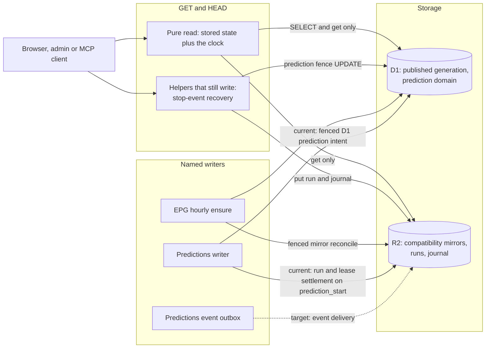

# Read paths and repair owners

This page shows what a GET, a HEAD or an MCP read tool may touch, which reads **still write today** and which writer owns each repair. It follows [ADR 0107](../adr/0107-get-head-read-side-effect-boundary.md) (Accepted) and [ADR 0108](../adr/0108-epg-mirror-reconciliation-writer.md) (Accepted). Solid arrows are current behavior verified by `tests/get-write-audit.mjs`; the dashed arrows are the remaining **target** for the event outbox. Nothing here authorizes a production operation.

## How to read it

- **Every read route, page and MCP read tool ends in `pure` for the published EPG.** The `helper` branch is still taken by `GET /api/events` (the exact list and the exact effects are the baseline in [read side effects](../reference/api/read-side-effects.md)). `GET /api/enrichment/runs`, `GET /api/enrichment/status` and MCP `enrichment_status` are query-only ([AIR-415](https://trello.com/c/NHyIKM6z)).
- **The compiled ratings seed is an in-memory overlay.** `GET /api/enrichment/view` and catalog reads apply it without persisting view-index changes; writers still materialize missing seed entries.
- **Compatibility mirrors are the EPG writer's job.** GET never calls `repairMirrors`. The hourly `EpgOrchestration.ensure` reconciles R2 copies of the published D1 generation even when the daily publication is not due; aligned mirrors, a held cutover and a live step lease write nothing. The marker lives in `published_epg_authority`; the R2 objects are compatibility mirrors, not a fallback ([EPG and availability](epg-and-availability.md), [ADR 0108](../adr/0108-epg-mirror-reconciliation-writer.md)).
- **Prediction recovery.** An expired run lease is projected on the status and runs reads and persisted by `prediction_start` under the existing Predictions writer fence. Delivering an undelivered stop event still runs on `GET /api/events` until [AIR-416](https://trello.com/c/f7FX4Elk). In the D1 prediction domain every persisted object is a fenced D1 intent ([prediction pipeline](prediction-pipeline.md)).
- **Outbound requests.** One read sends a request of its own: the TMDB status probe (`GET` to TMDB, no body). It is registered as `outbound-read` and is not a storage write.
- **Authority is unchanged.** D1 stays authoritative for the published generation and the prediction domain; R2 mirrors are derived. The target moves the repair, not the authority ([persistence and migration](persistence-and-migration.md)).

## Enforcement

`tests/get-write-audit.mjs` builds the production bundle, runs it against an instrumented R2 bucket and an instrumented D1 in eight scenarios and compares the effects of every read route with the baseline `tests/get-write-baseline.mjs`. A new writer, a changed writer, an unregistered read route or MCP tool, and a baseline entry no request reproduces any more all fail the test. A fix card deletes its entry; see [testing and review](../process/agent-workflow.md).
