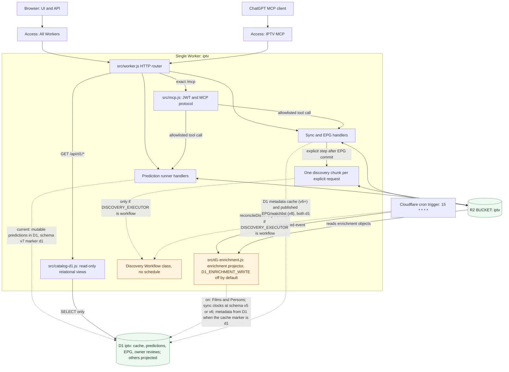

# Worker runtime topology

**Scope:** request routing and trusted storage boundary of the current deployed Worker. Sources: [`src/worker.js`](../../src/worker.js), [`src/mcp.js`](../../src/mcp.js), [`src/continuation.js`](../../src/continuation.js), [`src/d1-enrichment.js`](../../src/d1-enrichment.js), [Wrangler settings](../../wrangler.jsonc) and [runtime runbook](../runbooks/deployment.md).

The **one-chunk continuation** is executed inside the explicit step or request that asks for it while `DISCOVERY_EXECUTOR` is absent. The Discovery Workflow class is loaded with the Worker and has no schedule, so a deploy does not create an instance ([ADR 0083](../adr/0083-inert-discovery-workflow.md), Accepted 2026-11-02). Only an exact `workflow` value starts one, and then still one chunk per durable step. `DiscoveryContinuation` is an internal entrypoint, not an unauthenticated public endpoint, a second Worker, a cross-isolate guarantee, or a self-fetch with credentials. Only authorized operations invoke write handlers. Route names such as GET/status cannot universally be assumed read-only: consult [deployment safety notes](../runbooks/deployment.md).

`wrangler.jsonc` binds `BUCKET` to R2 `iptv` and `DB` to the D1 database `iptv`. R2 remains authoritative for Film/Person. Migration `0011` is applied. The ratings marker is `d1` / `open` at generation 12 ([manual run](../evidence/d1-migration/air-318-ratings-manual-run-2026-11-04.md)). The discovery marker is `d1` / `open` at generation 1 ([activation record](../evidence/d1-migration/air-320-discovery-activate-2026-11-04.md), [ADR 0085](../adr/0085-d1-authoritative-discovery.md), Accepted). D1 now owns the metadata cache, mutable predictions, published EPG/watchlist generation, owner reviews (`owner_review_authority.mode=d1`, generation 1, [activation record](../evidence/d1-migration/air-314-owner-review-activate-2026-11-03.md)), the mutable ratings documents, and the discovery ledger. The first successful post-cutover EPG commit was recorded on 3 November from a daily-task-created run completed by one owner-authorized manual step (`00ff34fa…`); the fenced generation-2 D1 member/show and R2 mirror comparison passed ([AIR-319 evidence](../evidence/d1-migration/air-319-production-cutover-2026-11-03.md)). Pages read D1 through the published programme/watchlist routes and [D1 catalog views](../reference/api/d1-catalog.md) under `/api/d1/`, behind the same Access policy as the rest of `/api/`. Film/Person catalog projections are backfilled from R2, while metadata cache, mutable predictions, published EPG, owner reviews and ratings have their own separately activated D1 domain authorities ([D1 backfill runbook](../runbooks/d1-backfill.md)).

The one Worker cron trigger runs the [enrichment projector](../adr/0056-d1-enrichment-write-through.md), the ratings `ensure`, and `reconcileDiscoveryWorkflow` ([ADR 0093](../adr/0093-discovery-workflow-cron-reconcile.md), Proposed). It never runs a sync, EPG download, discovery chunk or prediction step. With `D1_ENRICHMENT_WRITE` unset the projector returns at once. With `DISCOVERY_EXECUTOR` absent the Discovery reconcile returns without `create()`.

- With `dry`, it reads the enrichment objects from R2 and the change keys from D1, and logs the diff.
- With `on`, it also writes the changed Films and Persons to D1 under its lease, and it never writes R2. Sync clocks are included on that arrow from schema version 5 onward ([ADR 0070](../adr/0070-metadatasync-freshness-clocks.md)); current production schema is v9. While the metadata-cache marker is absent or `r2`, sync uses its R2 metadata working set; independent D1-owned domains retain separate markers. When that marker is `d1`, the sync arrow also writes the metadata cache, and the projector reads those rows instead of `metadata.json` ([ADR 0073](../adr/0073-metadata-cache-d1-authority.md)). A deploy does not apply any database migration or switch authority markers. Migration `0007` is applied and `prediction_domain_authority.mode=d1` was activated on 3 November 2026. Prediction handlers write mutable data to D1 and keep immutable bodies in R2. At schema version 7 or newer, zero prediction tables means that the domain is not installed and its mutable state remains on R2. A partial set of prediction tables, or a complete set with an invalid marker, fails closed instead of falling back to R2. The deployed Worker sets `PREDICTION_DB_REQUIRED=on`, so a missing `DB` binding fails closed the same way ([ADR 0078](../adr/0078-d1-authoritative-prediction-domain.md)). The projector does not write that domain.

Runtime mode and configured Cloudflare Access policies must be rechecked for live-state claims.

See [one-chunk ADR](../adr/0006-one-chunk-discovery.md), [MCP security contract](../reference/api/mcp.md) and [D1 schema boundary](../reference/data/d1-schema.md).

## Ratings Workflow binding (AIR-347)

`wrangler.jsonc` declares Workflow `iptv-ratings` (`RATINGS_WORKFLOW`, class `RatingsWorkflow`). Deployment creates the resource only; no instance exists until `ensure` runs in `cloudflare` mode. It also declares Workflow `iptv-epg` (`EPG_WORKFLOW`, class `EpgWorkflow`, [ADR 0100](../adr/0100-epg-cloudflare-workflow-executor.md), Proposed): inert, its mode is `external` until the owner's switch and its D1 table (migration `0017`) is not applied by a deploy.

## Monitor (AIR-349)

One more tick on the existing hourly cron, one R2 key (`monitor/state.json`) and, once the owner configures it, one outbound alert channel (the generic HTTPS webhook, or the fixed Telegram Bot API endpoint chosen by `MONITOR_TRANSPORT`) and one dead-man ping. No new Worker, Workflow, trigger or binding. See [ADR 0095](../adr/0095-cloudflare-native-production-monitor.md) and [ADR 0097](../adr/0097-monitor-telegram-bot-api-transport.md).
