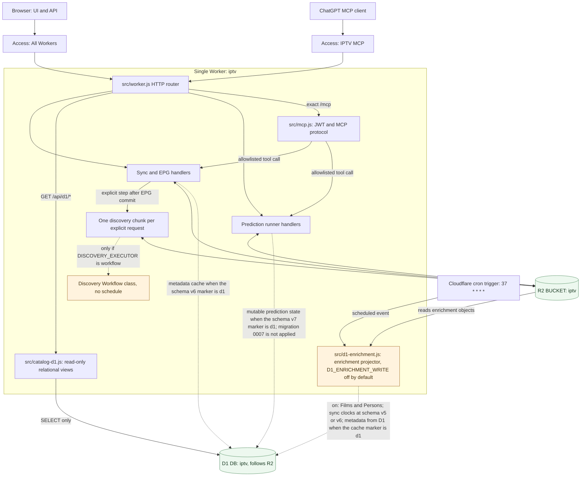

# Worker runtime topology

**Scope:** request routing and trusted storage boundary of the current deployed Worker. Sources: [`src/worker.js`](../../src/worker.js), [`src/mcp.js`](../../src/mcp.js), [`src/continuation.js`](../../src/continuation.js), [`src/d1-enrichment.js`](../../src/d1-enrichment.js), [Wrangler settings](../../wrangler.jsonc) and [runtime runbook](../runbooks/deployment.md).

The **one-chunk continuation** is executed inside the explicit step or request that asks for it while `DISCOVERY_EXECUTOR` is absent. The Discovery Workflow class is loaded with the Worker and has no schedule, so a deploy does not create an instance ([ADR 0082](../adr/0082-inert-discovery-workflow.md), Proposed). Only an exact `workflow` value starts one, and then still one chunk per durable step. `DiscoveryContinuation` is an internal entrypoint, not an unauthenticated public endpoint, a second Worker, a cross-isolate guarantee, or a self-fetch with credentials. Only authorized operations invoke write handlers. Route names such as GET/status cannot universally be assumed read-only: consult [deployment safety notes](../runbooks/deployment.md).

`wrangler.jsonc` binds `BUCKET` to R2 `iptv` and `DB` to the D1 database `iptv`. R2 stays authoritative for every existing page and writer. Pages read D1 only through the [D1 catalog views](../reference/api/d1-catalog.md) under `/api/d1/`, behind the same Access policy as the rest of `/api/`. The D1 data is the backfilled copy of R2 ([D1 backfill runbook](../runbooks/d1-backfill.md)).

The one Worker cron trigger runs only the [enrichment projector](../adr/0056-d1-enrichment-write-through.md), never a sync, EPG, discovery or prediction step. With `D1_ENRICHMENT_WRITE` unset it returns at once.

- With `dry`, it reads the enrichment objects from R2 and the change keys from D1, and logs the diff.
- With `on`, it also writes the changed Films and Persons to D1 under its lease, and it never writes R2. Sync clocks are included on that arrow at schema version 5 ([ADR 0070](../adr/0070-metadatasync-freshness-clocks.md)), which is the applied production schema. While the schema v6 marker is absent or `r2`, the sync arrow is the Worker's only D1 write besides the projector. When that marker is `d1`, the sync arrow also writes the metadata cache, and the projector reads those rows instead of `metadata.json` ([ADR 0073](../adr/0073-metadata-cache-d1-authority.md)). A deploy does not apply migration `0006` or `0007` and does not switch either marker. Migration `0007` is not applied. When it is, and `prediction_domain_authority.mode` is `d1`, the prediction handlers write that domain in D1 and keep immutable bodies in R2. At schema version 7 or newer, zero prediction tables means that the domain is not installed and its mutable state remains on R2. A partial set of prediction tables, or a complete set with an invalid marker, fails closed instead of falling back to R2. The deployed Worker sets `PREDICTION_DB_REQUIRED=on`, so a missing `DB` binding fails closed the same way ([ADR 0078](../adr/0078-d1-authoritative-prediction-domain.md)). The projector does not write that domain.

Runtime mode and configured Cloudflare Access policies must be rechecked for live-state claims.

See [one-chunk ADR](../adr/0006-one-chunk-discovery.md), [MCP security contract](../reference/api/mcp.md) and [D1 schema boundary](../reference/data/d1-schema.md).
