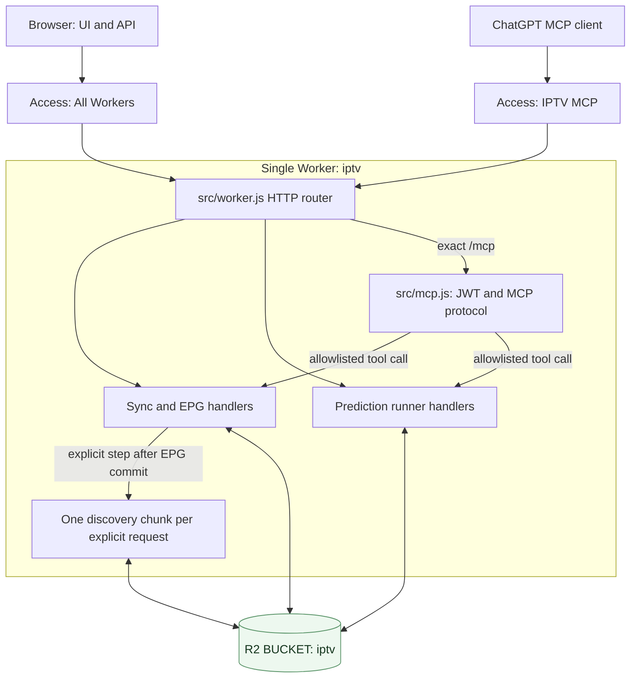

# Worker runtime topology

**Scope:** request routing and trusted storage boundary of the current deployed Worker. Sources: [`src/worker.js`](../../src/worker.js), [`src/mcp.js`](../../src/mcp.js), [`src/continuation.js`](../../src/continuation.js), [Wrangler settings](../../wrangler.jsonc) and [runtime runbook](../runbooks/deployment.md).

The **one-chunk continuation** is executed inside the explicit step/request that asks for it. `DiscoveryContinuation` is an internal entrypoint, not an unauthenticated public endpoint, a second Worker, a cross-isolate guarantee, or a self-fetch with credentials. Only authorized operations invoke write handlers. Route names such as GET/status cannot universally be assumed read-only: consult [deployment safety notes](../runbooks/deployment.md).

`wrangler.jsonc` binds `BUCKET` to R2 `iptv` and contains no production D1 binding. Local D1 repository code and dry-run migration do not make D1 part of this deployed topology. Runtime mode and configured Cloudflare Access policies must be rechecked for live-state claims.

See [one-chunk ADR](../adr/0006-one-chunk-discovery.md), [MCP security contract](../reference/api/mcp.md) and [D1 schema boundary](../reference/data/d1-schema.md).
