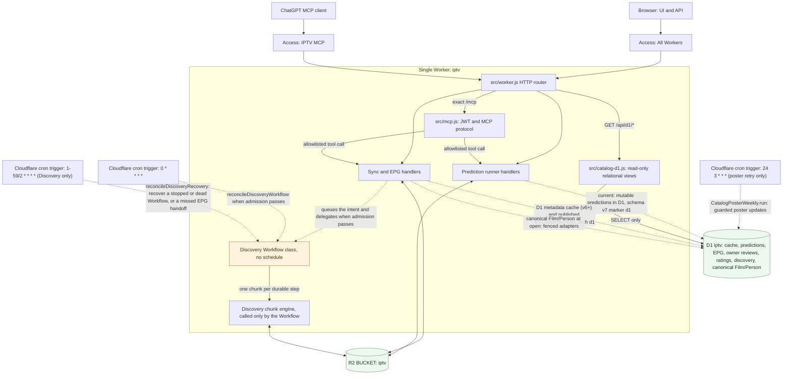

# Worker runtime topology

**Scope:** request routing and trusted storage boundary of the current deployed Worker. Sources: [`src/worker.js`](../../src/worker.js), [`src/mcp.js`](../../src/mcp.js), [`src/continuation.js`](../../src/continuation.js), [`src/d1-enrichment.js`](../../src/d1-enrichment.js), [Wrangler settings](../../wrangler.jsonc) and [runtime runbook](../runbooks/deployment.md).

The **one-chunk continuation** is executed only by the Cloudflare Discovery Workflow, one chunk per durable step ([ADR 0083](../adr/0083-inert-discovery-workflow.md), selector retired by AIR-325). The Workflow class has no schedule, so a deploy does not create an instance; an EPG commit, a continuation or resolve request and the cron reconcile start or attach one only after the Workflow binding and D1 admission checks pass, and otherwise fail closed. No HTTP request runs a chunk any more. `DiscoveryContinuation` is an internal entrypoint, not an unauthenticated public endpoint, a second Worker, a cross-isolate guarantee, or a self-fetch with credentials. Only authorized operations invoke write handlers. Route names such as GET/status cannot universally be assumed read-only: consult [deployment safety notes](../runbooks/deployment.md).

`wrangler.jsonc` binds `BUCKET` to R2 `iptv` and `DB` to the D1 database `iptv`. Canonical Film/Person is D1-authoritative (`film_person_authority` `d1`/`open`, generation 2, 16 Nov 2026 UTC). Migration `0011` is applied. The ratings marker is `d1` / `open` at generation 12 ([manual run](../evidence/d1-migration/air-318-ratings-manual-run-2026-11-04.md)). The discovery marker is `d1` / `open` at generation 1 ([activation record](../evidence/d1-migration/air-320-discovery-activate-2026-11-04.md), [ADR 0085](../adr/0085-d1-authoritative-discovery.md), Accepted). D1 now owns the metadata cache, mutable predictions, published EPG/watchlist generation, owner reviews (`owner_review_authority.mode=d1`, generation 1, [activation record](../evidence/d1-migration/air-314-owner-review-activate-2026-11-03.md)), the mutable ratings documents, and the discovery ledger. The first successful post-cutover EPG commit was recorded on 3 November from a daily-task-created run completed by one owner-authorized manual step (`00ff34fa…`); the fenced generation-2 D1 member/show and R2 mirror comparison passed ([AIR-319 evidence](../evidence/d1-migration/air-319-production-cutover-2026-11-03.md)). Pages read D1 through the published programme/watchlist routes and [D1 catalog views](../reference/api/d1-catalog.md) under `/api/d1/`, behind the same Access policy as the rest of `/api/`. At Film/Person `open`, catalog freeze readers use bounded D1; canonical `titles.json` / `people.json` are frozen and are not a fallback. Metadata cache, mutable predictions, published EPG, owner reviews, ratings and discovery remain separately activated D1 domains ([D1 backfill runbook](../runbooks/d1-backfill.md)).

The hourly Worker cron trigger runs the EPG `ensure`, `reconcileDiscoveryWorkflow` ([ADR 0093](../adr/0093-discovery-workflow-cron-reconcile.md)) and the monitor. A second cron trigger ([ADR 0174](../adr/0174-discovery-only-fast-recovery-cron.md), AIR-534) every two minutes calls only the Discovery recovery reconcile and runs none of those. The hourly trigger does not call the enrichment projector ([ADR 0155](../adr/0155-retire-enrichment-projector-cron.md)), which no longer exists in the repository (its runner and write arms were removed in AIR-537 slice 3; `src/d1-enrichment.js` keeps only a historical read-only diagnostic function that, since AIR-690, no route calls; `/api/d1/status` reports the Film/Person status only); `D1_ENRICHMENT_WRITE` is ignored. It never runs a sync, EPG download, discovery chunk or prediction step. Without the Workflow binding or D1 admission the Discovery reconcile returns without `create()`; the retired `DISCOVERY_EXECUTOR` variable is ignored.

Canonical Film/Person writes are the fenced adapters. A first natural Producer Workflow pass at `open` is unproven. Sync clocks from schema version 5 onward ([ADR 0070](../adr/0070-metadatasync-freshness-clocks.md)) are written by those adapters at `open`; current production schema is **23**. While the metadata-cache marker is absent or `r2`, sync uses its R2 metadata working set; independent D1-owned domains retain separate markers. When that marker is `d1`, the sync arrow writes the metadata cache ([ADR 0073](../adr/0073-metadata-cache-d1-authority.md)). A deploy does not apply any database migration or switch authority markers. Migration `0007` is applied and `prediction_domain_authority.mode=d1` was activated on 3 November 2026. Prediction handlers write mutable data to D1 and keep immutable bodies in R2. At schema version 7 or newer, zero prediction tables means that the domain is not installed and its mutable state remains on R2. A partial set of prediction tables, or a complete set with an invalid marker, fails closed instead of falling back to R2. The deployed Worker sets `PREDICTION_DB_REQUIRED=on`, so a missing `DB` binding fails closed the same way ([ADR 0078](../adr/0078-d1-authoritative-prediction-domain.md)).

**Historical, removed in AIR-537 slice 3 (not drawn above): pre-AIR-308 projector.** With `dry`, the hourly projector read the enrichment objects from R2 and the change keys from D1, and logged the diff. With `on` while Film/Person was `open`, that projector was compare-only for canonical Film/Person and never wrote R2. When the metadata-cache marker was `d1`, it read those rows instead of `metadata.json`. It did not write the prediction domain. The cron no longer starts that run. A held `projector_window` row still refuses Discovery admission.

Runtime mode and configured Cloudflare Access policies must be rechecked for live-state claims.

See [one-chunk ADR](../adr/0006-one-chunk-discovery.md), [MCP security contract](../reference/api/mcp.md) and [D1 schema boundary](../reference/data/d1-schema.md).

## EPG diagnostic canary (retired)

No diagnostic binding, route or Workflow class exists: removed by AIR-457 ([ADR 0159](../adr/0159-detach-epg-diagnostic-runtime.md)), code deleted by AIR-521 ([ADR 0161](../adr/0160-delete-epg-diagnostic-canary-code.md)). The Worker keeps the production D1 `DB`, R2 `BUCKET` and the Discovery, Ratings, EPG and Producer Workflows.

## Prediction start Workflow binding (ADR 0193)

`wrangler.jsonc` declares Workflow `iptv-prediction-start` (`PREDICTION_START_WORKFLOW`, class `PredictionStartWorkflow`, [ADR 0193](../adr/0193-deferred-batch-start-with-server-issued-key.md), Proposed). Deployment creates the definition only; no instance exists until a Task sends a deferred `prediction_batch_start`. An instance is created per run id by the start request and runs one non-retried step `prepare` (the keyed start of [ADR 0188](../adr/0188-idempotent-keyed-batch-start-and-early-start-claim.md) with its claim and fencing) with a 4 minute timeout. It writes only what a synchronous keyed start writes, plus two create-only records: the attempt marker `enrichment/batch-start/attempt/<runId>.json` (written before the instance is created, so it exists whenever a dispatch is possible) and the terminal outcome `enrichment/batch-start/<runId>.json`. The run id is derived from the issued key, so an instance, a claim, an outcome and a manifest are all found by it; an error from `create` is reconciled against the instance identity instead of being assumed to mean absence. It is not a Cron job, not a scheduler and not a second prediction pipeline; the Task remains the only caller. Without the binding a deferred start answers `503 deferred_start_unavailable` and releases its claim.

## Ratings Workflow (retired)

The Ratings Cloudflare Workflow (`iptv-ratings`, binding `RATINGS_WORKFLOW`, class `RatingsWorkflow`) is retired: `wrangler.jsonc` no longer declares it, the Worker no longer exports the class and no code creates or runs an instance. Ratings are written by the Letterboxd Sync Workflow. A Cloudflare registration `iptv-ratings` with its historical instances may still exist until a separate, owner-approved deletion; it is not bound to any code. `wrangler.jsonc` declares Workflow `iptv-epg` (`EPG_WORKFLOW`, class `EpgWorkflow`, [ADR 0100](../adr/0100-epg-cloudflare-workflow-executor.md)). **Current:** EPG mode is `cloudflare` (epoch 1); migration `0017` is applied; hourly `ensure` creates or attaches instances. A deploy still creates no instance by itself. **Historical:** before the owner switch the binding was inert, mode `external`, and a deploy did not apply `0017`.

## Monitor (AIR-349)

One more tick on the existing hourly cron, one R2 key (`monitor/state.json`) and, once the owner configures it, one outbound alert channel (the generic HTTPS webhook, or the fixed Telegram Bot API endpoint chosen by `MONITOR_TRANSPORT`) and one dead-man ping. No new Worker, Workflow, trigger or binding. See [ADR 0095](../adr/0095-cloudflare-native-production-monitor.md) and [ADR 0097](../adr/0097-monitor-telegram-bot-api-transport.md).

The Worker declares a third cron entry, `24 3 * * *` UTC, that runs only the automatic catalog-poster retry ([ADR 0179](../adr/0179-weekly-automatic-catalog-poster-retry.md)); `src/worker.js` dispatches on the exact `controller.cron` and the poster branch runs none of the EPG, Ratings, Monitor or Discovery recovery work. The entry is declared in `wrangler.jsonc`; it takes effect on a deploy of that configuration, and its production activation is a separate owner decision that has not been taken.

The Worker declares a fifth cron entry, `11-59/15 * * * *` UTC, that runs only the Catalog Enrichment reconcile ([ADR 0219](../adr/0219-discovery-film-enrichment-and-refresh.md), [reconcile in the contract](../reference/domain/catalog-enrichment.md), [activation runbook](../runbooks/catalog-enrichment-producer.md#activating-the-rated-scope-c2-air-607)); `src/worker.js` dispatches the exact expression first and the branch runs none of the EPG, Ratings, Monitor, Discovery or poster work. It is idle while the producer's control is not `active`. The diagram above is not exhaustive and is unchanged. See [scheduling](scheduling-and-orchestration.md#daily-catalog-poster-retry-cron).
