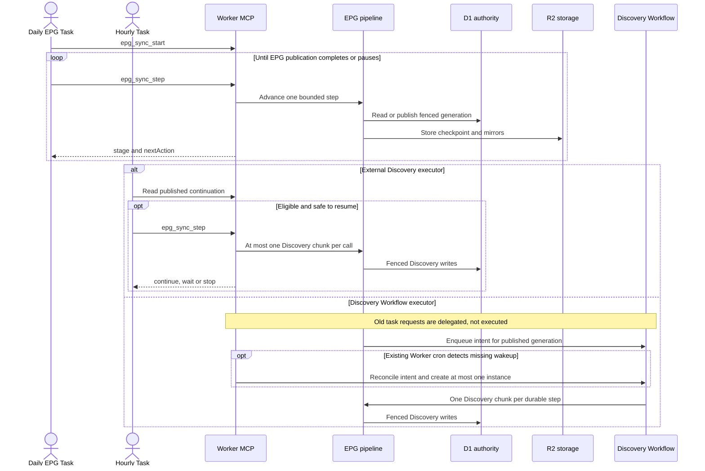
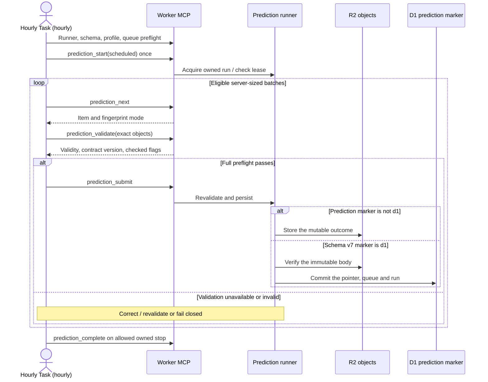
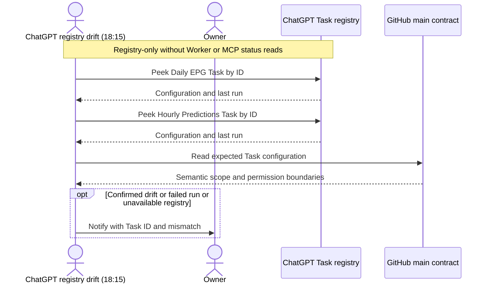
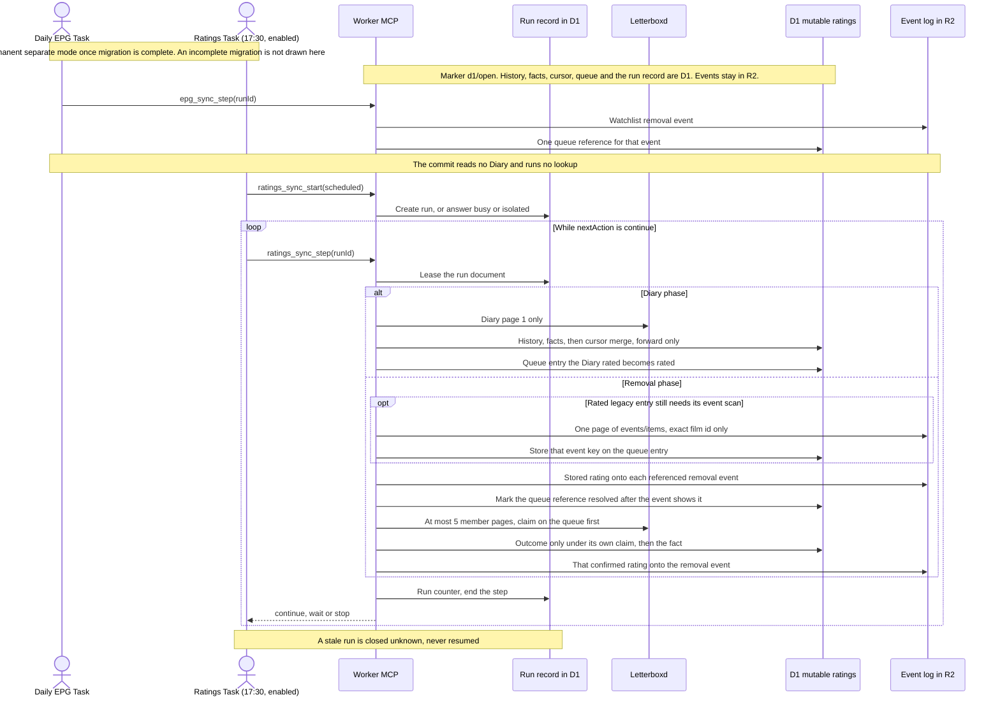
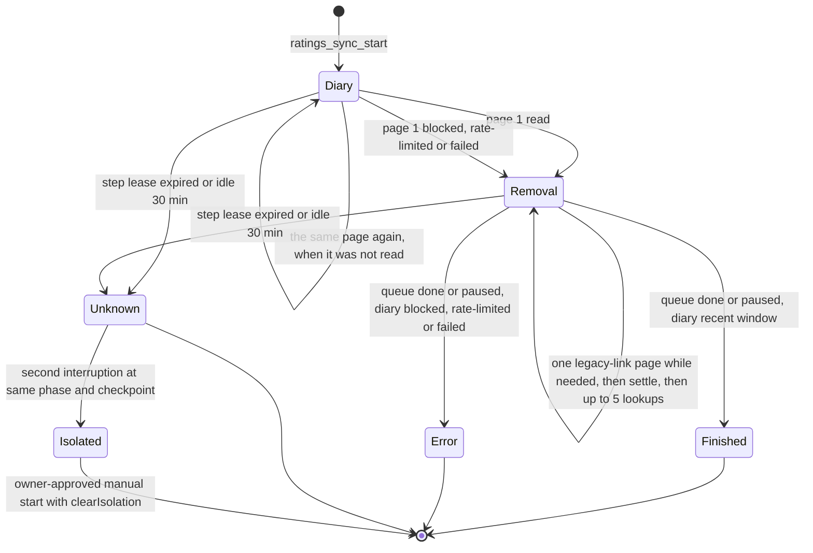
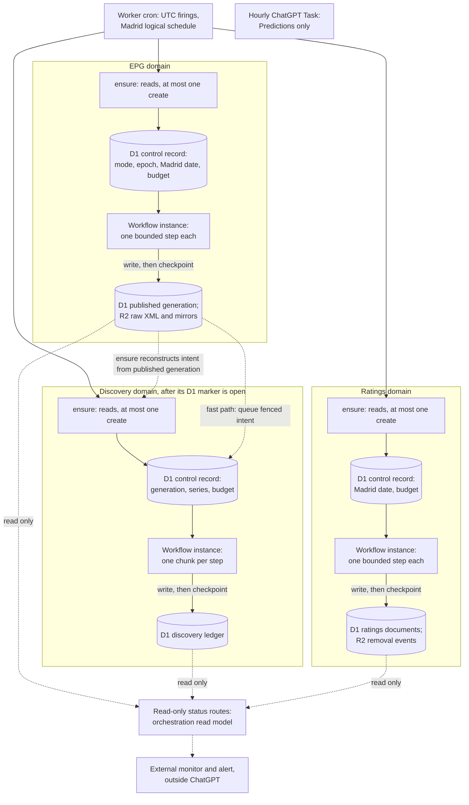
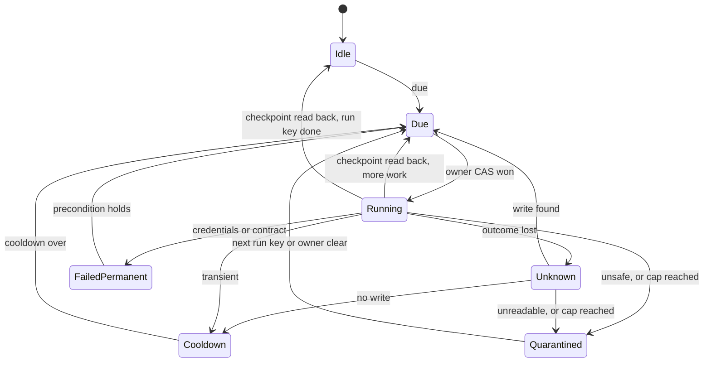

# Scheduling and orchestration

Scheduling is split. The only **external ChatGPT Scheduled Task** that produces anything is the hourly Predictions Task (the read-only drift monitor in the same registry is not a producer; the legacy Daily EPG and Ratings Tasks are retired and disabled). **Cloudflare** runs EPG (a Workflow, mode `cloudflare` since the AIR-348 cutover accepted on 8 November 2026), Ratings (a Workflow, mode `cloudflare`), Discovery (a Workflow, `DISCOVERY_EXECUTOR=workflow`), the monitor and the D1 enrichment projector, all started from the Worker's one cron trigger (`0 * * * *`, hourly at minute 0 UTC; it was `37 * * * *` until AIR-348). Each tick calls, independently of the others, the D1 enrichment projector ([ADR 0056](../adr/0056-d1-enrichment-write-through.md)), the Ratings `ensure` ([ADR 0090](../adr/0090-ratings-cloudflare-workflow-executor.md); once the daily run is due it creates one Workflow instance per Madrid date), the EPG `ensure` ([ADR 0100](../adr/0100-epg-cloudflare-workflow-executor.md); it creates the daily Workflow instance once the run is due, and nothing while its mode is `external`), `reconcileDiscoveryWorkflow` ([ADR 0093](../adr/0093-discovery-workflow-cron-reconcile.md), Accepted) and the monitor ([ADR 0095](../adr/0095-cloudflare-native-production-monitor.md)). The projector stays inert while `D1_ENRICHMENT_WRITE` is unset. The Discovery reconcile creates nothing while `DISCOVERY_EXECUTOR` is absent. The Worker exposes owner-only MCP tools that perform work only when invoked. Expected task behavior: [Scheduled Task contract](../reference/scheduled-tasks.md). Sources: [scheduling ADR](../adr/0005-external-chatgpt-tasks.md), [one-chunk ADR](../adr/0006-one-chunk-discovery.md), [MCP contract](../reference/api/mcp.md) and [prediction operations](../runbooks/prediction-operations.md).

The sequences below are **independent scheduled or externally driven flows**, not a single sequential execution. They are split for legibility; each uses the same existing Worker, Access, R2 and D1 boundaries. The cron expression is `0 * * * *` (AIR-348). The Predictions diagram shows the live hourly Task. The sequences headed *Daily EPG and hourly discovery continuation* and the Ratings sequence that draws a `Daily EPG Task` show the **retired** ChatGPT Daily EPG Task and the former Stage A discovery catch-up: production EPG, Discovery and Ratings are Cloudflare Workflows now. They are kept as the rollback and history flow; redrawing them is a separate change that needs a real render review and the owner's approval. The publication path currently uses D1 because `published_epg_authority.mode=d1` and `cutover=open` ([ADR 0079](../adr/0079-d1-authoritative-published-epg.md), Accepted). R2 holds compatibility mirrors. *Historical (3 November 2026):* the first post-cutover D1 publication succeeded on a daily-task-created run completed by one explicitly owner-authorized manual `epg_sync_step`, and unattended completion and direct R2/D1 parity were then unverified. *Since then:* the first natural Cloudflare EPG run was accepted on 8 November 2026 with the R2 compatibility mirrors checked against the D1 generation ([AIR-348 evidence](../evidence/orchestration/epg-first-natural-run-air-348-2026-11-08.md)). Discovery continuation state is D1-owned ([ADR 0085](../adr/0085-d1-authoritative-discovery.md)). The changed label was [visually approved by the owner on 2026-11-01](https://trello.com/c/pQL8NUTC#comment-6ae7b1d91923578e9aaaca44). *Historical (2 November 2026):* the workflow `opt` in the daily and hourly sequence was accepted but inactive ([ADR 0083](../adr/0083-inert-discovery-workflow.md), Accepted), its diagrams were visually approved by the owner on 2 November 2026, and while `DISCOVERY_EXECUTOR` was absent the sequence stayed the external tasks. *Since then:* `DISCOVERY_EXECUTOR` reads `workflow` (`feature_flags`, 10 November 2026) and the Cloudflare Discovery Workflow is the executor ([AIR-324](https://trello.com/c/kNtaEbm8), accepted 7 November 2026), so that `opt` branch is the live one and the external-task branches are the retired flow. *Historical, external executor:* an interrupted discovery series is not one of the safe paused continuations in the hourly alt below: the hourly task does not call `epg_sync_step` for `reason: interrupted`. After a gated confirm has stored an ordinary checkpoint for the same published generation ([ADR 0088](../adr/0088-guarded-interrupted-discovery-recovery.md), Proposed), the next hourly invocation follows the existing stage A rule. The diagram is unchanged.

### Daily EPG and hourly discovery continuation (retired external flow)

This is the flow of the retired ChatGPT Daily EPG Task and of the hourly Stage A that it drew. It no longer runs: the Daily Task is disabled, the hourly prompt is Stage B only, and the Worker refuses `epg_sync_start` and `epg_sync_step` with `external_writer_fenced` while the EPG mode is `cloudflare`. The diagram is retained for a separately approved reverse cutover.



### Hourly prediction pipeline



Migration `0007` is applied and the prediction marker is `d1`, so the live branch is D1 mutable state with immutable R2 bodies. The `r2` branch documents the prior and rollback behavior ([ADR 0078](../adr/0078-d1-authoritative-prediction-domain.md)). The hourly task stays enabled on the same `:20` Europe/Madrid schedule, and Stage A is unchanged. Stage B of the external prompt requests `fingerprint.evidence` on a new `fingerprint_and_prediction` item and passes that film's metadata into `prediction_validate` when an item cites a metadata token ([hourly evidence instruction](../reference/scheduled-tasks.md#fingerprint-evidence-instruction-in-the-live-hourly-task-air-335-2026-11-03)). The diagram above is the same validate and submit path. Worker fingerprint versions stay at 1.

### Read-only Scheduled Task registry drift

The drift monitor now peeks **one** Task, the hourly Predictions Task. The *Peek Daily EPG Task by ID* step below belongs to the earlier two-Task scope (AIR-377): the Daily EPG Task is retired and disabled and is no longer audited. The updated scope is [AIR-406](https://trello.com/c/PPe2fFcu); the diagram is not redrawn here.



### Worker cron: R2-to-D1 enrichment projection

```mermaid
sequenceDiagram
    participant Cron as Worker cron
    participant Worker as Enrichment projector
    participant R2 as Authoritative R2
    participant D1 as D1 database
    Cron->>Worker: Scheduled event at minute 0
    opt D1_ENRICHMENT_WRITE is dry or on
        Worker->>R2: Read published enrichment records
        Worker->>D1: Read projection change keys
        opt Schema v6 or v7 and the metadata cache marker is d1
            Worker->>D1: Read metadata cache records
        end
    end
    opt Flag on and source inputs complete
        Worker->>D1: Atomically write changed Films and Persons with keys
        opt Schema v5, v6 or v7 with film_sync_state present
            Worker->>D1: Write metadata sync clocks with checkpoint
        end
    end
    opt DISCOVERY_EXECUTOR is workflow
        Cron->>Worker: reconcileDiscoveryWorkflow
        Note over Worker,D1: Reads only unless a missing intent or a dead instance needs one create. No chunk, no TMDB. A projector_window refusal is retried in this tick after the window expiry (AIR-428); each attempt is logged.
    end
```

The cron expression is `0 * * * *` (it was `37 * * * *` until AIR-348; Madrid is a whole-hour offset, so an hourly UTC cron has a tick at Madrid 17:00 in CET and CEST, and each daily `ensure` decides due itself from the Madrid date). The same firing also calls the ratings `ensure`, the EPG `ensure` and `reconcileDiscoveryWorkflow`; the ratings `ensure` creates one Workflow instance per Madrid date once the daily run is due and the EPG and Discovery calls return without a `create()` while their modes are external (in production both are Cloudflare modes, so the EPG `ensure` creates the daily Workflow instance once the run is due and the Discovery reconcile acts on a missing intent or a dead instance). When the same tick grants a projector window, a scheduled reconcile that is refused as `projector_window` waits for that window's one expiry in the same invocation (at most three attempts) and then creates a due successor; it does not wait until the next hour. Each attempt is a Workers Log `discovery_workflow_reconcile`; a green cron is not a Discovery recovery. When `D1_ENRICHMENT_WRITE` is unset, the projector performs no R2 reads or D1 writes. With `dry`, it reads the source and change keys but never writes. With `on`, the projector writes changed Films and Persons in existing fenced batches. At schema v5, `film_sync_state` uses that same writer: sync clocks for an already-changing Film share its batch, while a clock-only change uses its own fenced batch. That schema is applied. At schema v6, the same clocks are written, and when the metadata cache marker is `d1` the metadata records come from D1. Schema v7 and v8 keep those clocks and cache reads; the projector writes neither the prediction nor the published EPG domain. A partial prediction domain, or a complete one without a valid marker, fails the run before a write. None of the prediction tables on a later contract does not: prediction stays on the objects. `PREDICTION_DB_REQUIRED=on` makes a missing `DB` binding, or a bound database without `schema_contract`, fail the same way. The variable is not a new cron and not a new operational flag. The projector still does not write R2 or the cache. A code deploy does not apply migration `0006` or `0007`. Production has applied `0006` and that marker is `d1` ([ADR 0073](../adr/0073-metadata-cache-d1-authority.md), [cutover](../evidence/d1-migration/air-313-metadata-cache-cutover-2026-11-01.md)). Production applied `0007` and activated the prediction marker on 3 November 2026 ([ADR 0078](../adr/0078-d1-authoritative-prediction-domain.md)).

The drift monitor is a read-only automation in the same ChatGPT registry, enabled daily at 18:15 Europe/Madrid (DTSTART 2026-10-31). It reads only the live hourly Predictions Task entry (and, until AIR-406 is applied to the live Task, the retired Daily EPG entry as well) and the maintained GitHub contract, and reports confirmed drift or failed execution. It neither reads Worker/MCP status nor watches Ratings. The independent Cloudflare-native monitor owns EPG, Discovery, Ratings and Predictions progress and alerts ([monitor runbook](../runbooks/monitoring.md)). The drift audit shares the scheduler with the producers, so no notification does not prove availability.

A scheduled trigger does not imply successful completion. `already_running`, `busy`, lease ownership, deferred backoff and a previous run's retries that could not yet be written (`prediction_retry_heal_pending`) may prevent new work. The prediction Task, the EPG Task's commit and the discovery chunks can overlap. All three write the prediction queue, and each write is conditional and rebuilds on conflict ([ADR 0064](../adr/0064-prediction-queue-conditional-writes.md), Accepted 2026-10-31), so the overlap does not lose a retry or a batch summary. Discovery uses **one chunk per explicit request**; it does not recursively self-fetch through an Access bypass or an internal continuation service. The [MCP security boundary](authentication-and-mcp.md) verifies signed identity and restricts tool arguments.

### Projector exclusive window ([ADR 0103](../adr/0103-projector-exclusive-window.md); `D1_ENRICHMENT_WINDOW` read `on` on 10 November 2026)

The projector's strict generation pin cannot pass while Discovery writes about seventeen times a minute, so a `D1_ENRICHMENT_WRITE=on` run may first take an exclusive window, behind `D1_ENRICHMENT_WINDOW` (off by default, [flag contract](../reference/feature-flags.md)) and the table `projector_window` of migration `0018` (applied to production on 2026-11-08, one `idle` row). The run asks for the single row; from then on every Discovery lease acquisition (a chunk, a seal, a publish handoff, an owner correction) is refused with the typed busy `projector_window` and its absolute deadline, and the in-flight chunk is not interrupted. When the lease row is free (and no ledger transfer is loading), one D1 batch gives it to the projector and marks the row `held`; the three generation writers that do not need the lease are refused by their own statement while it is held. The run then reads, diffs and writes under the unchanged generation pin, projector lease and batch fences, each batch also asserting that the run still owns an unexpired `held` row, and releases both rows at the end. One absolute deadline (a proposal of 300 s, with at least a minimum run time left at the grant) covers the request and the hold, is never extended, and an expired row is idle for every reader, so a crashed run frees Discovery by itself. The hourly cron, the Scheduled Tasks, the Ratings executor and the monitor do not read the row. An EPG publication that meets the window is answered with a structured `busy` until the deadline and is not failed; the external daily Task contract waits only for a `lease_held` seal busy within about 93 s, so that contract is the activation blocker named in the ADR. Nothing here is activated. The Discovery Workflow treats a refused state write as a soft wait: every caller (progress, wait, busy, start, rollover, final stop, recovery arming and its successor) turns the typed refusal into a value, sleeps to the window's one expiry, re-saves the record afterwards and charges neither the stall nor the recovery budget. A checkpoint (progress, final stop, recovery arming) counts as done only when it is confirmed persisted by the owner: a window refusal is retried after its expiry (at most 24 times, each a bounded sleep), a lost compare-and-swap up to three times, and the step cap bounds both. Exhausted retries are never reported as saved and never as lost ownership; the instance ends in an explicit `deferred` state (`window_checkpoint_unsaved`, `window_stop_unsaved`, `window_recovery_unarmed`, or the `*_write_conflict` forms), the record still names that instance, and the hourly reconcile recovers it. The coordination API itself refuses a window longer than 300 s, a zero or non-integer run time and a malformed clock before any statement runs, and the table repeats the bound as a CHECK.

## The separate ratings pipeline

**EPG executor (AIR-348, active).** [ADR 0100](../adr/0100-epg-cloudflare-workflow-executor.md) (Accepted) adds a Cloudflare EPG Workflow that drives the existing `/api/sync/*` steps in-process after an owner-approved three-step switch (`external`, `switching`, `cloudflare`; epoch fence asserted inside the D1 pointer batch). The switch is done: `epg_status` read `mode=cloudflare`, epoch 1, and the first natural run was accepted on 8 November 2026 ([evidence](../evidence/orchestration/epg-first-natural-run-air-348-2026-11-08.md)); the Daily Task is disabled. The diagram below shows the retired Daily Task and is retained as the rollback flow. The hourly cron calls an inert `EpgOrchestration.ensure` next to the projector, Ratings `ensure`, the Discovery reconcile and the monitor, each independent and none sharing a lease; the cron expression is `0 * * * *` since the separate owner-approved AIR-348 change (it was `37 * * * *`). The Ratings Cloudflare executor shares the 17:00 Europe/Madrid logical due time ([ADR 0101](../adr/0101-ratings-logical-due-time-1700.md), which supersedes the 17:30 of ADR 0090 in that one respect); the diagram below shows the legacy Ratings Task and is unchanged.

[ADR 0060](../adr/0060-independent-letterboxd-ratings-pipeline.md) moved Letterboxd ratings out of the EPG commit. [ADR 0074](../adr/0074-retire-ratings-pipeline-switch.md) (Accepted 2026-11-01) makes that the only path: the Worker does not read `RATINGS_PIPELINE`. When migration is complete the commit only enqueues removed films, and the Ratings Task drives its own run with `ratings_sync_start` and `ratings_sync_step`. When migration is not complete the commit publishes and does not read Diary, look up films or enqueue; that failure is not drawn here. A live read-only check on 2026-10-31 found the storage migrated, the binding `separate` and the Ratings Task enabled. The registry-only drift audit does not read Ratings status; the Cloudflare-native production monitor observes durable Ratings progress. Neither monitor invokes ratings writers. `ratings_storage_migrate` stays the one-time owner tool that made the mode possible; the commit does not call it. The expected recurrence of the Ratings Task, after the owner-approved registry change on 2026-10-31, is daily at 17:30 Europe/Madrid with flexible timing and DTSTART 2026-11-01. A scheduled start is not refused for following the previous one ([ADR 0069](../adr/0069-no-scheduled-ratings-start-gap.md), Accepted). `busy` and `isolated` still end the invocation. The six-hour pause after a Letterboxd 403 or 429 on the removal queue stays. While a rated legacy entry still needs event references, a removal step first lists one page of existing removal events and links the exact film id, then settles stored ratings ([ADR 0071](../adr/0071-legacy-removal-event-link.md), Accepted 2026-10-31). A step with nothing left to link does not list. This page does not change a flag or a task, and it does not start that scan. Contracts: [ratings reference](../reference/integrations/letterboxd-ratings.md#separate-ratings-pipeline), [MCP reference](../reference/api/mcp.md), [Scheduled Tasks](../reference/scheduled-tasks.md#ratings-task); operation: [runbook](../runbooks/letterboxd-diary-history.md#separate-ratings-pipeline).





The run record is one D1 document. It admits one running run and one active step, and the lease is that document. Diary history, the diary cursor, facts and the removal queue are separate D1 documents. A compare-and-swap of one document is one fenced batch: a film record also writes its `ratings_view` rows in that batch, and the batch advances `ratings_domain_authority.generation`. A stale etag leaves the batch uncommitted. Those documents do not fall back to R2. Removal events stay in the R2 event log. There is no transaction across D1 and R2, so a settle writes the event by compare-and-swap and only then marks the queue reference resolved. A kill between the two repeats the event write. The cursor join only moves forward. Its last-attempt diagnostics are a deterministic last-writer-wins record that never plans a read. The queue accepts an outcome only under the step's own claim. History and facts take an idempotent merge, so a late write can add a newer observation and does not move an existing one backwards. A late event merge can add the rating and does not move the D1 fact. The cursor and the queue are authoritative; the run record's checkpoint is a per-run counter. Each removal event keeps its own reference in the queue, and an unresolved one is never pruned. The diagram shows that open marker. The event log still has no multi-key transaction, so a step that outlived its lease is not fenced out of an event object. A removal step lists one page of `events/items/` only while a rated legacy entry still needs that scan, then writes the ratings of rated entries to their removal events (at most 100 references per step), then runs the lookups. With nothing left to link, the list does not run. Deploying this page does not start a ratings run. The ratings run reads Diary page 1 only ([ADR 0067](../adr/0067-diary-recent-window.md)). That is not a byte copy of the earlier multi-page reader. The queue and the cursor migration rules are unchanged. The migration's witness `letterboxd/ratings/migration.json` records each converted object, so the status reports one found back at version 1 as `regressed`. The queue and the cursor are migrated only by the owner-approved `ratings_storage_migrate` tool. The separate pipeline runs only once that migration is complete; until then the commit fails closed. A stale run is closed by the next start or step, never by the status read. Ownership, contracts, races, migration and rollback are in the ADR. The diagram is the production mode as of the 2026-10-31 live read (migration complete, Ratings Task enabled). The Worker does not read `RATINGS_PIPELINE`, `LETTERBOXD_DIARY_HISTORY` ([ADR 0075](../adr/0075-retire-letterboxd-diary-history-switch.md), Accepted 2026-11-01) or `REMOVAL_RATING_LOOKUP` ([ADR 0077](../adr/0077-retire-removal-rating-lookup-switch.md), Proposed). The up-to-five lookups on the Removal loop are that permanent fallback: a film the Diary already rated, or absent from the current Diary page with a confirmed stored fact, is not requested, including after a new reference reopens its queue entry, and a paused queue is not requested. A film that page lists without a rating is still looked up. A null or absent rating is not watched. A step probes at most five stored ratings and does not request a film it has not probed. The state-diagram arrows are unchanged. The sequence diagram draws the open marker ([ADR 0084](../adr/0084-d1-authoritative-ratings.md), Accepted). History, facts, the cursor, the removal queue and the run record go to the D1 participant. Event writes and the event-list page stay on R2. While `0010` is absent, or the marker is `r2`, those documents stay in R2; that state is not drawn. `0010` is applied and the marker is `d1` / `open`. Activation left generation 1 ([activation record](../evidence/d1-migration/air-318-ratings-activate-2026-11-04.md)). A manual MCP run at 08:28 UTC left generation 12 ([manual run](../evidence/d1-migration/air-318-ratings-manual-run-2026-11-04.md)) and did not change the 17:30 Europe/Madrid Ratings Task. The owner visually approved an earlier note on 2026-11-04, while these arrows still pointed at R2. This participant change needs a fresh rendered owner visual approval, as does the persistence arrow. A removal does not become a viewing. Diary page 1, the removal-lookup budgets, and the fail-closed migration states are unchanged. A migrated run enters Diary. One arrow leaves Diary for Removal when page 1 was read. A second leaves Diary for Removal when that request was blocked, rate-limited or failed and the page was not read: the removal phase still runs, and the run ends `error` on the arrow from Removal to Error. There is no off-gate arrow. Neither this diagram nor a deploy changes a task or deletes a leftover binding.

## Proposed Cloudflare executors and shared recovery

**Accepted architecture, not live.** Both diagrams below show the future implementation of [ADR 0089](../adr/0089-shared-orchestration-reliability-contract.md) (Accepted; both diagrams visually approved by the owner on 2026-11-04). Nothing in this section is deployed as drawn: today EPG, Discovery and Ratings are driven by the external tasks above, the Discovery Workflow is inert, and the cron runs the enrichment projector plus inert ratings `ensure` and Discovery `reconcile`. Each domain moves to its executor only through its own owner-approved switch; the field-level contract is the [orchestration reliability reference](../reference/orchestration-reliability.md).



The three domains share no lease, queue, store or Workflow instance; the only shared element is the clock. Each domain commit to D1 compares the epoch and mode in the same batch; R2 side effects are idempotent and bounded by the lease, and a mode switch is close admission, verified drain, then complete ([reference](../reference/orchestration-reliability.md#mode-switch-and-write-fencing)). Each instance writes its domain data first and then its fenced checkpoint and budget into its own control record, compared against the epoch. Each `ensure` runs no chunk, download or lookup. It reads its own control record and creates or attaches at most one instance with an id derived from the run key, so a duplicate firing attaches to the same instance. EPG publication may queue Discovery's fenced intent as a fast path, not in one transaction with the pointer switch; `ensure Discovery` reconstructs the intent from the published generation if that write is missing, and EPG never waits for Discovery. The dotted arrows to the status routes are reads only; the read model reads each domain's control record and its authority.



`Due` includes a known future wake (`retryAt`, `Retry-After`, a pause or a lease), which the read model reports as `waiting`. `Unknown` means a timeout, a lost response or a killed step, resolved only by reading back. A duplicate firing while a run is `Due` or `Running` attaches to it. `Quarantined` returns to `Due` on the next run key only after a budget exhaustion; after unsafe evidence only an owner-approved clear does. Only a read-back checkpoint that moved forward resets the consecutive failure count; a create, an HTTP 200 or a lease does not. The executor never forces a step, never resets a lease and never clears its own quarantine. Predictions are outside both diagrams and stay on the hourly ChatGPT task.

## Canonical Film/Person writer routing ([AIR-371](https://trello.com/c/gt1afd0C), inactive)

The hourly cron still runs only the D1 enrichment projector for canonical Film/Person. `src/canonical-producers.js` is not imported by the Worker, no cron, route or Task calls it, and the projector is unchanged. When the marker is `open` (AIR-374, a separate owner-gated handoff) the projector becomes compare-only and the fenced adapters are the only writers; a projector batch built before the move carries a fence assertion on the marker generation and fails whole, so the two writers never overlap, and a handoff readiness check (read-only) lists what must be drained or built first: the marker and baseline state, the live projector lease and the producer writes that no fenced mutation covers yet. No timing, lease or schedule changes.

## Timing and authority

The timetable and enabled status belong to the external automation registry. The Worker states only the expected hourly trigger (`:20` Europe/Madrid) for display and keeps it apart from its own discovery wait gate; see [Scheduled Task timing](../reference/scheduled-tasks.md#timing-nominal-trigger-versus-server-gate). Historical records of successful scheduling are not a live status check; production task changes or manual invocations require separate owner approval. A GitHub deployment does not trigger any of these workflows.

## Ratings executor implementation (AIR-347)

The hourly cron calls `RatingsOrchestration.ensure` after the enrichment projector. It is inert unless the D1-owned mode document says `cloudflare`; then it claims the Madrid date by CAS and creates one `RatingsWorkflow` instance. The instance loops `start`/`step` with `sleepUntil` between actions and commits through the etag epoch fence. See [ADR 0090](../adr/0090-ratings-cloudflare-workflow-executor.md).

## Discovery Workflow handover ([ADR 0094](../adr/0094-discovery-workflow-invocation-budget.md), Accepted)

A Discovery Workflow instance hands over to a successor at 20 chunks or when the D1 statements it has issued reach 6,000, whichever comes first, so no instance runs into the level at which two instances failed on 6 November 2026. The durable steps, the owner fence and the recovery are those of [ADR 0083](../adr/0083-inert-discovery-workflow.md); no diagram changes.

## Discovery Workflow step-failure recovery ([ADR 0098](../adr/0098-discovery-workflow-step-failure-recovery.md), Accepted)

An instance whose step fails after the platform's retries, with a recognised transient failure (the `discovery_unavailable` code or a transient class), arms the existing recovery once, sleeps durably until `recovery.dueAt` (60 s for the first failure, then 5 min, 15 min, 1 h; four, then quarantine) and, after re-checking owner, authority, pinned generation and mode, opens the deterministic successor through `ensureDiscoveryWorkflow`. The hourly cron remains the fallback and covers what this cannot: an instance killed by the platform, a failure of the arming step, and a `stopped` record without a live owner. No trigger, binding or cron changes; no diagram changes.

## Monitor tick (AIR-349)

The hourly cron also calls `Monitor.run`, which does nothing unless `MONITOR` is `on` (`off` is a permanent emergency gate that also stops the dead-man heartbeat). It reads status records the domains keep, never calls `ensure`, `reconcile` or a resolver, and writes only `monitor/state.json`. Recovery stays with the domain executors ([ADR 0089](../adr/0089-shared-orchestration-reliability-contract.md)). See [ADR 0095](../adr/0095-cloudflare-native-production-monitor.md).
