# Scheduling and orchestration

Scheduling is split. The only **external ChatGPT Scheduled Tasks** that produce anything are the four hourly Predictions v2 Tasks (the read-only drift monitor in the same registry is not a producer; the legacy Daily EPG and Ratings Tasks are retired and disabled). **Cloudflare** runs EPG (a Workflow, mode `cloudflare` since the AIR-348 cutover accepted on 8 November 2026), Ratings (written by the Letterboxd Sync Workflow on its own cron `30 * * * *`; the former Ratings Workflow is retired and deleted), Discovery (a Workflow, permanent since AIR-325; the `DISCOVERY_EXECUTOR` selector is retired and ignored), and the monitor, started from the Worker's hourly cron trigger (`0 * * * *`, hourly at minute 0 UTC; it was `37 * * * *` until AIR-348). A second, Discovery-only trigger (`1-59/2 * * * *`, [ADR 0174](../adr/0174-discovery-only-fast-recovery-cron.md)) runs only the Discovery recovery reconcile every two minutes and none of the consumers below. The D1 enrichment projector is not on that tick ([ADR 0155](../adr/0155-retire-enrichment-projector-cron.md)). Each tick calls, independently of the others, the EPG `ensure` ([ADR 0100](../adr/0100-epg-cloudflare-workflow-executor.md); it creates the daily Workflow instance once the run is due, and nothing while its mode is `external`), `reconcileDiscoveryWorkflow` ([ADR 0093](../adr/0093-discovery-workflow-cron-reconcile.md), Accepted) and the monitor ([ADR 0095](../adr/0095-cloudflare-native-production-monitor.md)). `D1_ENRICHMENT_WRITE` is retired and does not start a projector run. The Discovery reconcile creates nothing without the Workflow binding and D1 admission. HTTP and MCP only delegate to or are refused by the Workflow; the Workflow owns chunk execution, budget renewal and recovery. The Worker exposes owner-only MCP tools that perform work only when invoked. Expected task behavior: [Scheduled Task contract](../reference/scheduled-tasks.md). Sources: [scheduling ADR](../adr/0005-external-chatgpt-tasks.md), [one-chunk ADR](../adr/0006-one-chunk-discovery.md), [MCP contract](../reference/api/mcp.md) and [prediction operations](../runbooks/prediction-operations.md).

**Research within each hourly Predictions Task.** Before generating a prediction, the Task attempts to read original author reviews, distinguishes genuinely read full text from partial text and search snippets, and records per-film access outcomes and fallback reasons in its saved Task report. This work is internal to the external Task: it does not add an orchestration edge, Worker API call, storage table, Cron trigger or `assessment` field. The existing Task-to-MCP validation and submission flow, followed by D1/R2 persistence, remains as diagrammed. Consult the [maintained prompt](../reference/scheduled-task-prompts/hourly-predictions-batch-v2.md) and [research verification procedure](../runbooks/prediction-operations.md); the live registry alone determines whether the Task is currently enabled.

The sequences below are **independent scheduled or externally driven flows**, not a single sequential execution. They are split for legibility; each uses the same existing Worker, Access, R2 and D1 boundaries. The cron expression is `0 * * * *` (AIR-348). The Predictions diagram shows the live hourly Task. The sequences headed *Daily EPG and hourly discovery continuation* and the Ratings sequence that draws a `Daily EPG Task` show the **retired** ChatGPT Daily EPG Task and the former Stage A discovery catch-up: production EPG, Discovery and Ratings are Cloudflare Workflows now. They are kept as the rollback and history flow; redrawing them is a separate change that needs a real render review and the owner's approval. The publication path currently uses D1 because `published_epg_authority.mode=d1` and `cutover=open` ([ADR 0079](../adr/0079-d1-authoritative-published-epg.md), Accepted). R2 holds compatibility mirrors. *Historical (3 November 2026):* the first post-cutover D1 publication succeeded on a daily-task-created run completed by one explicitly owner-authorized manual `epg_sync_step`, and unattended completion and direct R2/D1 parity were then unverified. *Since then:* the first natural Cloudflare EPG run was accepted on 8 November 2026 with the R2 compatibility mirrors checked against the D1 generation ([AIR-348 evidence](../evidence/orchestration/epg-first-natural-run-air-348-2026-11-08.md)). Discovery continuation state is D1-owned ([ADR 0085](../adr/0085-d1-authoritative-discovery.md)). The changed label was [visually approved by the owner on 2026-11-01](https://trello.com/c/pQL8NUTC#comment-6ae7b1d91923578e9aaaca44). *Historical (2 November 2026):* the workflow `opt` in the daily and hourly sequence was accepted but inactive ([ADR 0083](../adr/0083-inert-discovery-workflow.md), Accepted), its diagrams were visually approved by the owner on 2 November 2026, and while `DISCOVERY_EXECUTOR` was absent the sequence stayed the external tasks. *Since then:* `DISCOVERY_EXECUTOR` read `workflow` (`feature_flags`, 10 November 2026), the Cloudflare Discovery Workflow became the executor ([AIR-324](https://trello.com/c/kNtaEbm8), accepted 7 November 2026), so that `opt` branch is the live one and the external-task branches are the retired flow. *Historical, external executor:* an interrupted discovery series is not one of the safe paused continuations in the hourly alt below: the hourly task does not call `epg_sync_step` for `reason: interrupted`. After a gated confirm has stored an ordinary checkpoint for the same published generation ([ADR 0088](../adr/0088-guarded-interrupted-discovery-recovery.md), Proposed), the next hourly invocation follows the existing stage A rule. The diagram is unchanged.

### Daily EPG and hourly discovery continuation (retired external flow)

This is the flow of the retired ChatGPT Daily EPG Task and of the hourly Stage A that it drew. It no longer runs: the Daily Task is disabled, the hourly prompt is Stage B only, and the Worker refuses `epg_sync_start` and `epg_sync_step` with `external_writer_fenced` while the EPG mode is `cloudflare`. The diagram is retained for a separately approved reverse cutover.

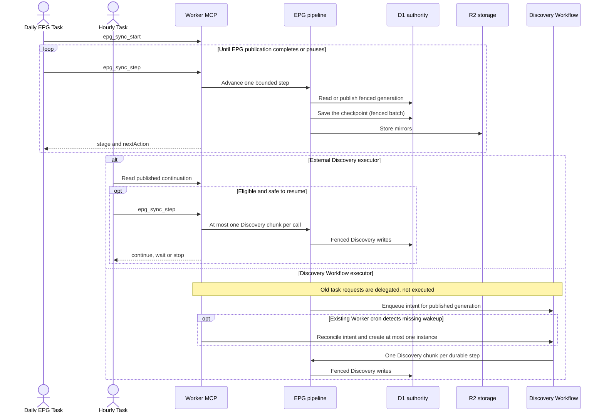

The hourly Predictions Task does not wait for the EPG Workflow to finish a seal. An unsealed generation leaves the stored prediction queue runnable ([ADR 0154](../adr/0154-prediction-eligibility-independent-of-epg.md)).

### Hourly prediction pipeline

The producer of personal predictions is the external batch v2 Scheduled Tasks described in the next section; batch v2 is the only prediction protocol, and the one-film v5 path (`prediction_start`, `prediction_next`, `prediction_validate`, `prediction_submit`) is retired ([ADR 0167](../adr/0167-retire-prediction-runner-v5.md)). Verify the enabled Tasks, schedules and prompts in the live registry; the dated readback is in the [Scheduled Tasks reference](../reference/scheduled-tasks.md).

Migration `0007` is applied and the prediction marker is `d1`, so the runner writes D1 mutable state with immutable R2 bodies ([ADR 0078](../adr/0078-d1-authoritative-prediction-domain.md)). The batch runner refuses to start while the marker is `r2` (`batch_runner_requires_d1`); D1 stays the prediction authority and no rollback to `r2` is planned. A new `fingerprint_and_prediction` item carries `fingerprint.evidence`, and the film's metadata is passed to `prediction_batch_validate` when an item cites a metadata token. Worker fingerprint versions stay at 1.

### Four independent hourly Predictions v2 Tasks

**Target protocol ([ADR 0193](../adr/0193-deferred-batch-start-with-server-issued-key.md), Proposed; dormant until the prompts use it).** Each execution asks for a server-issued key, starts with `deferred: true` and receives a receipt within seconds, polls `prediction_batch_manifest` until the manifest is ready or a typed final outcome arrives, and heartbeats at once. The heavy preparation runs in the Workflow `iptv-prediction-start` (one instance per run id, one non-retried step), so it no longer depends on the lifetime of the MCP request or on the Task's patience. The Task prompt change and the move of all four Tasks together are the Controller's, after delivery; the minimal prompt delta is [a reference note](../reference/scheduled-task-prompts/hourly-predictions-batch-v2-deferred-start-delta.md).

**Live producer.** Four batch v2 Tasks are enabled following the owner's separate GOs for the scale-out; a fifth registry entry exists but is disabled. The live registry, not this page, is the authority for their state. Nothing here creates, edits, enables or runs a Task ([authorization](../process/authorization-and-escalation.md#chatgpt-scheduled-task-authorization)). The contract is [ADR 0122](../adr/0122-prediction-batch-runner-v2-dual-protocol.md), [ADR 0136](../adr/0136-prediction-batch-manifest-size-and-spent-complete.md) and [ADR 0167](../adr/0167-retire-prediction-runner-v5.md).

Four hourly Tasks, nominally offset by 15 minutes, each one a bounded invocation: A `:00`, B `:15`, C `:30`, D `:45` (Europe/Madrid). These are four independent hourly recurrences, not one 15-minute recurrence; scheduler drift can still produce overlaps. The Tasks share no memory and no orchestration; the only coordination is the one D1 queue and the one runner lease. The lease lives 12 minutes after its last write (since the [AIR-588](https://trello.com/c/vyxbU1l0) containment of 24 November 2026; 15 minutes before): a run that stops renewing within about the first 3 minutes of its slot frees the runner before the next quarter-hour slot, while a run that is still renewing keeps it, and that slot answers `already_running` as before. A fifth registry entry at `:48` is disabled. [Scheduled Tasks reference](../reference/scheduled-tasks.md#predictions-v2-four-active-hourly-tasks-00153045).

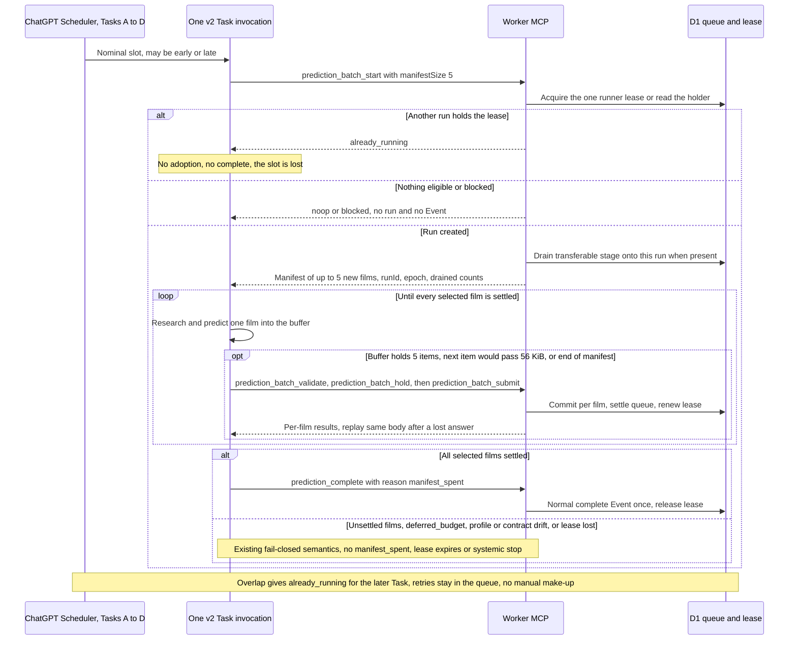

Boundaries: the legacy v5 Task cannot run because its tools are retired; the Worker never reads the Task registry; `IPTV Scheduled Task Drift` was not edited. A fifth Task with 12-minute spacing was tried on 20 November 2026 and withdrawn by the owner the same evening; it is recorded in the [early-stop evidence](../evidence/prediction/air-544-five-task-early-stop-2026-11-20.md), with no throughput or research-quality acceptance claimed and no automatic rollback installed. The earlier four-Task rollout ran as one one-off canary Task, then `:00`, then `:15/:30/:45`, each a separate owner GO ([historical runbook](../runbooks/prediction-operations.md#planned-rollout-of-four-hourly-v2-tasks-air-451)).

### Read-only Scheduled Task registry drift

The drift monitor now peeks **one** Task, the hourly Predictions Task. The *Peek Daily EPG Task by ID* step below belongs to the earlier two-Task scope (AIR-377): the Daily EPG Task is retired and disabled and is no longer audited. The updated scope is [AIR-406](https://trello.com/c/PPe2fFcu); the diagram is not redrawn here.

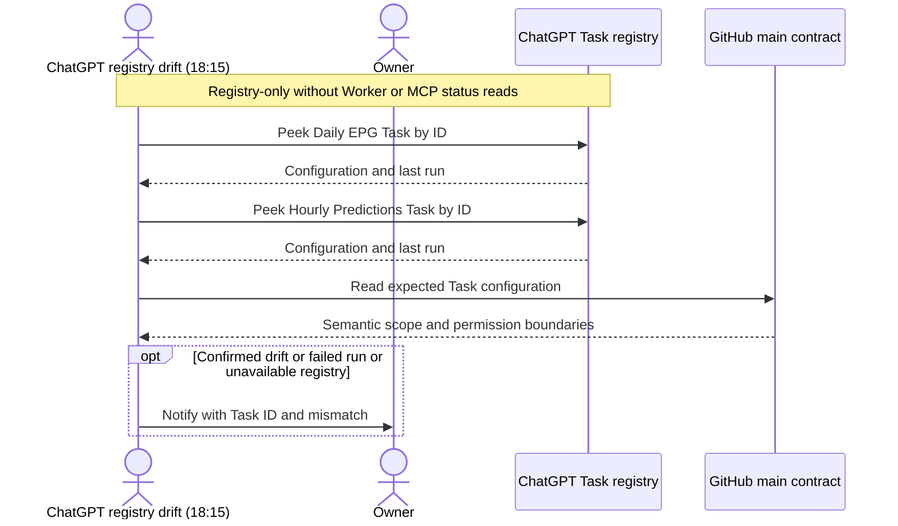

### Worker cron: enrichment projector retired (AIR-308)

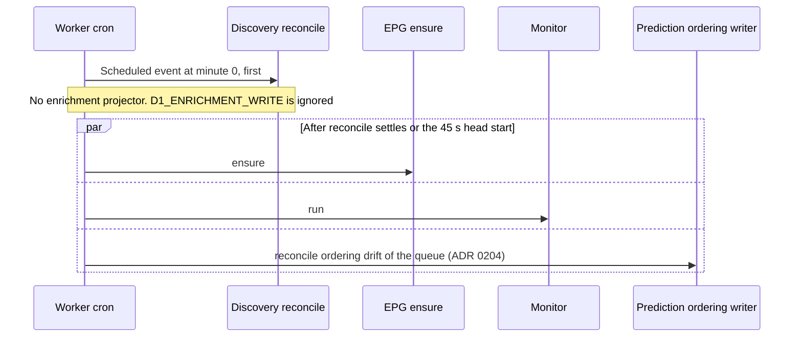

The diagram above is the live tick. The historical R2-to-D1 projector sequence (ADR 0056, ADR 0103, ADR 0106) is no longer started by this cron.

**Prediction ordering writer (AIR-588, [ADR 0204](../adr/0204-prediction-ordering-drift-leaves-the-start.md), Accepted).** The same hourly tick calls `reconcilePredictionOrdering` beside the EPG ensure and the Monitor. It rebuilds the Prediction queue only for ordering drift of its own completed generation (a changed assigned-shows signature, or a window edge past its 15-minute cap), only for a queue that passes the advance gate with a verified signature, and only while no start claim or commit gate holds the runner lease (it waits up to 5 minutes, then gives the tick up). Each rebuild attempt decides its admission again on the queue head and inputs it builds from, refuses a candidate that is not a verified ranking of the same generation and checks the lease again just before its write. It writes through the ordinary queue refresh and logs one `prediction_ordering_reconcile` line. A Task start no longer pays that rebuild; a queue older than 90 minutes is still rebuilt by the start. No cron trigger was added, and the Discovery fast tick does not run it.

The cron expression is `0 * * * *` (it was `37 * * * *` until AIR-348; Madrid is a whole-hour offset, so an hourly UTC cron has a tick at Madrid 17:00 in CET and CEST, and each daily `ensure` decides due itself from the Madrid date). Since AIR-482, as a best-effort mitigation only (not an isolation guarantee, the OOM allocator is unproven), the tick starts `reconcileDiscoveryWorkflow` (which closes the hourly Discovery report) first and starts EPG `ensure` and the monitor together when that reconcile settles or after a 45 s head start. A reconcile or report close still pending at 45 s overlaps the other members in the same invocation and stays exposed to the same memory kill. A rejected reconcile never blocks the other members. The tick does not call the legacy Ratings executor: no code creates an `iptv-ratings` Workflow instance, and the Ratings phase runs only inside the Letterboxd Sync (cron `30 * * * *`). The EPG `ensure` creates the daily Workflow instance once the run is due. The Discovery reconcile acts on a missing intent or a dead instance. Each reconcile attempt is a Workers Log `discovery_workflow_reconcile`; a green cron is not a Discovery recovery. The enrichment projector is not a member of this tick ([ADR 0155](../adr/0155-retire-enrichment-projector-cron.md)). `D1_ENRICHMENT_WRITE` does not start a run. A `projector_window` row that is already held still refuses Discovery admission until it expires; this retirement does not ignore that fence.

**Discovery fast recovery tick (AIR-534, [ADR 0174](../adr/0174-discovery-only-fast-recovery-cron.md), Accepted).** The Worker has a second cron trigger, `1-59/2 * * * *` (every two minutes on odd minutes, never minute 0). It calls only `reconcileDiscoveryRecovery`: no chunk, no TMDB, no EPG, Ratings or Monitor, and no hourly report. It is a fallback for a killed, completed or errored instance, a lost or uncertain wake, an overdue recovery and a missed EPG handoff (no record, or a record of an older generation than the published one); the EPG-publication fast start and the durable `step.sleepUntil` of a live instance ([ADR 0098](../adr/0098-discovery-workflow-step-failure-recovery.md)) stay primary.

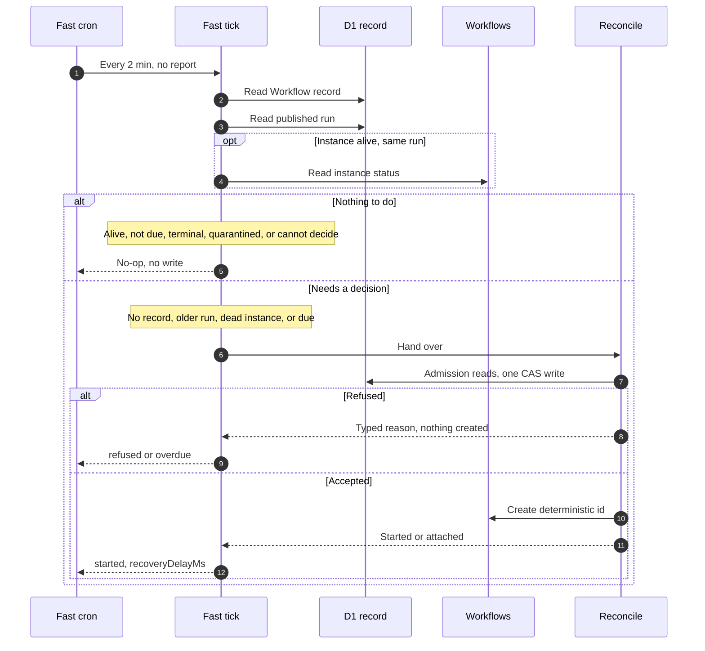

The diagram shows the fast tick only; the hourly tick above is unchanged and may overlap with it. Overlap, a repeated cron and a durable wake create no second owner: the successor id is deterministic and the record write is an expected-etag CAS, both unchanged. An idle tick is one record read, one published-pointer read (plus one platform status call while an instance is alive) and no write.

**Historical: pre-AIR-308 projector.** Before ADR 0155 the same tick also called the projector. When the tick granted a projector window, a scheduled reconcile that was refused as `projector_window` waited for that window's one expiry in the same invocation (at most three attempts) and then created a due successor. With the flag unset, the projector performed no R2 reads or D1 writes. With `dry`, it read the source and change keys and never wrote. With `on` and the Film/Person marker below `open`, it wrote changed Films and Persons in existing fenced batches. At `open` those canonical writes were refused as compare-only; the fenced adapters own them. At schema v5, `film_sync_state` used that same writer: sync clocks for an already-changing Film shared its batch, while a clock-only change used its own fenced batch. That schema is applied. At schema v6, the same clocks were written, and when the metadata cache marker is `d1` the metadata records came from D1. Schema v7 and v8 kept those clocks and cache reads; the projector wrote neither the prediction nor the published EPG domain. A partial prediction domain, or a complete one without a valid marker, failed the run before a write. None of the prediction tables on a later contract does not: prediction stays on the objects. `PREDICTION_DB_REQUIRED=on` makes a missing `DB` binding, or a bound database without `schema_contract`, fail the same way. The variable is not a new cron and not a new operational flag. The projector did not write R2 or the cache. A code deploy does not apply migration `0006` or `0007`. Production has applied `0006` and that marker is `d1` ([ADR 0073](../adr/0073-metadata-cache-d1-authority.md), [cutover](../evidence/d1-migration/air-313-metadata-cache-cutover-2026-11-01.md)). Production applied `0007` and activated the prediction marker on 3 November 2026 ([ADR 0078](../adr/0078-d1-authoritative-prediction-domain.md)).

The drift monitor is a read-only automation in the same ChatGPT registry, enabled daily at 18:15 Europe/Madrid (DTSTART 2026-10-31). It reads only the live hourly Predictions Task entry (and, until AIR-406 is applied to the live Task, the retired Daily EPG entry as well) and the maintained GitHub contract, and reports confirmed drift or failed execution. It neither reads Worker/MCP status nor watches Ratings. The independent Cloudflare-native monitor owns EPG, Discovery, Ratings and Predictions progress and alerts ([monitor runbook](../runbooks/monitoring.md)). The drift audit shares the scheduler with the producers, so no notification does not prove availability.

A scheduled trigger does not imply successful completion. `already_running`, `busy`, lease ownership, deferred backoff and a previous run's retries that could not yet be written (`prediction_retry_heal_pending`) may prevent new work. The prediction Task, the EPG Task's commit and the discovery chunks can overlap. All three write the prediction queue, and each write is conditional and rebuilds on conflict ([ADR 0064](../adr/0064-prediction-queue-conditional-writes.md), Accepted 2026-10-31), so the overlap does not lose a retry or a batch summary. Discovery runs **one chunk per durable Workflow step** (no HTTP request runs a chunk since AIR-325); it does not recursively self-fetch through an Access bypass or an internal continuation service. The [MCP security boundary](authentication-and-mcp.md) verifies signed identity and restricts tool arguments.

### Projector exclusive window ([ADR 0103](../adr/0103-projector-exclusive-window.md); `D1_ENRICHMENT_WINDOW` read `on` on 10 November 2026)

**Live (ADR 0155).** The hourly cron does not acquire `projector_window`. `D1_ENRICHMENT_WINDOW` starts no production run. A row that is already `requested` or `held` still refuses Discovery admission until it expires.

**Historical: pre-AIR-308 projector.** The following paragraphs describe how a projector run acquired the window. They are not the current cron.

The projector's strict generation pin cannot pass while Discovery writes about seventeen times a minute, so a `D1_ENRICHMENT_WRITE=on` run may first take an exclusive window, behind `D1_ENRICHMENT_WINDOW` (off by default, [flag contract](../reference/feature-flags.md)) and the table `projector_window` of migration `0018` (applied to production on 2026-11-08, one `idle` row). The run asks for the single row; from then on every Discovery lease acquisition (a chunk, a seal, a publish handoff, an owner correction) is refused with the typed busy `projector_window` and its absolute deadline, and the in-flight chunk is not interrupted. When the lease row is free (and no ledger transfer is loading), one D1 batch gives it to the projector and marks the row `held`; the three generation writers that do not need the lease are refused by their own statement while it is held. The run then reads, diffs and writes under the unchanged generation pin, projector lease and batch fences, each batch also asserting that the run still owns an unexpired `held` row, and releases both rows at the end. One absolute deadline (a proposal of 300 s, with at least a minimum run time left at the grant) covers the request and the hold, is never extended, and an expired row is idle for every reader, so a crashed run frees Discovery by itself. The hourly cron, the Scheduled Tasks, the Ratings executor and the monitor do not read the row. An EPG publication that meets the window is answered with a structured `busy` until the deadline and is not failed; the external daily Task contract waits only for a `lease_held` seal busy within about 93 s, so that contract is the activation blocker named in the ADR. Nothing here is activated. The Discovery Workflow treats a refused state write as a soft wait: every caller (progress, wait, busy, start, rollover, final stop, recovery arming and its successor) turns the typed refusal into a value, sleeps to the window's one expiry, re-saves the record afterwards and charges neither the stall nor the recovery budget. A checkpoint (progress, final stop, recovery arming) counts as done only when it is confirmed persisted by the owner: a window refusal is retried after its expiry (at most 24 times, each a bounded sleep), a lost compare-and-swap up to three times, and the step cap bounds both. Exhausted retries are never reported as saved and never as lost ownership; the instance ends in an explicit `deferred` state (`window_checkpoint_unsaved`, `window_stop_unsaved`, `window_recovery_unarmed`, or the `*_write_conflict` forms), the record still names that instance, and the hourly reconcile recovers it. The coordination API itself refuses a window longer than 300 s, a zero or non-integer run time and a malformed clock before any statement runs, and the table repeats the bound as a CHECK.

**Marker fence on every batch ([ADR 0116](../adr/0116-projector-marker-and-generation-fence-on-every-batch.md)).** Every `on` run reads the `film_person_authority` marker first (not `r2`/`prepared`: deferred `authority_unavailable`), and every per-entity and grouped write batch asserts mode, `cutover='open'` and generation inside the batch, so a marker move fails the batch whole (`authority_moved`).

### EPG-priority Discovery pause ([ADR 0135](../adr/0135-epg-priority-discovery-pause.md), Accepted and live since 14 Nov 2026; release point moved by [ADR 0175](../adr/0175-epg-priority-holds-until-run-complete.md), Accepted, code by AIR-539)

The pause is live (migration `0022` applied). ADR 0175 changes **when it lifts**: not in the pointer batch but after the run is durably `stage=complete`, certified by one fenced D1 batch. Migration `0026` (two certificate columns) was applied to production on 19 Nov 2026 under a separate owner GO, so that behaviour is active; before it, with the columns absent, every statement was the ADR 0135 behaviour and the pause lifted at the pointer. Its natural-run acceptance is not yet recorded. The diagram shows the ADR 0175 behaviour: new Discovery admission closes at 16:55 Europe/Madrid by a predicate on the lease write, with no business TTL and no cron at that minute. `sealArchive` moves the Discovery pin first and does not lift the pause. `publishGeneration` later switches the pointer and writes `published_epg_authority.madrid_run_key` from `sync.json.runKey`, frozen when that sync run started. A later Workflow that resumes the seal does not relabel the day with its own `runKey`. The day is not `published_at` and not the live orchestration control. An in-flight chunk may finish. EPG does not run Discovery; it may wait, without a failure count, while a Discovery lease is live. The projector window is a separate hold and is not drawn here. GitHub's own SVG of this figure is a reviewer's check of the blob; a headless session does not run GitHub's Mermaid enricher.

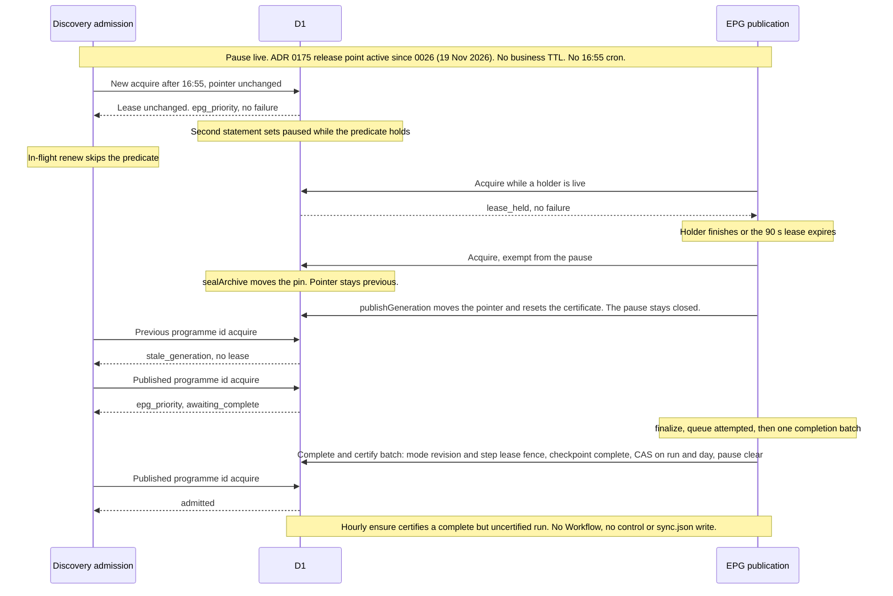

**Current (D1-authoritative since 21 Nov 2026, [ADR 0185](../adr/0185-epg-checkpoint-d1-authority.md), [ADR 0199](../adr/0199-retire-the-epg-checkpoint-r2-arm.md)):** the run checkpoint is in D1 and its marker is `d1`, so the two steps "sync.json stage complete in R2" and "Certify batch" in the diagram above are one fenced batch (the certificate stays conditional and non-aborting), and the crash window between them no longer exists for runs completed in this mode. The single-call completion route uses the same operation and attempts the queue refresh before it. The diagram above draws that single batch; the hourly repair `certifyComplete` stays for a certificate that did not match.

### Seal in a successor instance ([ADR 0144](../adr/0144-epg-seal-successor-workflow-instance.md), implemented by AIR-484; production acceptance awaits a natural run)

**State:** the diagram is implemented in `src/epg-orchestration.js`; it has not yet run in production. The successor is the next series id (a terminal Workflow id cannot be created again) and is **not** claimed to get a fresh isolate. After ADR 0145 the producing instance stores `epg/seal/<runId>/publication.json` (no catalog) with `run.seal.layout: 2` and `publicationEtag` beside the ledger `etag`, then saves `sync.json` at `stage: seal`. A leftover `payload.json` run is finished by the legacy reader. A pending claim, even of a previous Madrid day, takes priority over today's start.

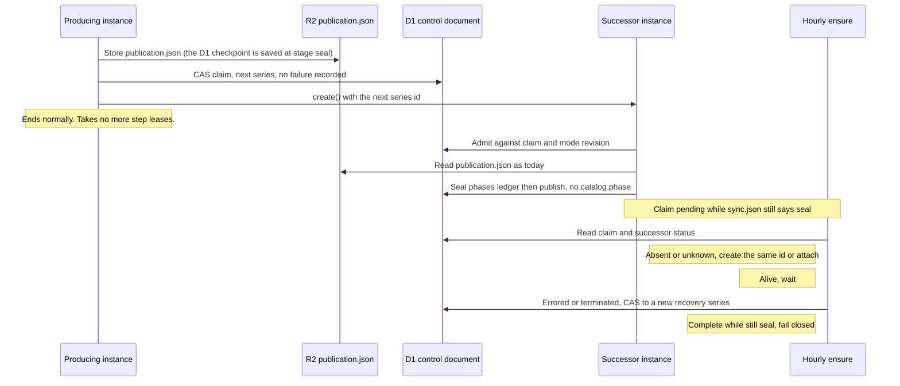

## The separate ratings pipeline

**EPG executor (AIR-348, active).** [ADR 0100](../adr/0100-epg-cloudflare-workflow-executor.md) (Accepted) adds a Cloudflare EPG Workflow that drives the existing `/api/sync/*` steps in-process after an owner-approved three-step switch (`external`, `switching`, `cloudflare`; epoch fence asserted inside the D1 pointer batch). The switch is done: `epg_status` read `mode=cloudflare`, epoch 1, and the first natural run was accepted on 8 November 2026 ([evidence](../evidence/orchestration/epg-first-natural-run-air-348-2026-11-08.md)); the Daily Task is disabled. The diagram below shows the retired Daily Task and is retained as the rollback flow. The hourly cron calls an inert `EpgOrchestration.ensure` next to the projector, the Discovery reconcile and the monitor (the Ratings `ensure` of that time is retired), each independent and none sharing a lease; the cron expression is `0 * * * *` since the separate owner-approved AIR-348 change (it was `37 * * * *`). The Ratings Cloudflare executor shares the 17:00 Europe/Madrid logical due time ([ADR 0101](../adr/0101-ratings-logical-due-time-1700.md), which supersedes the 17:30 of ADR 0090 in that one respect); the diagram below shows the legacy Ratings Task and is unchanged.

[ADR 0060](../adr/0060-independent-letterboxd-ratings-pipeline.md) moved Letterboxd ratings out of the EPG commit. [ADR 0074](../adr/0074-retire-ratings-pipeline-switch.md) (Accepted 2026-11-01) makes that the only path: the Worker does not read `RATINGS_PIPELINE`. On supported storage (the removal queue at schema version 2 and the Diary cursor in its merge form, [ADR 0161](../adr/0161-retire-ratings-storage-migration.md)) the commit only enqueues removed films, and the Ratings phase runs inside the Letterboxd Sync Workflow. The tools `ratings_sync_start` and `ratings_sync_step` and their POST routes no longer exist (unknown tools and a plain `404`); the sequence and state diagrams of this section show that retired external Ratings Task path and are kept as history of the run record's states. On any other stored state the commit publishes and does not read Diary, look up films or enqueue; that failure is not drawn here. A live read-only check on 2026-10-31 found the storage migrated, the binding `separate` and the Ratings Task enabled. The registry-only drift audit does not read Ratings status; the Cloudflare-native production monitor observes durable Ratings progress. Neither monitor invokes ratings writers. The one-time owner tool that converted the storage to version 2 no longer exists in the Worker; the commit never called it. The expected recurrence of the Ratings Task, after the owner-approved registry change on 2026-10-31, is daily at 17:30 Europe/Madrid with flexible timing and DTSTART 2026-11-01. A scheduled start is not refused for following the previous one ([ADR 0069](../adr/0069-no-scheduled-ratings-start-gap.md), Accepted). `busy` and `isolated` still end the invocation. The six-hour pause after a Letterboxd 403 or 429 on the removal queue stays. While a rated legacy entry still needs event references, a removal step first lists one page of existing removal events and links the exact film id, then settles stored ratings ([ADR 0071](../adr/0071-legacy-removal-event-link.md), Accepted 2026-10-31). A step with nothing left to link does not list. This page does not change a flag or a task, and it does not start that scan. Contracts: [ratings reference](../reference/integrations/letterboxd-ratings.md#separate-ratings-pipeline), [MCP reference](../reference/api/mcp.md), [Scheduled Tasks](../reference/scheduled-tasks.md#ratings-task); operation: [runbook](../runbooks/letterboxd-diary-history.md#separate-ratings-pipeline).

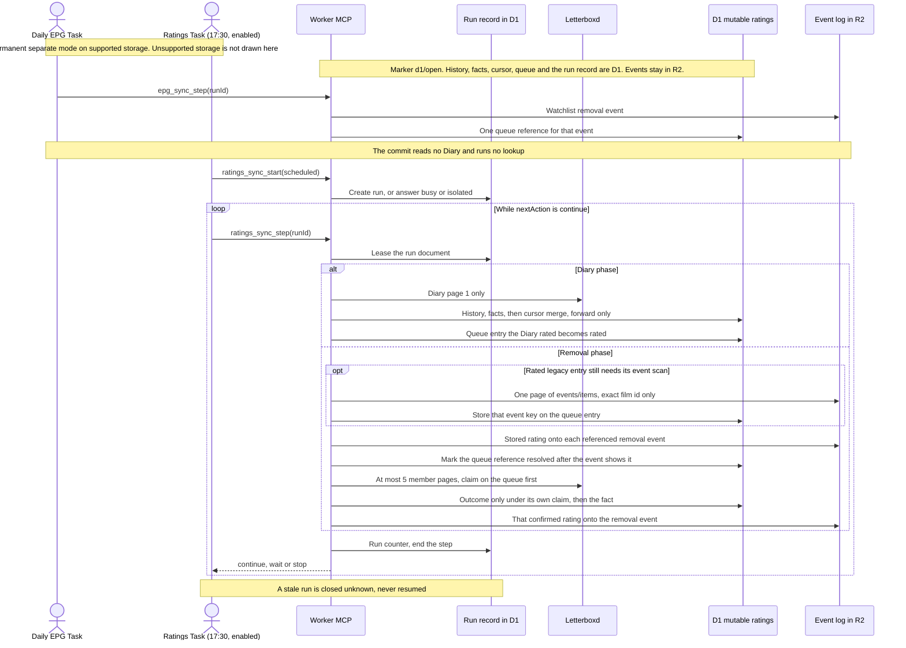

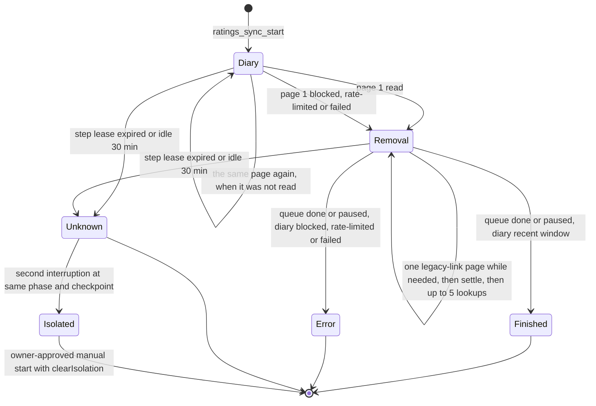

The run record is one D1 document. It admits one running run and one active step, and the lease is that document. Diary history, the diary cursor, facts and the removal queue are separate D1 documents. A compare-and-swap of one document is one fenced batch: a film record also writes its `ratings_view` rows in that batch, and the batch advances `ratings_domain_authority.generation`. A stale etag leaves the batch uncommitted. Those documents do not fall back to R2. Removal events stay in the R2 event log. There is no transaction across D1 and R2, so a settle writes the event by compare-and-swap and only then marks the queue reference resolved. A kill between the two repeats the event write. The cursor join only moves forward. Its last-attempt diagnostics are a deterministic last-writer-wins record that never plans a read. The queue accepts an outcome only under the step's own claim. History and facts take an idempotent merge, so a late write can add a newer observation and does not move an existing one backwards. A late event merge can add the rating and does not move the D1 fact. The cursor and the queue are authoritative; the run record's checkpoint is a per-run counter. Each removal event keeps its own reference in the queue, and an unresolved one is never pruned. The diagram shows that open marker. The event log still has no multi-key transaction, so a step that outlived its lease is not fenced out of an event object. A removal step lists one page of `events/items/` only while a rated legacy entry still needs that scan, then writes the ratings of rated entries to their removal events (at most 100 references per step), then runs the lookups. With nothing left to link, the list does not run. Deploying this page does not start a ratings run. The ratings run reads Diary page 1 only ([ADR 0067](../adr/0067-diary-recent-window.md)). That is not a byte copy of the earlier multi-page reader. The queue and the cursor forms are unchanged. The separate pipeline runs only on supported storage, the queue at schema version 2 and the cursor in its merge form, and the status reports that as `storage`; on any other stored state the commit fails closed. Nothing in the Worker converts the storage ([ADR 0161](../adr/0161-retire-ratings-storage-migration.md)). A stale run is closed by the next start or step, never by the status read. Ownership, contracts, races and rollback are in the ADR. The diagram is the production mode as of the 2026-10-31 live read (storage migrated, Ratings Task enabled). The Worker does not read `RATINGS_PIPELINE`, `LETTERBOXD_DIARY_HISTORY` ([ADR 0075](../adr/0075-retire-letterboxd-diary-history-switch.md), Accepted 2026-11-01) or `REMOVAL_RATING_LOOKUP` ([ADR 0077](../adr/0077-retire-removal-rating-lookup-switch.md), Proposed). The up-to-five lookups on the Removal loop are that permanent fallback: a film the Diary already rated, or absent from the current Diary page with a confirmed stored fact, is not requested, including after a new reference reopens its queue entry, and a paused queue is not requested. A film that page lists without a rating is still looked up. A null or absent rating is not watched. A step probes at most five stored ratings and does not request a film it has not probed. The state-diagram arrows are unchanged. The sequence diagram draws the open marker ([ADR 0084](../adr/0084-d1-authoritative-ratings.md), Accepted). History, facts, the cursor, the removal queue and the run record go to the D1 participant. Event writes and the event-list page stay on R2. While `0010` is absent, or the marker is `r2`, those documents stay in R2; that state is not drawn. `0010` is applied and the marker is `d1` / `open`. Activation left generation 1 ([activation record](../evidence/d1-migration/air-318-ratings-activate-2026-11-04.md)). A manual MCP run at 08:28 UTC left generation 12 ([manual run](../evidence/d1-migration/air-318-ratings-manual-run-2026-11-04.md)) and did not change the 17:30 Europe/Madrid Ratings Task. The owner visually approved an earlier note on 2026-11-04, while these arrows still pointed at R2. This participant change needs a fresh rendered owner visual approval, as does the persistence arrow. A removal does not become a viewing. Diary page 1, the removal-lookup budgets, and the fail-closed migration states are unchanged. A migrated run enters Diary. One arrow leaves Diary for Removal when page 1 was read. A second leaves Diary for Removal when that request was blocked, rate-limited or failed and the page was not read: the removal phase still runs, and the run ends `error` on the arrow from Removal to Error. There is no off-gate arrow. Neither this diagram nor a deploy changes a task or deletes a leftover binding.

## Historical design snapshot: proposed Cloudflare executors (ADR 0089, 4 Nov 2026)

**Historical (drawn 4 Nov 2026).** Both diagrams below show the then-future implementation of [ADR 0089](../adr/0089-shared-orchestration-reliability-contract.md) (Accepted; both diagrams visually approved by the owner on 2026-11-04). The accepted ADR is unchanged. At the time of that drawing, EPG, Discovery and Ratings were still driven by the external tasks above, the Discovery Workflow was inert, and the cron ran the enrichment projector plus inert ratings `ensure` and Discovery `reconcile`. **Current production (16 Nov 2026 UTC):** EPG and Ratings run as Cloudflare Workflow executors (`mode=cloudflare`); Discovery is executed by the Cloudflare Discovery Workflow; the hourly cron runs EPG `ensure`, Ratings `ensure`, Discovery reconcile and Producer reconcile. It does not run the enrichment projector (ADR 0155). The Daily EPG and Ratings Tasks are retired. Each domain moved to its executor through its own owner-approved switch; the field-level contract is the [orchestration reliability reference](../reference/orchestration-reliability.md).

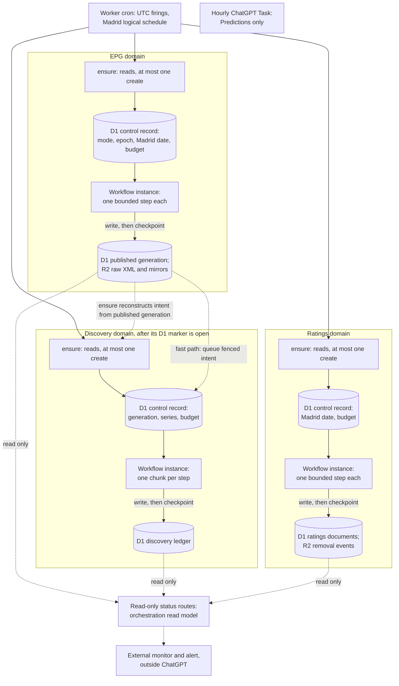

The three domains share no lease, queue, store or Workflow instance; the only shared element is the clock. Each domain commit to D1 compares the epoch and mode in the same batch; R2 side effects are idempotent and bounded by the lease, and a mode switch is close admission, verified drain, then complete ([reference](../reference/orchestration-reliability.md#mode-switch-and-write-fencing)). Each instance writes its domain data first and then its fenced checkpoint and budget into its own control record, compared against the epoch. Each `ensure` runs no chunk, download or lookup. It reads its own control record and creates or attaches at most one instance with an id derived from the run key, so a duplicate firing attaches to the same instance. EPG publication may queue Discovery's fenced intent as a fast path, not in one transaction with the pointer switch; `ensure Discovery` reconstructs the intent from the published generation if that write is missing, and EPG never waits for Discovery. The dotted arrows to the status routes are reads only; the read model reads each domain's control record and its authority.

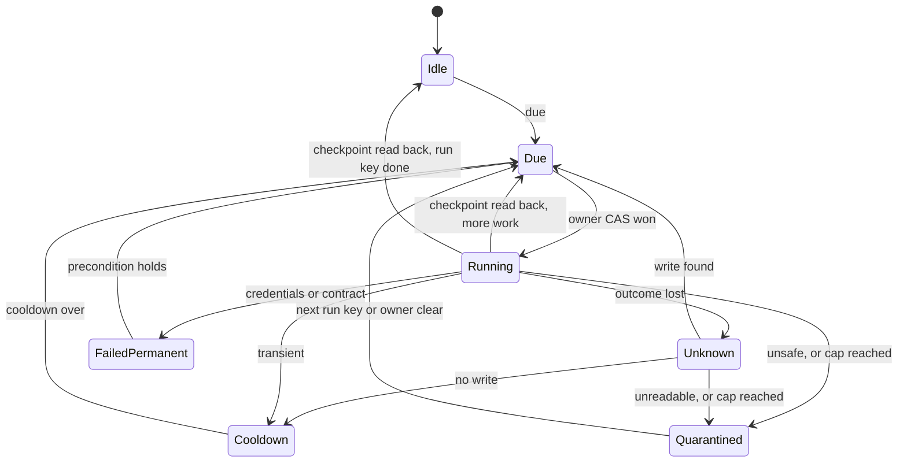

`Due` includes a known future wake (`retryAt`, `Retry-After`, a pause or a lease), which the read model reports as `waiting`. `Unknown` means a timeout, a lost response or a killed step, resolved only by reading back. A duplicate firing while a run is `Due` or `Running` attaches to it. `Quarantined` returns to `Due` on the next run key only after a budget exhaustion; after unsafe evidence only an owner-approved clear does. Only a read-back checkpoint that moved forward resets the consecutive failure count; a create, an HTTP 200 or a lease does not. The executor never forces a step, never resets a lease and never clears its own quarantine. Predictions are outside both diagrams and stay on the hourly ChatGPT task.

## Canonical Film/Person writer routing

The hourly cron does not run the D1 enrichment projector (ADR 0155). After the EPG mirror reconcile, `EpgOrchestration.ensure` also calls `reconcileProducerChain` ([ADR 0141](../adr/0141-producer-workflow-chain-protocol.md)). That call stays dormant unless the Film/Person marker is `d1`/`open` **and** the `PRODUCER_WORKFLOW` binding exists; it never throws into `ensure`. There is no new cron, flag or Scheduled Task. With the marker at `open` (generation 2 as of 16 Nov 2026 UTC) the fenced adapters are the only canonical Film/Person writers. The hourly projector no longer runs; its former compare-only behaviour at `open` is historical, and the Producer Workflow chain is the EPG-origin producer when the binding exists. A first natural chain run at `open` is unproven. A projector batch built before the move carries a fence assertion on the marker generation and fails whole, so the two writers never overlap. No timing of the existing cron changes. The enrichment-projection sequence on this page labels compare-only at `open`; it does not claim a completed Producer Workflow run.

## Timing and authority

The timetable and enabled status belong to the external automation registry. The Worker does not store that recurrence and does not display a next Task time; it keeps its own discovery wait gate apart from registry clocks; see [Scheduled Task timing](../reference/scheduled-tasks.md#timing-nominal-trigger-versus-server-gate). Historical records of successful scheduling are not a live status check; production task changes or manual invocations require separate owner approval. A GitHub deployment does not trigger any of these workflows.

## Ratings executor (retired)

The Cloudflare Workflow that drove the daily Ratings run is retired: the hourly cron does not call `RatingsOrchestration.ensure`, the class `RatingsWorkflow`, its loop and the `RATINGS_WORKFLOW` binding are removed, and no code creates or runs an instance. `src/ratings-orchestration.js` keeps what the Letterboxd Sync still reads: the Ratings mode document and its fence, the drain check, the external-writer gate and the read model used by the monitor and `ratings_sync_status`. The owner mode route can no longer enter `cloudflare` (it answers `legacy_executor_retired`), and the drain check fails closed for a control record in a live phase because no instance can be read any more. There is no rollback to a legacy writer: recovery is forward only ([runbook](../runbooks/letterboxd-sync.md#recovery-forward-only)). The decision record of the former executor is [ADR 0090](../adr/0090-ratings-cloudflare-workflow-executor.md); the sequence and state diagrams of this section are history.

## Discovery Workflow handover ([ADR 0094](../adr/0094-discovery-workflow-invocation-budget.md), Accepted)

A Discovery Workflow instance hands over to a successor at 20 chunks or when the D1 statements it has issued reach 6,000, whichever comes first, so no instance runs into the level at which two instances failed on 6 November 2026. The durable steps, the owner fence and the recovery are those of [ADR 0083](../adr/0083-inert-discovery-workflow.md); no diagram changes.

**Chunk wall budget (AIR-682).** Each Workflow chunk runs under a 300 s wall budget, passed by the Workflow to `advanceDiscovery`; the 40 s default of the paged resolver (AIR-352) applies only to a caller that passes none. The lease TTL (90 s), its renewal at each long phase, the fence on a changed generation and the TMDB, subrequest and checkpoint limits are unchanged. The owner instruction is on [AIR-682](https://trello.com/c/UWYTPEDB), 25 November 2026.

## Controlled Discovery Workflow rollover ([ADR 0164](../adr/0164-controlled-discovery-workflow-rollover.md), Accepted)

An instance keeps the Worker version it was created on until its own handover. The owner can move Discovery onto the deployed version earlier with the owner-only MCP tool `discovery_workflow_rollover` ([runbook](../runbooks/discovery-workflow-rollover.md)). It is never called by the cron, a Workflow schedule or a Scheduled Task. The only ownership change is one compare-and-swap of the executor record, admitted only while the owner sleeps durably; the old instance then fails its own owner gate when it wakes. A create that cannot be confirmed is recovered by the hourly reconcile under the same deterministic id.

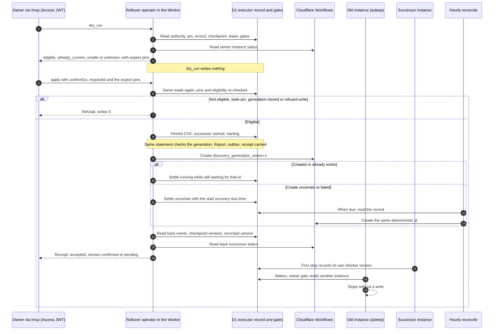

The sequence shows only the operator path. The natural handover, the step-failure recovery and the reconcile are unchanged. The diagram is not evidence that a live apply ran; each production `apply` needs its own owner approval.

## Controlled EPG Workflow rollover ([ADR 0176](../adr/0176-controlled-epg-workflow-rollover.md), Accepted)

A live EPG Workflow instance keeps the Worker version it was created on until it hands over or ends. The owner can move the run onto the deployed version earlier with the owner-only MCP tool `epg_workflow_rollover` ([runbook](../runbooks/epg-workflow-rollover.md)). It is never called by the cron, a Workflow schedule or a Scheduled Task. The only ownership change is one compare-and-set of the control record to the deterministic successor (`series + 1`, same run key, epoch and run id), conditioned on the mode revision and on the step-lease row being unchanged since the read, and admitted only while the owner is provably asleep outside a step.

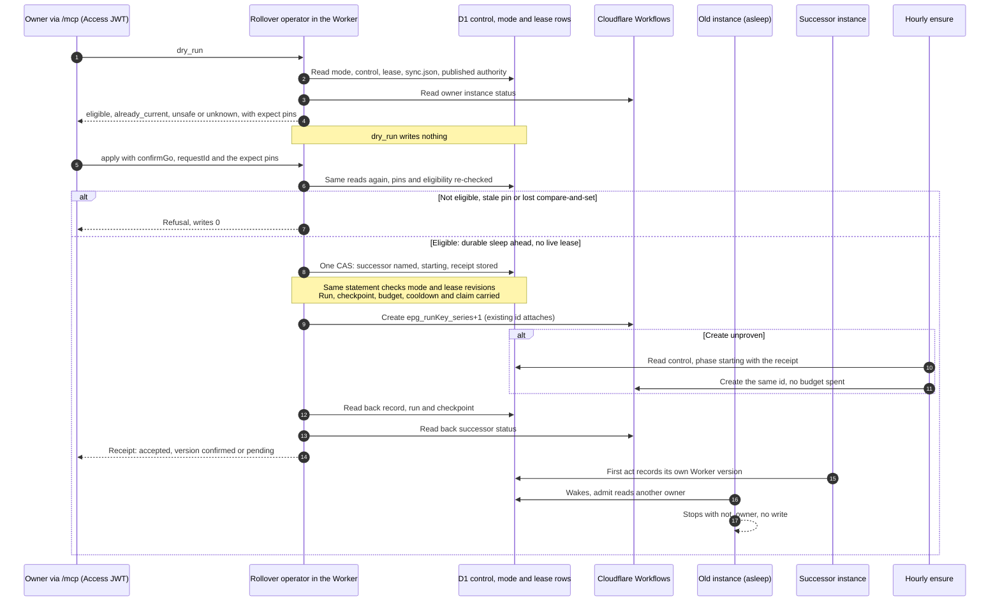

The sequence shows only the operator path. The natural seal hand-off, the orphan-claim recovery and the failure budget are unchanged: a rollover never writes a claim naming the old series, so the old instance cannot recover one. The diagram is not evidence that a live apply ran; each production `apply` needs its own owner approval.

## Discovery Workflow step-failure recovery ([ADR 0098](../adr/0098-discovery-workflow-step-failure-recovery.md), Accepted)

An instance whose step fails after the platform's retries, with a recognised transient failure (the `discovery_unavailable` code or a transient class), arms the existing recovery once, sleeps durably until `recovery.dueAt` (60 s for the first failure, then 5 min, 15 min, 1 h; four, then quarantine) and, after re-checking owner, authority, pinned generation and mode, opens the deterministic successor through `ensureDiscoveryWorkflow`. The hourly cron remains the fallback and covers what this cannot: an instance killed by the platform, a failure of the arming step, and a `stopped` record without a live owner. No trigger, binding or cron changes; no diagram changes.

## Shared upstream cooldown (AIR-604, dormant)

One durable cooldown per upstream scope (`tmdb`, `letterboxd`, `wikidata`), read by the Discovery chunks, the poster route and the weekly poster cron, the Letterboxd Sync phases (Diary page, Watchlist scan, identity checks, removal lookups), metadata sync and EPG localization, and written by the same writer paths on a 429, a Cloudflare challenge or a 403 (`src/upstream-cooldown.js`). It adds no schedule, Workflow or writer: the mode row `upstream_coordination` is `off` by default, `observe` writes without skipping and `enforce` skips, and a skip costs the caller no attempt, failure or quarantine budget. It is not a rate limiter. Each caller's skip path and the fail-safe are in the [contract](../reference/integrations/upstream-cooldown.md); the schema is [migration 0045](../../migrations/0045_upstream_cooldown.sql) (not applied by a deploy). The flow of control between components is unchanged, so no diagram changes. The `off -> observe` change (UC2, [AIR-609](https://trello.com/c/q8XXpWAi)) is a separate owner production operation through a dedicated operator and adds no schedule, Workflow or writer ([runbook](../runbooks/upstream-cooldown-observe.md)); it takes effect at the next natural run of each caller.

## Catalog Enrichment Producer

The producer is woken by the change that causes its work, not by a timer: triggers on the identity tables write one coalesced row per cause in `enrichment_signal`, and a run consumes them. A run is one call of `drain` (`src/catalog-enrichment-drain.js`): it owns the `projection_run` lease named `catalog_enrichment`, consumes the runnable signals, drains due Films and stops only for a reason (`idle`, `parked`, `handover`, `paused`, `generation_moved`, `lease_held`, `yield`, `error_backoff`). It carries no throughput quota: its budgets are safety budgets on D1 statements, upstream requests, steps and the lease, and a handover or a pause never counts toward the 72-hour transport fallback. It takes neither the Discovery lease nor the projector window and writes only canonical Film and Person state behind the Film/Person authority marker. The producer is dormant without a control row in `active`. A Cloudflare Workflow (`CatalogEnrichmentWorkflow`) runs the drainer in steps with a durable run record, a kick that wakes a parked instance, a handover at the statement budget and a reconcile as the safety net; the reconcile cron expression is delivered by the activation change, not by a deploy. The Discovery scope (dormant, [AIR-684](https://trello.com/c/G8hayTH6)) adds no Workflow, cron or Scheduled Task: its admission signals come from triggers on `discovery_admission` (a `staged` signal inside a transfer, settled by the transfer's own commit; a `pending` one on the steady path), `upsertAdmissions` and `replaceCatalog` kick the producer after their commit only when work is runnable, and a lost kick is recovered by the same reconcile. Contract: [Catalog Enrichment Producer](../reference/domain/catalog-enrichment.md).

## Monitor tick (AIR-349)

The hourly cron also calls `Monitor.run`, which does nothing unless `MONITOR` is `on` (`off` is a permanent emergency gate that also stops the dead-man heartbeat). It reads status records the domains keep, never calls `ensure`, `reconcile` or a resolver, and writes only `monitor/state.json`. Recovery stays with the domain executors ([ADR 0089](../adr/0089-shared-orchestration-reliability-contract.md)). See [ADR 0095](../adr/0095-cloudflare-native-production-monitor.md).

## EPG diagnostic canary (retired)

The canary flow (route, Workflow, diagnostic D1 and R2) is gone: [ADR 0159](../adr/0159-detach-epg-diagnostic-runtime.md) detached it and [ADR 0161](../adr/0160-delete-epg-diagnostic-canary-code.md) deleted the code. Its diagram was removed with it; the original design stays in ADR 0121/0124 as history.

## Daily catalog-poster retry cron

The Worker has a third cron trigger, `24 3 * * *` UTC, beside the hourly `0 * * * *` and the Discovery-only `1-59/2 * * * *` ([ADR 0179](../adr/0179-weekly-automatic-catalog-poster-retry.md), Accepted; **live in production**: the read-only preflight of 22 Nov 2026 reads exactly these three expressions). A fourth trigger, `30 * * * *` UTC (AIR-571, [ADR 0186](../adr/0186-letterboxd-sync-and-independent-watchlist-authority.md)), is configured by the E activation change and takes effect only when the owner-approved deployment of that commit carries it; the Worker dispatches it only to the Letterboxd `ensure`. `src/worker.js` dispatches on the exact `controller.cron`: the other two expressions are routed exactly as before, asserted by test, and the poster branch runs only `CatalogPosterWeekly.run`, none of EPG, Ratings, Monitor or Discovery recovery.

A firing starts a sweep on the first firing of a new week (weeks start Sunday 00:00 UTC) whose `weekStart` is newer than the checkpoint's, normally the Sunday one; a missed Sunday is caught up by the next firing, and an absent checkpoint bootstraps a sweep on any day. Otherwise it is **pending-only**: it resumes only a run that is `pending` with `nextRetryAt` reached (or `running` past its 2 h budget). A firing with nothing pending, nothing owed and the week's report present is **idle**: one R2 read, no TMDB call, no write, no event. A firing with an undelivered event replays it first and is not idle.

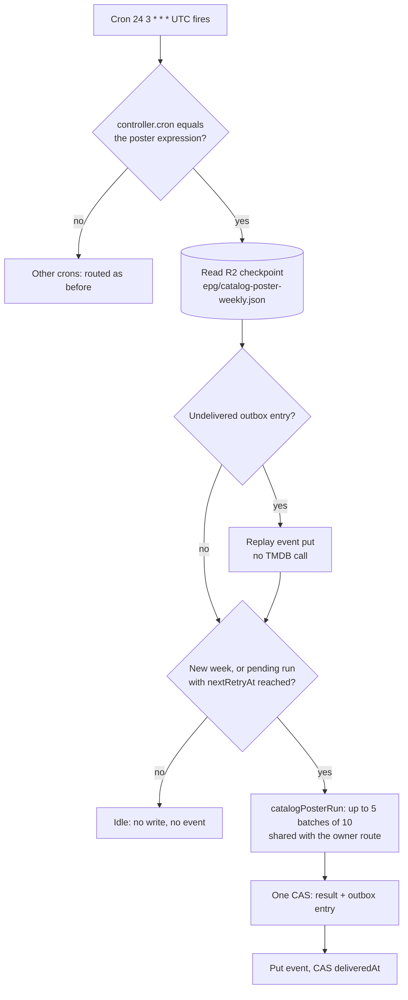

The unfinished-run backoff is 30 minutes by default (`Retry-After` is honoured), the retry cap is six attempts, and a busy resolver lease or EPG priority is recorded as `deferredBusy` and resumed on a later firing without holding the lease. A checkpoint write that loses its compare-and-swap leaves the guarded D1 hydration idempotent; the next firing re-reads D1 and the negative index. The R2 checkpoint is one object with version-aware compare-and-swap and needs no D1 migration. Rollback removes the cron entry and its dispatch by pull request; stored posters and index entries stay.

## Accepted design, staged activation: one Letterboxd Sync Workflow with four daily slots ([ADR 0186](../adr/0186-letterboxd-sync-and-independent-watchlist-authority.md), Accepted)

**Activation status (22 Nov 2026).** The code is delivered and dormant in `main`; the staged production activation is under way and each step is its own owner GO ([activation runbook](../runbooks/letterboxd-activation.md)). Done: the Watchlist is its own authority, `d1`/`open` at generation 3 (bootstrap B and the switch C1 and C2), so it is served from the D1 snapshot and, by the code, the EPG run reads that snapshot instead of fetching Letterboxd (the first natural EPG run after the switch, 23 Nov 2026 17:00 Europe/Madrid, is the verification); the Ratings Cloudflare executor is closed (D1, mode `external`, epoch 2); the Letterboxd Sync mode is `cloudflare` at epoch 1 with the canary hold `2026-11-23T1030` (D2). Not yet done: the cron `30 * * * *` and the `iptv-letterboxd` Workflow registration (E, configured by a reviewed change and not deployed), the canary slot itself (F1) and the open schedule (F2). Until E is deployed nothing claims a slot; the daily Ratings run at 17:00 Europe/Madrid, which this design replaces, does not run while the Ratings executor is `external`. The diagram is the target flow; its nodes become live only with the E deployment, the canary hold admits exactly one slot until `open_schedule`, and the flows of the sections above remain the path only for a Watchlist marker `epg` or absent.

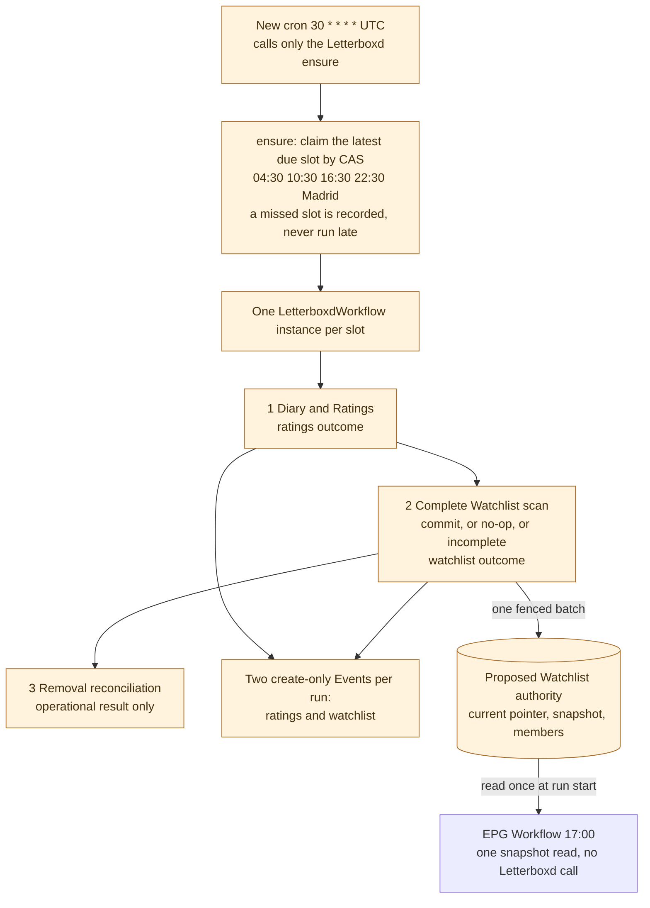

The four wall times are never inside the Madrid DST gap or fold, so a day has exactly four slots on every date; the spacing is 5 or 7 real hours across a changeover. A slot is eligible from its due instant until the next slot's due instant, and no retry crosses that boundary. Diary and Watchlist outcomes are independent (a Diary outage does not stop the scan, a Watchlist outage does not unconfirm Ratings). The mode document, epoch fence and three-step switch of [ADR 0090](../adr/0090-ratings-cloudflare-workflow-executor.md) apply, and the Ratings writer is closed, drained and fenced (the legacy start and step entry points included, not only the `external` mode) before the Letterboxd one is opened, so two Diary writers never coexist; the old 17:00 contract is retired only in a later cleanup, and the shared hourly cron stays. Neither the EPG, Discovery nor the EPG-priority pause gates a Letterboxd step, and the Letterboxd cron does not call them.

### Dormant executor (delivered; not active)

The code of the Letterboxd Sync is in the repository and **inert**: no Worker binding, no cron and no Task names it, the mode table is empty (read as `external`), and nothing in the hourly tick calls it. What exists:

- **Slots** (`src/domain/letterboxd-slots.js`): four Madrid slots, their keys, due instants, the window to the next slot, the instance id `lbsync_<YYYYMMDD>_<HHMM>_<series>` and the two Event keys `lbsync-<YYYYMMDDTHHMM>-ratings|watchlist`.
- **Control plane** (`src/letterboxd-sync.js`): the owner's three-step mode switch with the epoch fence; `ensure` claiming the latest due slot by primary key and creating one instance, recording a wholly missed slot as `skipped_missed` without an instance; the instance loop through three phase ports with a deadline that never crosses the next slot; the slot close that writes both outbox rows in one batch; delivery by `ensure`, by each run and in slot order; the read model.
- **Phase ports** (assembled by `letterboxdPorts` in the Worker): `ratings` (the Diary part of one ratings-pipeline run) and `reconcile` (the removal part of the same run) over `LetterboxdRatings` (`src/letterboxd-sync-ratings.js`); `watchlist` (`src/letterboxd-sync-watchlist.js`), the complete-scan rule and one call into the Watchlist authority repository through `src/letterboxd-sync-repository.js`. A phase whose port is missing fails closed.
- **Causal effects** (`src/letterboxd-sync-effects.js`): `scan_facts`, `retention` and `removal_enqueue` (and, only after the owner switches the membership marker to `sync`, the fourth effect `membership` of `src/watchlist-membership.js`, [ADR 0203](../adr/0203-watchlist-membership-letterboxd-single-writer-projection.md), Proposed: it also carries a bounded reconcile step of its handoff ledger after each scan; no new cron or Task), applied oldest version first from the durable snapshot and change rows, each idempotent and returning a receipt; a failure holds the drain and the scan. Every authoritative write of an effect, of the admission identity check and of the ratings pipeline step goes through an env fenced by the Letterboxd mode epoch (`ratingsFence.guard` for the Ratings documents and the `letterboxd` producer fence for the canonical writers), so a step whose mode moved mid-flight commits nothing. Removal is membership only: the writers delete no Film, show or rating and infer no watched state. `removal_enqueue` hands the removed films to the Ratings lookup queue with a reference to the slot's own `watchlist` Event, whose key is deterministic (the slot Event key and the Watchlist phase time recorded on the slot), so it can run between the scan and the reconciliation: a removal is reconciled by phase 3 of the same run, before the Event object is stored at the slot close (the queue tolerates that as `event_missing`).
- **Admission** (`src/letterboxd-sync-admission.js`): at most three due ledger rows per step through the existing same-run identity check; resolved, still pending with a backoff, or terminal after the bounded attempts. A transport stop or a deferral uses no attempt; an id removed before it resolved becomes `superseded`. A row becomes terminal after the bounded attempts or, whatever its attempts, 14 days (or 8 snapshot versions when the first-seen snapshot is already pruned) after the snapshot that first listed the id; it then waits for an owner decision and is listed in the owner's identity work inventory as a `watchlist_admission` row needing review.
- **No pipeline Event.** A ratings-pipeline run started by a slot carries the slot key and writes no `ratings` Event of its own; the slot outbox is the only source, so there is no duplicate. Such a run reads no EPG state. Every pipeline write rides in a batch with the Letterboxd mode-epoch guard.
- **Handover proof.** The mode switch refuses `cloudflare` unless `letterboxdHandover` reads live evidence: the Ratings executor is closed and drained, the legacy Ratings start and step gate (`externalGate`) answers fenced (it does, while the Letterboxd mode is `switching`), the Watchlist authority is an open `d1`, and all three phase ports exist. There is no HTTP route for the switch yet; its operation belongs to the cutover plan.
- **Status and monitor.** `status().letterboxdSync` and a `letterboxd` monitor stream carry the slot read model while the executor is `switching` or `cloudflare`, with a signal per source (a failed Diary and a failed or incomplete Watchlist alert separately; a rate limit is recorded as delayed and never alerts); with no mode row both are absent, so today's status and monitor are unchanged.
- **Legacy writer fence.** While the Letterboxd mode is `switching` or `cloudflare`, `RatingsOrchestration.externalGate` refuses `start` and `step` (`external_writer_fenced`), an old instance's `admit` is refused, so the two Diary writers can never both be admitted. Setting the Ratings mode to `external` alone is not that fence.

Operating the slots is described in the [Letterboxd Sync runbook](../runbooks/letterboxd-sync.md); the numeric budgets are in the [orchestration reliability reference](../reference/orchestration-reliability.md#letterboxd-sync-slots).
