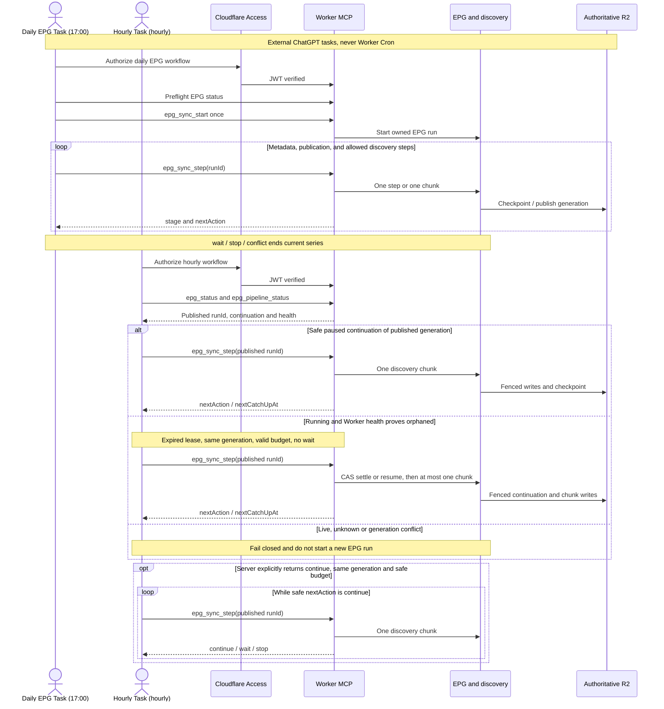
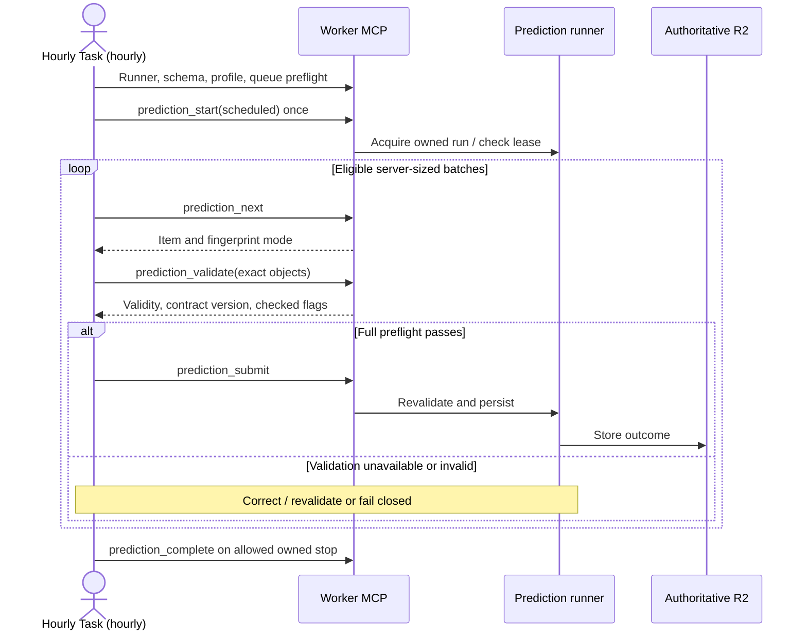
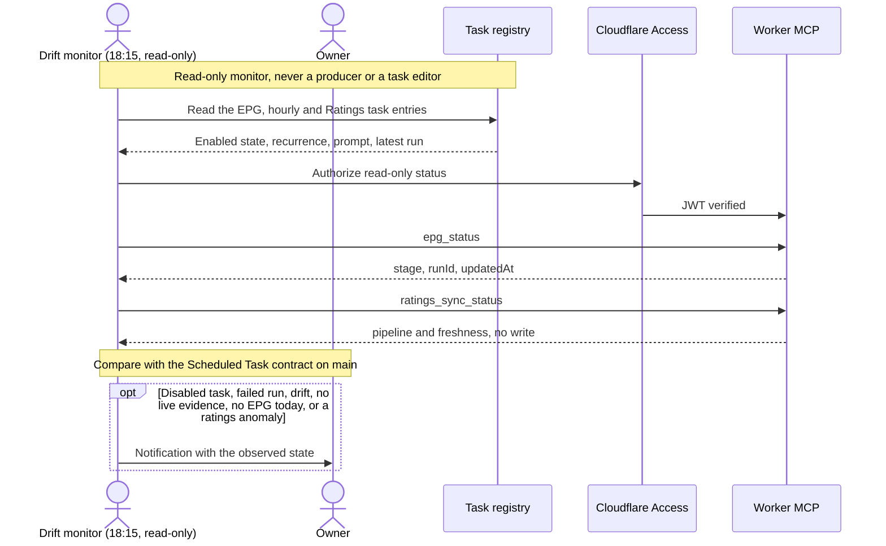
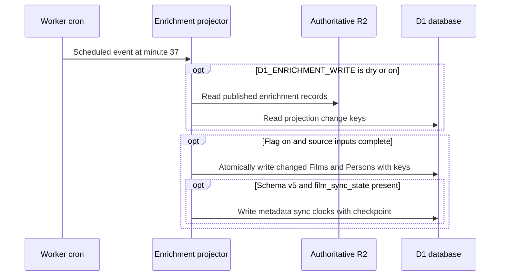
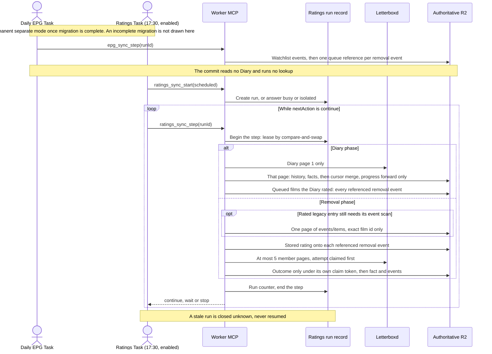
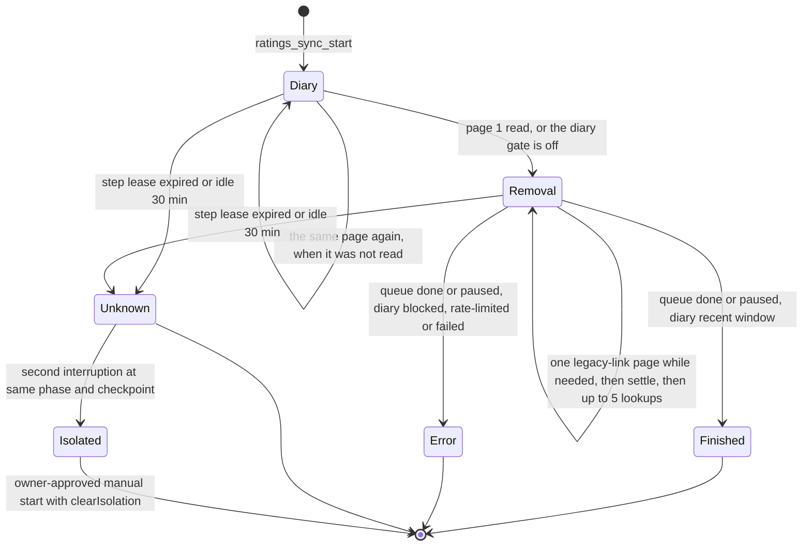

# Scheduling and orchestration

Scheduling is performed by **external ChatGPT Scheduled Tasks**, not Worker Cron. The Worker's one cron trigger runs only the D1 enrichment projector ([ADR 0056](../adr/0056-d1-enrichment-write-through.md)), shown last in the diagram: it reads R2, writes only D1, and stays inert while `D1_ENRICHMENT_WRITE` is unset. The Worker exposes owner-only MCP tools that perform work only when invoked. Expected task behavior: [Scheduled Task contract](../reference/scheduled-tasks.md). Sources: [scheduling ADR](../adr/0005-external-chatgpt-tasks.md), [one-chunk ADR](../adr/0006-one-chunk-discovery.md), [MCP contract](../reference/api/mcp.md) and [prediction operations](../runbooks/prediction-operations.md).

The sequences below are **independent scheduled or externally driven flows**, not a single sequential execution. They are split for legibility; each uses the same existing Worker, Access, R2 and D1 boundaries. No scheduling or authority changes are introduced by this presentation.

### Daily EPG and hourly discovery continuation

### Hourly prediction pipeline

### Read-only Scheduled Task drift monitor

### Worker cron: R2-to-D1 enrichment projection

The cron expression is `37 * * * *`. When `D1_ENRICHMENT_WRITE` is unset, the trigger performs no R2 reads or D1 writes. With `dry`, it reads the source and change keys but never writes. With `on`, the projector writes changed Films and Persons in existing fenced batches. At schema v5, `film_sync_state` uses that same writer: sync clocks for an already-changing Film share its batch, while a clock-only change uses its own fenced batch. The migration is not applied by a code deploy.

The drift monitor is a read-only automation in the same registry. Its expected recurrence, after the owner-approved registry change recorded on 2026-10-31, is daily at 18:15 Europe/Madrid, DTSTART 2026-10-31, enabled. It reads the live entries of the daily EPG task, the hourly task and the Ratings Task, then `epg_status` and read-only `ratings_sync_status` through the same Access-protected MCP, and only notifies the owner. It cannot edit a task or start a run, and it can itself stop or run late, so it is not a guaranteed alert. The Ratings Task's own run is drawn in the next diagram. The daily commit does not read Diary. `RATINGS_PIPELINE` is retired ([ADR 0074](../adr/0074-retire-ratings-pipeline-switch.md), Proposed): an incomplete migration fails closed, and a migrated one stays on the separate pipeline whatever the leftover binding holds. This page does not edit the monitor or any task.

A scheduled trigger does not imply successful completion. `already_running`, `busy`, lease ownership, deferred backoff and a previous run's retries that could not yet be written (`prediction_retry_heal_pending`) may prevent new work. The prediction Task, the EPG Task's commit and the discovery chunks can overlap. All three write the prediction queue, and each write is conditional and rebuilds on conflict ([ADR 0064](../adr/0064-prediction-queue-conditional-writes.md), Accepted 2026-10-31), so the overlap does not lose a retry or a batch summary. Discovery uses **one chunk per explicit request**; it does not recursively self-fetch through an Access bypass or an internal continuation service. The [MCP security boundary](authentication-and-mcp.md) verifies signed identity and restricts tool arguments.

## The separate ratings pipeline

[ADR 0060](../adr/0060-independent-letterboxd-ratings-pipeline.md) moved Letterboxd ratings out of the EPG commit. [ADR 0074](../adr/0074-retire-ratings-pipeline-switch.md) (Proposed) makes that the only path: the Worker does not read `RATINGS_PIPELINE`. When migration is complete the commit only enqueues removed films, and the Ratings Task drives its own run with `ratings_sync_start` and `ratings_sync_step`. When migration is not complete the commit publishes and does not read Diary, look up films or enqueue; that failure is not drawn here. A live read-only check on 2026-10-31 found the storage migrated, the binding `separate` and the Ratings Task enabled. The drift monitor reads `ratings_sync_status` and does not call `ratings_sync_start` or `ratings_sync_step`. `ratings_storage_migrate` stays the one-time owner tool that made the mode possible; the commit does not call it. The expected recurrence of the Ratings Task, after the owner-approved registry change on 2026-10-31, is daily at 17:30 Europe/Madrid with flexible timing and DTSTART 2026-11-01. A scheduled start is not refused for following the previous one ([ADR 0069](../adr/0069-no-scheduled-ratings-start-gap.md), Accepted). `busy` and `isolated` still end the invocation. The six-hour pause after a Letterboxd 403 or 429 on the removal queue stays. While a rated legacy entry still needs event references, a removal step first lists one page of existing removal events and links the exact film id, then settles stored ratings ([ADR 0071](../adr/0071-legacy-removal-event-link.md), Accepted 2026-10-31). A step with nothing left to link does not list. This page does not change a flag or a task, and it does not start that scan. Contracts: [ratings reference](../reference/integrations/letterboxd-ratings.md#separate-ratings-pipeline), [MCP reference](../reference/api/mcp.md), [Scheduled Tasks](../reference/scheduled-tasks.md#ratings-task); operation: [runbook](../runbooks/letterboxd-diary-history.md#separate-ratings-pipeline).

The run record `letterboxd/ratings/run.json` admits one running run and one active step at a time, and the lease owns only that object. R2 has no multi-key transaction, so a step that outlived its lease cannot be fenced out of other objects; instead every shared object changes by a monotone merge. The Diary cursor's progress in `letterboxd/diary/state.json` is a join that only moves forward (its last-attempt diagnostics are a deterministic last-writer-wins record that never plans a read), removal-queue entries move one way and accept an outcome only under the step's own claim, and the history, facts and removal events take idempotent merges, so a late write can add real progress and never move anything back. The cursor and the queue are authoritative; the run record's checkpoint is a per-run counter. Each removal event keeps its own reference in the queue, and an unresolved one is never pruned. The diagram shows the permanent separate mode after the storage migration. A removal step lists one page of `events/items/` only while a rated legacy entry still needs that scan, then writes the ratings of rated entries to their removal events (at most 100 references per step), then runs the lookups. With nothing left to link, the list does not run. Deploying this page does not start a ratings run. The ratings run reads Diary page 1 only ([ADR 0067](../adr/0067-diary-recent-window.md)). That is not a byte copy of the earlier multi-page reader. The queue and the cursor migration rules are unchanged. The migration's witness `letterboxd/ratings/migration.json` records each converted object, so the status reports one found back at version 1 as `regressed`. The queue and the cursor are migrated only by the owner-approved `ratings_storage_migrate` tool. The separate pipeline runs only once that migration is complete; until then the commit fails closed. A stale run is closed by the next start or step, never by the status read. Ownership, contracts, races, migration and rollback are in the ADR. The diagram is the production mode as of the 2026-10-31 live read (migration complete, Ratings Task enabled). The Worker does not read `RATINGS_PIPELINE`. Neither this diagram nor a deploy changes a task or deletes the leftover binding.

## Timing and authority

The timetable and enabled status belong to the external automation registry. The Worker states only the expected hourly trigger (`:20` Europe/Madrid) for display and keeps it apart from its own discovery wait gate; see [Scheduled Task timing](../reference/scheduled-tasks.md#timing-nominal-trigger-versus-server-gate). Historical records of successful scheduling are not a live status check; production task changes or manual invocations require separate owner approval. A GitHub deployment does not trigger any of these workflows.
