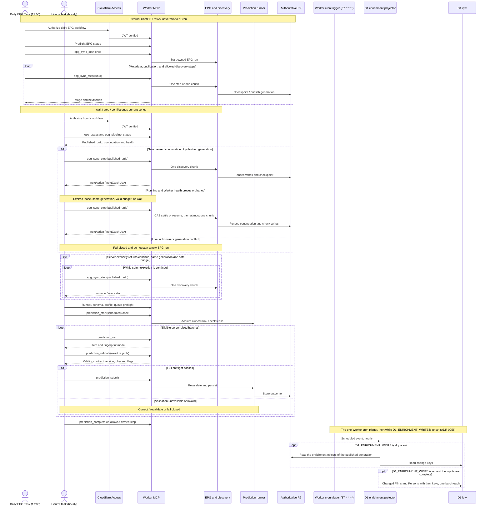

# Scheduling and orchestration

Scheduling is performed by **external ChatGPT Scheduled Tasks**, not Worker Cron. The Worker's one cron trigger runs only the D1 enrichment projector ([ADR 0056](../adr/0056-d1-enrichment-write-through.md)), shown last in the diagram: it reads R2, writes only D1, and stays inert while `D1_ENRICHMENT_WRITE` is unset. The Worker exposes owner-only MCP tools that perform work only when invoked. Expected task behavior: [Scheduled Task contract](../reference/scheduled-tasks.md). Sources: [scheduling ADR](../adr/0005-external-chatgpt-tasks.md), [one-chunk ADR](../adr/0006-one-chunk-discovery.md), [MCP contract](../reference/api/mcp.md) and [prediction operations](../runbooks/prediction-operations.md).

A scheduled trigger does not imply successful completion. `already_running`, `busy`, lease ownership and deferred backoff may prevent new work. Discovery uses **one chunk per explicit request**; it does not recursively self-fetch through an Access bypass or an internal continuation service. The [MCP security boundary](authentication-and-mcp.md) verifies signed identity and restricts tool arguments.

The timetable and enabled status belong to the external automation registry. The Worker states only the expected hourly trigger (`:20` Europe/Madrid) for display and keeps it apart from its own discovery wait gate; see [Scheduled Task timing](../reference/scheduled-tasks.md#timing-nominal-trigger-versus-server-gate). Historical records of successful scheduling are not a live status check; production task changes or manual invocations require separate owner approval. A GitHub deployment does not trigger any of these workflows.
