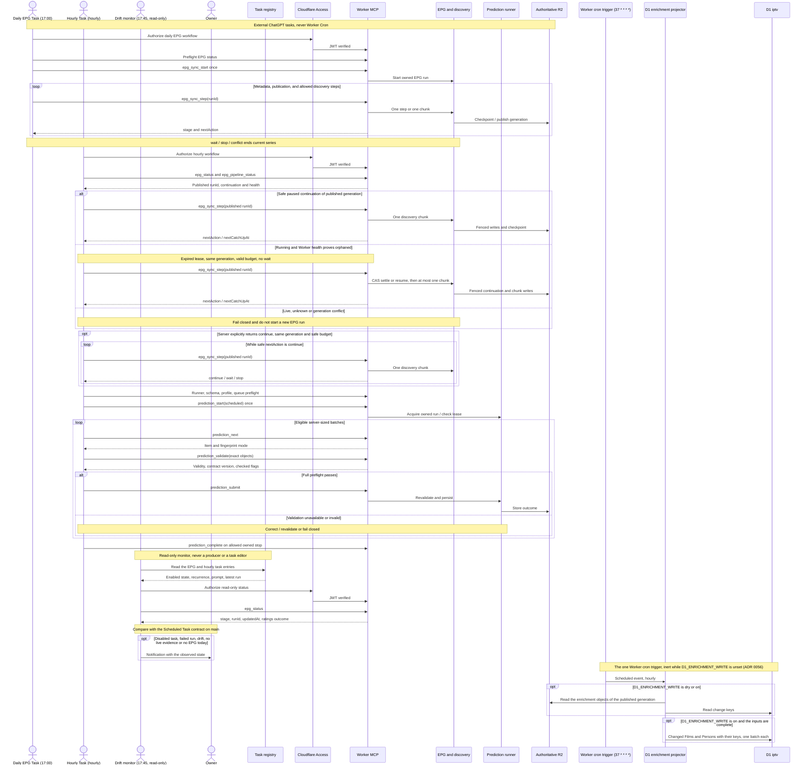
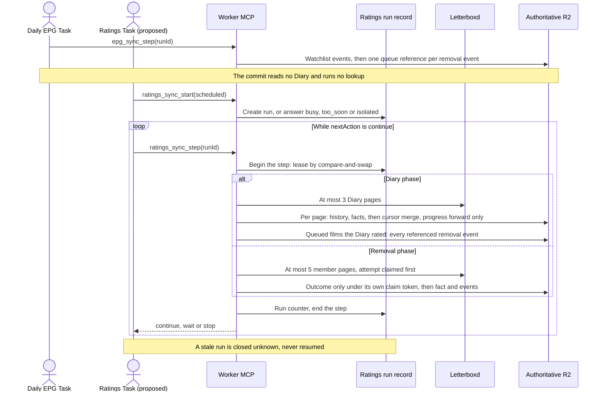
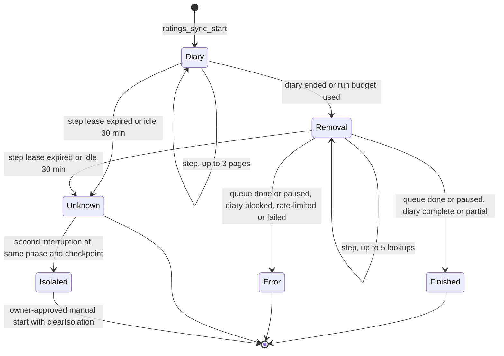

# Scheduling and orchestration

Scheduling is performed by **external ChatGPT Scheduled Tasks**, not Worker Cron. The Worker's one cron trigger runs only the D1 enrichment projector ([ADR 0056](../adr/0056-d1-enrichment-write-through.md)), shown last in the diagram: it reads R2, writes only D1, and stays inert while `D1_ENRICHMENT_WRITE` is unset. The Worker exposes owner-only MCP tools that perform work only when invoked. Expected task behavior: [Scheduled Task contract](../reference/scheduled-tasks.md). Sources: [scheduling ADR](../adr/0005-external-chatgpt-tasks.md), [one-chunk ADR](../adr/0006-one-chunk-discovery.md), [MCP contract](../reference/api/mcp.md) and [prediction operations](../runbooks/prediction-operations.md).

The drift monitor is a third, read-only automation in the same registry. It compares the two producers' live entries with the [contract](../reference/scheduled-tasks.md#read-only-drift-monitor), reads `epg_status` through the same Access-protected MCP and only notifies the owner; it cannot edit a task or start a run, and it can itself stop or run late, so it is not a guaranteed alert. A staged Ratings Task also exists in the registry but is disabled and is not drawn: ratings still run inside the EPG commit that the daily task's `epg_sync_step` triggers.

A scheduled trigger does not imply successful completion. `already_running`, `busy`, lease ownership and deferred backoff may prevent new work. Discovery uses **one chunk per explicit request**; it does not recursively self-fetch through an Access bypass or an internal continuation service. The [MCP security boundary](authentication-and-mcp.md) verifies signed identity and restricts tool arguments.

## Proposed: a separate ratings pipeline (not implemented)

[ADR 0060](../adr/0060-independent-letterboxd-ratings-pipeline.md) proposes moving the Letterboxd ratings out of the EPG commit. Nothing below is deployed: today ratings run inside the commit as in the diagram above. In the proposal the commit only enqueues removed films, and the Ratings Task drives its own run through three dedicated tools.

The run record `letterboxd/ratings/run.json` admits one running run and one active step at a time, and the lease owns only that object. R2 has no multi-key transaction, so a step that outlived its lease cannot be fenced out of other objects; instead every shared object changes by a monotone merge. The Diary cursor's progress in `letterboxd/diary/state.json` is a join that only moves forward (its last-attempt diagnostics are a deterministic last-writer-wins record that never plans a read), removal-queue entries move one way and accept an outcome only under the step's own claim, and the history, facts and removal events take idempotent merges, so a late write can add real progress and never move anything back. The cursor and the queue are authoritative; the run record's checkpoint is a per-run counter. Each removal event keeps its own reference in the queue, and an unresolved one is never pruned. The diagram shows `RATINGS_PIPELINE=separate` after the storage migration. Deploying the code changes nothing: under `inline` with unmigrated objects today's path stays unchanged. The queue and the cursor are migrated only by the owner-approved `ratings_storage_migrate` tool, run under `inline` before the switch, and `separate` takes effect only once that migration is complete. A stale run is closed by the next start or step, never by the status read. Ownership, contracts, races, migration and rollback are in the ADR; activation is a separate owner decision.

## Timing and authority

The timetable and enabled status belong to the external automation registry. The Worker states only the expected hourly trigger (`:20` Europe/Madrid) for display and keeps it apart from its own discovery wait gate; see [Scheduled Task timing](../reference/scheduled-tasks.md#timing-nominal-trigger-versus-server-gate). Historical records of successful scheduling are not a live status check; production task changes or manual invocations require separate owner approval. A GitHub deployment does not trigger any of these workflows.
