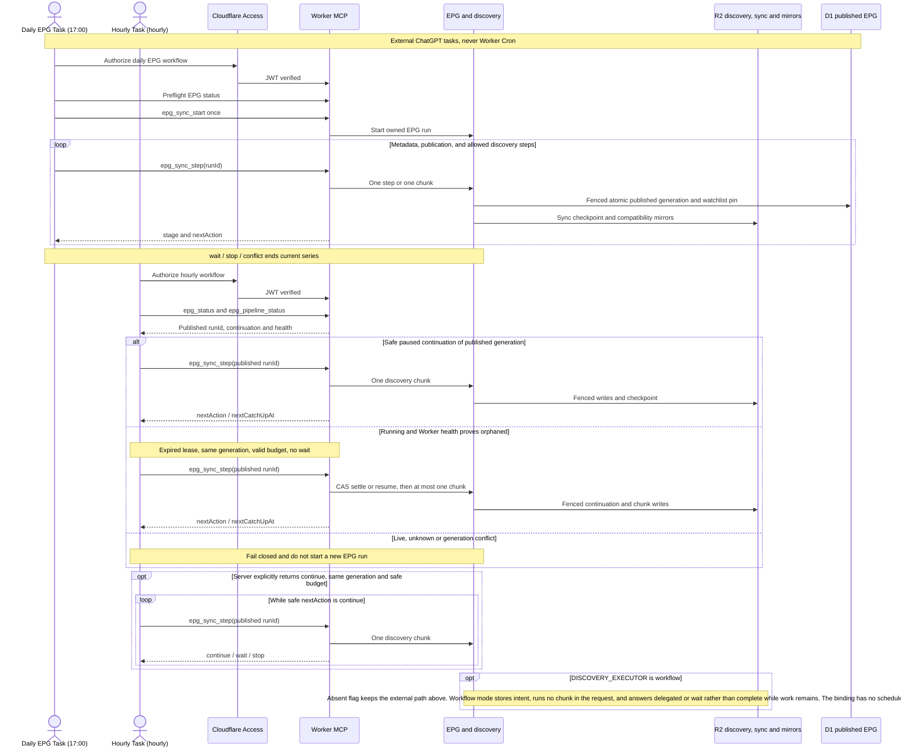
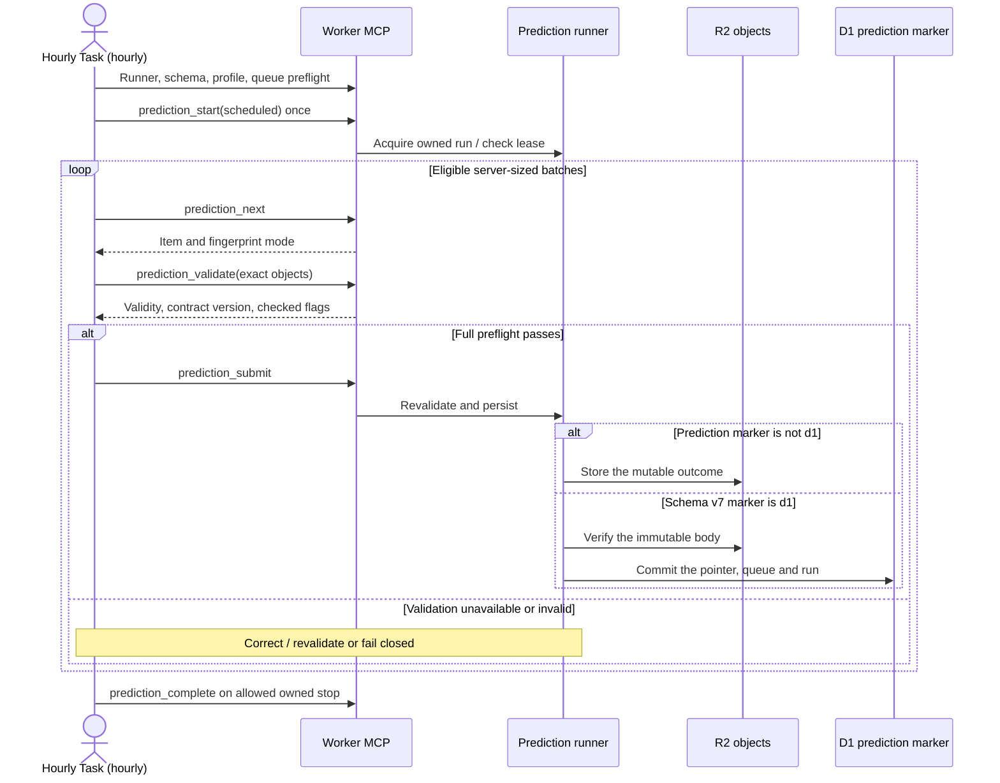
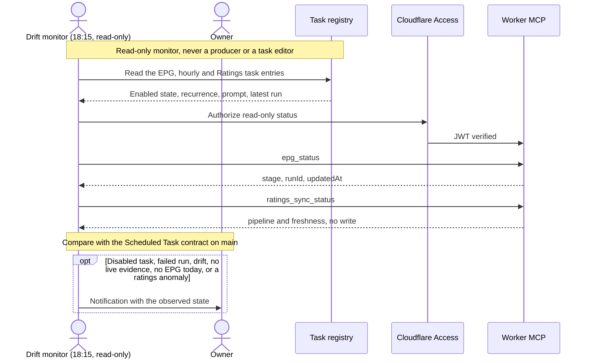
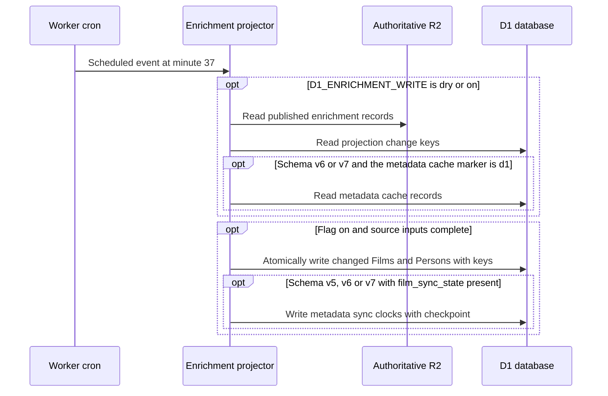
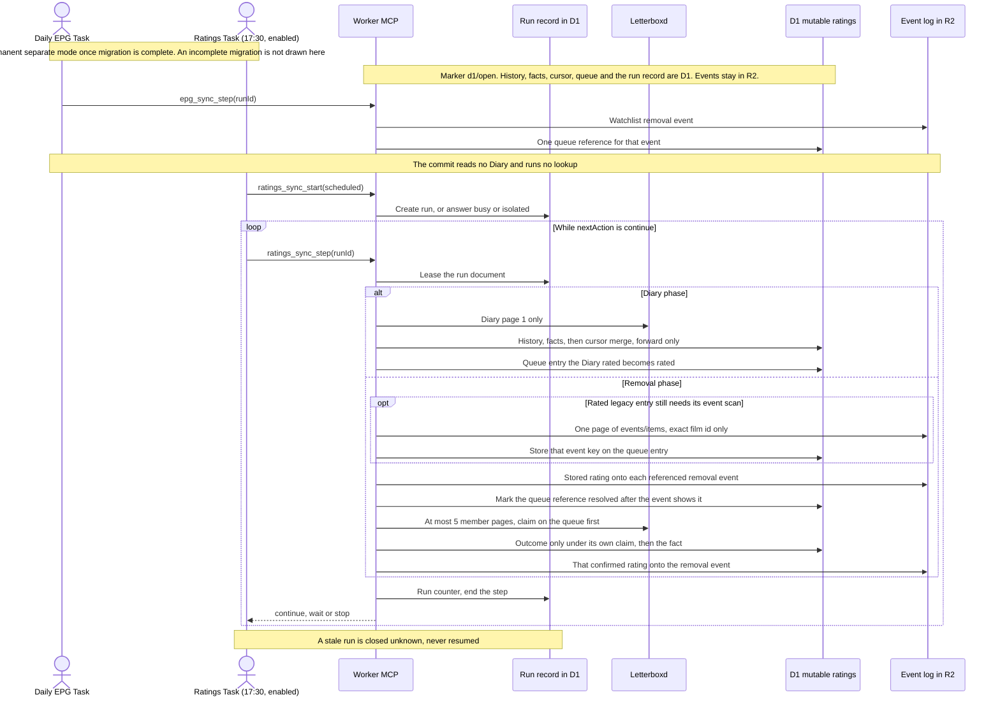
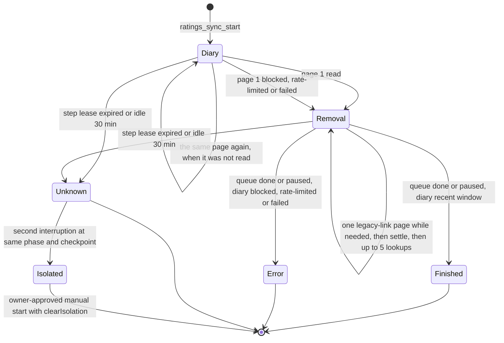
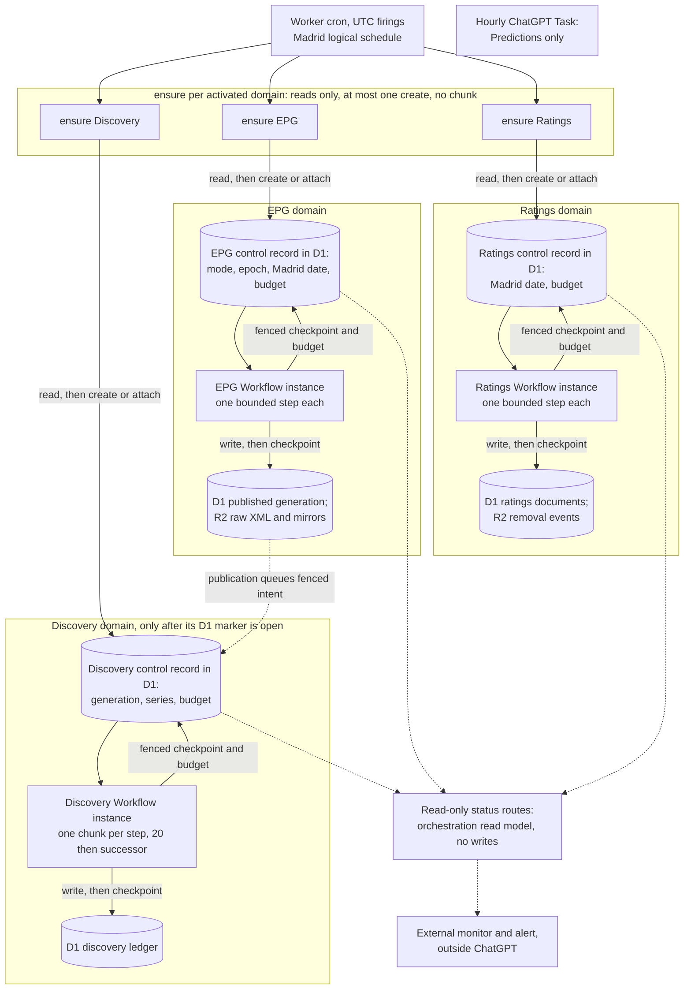
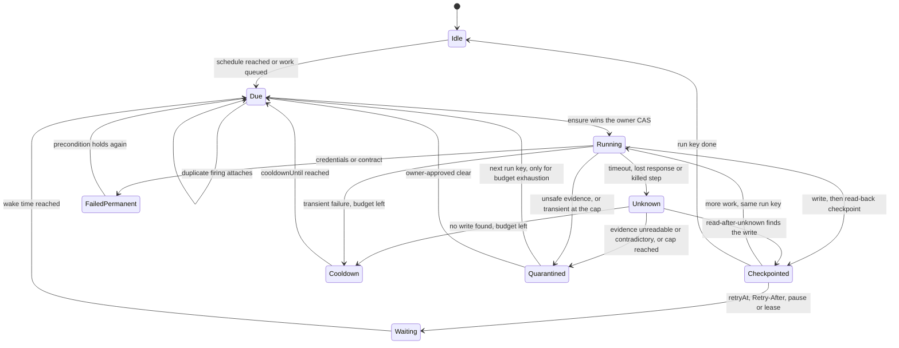

# Scheduling and orchestration

Scheduling is performed by **external ChatGPT Scheduled Tasks**, not Worker Cron. The Worker's one cron trigger runs only the D1 enrichment projector ([ADR 0056](../adr/0056-d1-enrichment-write-through.md)), shown last in the diagram: it reads R2, writes only D1, and stays inert while `D1_ENRICHMENT_WRITE` is unset. The Worker exposes owner-only MCP tools that perform work only when invoked. Expected task behavior: [Scheduled Task contract](../reference/scheduled-tasks.md). Sources: [scheduling ADR](../adr/0005-external-chatgpt-tasks.md), [one-chunk ADR](../adr/0006-one-chunk-discovery.md), [MCP contract](../reference/api/mcp.md) and [prediction operations](../runbooks/prediction-operations.md).

The sequences below are **independent scheduled or externally driven flows**, not a single sequential execution. They are split for legibility; each uses the same existing Worker, Access, R2 and D1 boundaries. External tasks and the cron expression do not change. The publication path currently uses D1 because `published_epg_authority.mode=d1` and `cutover=open` ([ADR 0079](../adr/0079-d1-authoritative-published-epg.md), Accepted). R2 holds compatibility mirrors. The first post-cutover D1 publication succeeded on 3 November on a daily-task-created run completed by one explicitly owner-authorized manual `epg_sync_step`; unattended scheduled-task completion and direct R2/D1 parity remain unverified. Discovery continuation writes stay R2. The changed label was [visually approved by the owner on 2026-11-01](https://trello.com/c/pQL8NUTC#comment-6ae7b1d91923578e9aaaca44). The workflow `opt` in the daily and hourly sequence is accepted but inactive ([ADR 0083](../adr/0083-inert-discovery-workflow.md), Accepted). Its diagrams were separately visually approved by the owner on 2 November 2026; neither that decision nor this documentation deploy activates it. While `DISCOVERY_EXECUTOR` is absent, the sequence stays the external tasks. An interrupted discovery series is not one of the safe paused continuations in the hourly alt below: the hourly task does not call `epg_sync_step` for `reason: interrupted`. After a gated confirm has stored an ordinary checkpoint for the same published generation ([ADR 0088](../adr/0088-guarded-interrupted-discovery-recovery.md), Proposed), the next hourly invocation follows the existing stage A rule. The diagram is unchanged.

### Daily EPG and hourly discovery continuation

### Hourly prediction pipeline

Migration `0007` is applied and the prediction marker is `d1`, so the live branch is D1 mutable state with immutable R2 bodies. The `r2` branch documents the prior and rollback behavior ([ADR 0078](../adr/0078-d1-authoritative-prediction-domain.md)). The hourly task stays enabled on the same `:20` Europe/Madrid schedule, and Stage A is unchanged. Stage B of the external prompt requests `fingerprint.evidence` on a new `fingerprint_and_prediction` item and passes that film's metadata into `prediction_validate` when an item cites a metadata token ([hourly evidence instruction](../reference/scheduled-tasks.md#fingerprint-evidence-instruction-in-the-live-hourly-task-air-335-2026-11-03)). The diagram above is the same validate and submit path. Worker fingerprint versions stay at 1.

### Read-only Scheduled Task drift monitor

### Worker cron: R2-to-D1 enrichment projection

The cron expression is `37 * * * *`. When `D1_ENRICHMENT_WRITE` is unset, the trigger performs no R2 reads or D1 writes. With `dry`, it reads the source and change keys but never writes. With `on`, the projector writes changed Films and Persons in existing fenced batches. At schema v5, `film_sync_state` uses that same writer: sync clocks for an already-changing Film share its batch, while a clock-only change uses its own fenced batch. That schema is applied. At schema v6, the same clocks are written, and when the metadata cache marker is `d1` the metadata records come from D1. Schema v7 and v8 keep those clocks and cache reads; the projector writes neither the prediction nor the published EPG domain. A partial prediction domain, or a complete one without a valid marker, fails the run before a write. None of the prediction tables on a later contract does not: prediction stays on the objects. `PREDICTION_DB_REQUIRED=on` makes a missing `DB` binding, or a bound database without `schema_contract`, fail the same way. The variable is not a new cron and not a new operational flag. The projector still does not write R2 or the cache. A code deploy does not apply migration `0006` or `0007`. Production has applied `0006` and that marker is `d1` ([ADR 0073](../adr/0073-metadata-cache-d1-authority.md), [cutover](../evidence/d1-migration/air-313-metadata-cache-cutover-2026-11-01.md)). Production applied `0007` and activated the prediction marker on 3 November 2026 ([ADR 0078](../adr/0078-d1-authoritative-prediction-domain.md)).

The drift monitor is a read-only automation in the same registry. Its expected recurrence, after the owner-approved registry change recorded on 2026-10-31, is daily at 18:15 Europe/Madrid, DTSTART 2026-10-31, enabled. It reads the live entries of the daily EPG task, the hourly task and the Ratings Task, then `epg_status` and read-only `ratings_sync_status` through the same Access-protected MCP, and only notifies the owner. It cannot edit a task or start a run, and it can itself stop or run late, so it is not a guaranteed alert. The Ratings Task's own run is drawn in the next diagram. The daily commit does not read Diary. `RATINGS_PIPELINE` is retired ([ADR 0074](../adr/0074-retire-ratings-pipeline-switch.md), Accepted 2026-11-01): an incomplete migration fails closed, and a migrated one stays on the separate pipeline whatever the leftover binding holds. This page does not edit the monitor or any task.

A scheduled trigger does not imply successful completion. `already_running`, `busy`, lease ownership, deferred backoff and a previous run's retries that could not yet be written (`prediction_retry_heal_pending`) may prevent new work. The prediction Task, the EPG Task's commit and the discovery chunks can overlap. All three write the prediction queue, and each write is conditional and rebuilds on conflict ([ADR 0064](../adr/0064-prediction-queue-conditional-writes.md), Accepted 2026-10-31), so the overlap does not lose a retry or a batch summary. Discovery uses **one chunk per explicit request**; it does not recursively self-fetch through an Access bypass or an internal continuation service. The [MCP security boundary](authentication-and-mcp.md) verifies signed identity and restricts tool arguments.

## The separate ratings pipeline

[ADR 0060](../adr/0060-independent-letterboxd-ratings-pipeline.md) moved Letterboxd ratings out of the EPG commit. [ADR 0074](../adr/0074-retire-ratings-pipeline-switch.md) (Accepted 2026-11-01) makes that the only path: the Worker does not read `RATINGS_PIPELINE`. When migration is complete the commit only enqueues removed films, and the Ratings Task drives its own run with `ratings_sync_start` and `ratings_sync_step`. When migration is not complete the commit publishes and does not read Diary, look up films or enqueue; that failure is not drawn here. A live read-only check on 2026-10-31 found the storage migrated, the binding `separate` and the Ratings Task enabled. The drift monitor reads `ratings_sync_status` and does not call `ratings_sync_start` or `ratings_sync_step`. `ratings_storage_migrate` stays the one-time owner tool that made the mode possible; the commit does not call it. The expected recurrence of the Ratings Task, after the owner-approved registry change on 2026-10-31, is daily at 17:30 Europe/Madrid with flexible timing and DTSTART 2026-11-01. A scheduled start is not refused for following the previous one ([ADR 0069](../adr/0069-no-scheduled-ratings-start-gap.md), Accepted). `busy` and `isolated` still end the invocation. The six-hour pause after a Letterboxd 403 or 429 on the removal queue stays. While a rated legacy entry still needs event references, a removal step first lists one page of existing removal events and links the exact film id, then settles stored ratings ([ADR 0071](../adr/0071-legacy-removal-event-link.md), Accepted 2026-10-31). A step with nothing left to link does not list. This page does not change a flag or a task, and it does not start that scan. Contracts: [ratings reference](../reference/integrations/letterboxd-ratings.md#separate-ratings-pipeline), [MCP reference](../reference/api/mcp.md), [Scheduled Tasks](../reference/scheduled-tasks.md#ratings-task); operation: [runbook](../runbooks/letterboxd-diary-history.md#separate-ratings-pipeline).

The run record is one D1 document. It admits one running run and one active step, and the lease is that document. Diary history, the diary cursor, facts and the removal queue are separate D1 documents. A compare-and-swap of one document is one fenced batch: a film record also writes its `ratings_view` rows in that batch, and the batch advances `ratings_domain_authority.generation`. A stale etag leaves the batch uncommitted. Those documents do not fall back to R2. Removal events stay in the R2 event log. There is no transaction across D1 and R2, so a settle writes the event by compare-and-swap and only then marks the queue reference resolved. A kill between the two repeats the event write. The cursor join only moves forward. Its last-attempt diagnostics are a deterministic last-writer-wins record that never plans a read. The queue accepts an outcome only under the step's own claim. History and facts take an idempotent merge, so a late write can add a newer observation and does not move an existing one backwards. A late event merge can add the rating and does not move the D1 fact. The cursor and the queue are authoritative; the run record's checkpoint is a per-run counter. Each removal event keeps its own reference in the queue, and an unresolved one is never pruned. The diagram shows that open marker. The event log still has no multi-key transaction, so a step that outlived its lease is not fenced out of an event object. A removal step lists one page of `events/items/` only while a rated legacy entry still needs that scan, then writes the ratings of rated entries to their removal events (at most 100 references per step), then runs the lookups. With nothing left to link, the list does not run. Deploying this page does not start a ratings run. The ratings run reads Diary page 1 only ([ADR 0067](../adr/0067-diary-recent-window.md)). That is not a byte copy of the earlier multi-page reader. The queue and the cursor migration rules are unchanged. The migration's witness `letterboxd/ratings/migration.json` records each converted object, so the status reports one found back at version 1 as `regressed`. The queue and the cursor are migrated only by the owner-approved `ratings_storage_migrate` tool. The separate pipeline runs only once that migration is complete; until then the commit fails closed. A stale run is closed by the next start or step, never by the status read. Ownership, contracts, races, migration and rollback are in the ADR. The diagram is the production mode as of the 2026-10-31 live read (migration complete, Ratings Task enabled). The Worker does not read `RATINGS_PIPELINE`, `LETTERBOXD_DIARY_HISTORY` ([ADR 0075](../adr/0075-retire-letterboxd-diary-history-switch.md), Accepted 2026-11-01) or `REMOVAL_RATING_LOOKUP` ([ADR 0077](../adr/0077-retire-removal-rating-lookup-switch.md), Proposed). The up-to-five lookups on the Removal loop are that permanent fallback: a film the Diary already rated, or absent from the current Diary page with a confirmed stored fact, is not requested, including after a new reference reopens its queue entry, and a paused queue is not requested. A film that page lists without a rating is still looked up. A null or absent rating is not watched. A step probes at most five stored ratings and does not request a film it has not probed. The state-diagram arrows are unchanged. The sequence diagram draws the open marker ([ADR 0084](../adr/0084-d1-authoritative-ratings.md), Accepted). History, facts, the cursor, the removal queue and the run record go to the D1 participant. Event writes and the event-list page stay on R2. While `0010` is absent, or the marker is `r2`, those documents stay in R2; that state is not drawn. `0010` is applied and the marker is `d1` / `open`. Activation left generation 1 ([activation record](../evidence/d1-migration/air-318-ratings-activate-2026-11-04.md)). A manual MCP run at 08:28 UTC left generation 12 ([manual run](../evidence/d1-migration/air-318-ratings-manual-run-2026-11-04.md)) and did not change the 17:30 Europe/Madrid Ratings Task. The owner visually approved an earlier note on 2026-11-04, while these arrows still pointed at R2. This participant change needs a fresh rendered owner visual approval, as does the persistence arrow. A removal does not become a viewing. Diary page 1, the removal-lookup budgets, and the fail-closed migration states are unchanged. A migrated run enters Diary. One arrow leaves Diary for Removal when page 1 was read. A second leaves Diary for Removal when that request was blocked, rate-limited or failed and the page was not read: the removal phase still runs, and the run ends `error` on the arrow from Removal to Error. There is no off-gate arrow. Neither this diagram nor a deploy changes a task or deletes a leftover binding.

## Proposed Cloudflare executors and shared recovery

**Proposed, not live.** Both diagrams below show the target of [ADR 0089](../adr/0089-shared-orchestration-reliability-contract.md) (Proposed). Nothing in this section is deployed as drawn: today EPG, Discovery and Ratings are driven by the external tasks above, the Discovery Workflow is inert, and the cron runs only the enrichment projector. Each domain moves to its executor only through its own owner-approved switch; the field-level contract is the [orchestration reliability reference](../reference/orchestration-reliability.md).

The three domains share no lease, queue, store or Workflow instance; the only shared element is the clock. Each `ensure` reads its own control record and creates or attaches at most one instance with an id derived from the run key, so a duplicate firing attaches to the same instance. EPG publication queues Discovery's fenced intent and does not wait for Discovery. The dotted arrows to the status routes are reads only.

Only a read-back checkpoint that moved forward resets the consecutive failure count; a create, an HTTP 200 or a lease does not. The executor never forces a step, never resets a lease and never clears its own quarantine. An `unsafe` quarantine stays across run keys until the owner clears it; a budget exhaustion ends only the current run key. Predictions are outside both diagrams and stay on the hourly ChatGPT task.

## Timing and authority

The timetable and enabled status belong to the external automation registry. The Worker states only the expected hourly trigger (`:20` Europe/Madrid) for display and keeps it apart from its own discovery wait gate; see [Scheduled Task timing](../reference/scheduled-tasks.md#timing-nominal-trigger-versus-server-gate). Historical records of successful scheduling are not a live status check; production task changes or manual invocations require separate owner approval. A GitHub deployment does not trigger any of these workflows.
